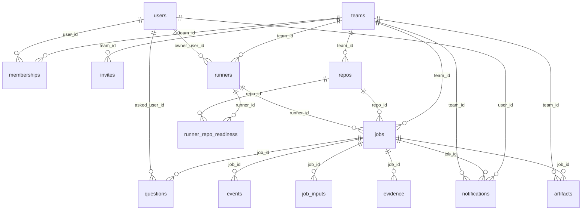

# Foundry — Database Design

> 中文版本: [database.zh-CN.md](database.zh-CN.md)

Status: current implementation · Last reviewed: 2026-11-11

This is the data dictionary for Foundry's Postgres database. It describes every table and column,
the indexes and constraints that protect them, the JSON shapes stored in `jsonb`, the triggers and
reporting views, and worked examples to copy from.

The authoritative schema is [`packages/db/src/schema.ts`](../../packages/db/src/schema.ts) (Drizzle
ORM definitions). SQL migrations live in [`packages/db/migrations`](../../packages/db/migrations)
and are applied by [`packages/db/src/migrate.ts`](../../packages/db/src/migrate.ts). If this
document and the schema disagree, the schema wins — fix the document.

Read [`overall-design.md`](overall-design.md) §2.5 for where the data model sits in the system and
[`components.md`](components.md) §6 for the `packages/db` module list.

---

## 1. Conventions

- **Postgres 16+.** The panel, API and realtime service share one database; a runner never connects
  to it except through the HTTP runner API.
- **`snake_case`** column names, plural table names, no table prefixes.
- **Primary keys.** Most tables use a UUID (`uuid PRIMARY KEY DEFAULT gen_random_uuid()`). The two
  high-volume append tables (`events`, `webhook_inbox`) use `bigserial` so their order is cheap and
  monotonic. Join tables (`memberships`, `runner_repo_readiness`) use a composite primary key.
- **Timestamps** are `timestamptz` (UTC), default `now()` where the row is created by the control
  plane. Application code passes ISO-8601 strings to nested SQL fragments — never `Date` objects;
  see [`../logging.md`](../logging.md) and `AGENTS.md`.
- **Enumerations are `text` columns, not Postgres enums.** Values are validated at the API boundary
  by zod schemas in `@foundry/shared`, and the legal job-status edges live in
  [`packages/shared/src/states.ts`](../../packages/shared/src/states.ts). The accepted values are
  listed in [§4](#4-enumerated-values).
- **Team scoping.** A row belongs to exactly one team, directly (`team_id`) or through its job/repo.
  `events`, `questions`, `artifacts` and `notifications` also denormalize `team_id` so realtime
  fan-out and list queries do not need a join. `users` is global; team membership is the
  `memberships` join table.
- **`jsonb` for evolving payloads** (`events.payload`, `jobs.confidence`, `jobs.gate_result`,
  `runners.harnesses`, …). The shapes are documented in [§5](#5-jsonb-shapes).
- **Delete behavior is explicit.** Team- or job-owned data cascades; references to the _actor_ that
  caused a row (`jobs.author_user_id`, `jobs.runner_id`, `questions.asked_user_id`) are
  `ON DELETE SET NULL` so audit rows survive.
- **The database stores no plaintext secrets.** Runner credentials are SHA-256 hashes
  (`runners.token_hash`); GitHub installation tokens are short-lived and never persisted.
  `users.push_subscription` is a Web Push subscription (an endpoint URL plus keys), not a password.

---

## 2. Entity-relationship overview



`webhook_inbox` is deliberately not linked by a foreign key: deliveries arrive before the control
plane knows which repo (or team) they belong to, and the raw payload must be kept even if the repo
is unlinked later.

---

## 3. Data dictionary

### 3.1 Identity and access

#### `teams`

A tenant. Every repo, runner, job and notification belongs to one team.

| Column                 | Type               | Null | Default             | Description                                                                                                                            |
| ---------------------- | ------------------ | ---- | ------------------- | -------------------------------------------------------------------------------------------------------------------------------------- |
| `id`                   | `uuid`             | no   | `gen_random_uuid()` | Primary key.                                                                                                                           |
| `name`                 | `text`             | no   | —                   | Display name shown in the panel.                                                                                                       |
| `gh_org`               | `text`             | yes  | —                   | GitHub organization login this team works in; informational.                                                                           |
| `daily_spend_cap_usd`  | `double precision` | yes  | —                   | Soft cap on agent spend per local day (UTC on servers). `null` means no cap. Claiming stops once today's `usage` events reach the cap. |
| `outgoing_webhook_url` | `text`             | yes  | —                   | Slack/Discord-style webhook that receives every notification event.                                                                    |
| `default_harness`      | `text`             | no   | `'claude-code'`     | Harness used when neither the issue label nor the repo overrides it.                                                                   |
| `default_model`        | `text`             | yes  | —                   | Model id used the same way; `null` means the harness default.                                                                          |
| `created_at`           | `timestamptz`      | no   | `now()`             | Creation time.                                                                                                                         |

**Key:** `PK (id)`.

#### `users`

A GitHub identity. One row per login, reused across teams.

| Column              | Type          | Null | Default             | Description                                                                           |
| ------------------- | ------------- | ---- | ------------------- | ------------------------------------------------------------------------------------- |
| `id`                | `uuid`        | no   | `gen_random_uuid()` | Primary key.                                                                          |
| `email`             | `text`        | yes  | —                   | Address for `email` notifications and the daily digest.                               |
| `gh_login`          | `text`        | no   | —                   | GitHub login, lower-cased by the app. Unique.                                         |
| `gh_id`             | `integer`     | yes  | —                   | Numeric GitHub user id from OAuth.                                                    |
| `name`              | `text`        | yes  | —                   | Display name from GitHub.                                                             |
| `avatar_url`        | `text`        | yes  | —                   | Avatar URL from GitHub.                                                               |
| `notify_pref`       | `text`        | no   | `'github'`          | Delivery preference: `github` (rely on GitHub mentions), `email`, `push` or `digest`. |
| `push_subscription` | `jsonb`       | yes  | —                   | Web Push subscription object (`endpoint`, `keys`, …) stored by the browser.           |
| `created_at`        | `timestamptz` | no   | `now()`             | First sign-in.                                                                        |

**Keys and indexes:** `PK (id)`; unique index `users_gh_login_idx (gh_login)` — sign-in looks users
up by login.

#### `memberships`

Join table: which GitHub identities belong to a team and with what role.

| Column       | Type          | Null | Default    | Description                                  |
| ------------ | ------------- | ---- | ---------- | -------------------------------------------- |
| `team_id`    | `uuid`        | no   | —          | Team. `ON DELETE CASCADE`.                   |
| `user_id`    | `uuid`        | no   | —          | User. `ON DELETE CASCADE`.                   |
| `role`       | `text`        | no   | `'member'` | `admin` or `member`. Admins manage the team. |
| `created_at` | `timestamptz` | no   | `now()`    | When the user joined.                        |

**Key:** `PK (team_id, user_id)`; both columns are foreign keys.

#### `invites`

A pending invitation for a GitHub login that has not signed in yet. Accepted by matching
`gh_login` at sign-in, which creates the membership.

| Column       | Type          | Null | Default             | Description                                      |
| ------------ | ------------- | ---- | ------------------- | ------------------------------------------------ |
| `id`         | `uuid`        | no   | `gen_random_uuid()` | Primary key.                                     |
| `team_id`    | `uuid`        | no   | —                   | Team. `ON DELETE CASCADE`.                       |
| `gh_login`   | `text`        | no   | —                   | Invited GitHub login.                            |
| `role`       | `text`        | no   | `'member'`          | Role granted on acceptance: `admin` or `member`. |
| `created_at` | `timestamptz` | no   | `now()`             | When the invite was created.                     |

**Key:** `PK (id)`.

### 3.2 Repositories and runners

#### `repos`

A GitHub repository linked to a team through an App installation.

| Column               | Type          | Null | Default             | Description                                                                                   |
| -------------------- | ------------- | ---- | ------------------- | --------------------------------------------------------------------------------------------- |
| `id`                 | `uuid`        | no   | `gen_random_uuid()` | Primary key.                                                                                  |
| `team_id`            | `uuid`        | no   | —                   | Owning team. `ON DELETE CASCADE`.                                                             |
| `gh_installation_id` | `integer`     | no   | —                   | GitHub App installation used for API calls and git tokens.                                    |
| `gh_repo_id`         | `integer`     | no   | —                   | GitHub's numeric repository id. Unique.                                                       |
| `full_name`          | `text`        | no   | —                   | `owner/name`.                                                                                 |
| `default_branch`     | `text`        | no   | `'main'`            | Base branch for job worktrees and PRs.                                                        |
| `gh_project_id`      | `text`        | yes  | —                   | GitHub Projects V2 node id, when the repo is mirrored to a project board (`PVT_…`).           |
| `default_harness`    | `text`        | yes  | —                   | Per-repo harness override; falls back to the team, then `claude-code`.                        |
| `default_model`      | `text`        | yes  | —                   | Per-repo model override; falls back to the team.                                              |
| `merge_mode`         | `text`        | no   | `'off'`             | Panel setting: `off` or `merge_when_confident`. When `off`, the cached `policy.yaml` decides. |
| `accepts_jobs`       | `boolean`     | no   | `false`             | True once `recipe.yaml` parses; queued ticket jobs are not claimed until this is true.        |
| `recipe_sha`         | `text`        | yes  | —                   | Commit SHA of the cached `.foundry/` files. `null` when the repo has no recipe.               |
| `recipe_yaml`        | `text`        | yes  | —                   | Raw `.foundry/recipe.yaml` at `recipe_sha`. Parsed on read with zod.                          |
| `policy_yaml`        | `text`        | yes  | —                   | Raw `.foundry/policy.yaml` at `recipe_sha`. Missing/invalid falls back to `DEFAULT_POLICY`.   |
| `onboarding_status`  | `text`        | no   | `'not_started'`     | Onboarding job state: `not_started`, `running`, `pr_open`, `done`, `failed`.                  |
| `created_at`         | `timestamptz` | no   | `now()`             | When the repo was linked.                                                                     |

**Keys and indexes:** `PK (id)`; unique index `repos_gh_repo_idx (gh_repo_id)` — one team owns a
GitHub repo; the App setup route finds repos by this id.

**Notes:** `recipe_yaml` and `policy_yaml` are a cache of the files at `recipe_sha`, so the gate and
readiness checks can run without a GitHub round trip. They are refreshed when `Sync from GitHub`
runs or the cache is invalidated.

#### `runners`

A registered machine that can claim jobs.

| Column                 | Type          | Null | Default             | Description                                                                                       |
| ---------------------- | ------------- | ---- | ------------------- | ------------------------------------------------------------------------------------------------- |
| `id`                   | `uuid`        | no   | `gen_random_uuid()` | Primary key.                                                                                      |
| `team_id`              | `uuid`        | no   | —                   | Owning team. `ON DELETE CASCADE`.                                                                 |
| `owner_user_id`        | `uuid`        | yes  | —                   | User who joined the runner (personal runners). `ON DELETE SET NULL`.                              |
| `name`                 | `text`        | no   | —                   | Human-readable runner name, unique within the team.                                               |
| `kind`                 | `text`        | no   | —                   | `shared` (always on, team-owned) or `personal` (the owner's laptop).                              |
| `os`                   | `text`        | no   | —                   | `macos` or `linux`.                                                                               |
| `arch`                 | `text`        | no   | —                   | CPU architecture, e.g. `arm64`, `x64`.                                                            |
| `os_version`           | `text`        | no   | —                   | OS build string reported at join.                                                                 |
| `token_hash`           | `text`        | no   | —                   | SHA-256 of the runner bearer token. Unique; the raw token is shown once at join and never stored. |
| `version`              | `text`        | yes  | —                   | Runner CLI version from the latest heartbeat.                                                     |
| `last_seen_at`         | `timestamptz` | yes  | —                   | Last heartbeat. Two missed minutes make the runner eligible for job re-queue.                     |
| `cpu`                  | `integer`     | yes  | —                   | Logical CPU count from the heartbeat.                                                             |
| `mem_mb`               | `integer`     | yes  | —                   | Total memory in MiB.                                                                              |
| `disk_free_mb`         | `integer`     | yes  | —                   | Free disk in MiB on the runner data dir.                                                          |
| `on_ac_power`          | `boolean`     | yes  | —                   | `false` blocks claiming when policy requires AC power; `null` when the OS cannot tell.            |
| `accepting`            | `boolean`     | no   | `true`              | Whether the daemon currently accepts new jobs (schedule, power, disk checks).                     |
| `not_accepting_reason` | `text`        | yes  | —                   | Why `accepting` is false, shown in the panel.                                                     |
| `max_concurrency`      | `integer`     | no   | `1`                 | Jobs this runner may hold at once.                                                                |
| `harnesses`            | `jsonb`       | no   | `'[]'`              | Array of `HarnessInfo` objects from the heartbeat (see [§5.3](#53-runnersharnesses)).             |
| `status`               | `text`        | no   | `'active'`          | `active`, `draining` (finish current jobs, claim none) or `removed`.                              |
| `created_at`           | `timestamptz` | no   | `now()`             | Join time.                                                                                        |

**Keys and indexes:** `PK (id)`; unique index `runners_token_idx (token_hash)` — bearer-token auth;
unique index `runners_team_name_idx (team_id, name)` — runner names are per-team.

#### `runner_repo_readiness`

The last readiness probe for a `(runner, repo)` pair: whether that machine can run the repo's
recipe (toolchain, services, Postgres).

| Column       | Type          | Null | Default | Description                                                                   |
| ------------ | ------------- | ---- | ------- | ----------------------------------------------------------------------------- |
| `runner_id`  | `uuid`        | no   | —       | Runner. `ON DELETE CASCADE`.                                                  |
| `repo_id`    | `uuid`        | no   | —       | Repo. `ON DELETE CASCADE`.                                                    |
| `recipe_sha` | `text`        | yes  | —       | Recipe commit the probe ran against; lets a new recipe invalidate the result. |
| `ready`      | `boolean`     | no   | —       | Whether the runner can execute this repo's checks now.                        |
| `reason`     | `text`        | yes  | —       | Human-readable reason when `ready` is false.                                  |
| `checked_at` | `timestamptz` | no   | `now()` | Probe time.                                                                   |

**Key:** `PK (runner_id, repo_id)` — exactly one readiness row per pair.

### 3.3 Jobs

#### `jobs`

One row per unit of work: a ticket job created from a GitHub issue, or an onboarding job that
prepares a repo's `.foundry/` files. This is the central table; the status edges are enforced in
application code by `assertTransition` (`packages/shared/src/states.ts`).

| Column                 | Type               | Null | Default             | Description                                                                                                                                       |
| ---------------------- | ------------------ | ---- | ------------------- | ------------------------------------------------------------------------------------------------------------------------------------------------- |
| `id`                   | `uuid`             | no   | `gen_random_uuid()` | Primary key. Also the job's URL id and the prefix of its branch name.                                                                             |
| `team_id`              | `uuid`             | no   | —                   | Owning team. `ON DELETE CASCADE`.                                                                                                                 |
| `repo_id`              | `uuid`             | no   | —                   | Repo. `ON DELETE CASCADE`.                                                                                                                        |
| `kind`                 | `text`             | no   | `'ticket'`          | `ticket` (from an issue) or `onboarding` (open a recipe PR).                                                                                      |
| `author_user_id`       | `uuid`             | yes  | —                   | Matching `users` row for the issue author, when known. `ON DELETE SET NULL`.                                                                      |
| `author_login`         | `text`             | yes  | —                   | GitHub login of the author, kept even when no `users` row exists.                                                                                 |
| `source`               | `text`             | no   | `'github_issue'`    | Where the job came from: `github_issue` or `panel` (onboarding).                                                                                  |
| `issue_number`         | `integer`          | yes  | —                   | Source issue number; `null` for panel-created jobs.                                                                                               |
| `title`                | `text`             | no   | —                   | Issue title or onboarding title.                                                                                                                  |
| `body`                 | `text`             | no   | `''`                | Issue body / ticket.                                                                                                                              |
| `playbook`             | `text`             | no   | `'default'`         | Playbook name, chosen by issue label. Built-ins: `default`, `bugfix`, `feature`, `onboarding`; a repo can add `.foundry/playbook.<name>.md`.      |
| `harness`              | `text`             | no   | —                   | Harness adapter id, normally `claude-code` or `opencode`.                                                                                         |
| `model`                | `text`             | yes  | —                   | Model override passed to the harness; `null` means the harness default.                                                                           |
| `pinned_runner_name`   | `text`             | yes  | —                   | `runner:<name>` label: prefer this runner for the job.                                                                                            |
| `runner_id`            | `uuid`             | yes  | —                   | Runner currently holding the job. Cleared when the job leaves a runner stage. `ON DELETE SET NULL`.                                               |
| `origin_runner_id`     | `uuid`             | yes  | —                   | First runner that claimed the job; survives re-queues and feeds metrics (`origin_os`). `ON DELETE SET NULL`.                                      |
| `sticky_runner_id`     | `uuid`             | yes  | —                   | Runner whose native harness session may be resumed. Set on hand-back together with `sticky_until`. `ON DELETE SET NULL`.                          |
| `sticky_until`         | `timestamptz`      | yes  | —                   | Deadline for stickiness; after this a different runner may claim the job.                                                                         |
| `worktree_path`        | `text`             | yes  | —                   | Absolute worktree path on the runner, mirrored so a different machine can resume portably.                                                        |
| `port_base`            | `integer`          | yes  | —                   | First port of the job's leased block (`FOUNDRY_PORT` … `FOUNDRY_PORT_END`).                                                                       |
| `harness_session_id`   | `text`             | yes  | —                   | Native session id from the harness. Cleared when a different machine takes over.                                                                  |
| `status`               | `text`             | no   | `'queued'`          | Job status; one of the 12 values in [§4.1](#41-job-status).                                                                                       |
| `resume_stage`         | `text`             | no   | `'triage'`          | Stage a re-queued job restarts at: `triage`, `investigating`, `implementing`, `reviewing` or `verifying`.                                         |
| `last_completed_stage` | `text`             | yes  | —                   | Last runner stage the agent confirmed via a checkpoint.                                                                                           |
| `brief_ref`            | `text`             | yes  | —                   | Git ref for the handoff brief (`refs/foundry/<job id>/brief`), written by checkpoints and pushed to origin so another runner can resume portably. |
| `resume_count`         | `integer`          | no   | `0`                 | Number of times the job was re-queued and re-claimed.                                                                                             |
| `loop_count`           | `integer`          | no   | `0`                 | Review/verify loops; bumped when a review sends the job back to implementing.                                                                     |
| `branch`               | `text`             | no   | —                   | Deterministic work branch, `foundry/<id-prefix>-<slug>`.                                                                                          |
| `head_sha`             | `text`             | yes  | —                   | Last committed tree SHA reported by the runner; the PR is opened at this commit.                                                                  |
| `pr_number`            | `integer`          | yes  | —                   | Pull request number once opened.                                                                                                                  |
| `pr_url`               | `text`             | yes  | —                   | Pull request URL.                                                                                                                                 |
| `pr_title`             | `text`             | yes  | —                   | Title used for the PR (issue title plus any later refresh).                                                                                       |
| `ci_status`            | `text`             | no   | `'none'`            | Last observed CI state: `none`, `pending`, `success` or `failure`.                                                                                |
| `ai_review_status`     | `text`             | no   | `'none'`            | Reserved for the AI-reviewer status (`none`, `clean`, `blocking`). The gate currently reads live GitHub reviews instead.                          |
| `pr_ci_entered_at`     | `timestamptz`      | yes  | —                   | When the job last entered `pr_ci`; the no-CI grace period before the automatic review starts is measured from here.                               |
| `pr_review_sha`        | `text`             | yes  | —                   | PR head SHA the automatic post-PR review already ran on; prevents reviewing the same SHA twice.                                                   |
| `pr_review_count`      | `integer`          | no   | `0`                 | Automatic PR-review rounds that requested changes and re-queued the job at implementing.                                                          |
| `ui_changed`           | `boolean`          | no   | `false`             | Whether the diff touches `ui_paths`; requires screenshot evidence before auto-merge.                                                              |
| `changed_lines`        | `integer`          | no   | `0`                 | Diff size measured when the PR is opened / the gate runs.                                                                                         |
| `plan`                 | `text`             | yes  | —                   | Plan text recorded during investigating (also written as a `message` event).                                                                      |
| `max_job_minutes`      | `integer`          | yes  | —                   | Per-job wall-clock limit; `null` follows `policy.yaml` `max_job_minutes`.                                                                         |
| `max_cost_usd`         | `double precision` | yes  | —                   | Per-job cost cap; `null` follows `policy.yaml` `max_cost_per_job_usd`.                                                                            |
| `confidence`           | `jsonb`            | yes  | —                   | The agent's own confidence report, `{ level, reasons, uncertainties }`. See [§5.1](#51-jobsconfidence).                                           |
| `gate_result`          | `jsonb`            | yes  | —                   | Last `GateResult`: `{ pass, pending, failed[], reviewers[] }`. See [§5.2](#52-jobsgate_result).                                                   |
| `assigned_reviewers`   | `jsonb`            | no   | `'[]'`              | GitHub logins or team handles requested when the gate hands the PR to a human.                                                                    |
| `last_review_id`       | `bigint`           | yes  | —                   | Id of the last GitHub review delivered to the agent, so catch-up polling re-queues it once.                                                       |
| `status_comment_id`    | `bigint`           | yes  | —                   | Id of the issue comment the control plane keeps updated with status. `bigint` because GitHub ids exceed `int32`.                                  |
| `cost_usd`             | `double precision` | no   | `0`                 | Running agent cost in USD, accumulated from `usage` events.                                                                                       |
| `tokens_in`            | `integer`          | no   | `0`                 | Accumulated input tokens.                                                                                                                         |
| `tokens_out`           | `integer`          | no   | `0`                 | Accumulated output tokens.                                                                                                                        |
| `failure_reason`       | `text`             | yes  | —                   | Human-readable reason when the job failed.                                                                                                        |
| `created_at`           | `timestamptz`      | no   | `now()`             | When the job row was inserted.                                                                                                                    |
| `claimed_at`           | `timestamptz`      | yes  | —                   | Last claim time (reset on each claim). Used for queue-time metrics.                                                                               |
| `started_at`           | `timestamptz`      | yes  | —                   | First time a runner picked the job up; never overwritten on re-queue.                                                                             |
| `finished_at`          | `timestamptz`      | yes  | —                   | Set on `merged`, `failed` or `cancelled`.                                                                                                         |
| `reverted_at`          | `timestamptz`      | yes  | —                   | Set when a later merged PR reverts this job's PR (post-merge revert metric).                                                                      |
| `updated_at`           | `timestamptz`      | no   | `now()`             | Last row write. Refreshed by the `jobs_touch` trigger on every `UPDATE`, so it is always trustworthy for ordering.                                |

**Keys and indexes:**

- `PK (id)`.
- `jobs_team_status_idx (team_id, status)` — claim scanning and status counts.
- `jobs_team_updated_idx (team_id, updated_at)` — board and inbox list a team's jobs newest-first
  without sorting the whole team.
- `jobs_runner_idx (runner_id)` — heartbeat keep/revoke lookups for the jobs a runner reports.
- `jobs_issue_active_idx (repo_id, issue_number) UNIQUE WHERE status NOT IN ('merged','cancelled')
  AND issue_number IS NOT NULL` — at most one live job per issue; re-labelling re-uses or revives
  that job instead of creating a duplicate.

**Lifecycle in one line:** `queued` → runner stages (`triage` → `investigating` → `implementing` →
`reviewing` → `verifying`) → `pr_ci` → `merged`, with `needs_input`, `waiting_on_you`, `failed`
and `cancelled` as side exits. Every change is guarded by the state machine; see
[`overall-design.md`](overall-design.md) §2.4.

### 3.4 Timeline, human input and evidence

#### `events`

Append-only job timeline. Every stage change, agent message, tool call, usage record, checkpoint,
gate evaluation and evidence write becomes one row. Rows are never updated or deleted by the app
(they disappear only when the job is deleted, via cascade).

| Column    | Type          | Null | Default | Description                                                                         |
| --------- | ------------- | ---- | ------- | ----------------------------------------------------------------------------------- |
| `id`      | `bigserial`   | no   | —       | Primary key; monotonic within the database and used as the timeline cursor.         |
| `job_id`  | `uuid`        | no   | —       | Job. `ON DELETE CASCADE`.                                                           |
| `team_id` | `uuid`        | no   | —       | Owning team, denormalized for realtime fan-out and team-wide lists. No foreign key. |
| `ts`      | `timestamptz` | no   | `now()` | When the control plane recorded the event.                                          |
| `kind`    | `text`        | no   | —       | Event type; the `payload` discriminator. See [§4.9](#49-event-kinds).               |
| `stage`   | `text`        | yes  | —       | Job status at the time of the write (`queued`, `implementing`, …).                  |
| `payload` | `jsonb`       | no   | —       | The whole `FoundryEvent`, including `kind`. See [§5.4](#54-eventspayload).          |

**Indexes:** `events_job_idx (job_id, id)` — render one job's timeline in order;
`events_team_ts_idx (team_id, ts)` — activity feeds and spend-since-midnight queries.

**Trigger:** `AFTER INSERT` sends a realtime notification (see [§7](#7-triggers-and-realtime)).

#### `questions`

An "ask instead of guess" question from the agent, with the answer once a human responds.

| Column                | Type          | Null | Default             | Description                                                                         |
| --------------------- | ------------- | ---- | ------------------- | ----------------------------------------------------------------------------------- |
| `id`                  | `uuid`        | no   | `gen_random_uuid()` | Primary key.                                                                        |
| `job_id`              | `uuid`        | no   | —                   | Job. `ON DELETE CASCADE`.                                                           |
| `team_id`             | `uuid`        | no   | —                   | Owning team, denormalized. No foreign key.                                          |
| `asked_user_id`       | `uuid`        | yes  | —                   | User the question was routed to, when known. `ON DELETE SET NULL`.                  |
| `asked_login`         | `text`        | yes  | —                   | GitHub login the question was addressed to.                                         |
| `prompt`              | `text`        | no   | —                   | The question text.                                                                  |
| `options`             | `jsonb`       | no   | `'[]'`              | Suggested answers (array of strings, at most six).                                  |
| `answer`              | `text`        | yes  | —                   | Free-text answer, or the chosen option text.                                        |
| `answer_option_index` | `integer`     | yes  | —                   | Zero-based index of the chosen option, when the answer came from a checkbox/button. |
| `answered_by`         | `text`        | yes  | —                   | GitHub login or `panel` actor that answered.                                        |
| `answered_via`        | `text`        | yes  | —                   | Channel: `panel`, `gh_checkbox` or `gh_reply`.                                      |
| `gh_comment_id`       | `bigint`      | yes  | —                   | Issue comment carrying the question / checkbox. `bigint` for GitHub ids.            |
| `helpful`             | `boolean`     | yes  | —                   | Optional feedback on whether the question was useful.                               |
| `created_at`          | `timestamptz` | no   | `now()`             | When asked.                                                                         |
| `answered_at`         | `timestamptz` | yes  | —                   | When answered.                                                                      |

**Key:** `PK (id)`. **Trigger:** `AFTER INSERT OR UPDATE` notifies the panel.

#### `job_inputs`

A human input waiting to be delivered to the agent: an answer to a question, or a free-form panel
message (possibly with images). Rows are consumed when the job resumes.

| Column            | Type          | Null | Default             | Description                                                                                   |
| ----------------- | ------------- | ---- | ------------------- | --------------------------------------------------------------------------------------------- |
| `id`              | `uuid`        | no   | `gen_random_uuid()` | Primary key.                                                                                  |
| `job_id`          | `uuid`        | no   | —                   | Job. `ON DELETE CASCADE`.                                                                     |
| `kind`            | `text`        | no   | —                   | `answer` or `message`.                                                                        |
| `text`            | `text`        | no   | —                   | The content to hand to the agent.                                                             |
| `by`              | `text`        | no   | —                   | Actor who wrote it (GitHub login or `panel`).                                                 |
| `question_prompt` | `text`        | yes  | —                   | The original question, when this input answers one.                                           |
| `attachments`     | `jsonb`       | no   | `'[]'`              | Images attached in the panel, as `InputAttachment[]` (see [§5.5](#55-job_inputsattachments)). |
| `delivered_at`    | `timestamptz` | yes  | —                   | When the runner took the input; `null` means still pending.                                   |
| `created_at`      | `timestamptz` | no   | `now()`             | When queued.                                                                                  |

**Key:** `PK (id)`.

#### `evidence`

One row per proof item a runner submits: a recipe check result, a screenshot, a note, or the
independent code review. The gate reads the latest evidence per `(kind, name)`.

| Column        | Type          | Null | Default             | Description                                                                                                               |
| ------------- | ------------- | ---- | ------------------- | ------------------------------------------------------------------------------------------------------------------------- |
| `id`          | `uuid`        | no   | `gen_random_uuid()` | Primary key.                                                                                                              |
| `job_id`      | `uuid`        | no   | —                   | Job. `ON DELETE CASCADE`.                                                                                                 |
| `kind`        | `text`        | no   | —                   | `check`, `screenshot`, `note` or `review`.                                                                                |
| `name`        | `text`        | no   | —                   | Stable name: the check name from `recipe.yaml`, `screenshot`, `code review`, …                                            |
| `status`      | `text`        | no   | —                   | `passed`, `failed` or `skipped`.                                                                                          |
| `command`     | `text`        | yes  | —                   | Check command that was run.                                                                                               |
| `exit_code`   | `integer`     | yes  | —                   | Process exit code for check evidence.                                                                                     |
| `output_tail` | `text`        | yes  | —                   | Last part of the output, capped at 20 000 characters by the API.                                                          |
| `duration_ms` | `integer`     | yes  | —                   | Check duration in milliseconds.                                                                                           |
| `artifact_id` | `uuid`        | yes  | —                   | `artifacts` row for a screenshot or uploaded proof. No foreign key, so a deleted artifact leaves the evidence row intact. |
| `loop`        | `integer`     | no   | `0`                 | `jobs.loop_count` when recorded, so a later loop can override an earlier failure.                                         |
| `created_at`  | `timestamptz` | no   | `now()`             | When submitted.                                                                                                           |

**Key:** `PK (id)`. The gate also needs `kind = 'review' AND name = 'code review'` for the
independent review rule.

#### `artifacts`

Metadata for a file stored on the artifact volume (normally screenshots attached to PR bodies).
The file lives at `$ARTIFACTS_DIR/<team_id>/<artifact id>/<safe name>`; `storage_key` stores that
relative path. Bytes are served through `/api/artifacts/:id?t=<signed token>`.

| Column         | Type          | Null | Default             | Description                                                 |
| -------------- | ------------- | ---- | ------------------- | ----------------------------------------------------------- |
| `id`           | `uuid`        | no   | `gen_random_uuid()` | Primary key; also the signed-URL id.                        |
| `team_id`      | `uuid`        | no   | —                   | Owning team, denormalized. No foreign key.                  |
| `job_id`       | `uuid`        | yes  | —                   | Job, when the artifact belongs to one. `ON DELETE CASCADE`. |
| `name`         | `text`        | no   | —                   | Sanitized file name.                                        |
| `content_type` | `text`        | no   | —                   | MIME type (`image/png`, `text/plain`, …).                   |
| `size_bytes`   | `integer`     | no   | —                   | File size.                                                  |
| `storage_key`  | `text`        | no   | —                   | Relative path under the artifact directory.                 |
| `created_at`   | `timestamptz` | no   | `now()`             | Upload time.                                                |

**Key:** `PK (id)`.

### 3.5 Ingest and notifications

#### `webhook_inbox`

Raw GitHub webhook deliveries. The web route verifies the signature, inserts here and acknowledges
immediately; the worker dispatches and retries unprocessed rows (up to five attempts).

| Column         | Type          | Null | Default | Description                                                   |
| -------------- | ------------- | ---- | ------- | ------------------------------------------------------------- |
| `id`           | `bigserial`   | no   | —       | Primary key; also the processing order.                       |
| `provider`     | `text`        | no   | —       | Source, currently `github`.                                   |
| `delivery_id`  | `text`        | no   | —       | `X-GitHub-Delivery` header.                                   |
| `event`        | `text`        | no   | —       | `X-GitHub-Event` (`issues`, `pull_request`, `check_run`, …).  |
| `payload`      | `jsonb`       | no   | —       | Verified raw body.                                            |
| `received_at`  | `timestamptz` | no   | `now()` | When accepted.                                                |
| `processed_at` | `timestamptz` | yes  | —       | When dispatched successfully; `null` means pending or failed. |
| `attempts`     | `integer`     | no   | `0`     | Dispatch attempts so far.                                     |
| `error`        | `text`        | yes  | —       | Last dispatch error.                                          |

**Index:** unique `webhook_inbox_delivery_idx (provider, delivery_id)` — GitHub retries deliveries;
the unique key makes ingest idempotent.

#### `notifications`

Delivery log for human notifications. One row per delivery attempt (or one queued `digest` item);
a failed send keeps the row with `sent_at = NULL` and the error.

| Column       | Type          | Null | Default             | Description                                                                                                                      |
| ------------ | ------------- | ---- | ------------------- | -------------------------------------------------------------------------------------------------------------------------------- |
| `id`         | `uuid`        | no   | `gen_random_uuid()` | Primary key.                                                                                                                     |
| `team_id`    | `uuid`        | no   | —                   | Owning team, denormalized. No foreign key.                                                                                       |
| `user_id`    | `uuid`        | yes  | —                   | Recipient for per-user channels. `ON DELETE CASCADE`.                                                                            |
| `job_id`     | `uuid`        | yes  | —                   | Related job. `ON DELETE CASCADE`.                                                                                                |
| `event`      | `text`        | no   | —                   | `question_asked`, `handover`, `merged` or `failed`.                                                                              |
| `detail`     | `text`        | no   | —                   | Human-readable detail appended to the notification line.                                                                         |
| `channel`    | `text`        | no   | —                   | `push`, `email`, `webhook` (team outgoing webhook) or `digest`.                                                                  |
| `sent_at`    | `timestamptz` | yes  | —                   | Set when the send succeeded (for `digest`, when the digest email carrying it was sent); `null` on failure or while still queued. |
| `error`      | `text`        | yes  | —                   | Failure message.                                                                                                                 |
| `created_at` | `timestamptz` | no   | `now()`             | When the attempt was recorded.                                                                                                   |

**Key:** `PK (id)`. `github` is a `users.notify_pref` value, not a notification channel: in that
mode Foundry relies on GitHub's own mention/review notification and writes no row.

---

## 4. Enumerated values

Values are `text`; the list here is the contract. When adding one, update the writer, the zod
schema in `@foundry/shared` and this table.

### 4.1 Job status

| Value            | Runner stage | Meaning                                                |
| ---------------- | ------------ | ------------------------------------------------------ |
| `queued`         | —            | Waiting for a runner (or deliberately returned).       |
| `triage`         | yes          | Reading the ticket, deciding whether to build.         |
| `needs_input`    | —            | A question is waiting for a human.                     |
| `investigating`  | yes          | Exploring code and tests, writing a plan.              |
| `implementing`   | yes          | Editing files and adding tests.                        |
| `reviewing`      | yes          | Independent reviewer reads the diff.                   |
| `verifying`      | yes          | Running recipe checks, evidence and confidence.        |
| `pr_ci`          | —            | PR open; waiting on CI and the merge gate.             |
| `waiting_on_you` | —            | Handed to a human reviewer (risk rule or failed gate). |
| `merged`         | —            | PR merged. Terminal.                                   |
| `failed`         | —            | The job failed; can be retried through `queued`.       |
| `cancelled`      | —            | Cancelled by a human. Terminal for this attempt.       |

The legal edges are in `packages/shared/src/states.ts` (`TRANSITIONS`). Do not invent transitions.

### 4.2 Other job values

| Column                                  | Values                                                              |
| --------------------------------------- | ------------------------------------------------------------------- |
| `kind`                                  | `ticket`, `onboarding`                                              |
| `source`                                | `github_issue`, `panel`                                             |
| `playbook`                              | `default`, `bugfix`, `feature`, `onboarding`                        |
| `resume_stage` / `last_completed_stage` | `triage`, `investigating`, `implementing`, `reviewing`, `verifying` |
| `ci_status`                             | `none`, `pending`, `success`, `failure`                             |
| `ai_review_status`                      | `none`, `clean`, `blocking` (reserved; see the column note)         |

### 4.3 Repos

| Column              | Values                                                |
| ------------------- | ----------------------------------------------------- |
| `merge_mode`        | `off`, `merge_when_confident`                         |
| `onboarding_status` | `not_started`, `running`, `pr_open`, `done`, `failed` |

### 4.4 Runners

| Column   | Values                          |
| -------- | ------------------------------- |
| `kind`   | `shared`, `personal`            |
| `os`     | `macos`, `linux`                |
| `status` | `active`, `draining`, `removed` |

### 4.5 Users and notifications

| Column                             | Values                                           |
| ---------------------------------- | ------------------------------------------------ |
| `users.notify_pref`                | `github`, `email`, `push`, `digest`              |
| `notifications.channel`            | `push`, `email`, `webhook`, `digest`             |
| `notifications.event`              | `question_asked`, `handover`, `merged`, `failed` |
| `memberships.role`, `invites.role` | `admin`, `member`                                |

### 4.6 Questions and inputs

| Column                   | Values                             |
| ------------------------ | ---------------------------------- |
| `questions.answered_via` | `panel`, `gh_checkbox`, `gh_reply` |
| `job_inputs.kind`        | `answer`, `message`                |

### 4.7 Evidence

| Column   | Values                                  |
| -------- | --------------------------------------- |
| `kind`   | `check`, `screenshot`, `note`, `review` |
| `status` | `passed`, `failed`, `skipped`           |

### 4.8 Webhooks

| Column     | Values                           |
| ---------- | -------------------------------- |
| `provider` | `github` (the only writer today) |

### 4.9 Event kinds

`events.kind` mirrors the `kind` discriminator of `FoundryEvent` in
`packages/shared/src/events.ts`:

| Kind               | Payload highlights                                                            |
| ------------------ | ----------------------------------------------------------------------------- |
| `stage_changed`    | `from`, `to`, optional `reason`                                               |
| `subagent_started` | `name`                                                                        |
| `tool_call`        | `tool`, optional `summary`                                                    |
| `usage`            | `tokensIn`, `tokensOut`, `costUsd`, optional `model`; accumulated into `jobs` |
| `message`          | `role` (`agent`, `human`, `system`), `text`                                   |
| `question`         | `questionId`, `prompt`                                                        |
| `answer`           | `questionId`, `text`, `by`                                                    |
| `evidence`         | `name`, `status`                                                              |
| `log`              | `level` (`debug`…`error`), `message`                                          |
| `resumed`          | `runnerId`, `runnerName`, `mode` (`sticky`/`portable`), `harnessChanged`      |
| `gate`             | `pass`, `failed[]`                                                            |
| `checkpoint`       | `stage`, `briefRef`                                                           |
| `error`            | `message`                                                                     |

Control-plane code also records `kind: "log"` rows for operational notes (for example when a job is
re-queued after a missed heartbeat). Treat unknown kinds as display-only timeline entries.

---

## 5. JSONB shapes

### 5.1 `jobs.confidence`

Written by the `confidence` MCP tool (`ConfidenceRequestSchema`). Only `level` and `uncertainties`
are read by the gate; `high` with zero uncertainties is the only auto-merge-compatible value.

```json
{
  "level": "high",
  "reasons": ["Reproduced the failure in a new unit test", "The change is limited to the parser"],
  "uncertainties": []
}
```

### 5.2 `jobs.gate_result`

The last `GateResult` from `packages/shared/src/gate.ts`. `failed[].rule` is one of
`merge_mode`, `checks`, `screenshot`, `ci`, `ai_review`, `code_review`, `risk_rules`, `diff_size`,
`confidence`, `cost`.

```json
{
  "pass": false,
  "pending": false,
  "failed": [
    { "rule": "diff_size", "detail": "Diff is 812 lines (limit 400)" },
    { "rule": "confidence", "detail": "Agent confidence is medium with 2 open uncertainties" }
  ],
  "reviewers": ["security-team"]
}
```

`pending: true` means the gate is waiting on CI or an AI review and will be re-evaluated.

### 5.3 `runners.harnesses`

Array of `HarnessInfo` from the heartbeat. The claim scheduler only offers harnesses where both
`installed` and `authOk` are true.

```json
[
  { "id": "claude-code", "installed": true, "version": "2.1.0", "authOk": true },
  { "id": "opencode", "installed": false, "authOk": false }
]
```

### 5.4 `events.payload`

The payload is the complete event object, so the row is self-describing even if the `kind` column
is filtered out.

```json
{ "kind": "stage_changed", "from": "implementing", "to": "reviewing", "reason": "self-review done" }
```

```json
{ "kind": "usage", "model": "claude-sonnet-5-5", "tokensIn": 18422, "tokensOut": 2310, "costUsd": 0.0912 }
```

```json
{ "kind": "message", "role": "agent", "text": "Plan:\n1. Add the missing index…" }
```

### 5.5 `job_inputs.attachments`

Images a human attached in the panel. `url` is a long-lived signed artifact URL, so the runner can
download the bytes even when it is not the machine that uploaded them.

```json
[
  {
    "artifactId": "3f1c9a7e-2b4d-4a11-9c8e-0d6f5b1a2c34",
    "name": "error-state.png",
    "contentType": "image/png",
    "url": "https://foundry.example/api/artifacts/3f1c9a7e-2b4d-4a11-9c8e-0d6f5b1a2c34?t=…"
  }
]
```

---

## 6. Index and constraint catalog

| Index / constraint           | Table                   | Definition                                                                                                 | Why it exists                                                                     |
| ---------------------------- | ----------------------- | ---------------------------------------------------------------------------------------------------------- | --------------------------------------------------------------------------------- |
| `users_gh_login_idx`         | `users`                 | UNIQUE `(gh_login)`                                                                                        | Sign-in and issue-author lookup by login.                                         |
| `repos_gh_repo_idx`          | `repos`                 | UNIQUE `(gh_repo_id)`                                                                                      | App setup/install resolves a GitHub repo to exactly one team.                     |
| `runners_token_idx`          | `runners`               | UNIQUE `(token_hash)`                                                                                      | Bearer-token authentication.                                                      |
| `runners_team_name_idx`      | `runners`               | UNIQUE `(team_id, name)`                                                                                   | Runner names are unique per team; `runner:<name>` labels resolve safely.          |
| `jobs_team_status_idx`       | `jobs`                  | `(team_id, status)`                                                                                        | Claim scans queued jobs; status counts on the board.                              |
| `jobs_team_updated_idx`      | `jobs`                  | `(team_id, updated_at)`                                                                                    | Board and inbox list a team's jobs newest-first without a sort of the full table. |
| `jobs_runner_idx`            | `jobs`                  | `(runner_id)`                                                                                              | Heartbeat keep/revoke checks for the jobs a runner reports.                       |
| `jobs_issue_active_idx`      | `jobs`                  | UNIQUE `(repo_id, issue_number)` WHERE `status NOT IN ('merged','cancelled') AND issue_number IS NOT NULL` | One live job per issue; duplicate webhook deliveries cannot create a second card. |
| `events_job_idx`             | `events`                | `(job_id, id)`                                                                                             | Render a job timeline in order.                                                   |
| `events_team_ts_idx`         | `events`                | `(team_id, ts)`                                                                                            | Team activity feeds and spend-since-midnight.                                     |
| `webhook_inbox_delivery_idx` | `webhook_inbox`         | UNIQUE `(provider, delivery_id)`                                                                           | GitHub retries deliveries; ingest is idempotent.                                  |
| `memberships_*_pk`           | `memberships`           | PRIMARY KEY `(team_id, user_id)`                                                                           | One membership per user per team.                                                 |
| `runner_repo_readiness_*_pk` | `runner_repo_readiness` | PRIMARY KEY `(runner_id, repo_id)`                                                                         | One readiness result per pair.                                                    |

Indexes are declared in `schema.ts` where Drizzle supports them. `jobs_team_updated_idx` was added
by `0008_jobs_team_updated_idx.sql`; the partial predicate on the job/issue index is declared with
a `sql` fragment in `schema.ts`.

---

## 7. Triggers and realtime

Two PL/pgSQL functions live in the migrations:

### `foundry_touch_updated_at()`

`BEFORE UPDATE ON jobs` (`jobs_touch`) sets `NEW.updated_at = now()`. Application code should not
write `updated_at`; the trigger owns it. Because it fires before the row is stored, `updated_at`
always appears in the changed-column list of the NOTIFY payload.

### `foundry_notify_change()`

Emits `pg_notify('foundry_changes', payload)` for these triggers:

| Table       | Trigger events               |
| ----------- | ---------------------------- |
| `jobs`      | `INSERT`, `UPDATE`, `DELETE` |
| `events`    | `INSERT`                     |
| `questions` | `INSERT`, `UPDATE`           |
| `runners`   | `INSERT`, `UPDATE`           |

Payload:

```json
{
  "table": "jobs",
  "id": "aa9d6b37-411c-4a2e-9a4e-6b8f2c1d0e33",
  "team_id": "0b6a1f2e-…",
  "op": "UPDATE",
  "columns": ["status", "updated_at"]
}
```

- Only ids go over NOTIFY — Postgres limits a payload to 8 KB. Clients (the panel and the runner
  daemon) receive the change over WebSocket and fetch rows through authenticated APIs.
- `columns` is computed by diffing `to_jsonb(OLD)` and `to_jsonb(NEW)`. Clients can ignore
  cosmetic updates such as the cost/token counters written on every usage flush and re-render only
  when a meaningful column changes.
- `INSERT` and `DELETE` carry `columns: []`; clients treat those operations as always-refresh.
- `apps/realtime` LISTENs on `foundry_changes` and fans out only to connections whose signed token
  carries the same `team_id`.

Migration `0007_notify_columns.sql` replaced the original 0000 function to add `columns`. When
changing the payload, update the function in a new migration and both consumers (realtime service
and panel) together.

---

## 8. Reporting views

The metrics page reads pre-joined views instead of scanning `jobs` and `events` per request. The
views are defined in `0002_metrics_views.sql` and are not tables — they always reflect current data.

### `metrics_job_facts`

One row per job with everything the metrics page slices on.

| Column                                                                                             | Meaning                                                                         |
| -------------------------------------------------------------------------------------------------- | ------------------------------------------------------------------------------- |
| `id`, `team_id`, `repo_id`, `kind`, `harness`, `model`, `author_user_id`, `author_login`, `status` | Copied from `jobs`.                                                             |
| `cost_usd`                                                                                         | Final accumulated cost.                                                         |
| `created_at`, `claimed_at`, `finished_at`, `reverted_at`                                           | Timestamps copied from `jobs`.                                                  |
| `origin_os`                                                                                        | OS of the first runner that claimed the job.                                    |
| `resume_count`                                                                                     | How many times the job was re-queued.                                           |
| `lead_time_min`                                                                                    | `finished_at - created_at` in minutes.                                          |
| `first_queue_min`                                                                                  | `claimed_at - created_at` in minutes — how long before a runner took it.        |
| `reached_pr`                                                                                       | Whether the job ever reached `pr_ci`.                                           |
| `auto_merged`                                                                                      | Merged through the confidence gate (not by a human).                            |
| `human_touches`                                                                                    | Answers/messages from humans, plus one if a human merged it.                    |
| `requeued_offline`                                                                                 | Whether the job was re-queued because its runner went offline.                  |
| `portable_resumed`                                                                                 | Whether it resumed on a different machine (`resumed` event, `mode = portable`). |

### `metrics_handover_waits`

One row per transition **into** `waiting_on_you`, with `job_id`, `team_id`, `handed_at` and
`acted_at` (the first later stage change out of `waiting_on_you`; `NULL` while still waiting).

### `metrics_runner_busy`

Busy intervals per runner. A row starts at the `stage_changed` out of `queued` and ends at the next
stage change that releases the job (`queued`, `needs_input`, `pr_ci`, `failed`, `cancelled`), or
`now()` when still running. `runner_id` is matched through the `claimed by <name>` reason, so
runner renames cannot be reconstructed for old rows.

Example:

```sql
select round(avg(lead_time_min)::numeric, 1) as avg_minutes
from metrics_job_facts
where team_id = $1
  and finished_at >= now() - interval '30 days';
```

---

## 9. Worked examples

The examples below are illustrative rows; ids, names and numbers are fictional.

### 9.1 A ticket job's row after a review loop

```json
{
  "id": "aa9d6b37-411c-4a2e-9a4e-6b8f2c1d0e33",
  "team_id": "0b6a1f2e-3c4d-4e5f-8a9b-0c1d2e3f4a5b",
  "repo_id": "7d2e4c1a-9b8f-4a6d-8e2f-5c3b1a0d9e8f",
  "kind": "ticket",
  "source": "github_issue",
  "issue_number": 83,
  "title": "Add db design doc",
  "playbook": "default",
  "harness": "claude-code",
  "model": null,
  "status": "implementing",
  "resume_stage": "implementing",
  "last_completed_stage": "reviewing",
  "resume_count": 0,
  "loop_count": 1,
  "branch": "foundry/aa9d6b37-add-db-design-doc",
  "runner_id": "1f0e2d3c-4b5a-6978-8c9d-0e1f2a3b4c5d",
  "origin_runner_id": "1f0e2d3c-4b5a-6978-8c9d-0e1f2a3b4c5d",
  "sticky_runner_id": null,
  "ci_status": "none",
  "ui_changed": false,
  "changed_lines": 0,
  "cost_usd": 2.41,
  "tokens_in": 482310,
  "tokens_out": 39112,
  "created_at": "2026-11-11T02:14:03.512Z",
  "claimed_at": "2026-11-11T02:16:22.004Z",
  "started_at": "2026-11-11T02:16:22.041Z",
  "finished_at": null,
  "updated_at": "2026-11-11T03:02:19.830Z"
}
```

### 9.2 Timeline for the same job

| `id` | `kind`          | `stage`         | `payload`                                                                                             |
| ---- | --------------- | --------------- | ----------------------------------------------------------------------------------------------------- |
| 901  | `stage_changed` | `queued`        | `{"kind":"stage_changed","from":null,"to":"queued","reason":"issue labeled foundry"}`                 |
| 902  | `stage_changed` | `triage`        | `{"kind":"stage_changed","from":"queued","to":"triage","reason":"claimed by alice-laptop"}`           |
| 903  | `message`       | `investigating` | `{"kind":"message","role":"agent","text":"Plan:\n1. …"}`                                              |
| 904  | `usage`         | `implementing`  | `{"kind":"usage","model":"claude-sonnet-5-5","tokensIn":18422,"tokensOut":2310,"costUsd":0.0912}`     |
| 905  | `stage_changed` | `reviewing`     | `{"kind":"stage_changed","from":"implementing","to":"reviewing","reason":"self-review done"}`         |
| 906  | `stage_changed` | `implementing`  | `{"kind":"stage_changed","from":"reviewing","to":"implementing","reason":"review requested changes"}` |

### 9.3 Claim a job atomically

The control plane never selects a job and updates it in separate statements. The update locks the
chosen row and re-checks `status = 'queued'`, so two runners racing for the same card cannot both
win:

```sql
update jobs
set status = 'triage',
    runner_id = $1,
    origin_runner_id = coalesce(origin_runner_id, $1),
    claimed_at = now(),
    sticky_runner_id = null,
    sticky_until = null,
    harness_session_id = null
where id = (
  select id
  from jobs
  where id = $2 and status = 'queued'
  for update skip locked
)
returning *;
```

### 9.4 Board query

```sql
select id, title, status, pr_number, updated_at
from jobs
where team_id = $1
order by updated_at desc
limit 50;
```

This is the query `jobs_team_updated_idx` exists for: the index supplies the order, so Postgres
does not read every job for the team and sort it.

### 9.5 One live job per issue

```sql
select id, status, resume_stage
from jobs
where repo_id = $1
  and issue_number = $2
  and status not in ('merged', 'cancelled');
```

With no row, the webhook handler inserts a new job (or revives a failed/cancelled one); with a row,
it reuses that card. The partial unique index makes the invariant hold even under concurrent
deliveries.

---

## 10. Migrations

1. **Change `packages/db/src/schema.ts` first.** It is the Drizzle model every package imports.
2. **Add the next numbered SQL file** under `packages/db/migrations`, e.g.
   `0010_add_example.sql`. Use `--> statement-breakpoint` between statements. Drizzle-kit can
   generate the base DDL (`pnpm --filter @foundry/db exec drizzle-kit generate`), but triggers,
   views, partial indexes and data backfills are normally written by hand. Keep `schema.ts` and the
   SQL in the same change.
3. **Apply** with `pnpm db:migrate` (needs `DATABASE_URL`). The runner in
   `packages/db/src/migrate.ts` reads every `*.sql` in lexical order, applies each file in its own
   transaction, and records it in the internal `_foundry_migrations` table. It is safe to re-run.
   `migrations/meta/` is used only by drizzle-kit and may lag behind hand-written migrations.
4. **Guard the change with a test.** `packages/db/src/db.test.ts` shows the pattern: create a
   throwaway database with `createTestDatabase()`, run `migrate()`, and assert behavior (for
   example the NOTIFY payload). Create/alter tests need `FOUNDRY_TEST_DATABASE_URL`.
5. **Update this document** — the column table, the index catalog and the examples — in the same
   PR.

Notes:

- Adding a `NOT NULL` column requires a default or a backfill; the migration runner wraps each file
  in a transaction, but it does not split a file into online DDL.
- Use `timestamptz`, and cast ISO strings (`::timestamptz`) in nested SQL fragments. A `Date`
  object interpolated into a nested fragment stringifies with the server locale and Postgres
  rejects it.
- Do not add a Postgres enum type for a new value list; use `text` and update the zod schema.
- Do not add `ON UPDATE` behavior; timestamps are written by the app or the trigger.

---

## 11. Operational notes

- **Retention.** `events` grows with agent activity and is the biggest table; `notifications` is
  a delivery log. Both can be pruned by age (`created_at` / `ts`) without breaking the state
  machine. Keep `jobs` rows — they are the audit trail the metrics views read.
- **Artifacts** live on disk (`ARTIFACTS_DIR`, default `./.artifacts`), not in Postgres. Back up
  the volume separately; `artifacts` rows are meaningless without the matching files.
- **Backups.** A logical dump of Postgres plus the artifact volume is a complete restore.
- **Privacy.** `users` stores GitHub profile fields and optional email/push subscription.
  `webhook_inbox.payload` contains raw GitHub payloads (issue text, PR titles) and is the table to
  prune first when reducing data retention.
- **Realtime** depends on `foundry_changes`; if you disable the triggers, the panel stops updating
  live but remains correct on refresh.
