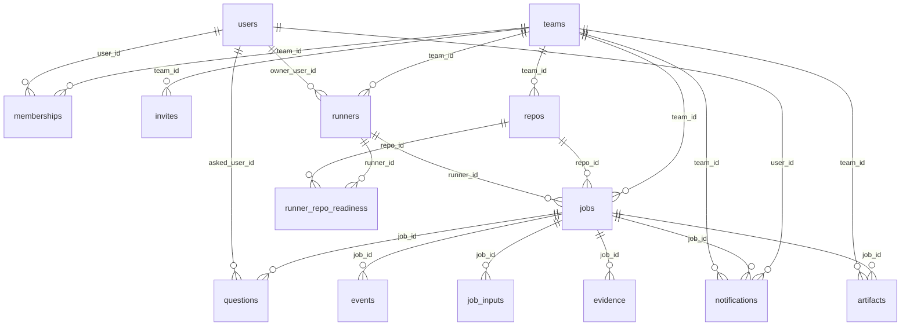

# Foundry — 数据库设计

> English: [database.md](database.md)

状态：当前实现 · 最后审阅：2026-11-11

本文是 Foundry Postgres 数据库的数据字典。它描述每张表和每个字段、保护数据的索引与约束、存放在
`jsonb` 中的 JSON 结构、触发器与报表视图，以及可直接复制的示例。

权威 schema 是 [`packages/db/src/schema.ts`](../../packages/db/src/schema.ts)（Drizzle ORM 定义）。
SQL 迁移位于 [`packages/db/migrations`](../../packages/db/migrations)，由
[`packages/db/src/migrate.ts`](../../packages/db/src/migrate.ts) 应用。如果本文与 schema 不一致，
以 schema 为准，并修正本文。

系统上下文见 [`overall-design.zh-CN.md`](overall-design.zh-CN.md) §2.5；`packages/db` 的模块列表见
[`components.zh-CN.md`](components.zh-CN.md) §6。

---

## 1. 约定

- **Postgres 16+。** 面板、API 和 realtime 服务共用一个数据库；runner 不会直接连接它，只能通过
  HTTP runner API 访问。
- **`snake_case`** 字段名、复数表名、不加表前缀。
- **主键。** 大多数表使用 UUID（`uuid PRIMARY KEY DEFAULT gen_random_uuid()`）。两张高写入追加表
  （`events`、`webhook_inbox`）使用 `bigserial`，让顺序便宜且单调。连接表（`memberships`、
  `runner_repo_readiness`）使用复合主键。
- **时间戳**一律是 `timestamptz`（UTC）；由控制面创建的行默认 `now()`。应用代码向嵌套 SQL 片段传
  ISO-8601 字符串，绝不传 `Date` 对象；见 [`../logging.zh-CN.md`](../logging.zh-CN.md) 和
  `AGENTS.md`。
- **枚举是 `text` 字段，不是 Postgres enum。** 取值在 API 边界由 `@foundry/shared` 的 zod schema
  校验；合法的任务状态迁移在
  [`packages/shared/src/states.ts`](../../packages/shared/src/states.ts) 中。允许的取值见
  [§4](#4-枚举取值)。
- **团队隔离。** 每一行属于且仅属于一个团队：直接通过 `team_id`，或通过其 job/repo 间接归属。
  `events`、`questions`、`artifacts` 和 `notifications` 也冗余保存 `team_id`，这样 realtime 分发和
  列表查询无需 join。`users` 是全局的；团队成员关系由 `memberships` 连接表表达。
- **`jsonb` 用于会演进的负载**（`events.payload`、`jobs.confidence`、`jobs.gate_result`、
  `runners.harnesses` 等）。结构见 [§5](#5-jsonb-结构)。
- **删除行为是显式的。** 团队或任务拥有的数据级联删除；指向*行为主体*的引用
  （`jobs.author_user_id`、`jobs.runner_id`、`questions.asked_user_id`）使用 `ON DELETE SET NULL`，
  以便审计行保留下来。
- **数据库不保存明文密钥。** Runner 凭据是 SHA-256 哈希（`runners.token_hash`）；GitHub 安装
  token 是短期凭据，从不落库。`users.push_subscription` 是 Web Push 订阅（endpoint URL 加密钥），
  不是密码。

---

## 2. 实体关系概览



`webhook_inbox` 有意不设外键：投递到达时控制面还不知道它属于哪个仓库（或团队），而且即使仓库后来被
解绑，原始负载也必须保留。

---

## 3. 数据字典

### 3.1 身份与访问

#### `teams`

租户。每个仓库、runner、任务和通知都属于一个团队。

| 字段                   | 类型               | 可空 | 默认值              | 说明                                                                                                             |
| ---------------------- | ------------------ | ---- | ------------------- | ---------------------------------------------------------------------------------------------------------------- |
| `id`                   | `uuid`             | 否   | `gen_random_uuid()` | 主键。                                                                                                           |
| `name`                 | `text`             | 否   | —                   | 面板显示名称。                                                                                                   |
| `gh_org`               | `text`             | 是   | —                   | 该团队工作的 GitHub 组织登录名；仅作信息展示。                                                                   |
| `daily_spend_cap_usd`  | `double precision` | 是   | —                   | 每个本机自然日（服务器上即 UTC）Agent 花费的软上限；`null` 表示不限制。当日 `usage` 事件达到上限后停止领取任务。 |
| `outgoing_webhook_url` | `text`             | 是   | —                   | Slack/Discord 风格的 webhook，接收所有通知事件。                                                                 |
| `default_harness`      | `text`             | 否   | `'claude-code'`     | 当 issue 标签和仓库都没有覆盖时使用的 harness。                                                                  |
| `default_model`        | `text`             | 是   | —                   | 同样优先级下使用的模型 id；`null` 表示 harness 默认模型。                                                        |
| `created_at`           | `timestamptz`      | 否   | `now()`             | 创建时间。                                                                                                       |

**键：** `PK (id)`。

#### `users`

一个 GitHub 身份。每个登录名一行，跨团队复用。

| 字段                | 类型          | 可空 | 默认值              | 说明                                                                  |
| ------------------- | ------------- | ---- | ------------------- | --------------------------------------------------------------------- |
| `id`                | `uuid`        | 否   | `gen_random_uuid()` | 主键。                                                                |
| `email`             | `text`        | 是   | —                   | `email` 通知和每日摘要使用的地址。                                    |
| `gh_login`          | `text`        | 否   | —                   | GitHub 登录名，由应用统一转小写。唯一。                               |
| `gh_id`             | `integer`     | 是   | —                   | OAuth 返回的 GitHub 数字用户 id。                                     |
| `name`              | `text`        | 是   | —                   | GitHub 显示名。                                                       |
| `avatar_url`        | `text`        | 是   | —                   | GitHub 头像 URL。                                                     |
| `notify_pref`       | `text`        | 否   | `'github'`          | 投递偏好：`github`（依赖 GitHub 提及）、`email`、`push` 或 `digest`。 |
| `push_subscription` | `jsonb`       | 是   | —                   | 浏览器保存的 Web Push 订阅对象（`endpoint`、`keys` 等）。             |
| `created_at`        | `timestamptz` | 否   | `now()`             | 首次登录时间。                                                        |

**键和索引：** `PK (id)`；唯一索引 `users_gh_login_idx (gh_login)` —— 登录时按登录名查用户。

#### `memberships`

连接表：哪些 GitHub 身份属于哪个团队，以及角色。

| 字段         | 类型          | 可空 | 默认值     | 说明                                  |
| ------------ | ------------- | ---- | ---------- | ------------------------------------- |
| `team_id`    | `uuid`        | 否   | —          | 团队。`ON DELETE CASCADE`。           |
| `user_id`    | `uuid`        | 否   | —          | 用户。`ON DELETE CASCADE`。           |
| `role`       | `text`        | 否   | `'member'` | `admin` 或 `member`。管理员管理团队。 |
| `created_at` | `timestamptz` | 否   | `now()`    | 用户加入的时间。                      |

**键：** `PK (team_id, user_id)`；两列都是外键。

#### `invites`

给尚未登录的 GitHub 登录名的待接受邀请。登录时按 `gh_login` 匹配并创建 membership。

| 字段         | 类型          | 可空 | 默认值              | 说明                                    |
| ------------ | ------------- | ---- | ------------------- | --------------------------------------- |
| `id`         | `uuid`        | 否   | `gen_random_uuid()` | 主键。                                  |
| `team_id`    | `uuid`        | 否   | —                   | 团队。`ON DELETE CASCADE`。             |
| `gh_login`   | `text`        | 否   | —                   | 被邀请的 GitHub 登录名。                |
| `role`       | `text`        | 否   | `'member'`          | 接受后授予的角色：`admin` 或 `member`。 |
| `created_at` | `timestamptz` | 否   | `now()`             | 邀请创建时间。                          |

**键：** `PK (id)`。

### 3.2 仓库与 runner

#### `repos`

通过 App 安装关联到团队的 GitHub 仓库。

| 字段                 | 类型          | 可空 | 默认值              | 说明                                                                                |
| -------------------- | ------------- | ---- | ------------------- | ----------------------------------------------------------------------------------- |
| `id`                 | `uuid`        | 否   | `gen_random_uuid()` | 主键。                                                                              |
| `team_id`            | `uuid`        | 否   | —                   | 所属团队。`ON DELETE CASCADE`。                                                     |
| `gh_installation_id` | `integer`     | 否   | —                   | 用于 API 调用和 git token 的 GitHub App 安装 id。                                   |
| `gh_repo_id`         | `integer`     | 否   | —                   | GitHub 的数字仓库 id。唯一。                                                        |
| `full_name`          | `text`        | 否   | —                   | `owner/name`。                                                                      |
| `default_branch`     | `text`        | 否   | `'main'`            | 任务 worktree 和 PR 的基线分支。                                                    |
| `gh_project_id`      | `text`        | 是   | —                   | 当仓库镜像到 GitHub Projects V2 看板时的 node id（`PVT_…`）。                       |
| `default_harness`    | `text`        | 是   | —                   | 仓库级 harness 覆盖；回退到团队，再回退到 `claude-code`。                           |
| `default_model`      | `text`        | 是   | —                   | 仓库级模型覆盖；回退到团队。                                                        |
| `merge_mode`         | `text`        | 否   | `'off'`             | 面板设置：`off` 或 `merge_when_confident`。为 `off` 时由缓存的 `policy.yaml` 决定。 |
| `accepts_jobs`       | `boolean`     | 否   | `false`             | `recipe.yaml` 解析成功后为 true；此前排队的 ticket 任务不会被领取。                 |
| `recipe_sha`         | `text`        | 是   | —                   | 缓存的 `.foundry/` 文件对应的提交 SHA；仓库没有 recipe 时为 `null`。                |
| `recipe_yaml`        | `text`        | 是   | —                   | `recipe_sha` 处的原始 `.foundry/recipe.yaml`，读取时用 zod 解析。                   |
| `policy_yaml`        | `text`        | 是   | —                   | `recipe_sha` 处的原始 `.foundry/policy.yaml`；缺失或无效时回退到 `DEFAULT_POLICY`。 |
| `onboarding_status`  | `text`        | 否   | `'not_started'`     | Onboarding 任务状态：`not_started`、`running`、`pr_open`、`done`、`failed`。        |
| `created_at`         | `timestamptz` | 否   | `now()`             | 仓库关联时间。                                                                      |

**键和索引：** `PK (id)`；唯一索引 `repos_gh_repo_idx (gh_repo_id)` —— 一个 GitHub 仓库只属于一个
团队；App 安装路由按此 id 查找仓库。

**说明：** `recipe_yaml` 和 `policy_yaml` 是 `recipe_sha` 处文件内容的缓存，使门禁和就绪检查无需往返
GitHub。`Sync from GitHub` 或缓存失效时会刷新。

#### `runners`

已注册、可领取任务的机器。

| 字段                   | 类型          | 可空 | 默认值              | 说明                                                                          |
| ---------------------- | ------------- | ---- | ------------------- | ----------------------------------------------------------------------------- |
| `id`                   | `uuid`        | 否   | `gen_random_uuid()` | 主键。                                                                        |
| `team_id`              | `uuid`        | 否   | —                   | 所属团队。`ON DELETE CASCADE`。                                               |
| `owner_user_id`        | `uuid`        | 是   | —                   | 加入 runner 的用户（personal runner）。`ON DELETE SET NULL`。                 |
| `name`                 | `text`        | 否   | —                   | 人类可读的 runner 名称，团队内唯一。                                          |
| `kind`                 | `text`        | 否   | —                   | `shared`（团队常开）或 `personal`（所有者的电脑）。                           |
| `os`                   | `text`        | 否   | —                   | `macos` 或 `linux`。                                                          |
| `arch`                 | `text`        | 否   | —                   | CPU 架构，例如 `arm64`、`x64`。                                               |
| `os_version`           | `text`        | 否   | —                   | 加入时上报的操作系统版本。                                                    |
| `token_hash`           | `text`        | 否   | —                   | runner bearer token 的 SHA-256。唯一；原始 token 只在加入时显示一次，不落库。 |
| `version`              | `text`        | 是   | —                   | 最近一次心跳上报的 runner CLI 版本。                                          |
| `last_seen_at`         | `timestamptz` | 是   | —                   | 最后一次心跳。超过两分钟未心跳的 runner，其任务可被重新排队。                 |
| `cpu`                  | `integer`     | 是   | —                   | 心跳上报的逻辑 CPU 数。                                                       |
| `mem_mb`               | `integer`     | 是   | —                   | 总内存（MiB）。                                                               |
| `disk_free_mb`         | `integer`     | 是   | —                   | runner 数据目录所在磁盘的剩余空间（MiB）。                                    |
| `on_ac_power`          | `boolean`     | 是   | —                   | 策略要求接入电源时，`false` 会阻止领取；无法判断时为 `null`。                 |
| `accepting`            | `boolean`     | 否   | `true`              | 守护进程当前是否接受新任务（调度、电源、磁盘检查）。                          |
| `not_accepting_reason` | `text`        | 是   | —                   | `accepting` 为 false 的原因，显示在面板中。                                   |
| `max_concurrency`      | `integer`     | 否   | `1`                 | 该 runner 同时可持有的任务数。                                                |
| `harnesses`            | `jsonb`       | 否   | `'[]'`              | 心跳上报的 `HarnessInfo` 数组（见 [§5.3](#53-runnersharnesses)）。            |
| `status`               | `text`        | 否   | `'active'`          | `active`、`draining`（跑完当前任务，不再领取）或 `removed`。                  |
| `created_at`           | `timestamptz` | 否   | `now()`             | 加入时间。                                                                    |

**键和索引：** `PK (id)`；唯一索引 `runners_token_idx (token_hash)` —— bearer token 认证；唯一索引
`runners_team_name_idx (team_id, name)` —— runner 名称按团队唯一。

#### `runner_repo_readiness`

`(runner, repo)` 最近一次就绪探测结果：该机器能否运行仓库的 recipe（工具链、服务、Postgres）。

| 字段         | 类型          | 可空 | 默认值  | 说明                                               |
| ------------ | ------------- | ---- | ------- | -------------------------------------------------- |
| `runner_id`  | `uuid`        | 否   | —       | Runner。`ON DELETE CASCADE`。                      |
| `repo_id`    | `uuid`        | 否   | —       | 仓库。`ON DELETE CASCADE`。                        |
| `recipe_sha` | `text`        | 是   | —       | 探测针对的 recipe 提交；新 recipe 可让旧结果失效。 |
| `ready`      | `boolean`     | 否   | —       | 该 runner 现在能否执行此仓库的检查。               |
| `reason`     | `text`        | 是   | —       | `ready` 为 false 时的人类可读原因。                |
| `checked_at` | `timestamptz` | 否   | `now()` | 探测时间。                                         |

**键：** `PK (runner_id, repo_id)` —— 每对 runner/repo 恰好一行就绪结果。

### 3.3 任务

#### `jobs`

每个工作单元一行：由 GitHub issue 创建的 ticket 任务，或准备仓库 `.foundry/` 文件的 onboarding 任务。
这是核心表；状态迁移由应用代码 `assertTransition`（`packages/shared/src/states.ts`）强制。

| 字段                   | 类型               | 可空 | 默认值              | 说明                                                                                                                             |
| ---------------------- | ------------------ | ---- | ------------------- | -------------------------------------------------------------------------------------------------------------------------------- |
| `id`                   | `uuid`             | 否   | `gen_random_uuid()` | 主键。也是任务 URL 的 id 和分支名前缀。                                                                                          |
| `team_id`              | `uuid`             | 否   | —                   | 所属团队。`ON DELETE CASCADE`。                                                                                                  |
| `repo_id`              | `uuid`             | 否   | —                   | 仓库。`ON DELETE CASCADE`。                                                                                                      |
| `kind`                 | `text`             | 否   | `'ticket'`          | `ticket`（来自 issue）或 `onboarding`（提交 recipe PR）。                                                                        |
| `author_user_id`       | `uuid`             | 是   | —                   | issue 作者对应的 `users` 行（若存在）。`ON DELETE SET NULL`。                                                                    |
| `author_login`         | `text`             | 是   | —                   | issue 作者的 GitHub 登录名，即使没有 `users` 行也保留。                                                                          |
| `source`               | `text`             | 否   | `'github_issue'`    | 任务来源：`github_issue` 或 `panel`（onboarding）。                                                                              |
| `issue_number`         | `integer`          | 是   | —                   | 来源 issue 编号；面板创建的任务为 `null`。                                                                                       |
| `title`                | `text`             | 否   | —                   | Issue 标题或 onboarding 标题。                                                                                                   |
| `body`                 | `text`             | 否   | `''`                | Issue 正文 / 工单内容。                                                                                                          |
| `playbook`             | `text`             | 否   | `'default'`         | Playbook 名称，由 issue 标签选择。内置：`default`、`bugfix`、`feature`、`onboarding`；仓库可添加 `.foundry/playbook.<name>.md`。 |
| `harness`              | `text`             | 否   | —                   | Harness 适配器 id，通常为 `claude-code` 或 `opencode`。                                                                          |
| `model`                | `text`             | 是   | —                   | 传给 harness 的模型覆盖；`null` 表示 harness 默认值。                                                                            |
| `pinned_runner_name`   | `text`             | 是   | —                   | `runner:<name>` 标签：优先把任务交给该 runner。                                                                                  |
| `runner_id`            | `uuid`             | 是   | —                   | 当前持有任务的 runner。任务离开 runner 阶段时清空。`ON DELETE SET NULL`。                                                        |
| `origin_runner_id`     | `uuid`             | 是   | —                   | 首次领取任务的 runner；重新排队后仍保留，供指标统计 `origin_os`。`ON DELETE SET NULL`。                                          |
| `sticky_runner_id`     | `uuid`             | 是   | —                   | 可恢复原生 harness session 的 runner。交还任务时与 `sticky_until` 一起写入。`ON DELETE SET NULL`。                               |
| `sticky_until`         | `timestamptz`      | 是   | —                   | 粘性截止时间；超时后允许其他 runner 领取。                                                                                       |
| `worktree_path`        | `text`             | 是   | —                   | runner 上的绝对 worktree 路径，镜像保存以便另一台机器可移植恢复。                                                                |
| `port_base`            | `integer`          | 是   | —                   | 任务租用端口块的起始端口（`FOUNDRY_PORT` … `FOUNDRY_PORT_END`）。                                                                |
| `harness_session_id`   | `text`             | 是   | —                   | Harness 返回的原生 session id。换机器接管时清空。                                                                                |
| `status`               | `text`             | 否   | `'queued'`          | 任务状态，取 [§4.1](#41-任务状态) 中的 12 个值之一。                                                                             |
| `resume_stage`         | `text`             | 否   | `'triage'`          | 重新排队的任务从哪个阶段重启：`triage`、`investigating`、`implementing`、`reviewing` 或 `verifying`。                            |
| `last_completed_stage` | `text`             | 是   | —                   | Agent 通过 checkpoint 确认的最后一个 runner 阶段。                                                                               |
| `brief_ref`            | `text`             | 是   | —                   | 交接 brief 的 git ref（`refs/foundry/<job id>/brief`），由 checkpoint 写入并推送到 origin，使另一台 runner 可移植恢复。          |
| `resume_count`         | `integer`          | 否   | `0`                 | 任务被重新排队并再次领取的次数。                                                                                                 |
| `loop_count`           | `integer`          | 否   | `0`                 | Review/verify 循环次数；review 把任务打回 implementing 时递增。                                                                  |
| `branch`               | `text`             | 否   | —                   | 确定性的工作分支：`foundry/<id-prefix>-<slug>`。                                                                                 |
| `head_sha`             | `text`             | 是   | —                   | Runner 上报的最后一次提交树 SHA；PR 在此提交上创建。                                                                             |
| `pr_number`            | `integer`          | 是   | —                   | 打开后的 pull request 编号。                                                                                                     |
| `pr_url`               | `text`             | 是   | —                   | Pull request URL。                                                                                                               |
| `pr_title`             | `text`             | 是   | —                   | PR 使用的标题（issue 标题及后续刷新）。                                                                                          |
| `ci_status`            | `text`             | 否   | `'none'`            | 最近观察到的 CI 状态：`none`、`pending`、`success` 或 `failure`。                                                                |
| `ai_review_status`     | `text`             | 否   | `'none'`            | 预留给 AI reviewer 状态（`none`、`clean`、`blocking`）。当前门禁读取 GitHub 上的实时 review。                                    |
| `pr_ci_entered_at`     | `timestamptz`      | 是   | —                   | 任务最近一次进入 `pr_ci` 的时间；无 CI 时启动自动评审的宽限期从这里开始计算。                                                     |
| `pr_review_sha`        | `text`             | 是   | —                   | 自动 PR 评审已经运行过的 PR head SHA；避免重复评审同一个 SHA。                                                                   |
| `pr_review_count`      | `integer`          | 否   | `0`                 | 自动 PR 评审要求修改并重新入队 implementing 的轮数。                                                                             |
| `ui_changed`           | `boolean`          | 否   | `false`             | Diff 是否触及 `ui_paths`；自动合并前必须有截图证据。                                                                             |
| `changed_lines`        | `integer`          | 否   | `0`                 | 创建 PR / 运行门禁时测得的 diff 行数。                                                                                           |
| `plan`                 | `text`             | 是   | —                   | Investigating 阶段记录的计划文本（同时写成 `message` 事件）。                                                                    |
| `max_job_minutes`      | `integer`          | 是   | —                   | 单任务墙钟上限；`null` 表示跟随 `policy.yaml` 的 `max_job_minutes`。                                                             |
| `max_cost_usd`         | `double precision` | 是   | —                   | 单任务成本上限；`null` 表示跟随 `policy.yaml` 的 `max_cost_per_job_usd`。                                                        |
| `confidence`           | `jsonb`            | 是   | —                   | Agent 自报的置信度，`{ level, reasons, uncertainties }`。见 [§5.1](#51-jobsconfidence)。                                         |
| `gate_result`          | `jsonb`            | 是   | —                   | 最近一次 `GateResult`：`{ pass, pending, failed[], reviewers[] }`。见 [§5.2](#52-jobsgate_result)。                              |
| `assigned_reviewers`   | `jsonb`            | 否   | `'[]'`              | 门禁把 PR 交给人工时请求的 GitHub 登录名或团队 handle。                                                                          |
| `last_review_id`       | `bigint`           | 是   | —                   | 已交给 Agent 的最后一条 GitHub review id，避免补偿轮询重复排队。                                                                 |
| `status_comment_id`    | `bigint`           | 是   | —                   | 控制面持续更新的 issue 状态评论 id。GitHub id 超出 `int32`，所以用 `bigint`。                                                    |
| `cost_usd`             | `double precision` | 否   | `0`                 | 累计 Agent 成本（USD），由 `usage` 事件累加。                                                                                    |
| `tokens_in`            | `integer`          | 否   | `0`                 | 累计输入 token。                                                                                                                 |
| `tokens_out`           | `integer`          | 否   | `0`                 | 累计输出 token。                                                                                                                 |
| `failure_reason`       | `text`             | 是   | —                   | 任务失败时的人类可读原因。                                                                                                       |
| `created_at`           | `timestamptz`      | 否   | `now()`             | 任务行插入时间。                                                                                                                 |
| `claimed_at`           | `timestamptz`      | 是   | —                   | 最近一次领取时间（每次领取都会重置），用于排队时长指标。                                                                         |
| `started_at`           | `timestamptz`      | 是   | —                   | Runner 首次接手任务的时间；重新排队不会覆盖。                                                                                    |
| `finished_at`          | `timestamptz`      | 是   | —                   | `merged`、`failed` 或 `cancelled` 时写入。                                                                                       |
| `reverted_at`          | `timestamptz`      | 是   | —                   | 后续合并的 PR 回滚本任务 PR 时写入（合并后回滚指标）。                                                                           |
| `updated_at`           | `timestamptz`      | 否   | `now()`             | 最近一次行写入时间。由 `jobs_touch` 触发器在每次 `UPDATE` 时刷新，因此排序总是可信。                                             |

**键和索引：**

- `PK (id)`。
- `jobs_team_status_idx (team_id, status)` —— 扫描待领取任务和统计状态数量。
- `jobs_team_updated_idx (team_id, updated_at)` —— 看板和收件箱按最新优先列出团队任务，无需排序整张表。
- `jobs_runner_idx (runner_id)` —— 心跳时检查该 runner 上报任务的保留/撤销。
- `jobs_issue_active_idx (repo_id, issue_number) UNIQUE WHERE status NOT IN ('merged','cancelled')
  AND issue_number IS NOT NULL` —— 每个 issue 至多一个活动任务；重复打标签会复用或复活该任务，
  而不是创建重复卡片。

**一句话生命周期：** `queued` → runner 阶段（`triage` → `investigating` → `implementing` →
`reviewing` → `verifying`）→ `pr_ci` → `merged`；`needs_input`、`waiting_on_you`、`failed` 和
`cancelled` 是旁路出口。每次变更都由状态机保护；见
[`overall-design.zh-CN.md`](overall-design.zh-CN.md) §2.4。

### 3.4 时间线、人工输入与证据

#### `events`

只追加的任务时间线。每次状态变更、Agent 消息、工具调用、usage 记录、checkpoint、门禁评估和证据写入
都会生成一行。应用永不更新或删除这些行（仅当任务删除时通过级联消失）。

| 字段      | 类型          | 可空 | 默认值  | 说明                                                               |
| --------- | ------------- | ---- | ------- | ------------------------------------------------------------------ |
| `id`      | `bigserial`   | 否   | —       | 主键；数据库内单调递增，用作时间线游标。                           |
| `job_id`  | `uuid`        | 否   | —       | 任务。`ON DELETE CASCADE`。                                        |
| `team_id` | `uuid`        | 否   | —       | 所属团队，冗余保存用于 realtime 分发和团队范围列表。无外键。       |
| `ts`      | `timestamptz` | 否   | `now()` | 控制面记录事件的时间。                                             |
| `kind`    | `text`        | 否   | —       | 事件类型，也是 `payload` 的判别字段。见 [§4.9](#49-事件类型)。     |
| `stage`   | `text`        | 是   | —       | 写入时的任务状态（`queued`、`implementing` 等）。                  |
| `payload` | `jsonb`       | 否   | —       | 完整的 `FoundryEvent`，包含 `kind`。见 [§5.4](#54-eventspayload)。 |

**索引：** `events_job_idx (job_id, id)` —— 按顺序渲染单个任务的时间线；
`events_team_ts_idx (team_id, ts)` —— 活动流和“自午夜起花费”查询。

**触发器：** `AFTER INSERT` 发送 realtime 通知（见 [§7](#7-触发器与-realtime)）。

#### `questions`

Agent 的“先问不猜”问题，以及人工回答后的结果。

| 字段                  | 类型          | 可空 | 默认值              | 说明                                                    |
| --------------------- | ------------- | ---- | ------------------- | ------------------------------------------------------- |
| `id`                  | `uuid`        | 否   | `gen_random_uuid()` | 主键。                                                  |
| `job_id`              | `uuid`        | 否   | —                   | 任务。`ON DELETE CASCADE`。                             |
| `team_id`             | `uuid`        | 否   | —                   | 所属团队，冗余保存。无外键。                            |
| `asked_user_id`       | `uuid`        | 是   | —                   | 问题路由到的用户（若已知）。`ON DELETE SET NULL`。      |
| `asked_login`         | `text`        | 是   | —                   | 问题指向的 GitHub 登录名。                              |
| `prompt`              | `text`        | 否   | —                   | 问题文本。                                              |
| `options`             | `jsonb`       | 否   | `'[]'`              | 建议答案（字符串数组，最多六个）。                      |
| `answer`              | `text`        | 是   | —                   | 自由文本答案，或所选选项的文本。                        |
| `answer_option_index` | `integer`     | 是   | —                   | 从复选框/按钮作答时，所选选项的零基索引。               |
| `answered_by`         | `text`        | 是   | —                   | 作答的 GitHub 登录名或 `panel` 行为主体。               |
| `answered_via`        | `text`        | 是   | —                   | 渠道：`panel`、`gh_checkbox` 或 `gh_reply`。            |
| `gh_comment_id`       | `bigint`      | 是   | —                   | 承载问题/复选框的 issue 评论。GitHub id 使用 `bigint`。 |
| `helpful`             | `boolean`     | 是   | —                   | 可选反馈：该问题是否有帮助。                            |
| `created_at`          | `timestamptz` | 否   | `now()`             | 提问时间。                                              |
| `answered_at`         | `timestamptz` | 是   | —                   | 回答时间。                                              |

**键：** `PK (id)`。**触发器：** `AFTER INSERT OR UPDATE` 通知面板。

#### `job_inputs`

等待投递给 Agent 的人工输入：对问题的回答，或面板中的自由消息（可带图片）。任务恢复时消费这些行。

| 字段              | 类型          | 可空 | 默认值              | 说明                                                                                   |
| ----------------- | ------------- | ---- | ------------------- | -------------------------------------------------------------------------------------- |
| `id`              | `uuid`        | 否   | `gen_random_uuid()` | 主键。                                                                                 |
| `job_id`          | `uuid`        | 否   | —                   | 任务。`ON DELETE CASCADE`。                                                            |
| `kind`            | `text`        | 否   | —                   | `answer` 或 `message`。                                                                |
| `text`            | `text`        | 否   | —                   | 交给 Agent 的内容。                                                                    |
| `by`              | `text`        | 否   | —                   | 写入者（GitHub 登录名或 `panel`）。                                                    |
| `question_prompt` | `text`        | 是   | —                   | 当此输入回答问题时的原始问题。                                                         |
| `attachments`     | `jsonb`       | 否   | `'[]'`              | 面板中附加的图片，格式为 `InputAttachment[]`（见 [§5.5](#55-job_inputsattachments)）。 |
| `delivered_at`    | `timestamptz` | 是   | —                   | Runner 取走输入的时间；`null` 表示仍待投递。                                           |
| `created_at`      | `timestamptz` | 否   | `now()`             | 入队时间。                                                                             |

**键：** `PK (id)`。

#### `evidence`

Runner 提交的每条证明一行：recipe 检查结果、截图、备注或独立代码审查。门禁按 `(kind, name)` 读取
最新证据。

| 字段          | 类型          | 可空 | 默认值              | 说明                                                                        |
| ------------- | ------------- | ---- | ------------------- | --------------------------------------------------------------------------- |
| `id`          | `uuid`        | 否   | `gen_random_uuid()` | 主键。                                                                      |
| `job_id`      | `uuid`        | 否   | —                   | 任务。`ON DELETE CASCADE`。                                                 |
| `kind`        | `text`        | 否   | —                   | `check`、`screenshot`、`note` 或 `review`。                                 |
| `name`        | `text`        | 否   | —                   | 稳定名称：`recipe.yaml` 中的检查名、`screenshot`、`code review` 等。        |
| `status`      | `text`        | 否   | —                   | `passed`、`failed` 或 `skipped`。                                           |
| `command`     | `text`        | 是   | —                   | 执行的检查命令。                                                            |
| `exit_code`   | `integer`     | 是   | —                   | check 证据的进程退出码。                                                    |
| `output_tail` | `text`        | 是   | —                   | 输出末尾，API 限制为 20 000 字符。                                          |
| `duration_ms` | `integer`     | 是   | —                   | 检查耗时（毫秒）。                                                          |
| `artifact_id` | `uuid`        | 是   | —                   | 截图或上传证明对应的 `artifacts` 行。无外键，删除 artifact 后证据行仍保留。 |
| `loop`        | `integer`     | 否   | `0`                 | 记录时的 `jobs.loop_count`，让后续循环覆盖先前失败。                        |
| `created_at`  | `timestamptz` | 否   | `now()`             | 提交时间。                                                                  |

**键：** `PK (id)`。独立审查规则需要 `kind = 'review' AND name = 'code review'`。

#### `artifacts`

存放在 artifact 卷上的文件（通常是嵌入 PR 正文的截图）的元数据。文件位于
`$ARTIFACTS_DIR/<team_id>/<artifact id>/<safe name>`；`storage_key` 保存该相对路径。字节通过
`/api/artifacts/:id?t=<signed token>` 提供。

| 字段           | 类型          | 可空 | 默认值              | 说明                                           |
| -------------- | ------------- | ---- | ------------------- | ---------------------------------------------- |
| `id`           | `uuid`        | 否   | `gen_random_uuid()` | 主键；也是签名 URL 的 id。                     |
| `team_id`      | `uuid`        | 否   | —                   | 所属团队，冗余保存。无外键。                   |
| `job_id`       | `uuid`        | 是   | —                   | 属于某个任务时的任务 id。`ON DELETE CASCADE`。 |
| `name`         | `text`        | 否   | —                   | 清理后的文件名。                               |
| `content_type` | `text`        | 否   | —                   | MIME 类型（`image/png`、`text/plain` 等）。    |
| `size_bytes`   | `integer`     | 否   | —                   | 文件大小。                                     |
| `storage_key`  | `text`        | 否   | —                   | artifact 目录下的相对路径。                    |
| `created_at`   | `timestamptz` | 否   | `now()`             | 上传时间。                                     |

**键：** `PK (id)`。

### 3.5 摄入与通知

#### `webhook_inbox`

原始 GitHub webhook 投递。Web 路由验证签名、插入此表并立即确认；worker 负责分发，并对未处理行重试
（最多五次）。

| 字段           | 类型          | 可空 | 默认值  | 说明                                                           |
| -------------- | ------------- | ---- | ------- | -------------------------------------------------------------- |
| `id`           | `bigserial`   | 否   | —       | 主键；也是处理顺序。                                           |
| `provider`     | `text`        | 否   | —       | 来源，目前为 `github`。                                        |
| `delivery_id`  | `text`        | 否   | —       | `X-GitHub-Delivery` 请求头。                                   |
| `event`        | `text`        | 否   | —       | `X-GitHub-Event`（`issues`、`pull_request`、`check_run` 等）。 |
| `payload`      | `jsonb`       | 否   | —       | 验证后的原始请求体。                                           |
| `received_at`  | `timestamptz` | 否   | `now()` | 接受时间。                                                     |
| `processed_at` | `timestamptz` | 是   | —       | 成功分发的时间；`null` 表示待处理或失败。                      |
| `attempts`     | `integer`     | 否   | `0`     | 已尝试分发次数。                                               |
| `error`        | `text`        | 是   | —       | 最近一次分发错误。                                             |

**索引：** 唯一索引 `webhook_inbox_delivery_idx (provider, delivery_id)` —— GitHub 会重试投递；唯一
键让摄入幂等。

#### `notifications`

人工通知的投递日志。每次投递尝试一行（或一条排队中的 `digest` 条目）；发送失败时保留该行，
`sent_at = NULL` 并记录错误。

| 字段         | 类型          | 可空 | 默认值              | 说明                                                                               |
| ------------ | ------------- | ---- | ------------------- | ---------------------------------------------------------------------------------- |
| `id`         | `uuid`        | 否   | `gen_random_uuid()` | 主键。                                                                             |
| `team_id`    | `uuid`        | 否   | —                   | 所属团队，冗余保存。无外键。                                                       |
| `user_id`    | `uuid`        | 是   | —                   | 按用户渠道的收件人。`ON DELETE CASCADE`。                                          |
| `job_id`     | `uuid`        | 是   | —                   | 相关任务。`ON DELETE CASCADE`。                                                    |
| `event`      | `text`        | 否   | —                   | `question_asked`、`handover`、`merged` 或 `failed`。                               |
| `detail`     | `text`        | 否   | —                   | 附加到通知行的人类可读细节。                                                       |
| `channel`    | `text`        | 否   | —                   | `push`、`email`、`webhook`（团队外发 webhook）或 `digest`。                        |
| `sent_at`    | `timestamptz` | 是   | —                   | 发送成功时写入（`digest` 在承载它的摘要邮件发出时写入）；失败或仍在排队为 `null`。 |
| `error`      | `text`        | 是   | —                   | 失败信息。                                                                         |
| `created_at` | `timestamptz` | 否   | `now()`             | 记录尝试的时间。                                                                   |

**键：** `PK (id)`。`github` 是 `users.notify_pref` 的取值，不是通知渠道：该模式下 Foundry 依赖
GitHub 自身的提及/review 通知，不写行。

---

## 4. 枚举取值

取值以 `text` 保存；此处的列表就是契约。新增取值时，同时更新写入方、`@foundry/shared` 中的 zod
schema 和本表。

### 4.1 任务状态

| 取值             | Runner 阶段 | 含义                                        |
| ---------------- | ----------- | ------------------------------------------- |
| `queued`         | —           | 等待 runner，或被有意交还。                 |
| `triage`         | 是          | 阅读工单，判断是否可构建。                  |
| `needs_input`    | —           | 问题等待人工回答。                          |
| `investigating`  | 是          | 探索代码和测试，编写计划。                  |
| `implementing`   | 是          | 修改文件并添加测试。                        |
| `reviewing`      | 是          | 独立 reviewer 阅读 diff。                   |
| `verifying`      | 是          | 运行 recipe 检查、收集证据和置信度。        |
| `pr_ci`          | —           | PR 已打开，等待 CI 和合并门禁。             |
| `waiting_on_you` | —           | 已交给人工 reviewer（风险规则或门禁失败）。 |
| `merged`         | —           | PR 已合并。终态。                           |
| `failed`         | —           | 任务失败；可通过 `queued` 重试。            |
| `cancelled`      | —           | 人工取消。本次尝试的终态。                  |

合法迁移见 `packages/shared/src/states.ts`（`TRANSITIONS`）。不要发明新的迁移。

### 4.2 其他任务取值

| 字段                                    | 取值                                                                |
| --------------------------------------- | ------------------------------------------------------------------- |
| `kind`                                  | `ticket`、`onboarding`                                              |
| `source`                                | `github_issue`、`panel`                                             |
| `playbook`                              | `default`、`bugfix`、`feature`、`onboarding`                        |
| `resume_stage` / `last_completed_stage` | `triage`、`investigating`、`implementing`、`reviewing`、`verifying` |
| `ci_status`                             | `none`、`pending`、`success`、`failure`                             |
| `ai_review_status`                      | `none`、`clean`、`blocking`（预留；见字段说明）                     |

### 4.3 仓库

| 字段                | 取值                                                  |
| ------------------- | ----------------------------------------------------- |
| `merge_mode`        | `off`、`merge_when_confident`                         |
| `onboarding_status` | `not_started`、`running`、`pr_open`、`done`、`failed` |

### 4.4 Runner

| 字段     | 取值                            |
| -------- | ------------------------------- |
| `kind`   | `shared`、`personal`            |
| `os`     | `macos`、`linux`                |
| `status` | `active`、`draining`、`removed` |

### 4.5 用户与通知

| 字段                               | 取值                                             |
| ---------------------------------- | ------------------------------------------------ |
| `users.notify_pref`                | `github`、`email`、`push`、`digest`              |
| `notifications.channel`            | `push`、`email`、`webhook`、`digest`             |
| `notifications.event`              | `question_asked`、`handover`、`merged`、`failed` |
| `memberships.role`、`invites.role` | `admin`、`member`                                |

### 4.6 问题与输入

| 字段                     | 取值                               |
| ------------------------ | ---------------------------------- |
| `questions.answered_via` | `panel`、`gh_checkbox`、`gh_reply` |
| `job_inputs.kind`        | `answer`、`message`                |

### 4.7 证据

| 字段     | 取值                                    |
| -------- | --------------------------------------- |
| `kind`   | `check`、`screenshot`、`note`、`review` |
| `status` | `passed`、`failed`、`skipped`           |

### 4.8 Webhook

| 字段       | 取值                         |
| ---------- | ---------------------------- |
| `provider` | `github`（目前唯一的写入方） |

### 4.9 事件类型

`events.kind` 与 `packages/shared/src/events.ts` 中 `FoundryEvent` 的 `kind` 判别字段一致：

| 类型               | Payload 要点                                                              |
| ------------------ | ------------------------------------------------------------------------- |
| `stage_changed`    | `from`、`to`，可选 `reason`                                               |
| `subagent_started` | `name`                                                                    |
| `tool_call`        | `tool`，可选 `summary`                                                    |
| `usage`            | `tokensIn`、`tokensOut`、`costUsd`，可选 `model`；累加到 `jobs`           |
| `message`          | `role`（`agent`、`human`、`system`）、`text`                              |
| `question`         | `questionId`、`prompt`                                                    |
| `answer`           | `questionId`、`text`、`by`                                                |
| `evidence`         | `name`、`status`                                                          |
| `log`              | `level`（`debug`…`error`）、`message`                                     |
| `resumed`          | `runnerId`、`runnerName`、`mode`（`sticky`/`portable`）、`harnessChanged` |
| `gate`             | `pass`、`failed[]`                                                        |
| `checkpoint`       | `stage`、`briefRef`                                                       |
| `error`            | `message`                                                                 |

控制面代码还会写入 `kind: "log"` 行作为运维记录（例如 runner 心跳丢失后重新排队任务）。未知类型按
只读时间线条目处理。

---

## 5. JSONB 结构

### 5.1 `jobs.confidence`

由 `confidence` MCP 工具写入（`ConfidenceRequestSchema`）。门禁只读取 `level` 和 `uncertainties`；
只有 `high` 且没有不确定项才满足自动合并条件。

```json
{
  "level": "high",
  "reasons": ["复现了失败并添加了单元测试", "改动仅限于 parser"],
  "uncertainties": []
}
```

### 5.2 `jobs.gate_result`

`packages/shared/src/gate.ts` 产出的最近一次 `GateResult`。`failed[].rule` 取值为
`merge_mode`、`checks`、`screenshot`、`ci`、`ai_review`、`code_review`、`risk_rules`、`diff_size`、
`confidence`、`cost`。

```json
{
  "pass": false,
  "pending": false,
  "failed": [
    { "rule": "diff_size", "detail": "Diff is 812 lines (limit 400)" },
    { "rule": "confidence", "detail": "Agent confidence is medium with 2 open uncertainties" }
  ],
  "reviewers": ["security-team"]
}
```

`pending: true` 表示门禁正在等待 CI 或 AI review，稍后会重新评估。

### 5.3 `runners.harnesses`

心跳上报的 `HarnessInfo` 数组。领取调度只会提供 `installed` 和 `authOk` 都为 true 的 harness。

```json
[
  { "id": "claude-code", "installed": true, "version": "2.1.0", "authOk": true },
  { "id": "opencode", "installed": false, "authOk": false }
]
```

### 5.4 `events.payload`

Payload 是完整的事件对象，因此即使过滤掉 `kind` 字段，该行仍然自描述。

```json
{ "kind": "stage_changed", "from": "implementing", "to": "reviewing", "reason": "self-review done" }
```

```json
{ "kind": "usage", "model": "claude-sonnet-5-5", "tokensIn": 18422, "tokensOut": 2310, "costUsd": 0.0912 }
```

```json
{ "kind": "message", "role": "agent", "text": "Plan:\n1. Add the missing index…" }
```

### 5.5 `job_inputs.attachments`

人工在面板中附加的图片。`url` 是长期有效的签名 artifact URL，因此即使 runner 不是上传机器也能下载
字节。

```json
[
  {
    "artifactId": "3f1c9a7e-2b4d-4a11-9c8e-0d6f5b1a2c34",
    "name": "error-state.png",
    "contentType": "image/png",
    "url": "https://foundry.example/api/artifacts/3f1c9a7e-2b4d-4a11-9c8e-0d6f5b1a2c34?t=…"
  }
]
```

---

## 6. 索引与约束清单

| 索引 / 约束                  | 表                      | 定义                                                                                                       | 存在原因                                                       |
| ---------------------------- | ----------------------- | ---------------------------------------------------------------------------------------------------------- | -------------------------------------------------------------- |
| `users_gh_login_idx`         | `users`                 | UNIQUE `(gh_login)`                                                                                        | 登录和 issue 作者按登录名查找。                                |
| `repos_gh_repo_idx`          | `repos`                 | UNIQUE `(gh_repo_id)`                                                                                      | App 安装/设置把 GitHub 仓库解析到唯一团队。                    |
| `runners_token_idx`          | `runners`               | UNIQUE `(token_hash)`                                                                                      | Bearer token 认证。                                            |
| `runners_team_name_idx`      | `runners`               | UNIQUE `(team_id, name)`                                                                                   | runner 名称按团队唯一；`runner:<name>` 标签可安全解析。        |
| `jobs_team_status_idx`       | `jobs`                  | `(team_id, status)`                                                                                        | 扫描 queued 任务；看板状态计数。                               |
| `jobs_team_updated_idx`      | `jobs`                  | `(team_id, updated_at)`                                                                                    | 看板和收件箱按最新优先列出团队任务，避免整表排序。             |
| `jobs_runner_idx`            | `jobs`                  | `(runner_id)`                                                                                              | 心跳时检查 runner 上报任务的保留/撤销。                        |
| `jobs_issue_active_idx`      | `jobs`                  | UNIQUE `(repo_id, issue_number)` WHERE `status NOT IN ('merged','cancelled') AND issue_number IS NOT NULL` | 每个 issue 一个活动任务；重复 webhook 投递不会创建第二张卡片。 |
| `events_job_idx`             | `events`                | `(job_id, id)`                                                                                             | 按顺序渲染任务时间线。                                         |
| `events_team_ts_idx`         | `events`                | `(team_id, ts)`                                                                                            | 团队活动流和“自午夜起花费”。                                   |
| `webhook_inbox_delivery_idx` | `webhook_inbox`         | UNIQUE `(provider, delivery_id)`                                                                           | GitHub 会重试投递；摄入幂等。                                  |
| `memberships_*_pk`           | `memberships`           | PRIMARY KEY `(team_id, user_id)`                                                                           | 每个用户在每个团队只有一条成员关系。                           |
| `runner_repo_readiness_*_pk` | `runner_repo_readiness` | PRIMARY KEY `(runner_id, repo_id)`                                                                         | 每对 runner/repo 只有一条就绪结果。                            |

Drizzle 支持的索引声明在 `schema.ts`。`jobs_team_updated_idx` 由
`0008_jobs_team_updated_idx.sql` 添加；job/issue 部分唯一索引的谓词在 `schema.ts` 中用 `sql`
片段声明。

---

## 7. 触发器与 realtime

迁移中定义了两个 PL/pgSQL 函数：

### `foundry_touch_updated_at()`

`BEFORE UPDATE ON jobs`（`jobs_touch`）把 `NEW.updated_at` 设为 `now()`。应用代码不应写
`updated_at`；触发器拥有它。由于它在行写入前触发，NOTIFY payload 的变更字段列表里总会出现
`updated_at`。

### `foundry_notify_change()`

为以下触发器发出 `pg_notify('foundry_changes', payload)`：

| 表          | 触发事件                     |
| ----------- | ---------------------------- |
| `jobs`      | `INSERT`、`UPDATE`、`DELETE` |
| `events`    | `INSERT`                     |
| `questions` | `INSERT`、`UPDATE`           |
| `runners`   | `INSERT`、`UPDATE`           |

Payload：

```json
{
  "table": "jobs",
  "id": "aa9d6b37-411c-4a2e-9a4e-6b8f2c1d0e33",
  "team_id": "0b6a1f2e-…",
  "op": "UPDATE",
  "columns": ["status", "updated_at"]
}
```

- NOTIFY 只传 id —— Postgres 限制 payload 为 8 KB。客户端（面板和 runner 守护进程）通过 WebSocket
  收到变更，再通过带认证的 API 拉取行。
- `columns` 通过比较 `to_jsonb(OLD)` 和 `to_jsonb(NEW)` 得到。客户端可以忽略表面更新，例如每次
  usage 刷新写入的成本/token 计数，只在有意义的字段变化时重新渲染。
- `INSERT` 和 `DELETE` 的 `columns` 为 `[]`；客户端把这两种操作视为总是刷新。
- `apps/realtime` LISTEN `foundry_changes`，只向签名 token 中携带相同 `team_id` 的连接分发。

迁移 `0007_notify_columns.sql` 替换了 0000 中的原函数以加入 `columns`。修改 payload 时，在新迁移中
更新函数，并同步修改两个消费者（realtime 服务和面板）。

---

## 8. 报表视图

指标页读取预连接视图，而不是每次请求扫描 `jobs` 和 `events`。视图定义在
`0002_metrics_views.sql` 中，它们不是表 —— 始终反映当前数据。

### `metrics_job_facts`

每个任务一行，包含指标页切片所需的全部字段。

| 字段                                                                                               | 含义                                                             |
| -------------------------------------------------------------------------------------------------- | ---------------------------------------------------------------- |
| `id`、`team_id`、`repo_id`、`kind`、`harness`、`model`、`author_user_id`、`author_login`、`status` | 从 `jobs` 复制。                                                 |
| `cost_usd`                                                                                         | 最终累计成本。                                                   |
| `created_at`、`claimed_at`、`finished_at`、`reverted_at`                                           | 从 `jobs` 复制的时间戳。                                         |
| `origin_os`                                                                                        | 首次领取任务的 runner 的操作系统。                               |
| `resume_count`                                                                                     | 任务被重新排队的次数。                                           |
| `lead_time_min`                                                                                    | `finished_at - created_at`，单位分钟。                           |
| `first_queue_min`                                                                                  | `claimed_at - created_at`，单位分钟 —— runner 接手前的等待时间。 |
| `reached_pr`                                                                                       | 任务是否到达过 `pr_ci`。                                         |
| `auto_merged`                                                                                      | 通过置信度门禁合并（而非人工）。                                 |
| `human_touches`                                                                                    | 人工回答/消息数；若由人工合并再加一。                            |
| `requeued_offline`                                                                                 | 任务是否因 runner 离线而重新排队。                               |
| `portable_resumed`                                                                                 | 是否在另一台机器上恢复（`resumed` 事件，`mode = portable`）。    |

### `metrics_handover_waits`

每次转入 `waiting_on_you` 一行，包含 `job_id`、`team_id`、`handed_at` 和 `acted_at`（之后第一次
离开 `waiting_on_you` 的状态变更；仍在等待时为 `NULL`）。

### `metrics_runner_busy`

每个 runner 的忙碌区间。一行从离开 `queued` 的 `stage_changed` 开始，到下一次释放任务的状态变更
（`queued`、`needs_input`、`pr_ci`、`failed`、`cancelled`），仍在运行时为 `now()`。`runner_id` 通过
`claimed by <name>` 原因匹配，因此旧行的 runner 改名无法重建。

示例：

```sql
select round(avg(lead_time_min)::numeric, 1) as avg_minutes
from metrics_job_facts
where team_id = $1
  and finished_at >= now() - interval '30 days';
```

---

## 9. 完整示例

以下示例中的行仅作说明；id、名称和数字均为虚构。

### 9.1 经历一次 review 循环后的 ticket 任务行

```json
{
  "id": "aa9d6b37-411c-4a2e-9a4e-6b8f2c1d0e33",
  "team_id": "0b6a1f2e-3c4d-4e5f-8a9b-0c1d2e3f4a5b",
  "repo_id": "7d2e4c1a-9b8f-4a6d-8e2f-5c3b1a0d9e8f",
  "kind": "ticket",
  "source": "github_issue",
  "issue_number": 83,
  "title": "Add db design doc",
  "playbook": "default",
  "harness": "claude-code",
  "model": null,
  "status": "implementing",
  "resume_stage": "implementing",
  "last_completed_stage": "reviewing",
  "resume_count": 0,
  "loop_count": 1,
  "branch": "foundry/aa9d6b37-add-db-design-doc",
  "runner_id": "1f0e2d3c-4b5a-6978-8c9d-0e1f2a3b4c5d",
  "origin_runner_id": "1f0e2d3c-4b5a-6978-8c9d-0e1f2a3b4c5d",
  "sticky_runner_id": null,
  "ci_status": "none",
  "ui_changed": false,
  "changed_lines": 0,
  "cost_usd": 2.41,
  "tokens_in": 482310,
  "tokens_out": 39112,
  "created_at": "2026-11-11T02:14:03.512Z",
  "claimed_at": "2026-11-11T02:16:22.004Z",
  "started_at": "2026-11-11T02:16:22.041Z",
  "finished_at": null,
  "updated_at": "2026-11-11T03:02:19.830Z"
}
```

### 9.2 同一任务的时间线

| `id` | `kind`          | `stage`         | `payload`                                                                                             |
| ---- | --------------- | --------------- | ----------------------------------------------------------------------------------------------------- |
| 901  | `stage_changed` | `queued`        | `{"kind":"stage_changed","from":null,"to":"queued","reason":"issue labeled foundry"}`                 |
| 902  | `stage_changed` | `triage`        | `{"kind":"stage_changed","from":"queued","to":"triage","reason":"claimed by alice-laptop"}`           |
| 903  | `message`       | `investigating` | `{"kind":"message","role":"agent","text":"Plan:\n1. …"}`                                              |
| 904  | `usage`         | `implementing`  | `{"kind":"usage","model":"claude-sonnet-5-5","tokensIn":18422,"tokensOut":2310,"costUsd":0.0912}`     |
| 905  | `stage_changed` | `reviewing`     | `{"kind":"stage_changed","from":"implementing","to":"reviewing","reason":"self-review done"}`         |
| 906  | `stage_changed` | `implementing`  | `{"kind":"stage_changed","from":"reviewing","to":"implementing","reason":"review requested changes"}` |

### 9.3 原子领取任务

控制面从不在两条语句中“先查后改”。下面的 update 会锁定选中的行并重新检查 `status = 'queued'`，
因此两个 runner 竞争同一张卡片时不会都成功：

```sql
update jobs
set status = 'triage',
    runner_id = $1,
    origin_runner_id = coalesce(origin_runner_id, $1),
    claimed_at = now(),
    sticky_runner_id = null,
    sticky_until = null,
    harness_session_id = null
where id = (
  select id
  from jobs
  where id = $2 and status = 'queued'
  for update skip locked
)
returning *;
```

### 9.4 看板查询

```sql
select id, title, status, pr_number, updated_at
from jobs
where team_id = $1
order by updated_at desc
limit 50;
```

这正是 `jobs_team_updated_idx` 存在的原因：索引直接提供顺序，Postgres 无需读取团队全部任务再排序。

### 9.5 每个 issue 一个活动任务

```sql
select id, status, resume_stage
from jobs
where repo_id = $1
  and issue_number = $2
  and status not in ('merged', 'cancelled');
```

没有行时，webhook 处理器插入新任务（或复活 failed/cancelled 任务）；有行时复用该卡片。部分唯一索引
保证即使并发投递，该不变式也成立。

---

## 10. 迁移

1. **先修改 `packages/db/src/schema.ts`。** 它是所有包导入的 Drizzle 模型。
2. **在 `packages/db/migrations` 下添加下一个编号 SQL 文件**，例如 `0010_add_example.sql`。语句之间
   使用 `--> statement-breakpoint`。Drizzle-kit 可以生成基础 DDL
   （`pnpm --filter @foundry/db exec drizzle-kit generate`），但触发器、视图、部分索引和数据回填
   通常手写。让 `schema.ts` 和 SQL 在同一次修改中保持一致。
3. **应用迁移：** `pnpm db:migrate`（需要 `DATABASE_URL`）。`packages/db/src/migrate.ts` 中的 runner
   按字典序读取每个 `*.sql`，每个文件在自己的事务中执行，并记录到内部 `_foundry_migrations` 表。
   可安全重复运行。`migrations/meta/` 仅供 drizzle-kit 使用，可能落后于手写迁移。
4. **用测试保护变更。** `packages/db/src/db.test.ts` 展示了模式：用 `createTestDatabase()` 创建一次性
   数据库，运行 `migrate()`，再断言行为（例如 NOTIFY payload）。创建/修改测试需要
   `FOUNDRY_TEST_DATABASE_URL`。
5. **在同一次 PR 中更新本文** —— 字段表、索引清单和示例。

注意：

- 添加 `NOT NULL` 字段需要默认值或回填；迁移 runner 会把每个文件包在事务中，但不会把文件拆成在线
  DDL。
- 使用 `timestamptz`，并在嵌套 SQL 片段中把 ISO 字符串转换为 `::timestamptz`。`Date` 对象插值到
  嵌套片段时会按服务器区域设置字符串化，Postgres 会拒绝。
- 不要为新的取值列表添加 Postgres enum 类型；使用 `text` 并更新 zod schema。
- 不要添加 `ON UPDATE` 行为；时间戳由应用或触发器写入。

---

## 11. 运维说明

- **保留策略。** `events` 随 Agent 活动增长，是最大的表；`notifications` 是投递日志。两者都可以按
  时间（`created_at` / `ts`）清理而不破坏状态机。保留 `jobs` 行 —— 它们是指标视图读取的审计轨迹。
- **Artifacts** 存放在磁盘（`ARTIFACTS_DIR`，默认 `./.artifacts`），不在 Postgres 中。卷需要单独
  备份；没有对应文件时 `artifacts` 行没有意义。
- **备份。** Postgres 逻辑转储加上 artifact 卷即可完整恢复。
- **隐私。** `users` 保存 GitHub 资料字段和可选的 email/push 订阅。`webhook_inbox.payload` 包含原始
  GitHub 负载（issue 文本、PR 标题），是减少数据保留时最先清理的表。
- **Realtime** 依赖 `foundry_changes`；禁用触发器后，面板不会实时更新，但刷新后仍然正确。
