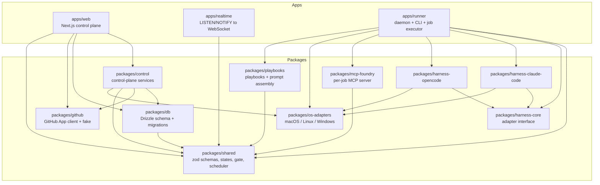
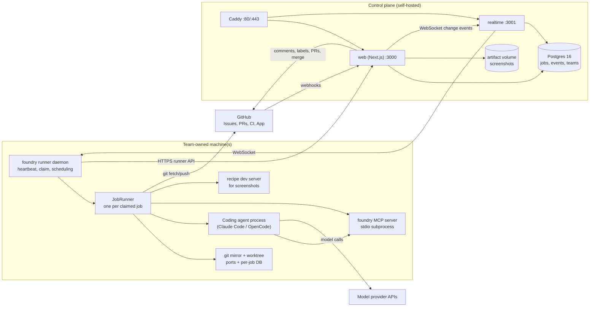
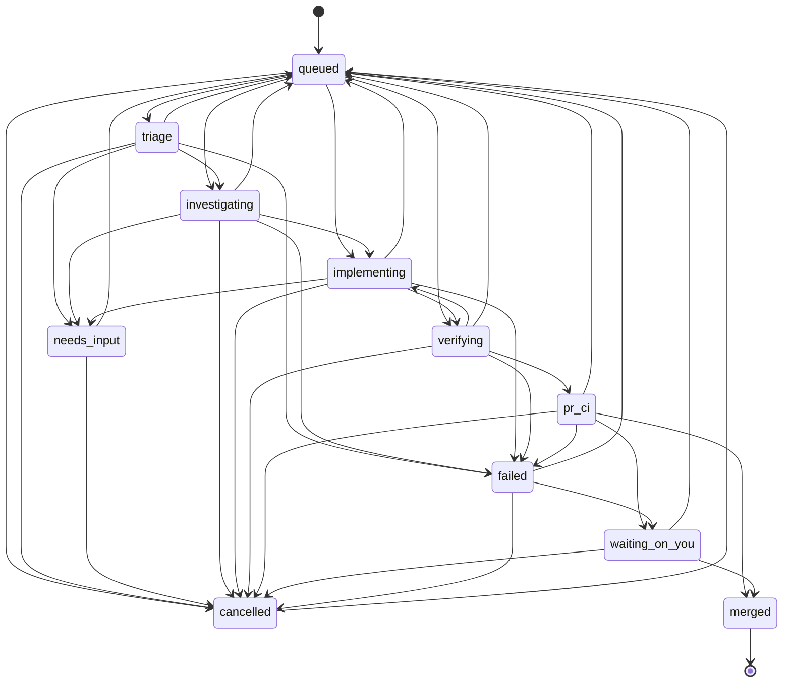
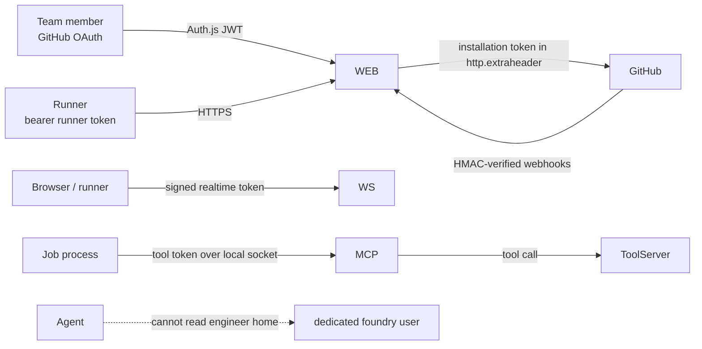
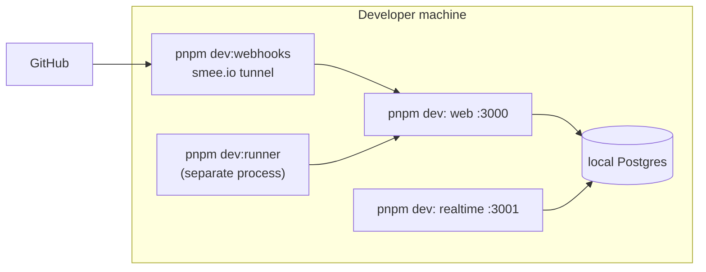
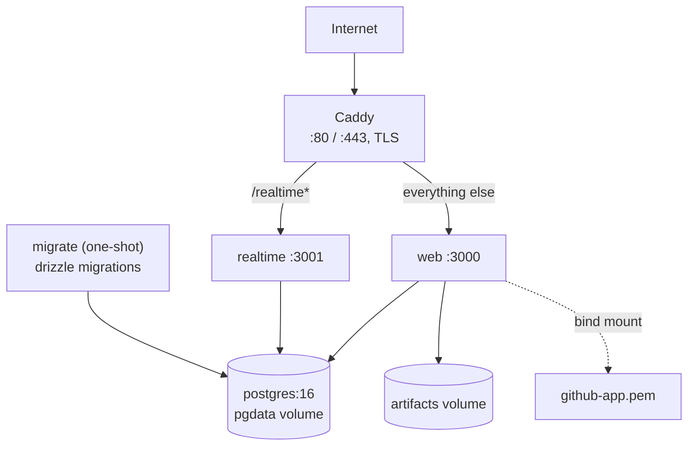

# Foundry — Overall Solution Design

> 中文版本: [overall-design.zh-CN.md](overall-design.zh-CN.md)

Status: current implementation · Applies to: Foundry 0.x (MVP) · Last reviewed: 2026-11-08

This document describes how Foundry is built today: the runtime components, how they talk to
each other, where state lives, how a job moves from a GitHub issue to a merged pull request, and
how the system is deployed. It is grounded in the source tree, not only in the product spec. When
this document and the code disagree, the code wins; update this document with the change.

Related documents:

- Product intent and scope: [`software-factory-product-spec.md`](../../software-factory-product-spec.md)
- Per-component design: [`components.md`](components.md)
- Core use cases and sequence diagrams: [`use-cases.md`](use-cases.md)
- Runner runtime decision: [`docs/adr/001-runner-runtime.md`](../adr/001-runner-runtime.md)
- Configuration and installation: [`docs/local-setup.md`](../local-setup.md)

---

## 1. What Foundry is

Foundry turns GitHub issues into verified, merged pull requests. A long-lived **runner** on a
team-owned machine claims a job, creates a git worktree, drives a coding agent (Claude Code or
OpenCode) through a fixed playbook, runs the repository's own checks, opens a pull request, and
applies a **confidence gate** that decides between auto-merge and human review.

Two properties shape the whole architecture:

1. **The control plane holds metadata, not source code.** Jobs, events, evidence metadata and
   screenshots pass through it; the repository checkout, credentials and any code the agent reads
   or writes stay on the runner machine.
2. **The pipeline is deterministic outside the model.** Stages, state transitions, scheduling,
   check execution, the merge gate and resume semantics are ordinary TypeScript. The model is
   called only for judgment inside a stage.

### 1.1 Actors

| Actor                      | Responsibility                                                                                                   |
| -------------------------- | ---------------------------------------------------------------------------------------------------------------- |
| **Team member**            | Files issues, answers questions, reviews or merges pull requests, configures repos.                              |
| **GitHub**                 | Issue source, App installation, pull requests, CI checks, reviews, notifications.                                |
| **Control plane**          | Authenticates users and runners, ingests webhooks, owns job state, schedules work, evaluates the gate, notifies. |
| **Runner**                 | Claims and executes jobs on a team machine; owns worktrees, ports, per-job services and the agent process.       |
| **Coding agent (harness)** | Reads and edits code inside one worktree and reports progress through Foundry MCP tools.                         |
| **Model provider**         | Serves the model used by the harness (Anthropic, OpenAI, Google, OpenRouter, self-hosted, …).                    |

---

## 2. Software architecture

### 2.1 Monorepo and packages

The repository is a pnpm workspace with Turborepo. Workspace packages are named
`@foundry/<name>` and export TypeScript source (not `dist`), so both the control plane and the
runner can share one set of types and schemas.



Dependency rules that keep the system testable:

- `packages/shared` depends only on zod, picomatch and small utilities. It must not import the
  database, GitHub or a harness.
- `packages/db` owns SQL and Drizzle; business rules do not live there.
- `packages/control` owns control-plane business rules and takes a `ControlContext` (database,
  GitHub client, notifier, clock, secret) so it can run in-process under Vitest.
- `apps/web` route handlers parse, authenticate, call `@foundry/control`, and return. They do not
  contain business rules.
- `apps/runner` is driven by `node:` APIs only; Bun is the runtime, not a source dependency. This
  lets Vitest run runner code under Node.
- Harnesses sit behind `HarnessAdapter`; adding a harness must not change the playbook, gate,
  scheduler or panel.

### 2.2 Runtime topology



Two process families exist:

**Control plane** (`apps/web`, `apps/realtime`, Postgres, Caddy). It is stateless apart from
Postgres and the artifact volume, and can be restarted freely. It runs in one Node process per
service; the web process also starts an in-process background worker.

**Runner** (`apps/runner`). It is a long-lived daemon installed on each machine. It owns local
state (git mirrors, worktrees, port leases, secrets, logs) and runs each claimed job in its own
in-process `JobRunner`, which in turn spawns harness processes.

### 2.3 Data flow

**Issue to job.** GitHub sends an `issues.labeled` webhook. `apps/web` verifies the signature,
stores the raw delivery in `webhook_inbox` and acknowledges immediately. The worker dispatches it;
`createJobFromIssue` inserts a `queued` job with a deterministic branch name and posts the first
status comment/label through the GitHub App.

**Claim.** A runner heartbeat returns the team's repos, a short-lived realtime token, revoked job
IDs, keep-IDs and per-job limits. The daemon then calls `POST /api/runner/claim`. The control plane
ranks eligible runners for each queued job and atomically hands the best job to this runner with a
`SELECT … FOR UPDATE SKIP LOCKED` update, recording `stage_changed` and optional `resumed` events.

**Execution.** `JobRunner` creates a worktree from the bare mirror, leases a port block, provisions
per-job services, starts the harness with the playbook as system prompt and the `foundry` MCP
server on stdio, and forwards normalized events to the control plane in batches
(`POST /api/runner/jobs/:id/events`).

**Progress and evidence.** Stage changes, plans, questions, evidence (checks and screenshots),
confidence and checkpoints each have a dedicated runner API action. The control plane validates
that the calling runner still owns the job and that the transition is legal in
`packages/shared/src/states.ts`.

**Pull request and gate.** At `verifying` the runner re-runs the recipe checks on the exact tree
that will be committed, commits and pushes the branch with a short-lived installation token, then
asks the control plane to open the PR. The control plane owns the PR body, reviewers and merge.
It evaluates the gate whenever CI, reviews or check status change.

**Realtime.** Postgres triggers emit `NOTIFY foundry_changes` with `{table, id, team_id, op}`.
`apps/realtime` fans that out over WebSocket to clients whose signed token carries the same
`teamId`. Clients then fetch rows through authenticated panel APIs. Runners listen only to know
that a job may be claimable.

### 2.4 Job state machine

The single source of truth is `packages/shared/src/states.ts`. Do not invent transitions.



`RUNNER_STAGES` are `triage`, `investigating`, `implementing`, `verifying`. Any state outside that
set is control-plane-owned. `queued` is the universal re-entry point: a paused, failed, cancelled
or human-requested change returns there with a `resumeStage`.

### 2.5 Data model

`packages/db/src/schema.ts` is the authoritative schema. The important tables:

| Table                              | Purpose                                                                                   |
| ---------------------------------- | ----------------------------------------------------------------------------------------- |
| `teams`                            | Team, defaults, daily spend cap, outgoing webhook.                                        |
| `users`, `memberships`, `invites`  | GitHub identities, roles, pending invitations.                                            |
| `repos`                            | Installation, repo, defaults, merge mode, cached `.foundry/` files, onboarding status.    |
| `runners`, `runner_repo_readiness` | Registered machines, capabilities, schedule/power state, per-recipe readiness.            |
| `jobs`                             | One row per unit of work: status, stage, branch, runner, resume state, cost, gate result. |
| `events`                           | Append-only job timeline (`stage_changed`, `usage`, `checkpoint`, `gate`, …).             |
| `questions`, `job_inputs`          | Ask-instead-of-guess questions and human input waiting for the agent.                     |
| `evidence`, `artifacts`            | Check results and screenshot/note artifacts plus signed-URL storage.                      |
| `webhook_inbox`                    | Verified raw GitHub deliveries, idempotent by delivery ID, retried by the worker.         |
| `notifications`                    | Delivery log per channel (push, email, webhook, digest).                                  |

SQL migrations live in `packages/db/migrations`; NOTIFY triggers and reporting views
(`metrics_job_facts`, `metrics_handover_waits`, `metrics_runner_busy`) are defined there.

### 2.6 Control-plane internals

`apps/web` starts an in-process worker from `instrumentation.node.ts` once `DATABASE_URL` and
`FOUNDRY_SECRET` are present. Every 30 seconds the worker:

1. Retries unprocessed webhook deliveries (up to 5 attempts).
2. Marks jobs merged when their GitHub PR is already merged.
3. Re-queues jobs whose PR has a pending "changes requested" review.
4. Creates jobs for open issues labeled `foundry` (catch-up when webhooks were down).
5. Re-queues jobs from runners that missed heartbeats for two minutes.
6. Sends the daily digest after the configured hour.

Everything executed by the worker is also callable on demand or from a route; `ControlContext`
injection (`setContextForTests`) lets the whole surface run against a throwaway database in tests.

### 2.7 Runner internals

The runner has a thin daemon and a heavy per-job executor:

| Module           | Responsibility                                                                                                             |
| ---------------- | -------------------------------------------------------------------------------------------------------------------------- |
| `daemon.ts`      | Heartbeat loop, schedule/power/disk gating, claim loop, realtime socket, sleep inhibitor, GC.                              |
| `job-runner.ts`  | Setup, harness session, stage enforcement, MCP tool handling, verify loop, PR/onboarding completion, checkpoints, cleanup. |
| `workspace.ts`   | Bare mirror per repo; `git worktree` per job; commit, diff, push, detached worktrees.                                      |
| `ports.ts`       | Leases a block of ten ports per job (`FOUNDRY_PORT` … `+9`).                                                               |
| `checks.ts`      | Runs recipe commands in their own process group with timeouts and output capture.                                          |
| `services.ts`    | Creates and drops per-job Postgres databases.                                                                              |
| `readiness.ts`   | Proves a recipe on this machine in a detached worktree before accepting its jobs.                                          |
| `tool-server.ts` | Local Unix socket (or loopback TCP on Windows) behind the stdio MCP server.                                                |
| `state.ts`       | Local job memory (worktree, session ID, port, parked/running) for sticky resume and GC.                                    |
| `scrub.ts`       | Redacts known values and token patterns before anything leaves the machine.                                                |
| `brief.ts`       | Pushes/fetches the handoff brief to `refs/foundry/<job-id>/brief`.                                                         |
| `gc.ts`          | Removes stale worktrees, leases and local job records.                                                                     |

### 2.8 Trust boundaries and security



- **Users** authenticate with GitHub through Auth.js; sessions are JWTs. Runner tokens are random,
  stored only as SHA-256 hashes. Join, realtime and artifact URLs use HMAC-signed expiring tokens.
- **GitHub** webhooks are verified against `x-hub-signature-256` before parsing. Installation
  tokens are created per call and passed to git in `http.extraheader`, never written into a remote
  URL or argv that error messages print.
- **Secrets** live in the OS secret store (Keychain, `systemd-creds`, or a `0600` file for a second
  home). Values matching secret-shaped env names and common token patterns are scrubbed from event
  text, check output and the harness transcript.
- **The agent** may not run policy-denied commands (`git push`, `rm -rf /`, `sudo` by default),
  may be denied web access, and is instructed to stay inside the worktree. The runner performs
  every git push itself.
- **Isolation** is per job: worktree, port block, process group, optional per-job database, and
  resource limits where the OS supports them (cgroups v2 on Linux; best-effort `nice` on macOS and
  Windows).
- **The control plane** never receives repository contents. Screenshots and notes are the only
  uploaded artifacts, and artifact URLs are signed.

### 2.9 Failure and recovery model

| Failure                                  | Detection                                             | Recovery                                                                                                                              |
| ---------------------------------------- | ----------------------------------------------------- | ------------------------------------------------------------------------------------------------------------------------------------- |
| Runner crashes or sleeps                 | Missing heartbeats for `HEARTBEAT_TIMEOUT_MS` (120 s) | Sweeper re-queues the job at the stage after `lastCompletedStage`; a 10-minute sticky window first offers it back to the same runner. |
| Runner shuts down or leaves its schedule | `daemon.stop()` / schedule transition                 | `JobRunner.pause()` completes the current turn, checkpoints, pushes branch + brief, and returns the job to `queued`.                  |
| Agent stops early                        | Harness turn ends without `stage(done)`               | Runner nudges up to two times, then fails the job with a clear reason.                                                                |
| Verify checks fail                       | Non-zero exit in the trusted check run                | Loop back to `implementing` up to `max_verify_loops` (default 3); the failure output is sent to the agent.                            |
| Agent asks a question                    | `ask` MCP tool                                        | Job parks in `needs_input`, worktree and session are kept; answer re-queues it.                                                       |
| Budget exceeded                          | Usage events, wall clock, spend cap                   | Agent stops, job fails with the budget reason; a limit change is pushed through the heartbeat.                                        |
| Webhook lost                             | Worker catch-up                                       | Labeled issues, merged PRs and changes-requested reviews are reconciled every 30 s.                                                   |
| Duplicate webhook                        | `webhook_inbox` unique key                            | Stored once; duplicates are ignored.                                                                                                  |
| Worktree left behind                     | Hourly GC + startup GC                                | Worktrees for finished jobs and stale parked jobs are removed; a free-disk floor pauses claims.                                       |

### 2.10 Why these choices

| Choice                              | Rationale                                                                                                              | Consequence                                                                        |
| ----------------------------------- | ---------------------------------------------------------------------------------------------------------------------- | ---------------------------------------------------------------------------------- |
| TypeScript everywhere, one monorepo | One definition of job states, events, recipe/policy and API contracts; runner and control plane cannot drift silently. | Strict types, shared zod schemas at every boundary.                                |
| Deterministic pipeline + LLM stages | Repeated work is code; the model is used for judgment. Jobs are reproducible and measurable.                           | Playbook and stage order are fixed; harnesses are interchangeable.                 |
| Local execution with git worktrees  | Code, secrets and compute stay on team machines; no sandbox bill.                                                      | The system must handle laptops disappearing (checkpoints, sticky/portable resume). |
| Control plane stores metadata only  | Reduces blast radius and keeps credentials local.                                                                      | Evidence is limited to checks, notes and screenshots.                              |
| Postgres as queue and event log     | Atomic claiming with `SKIP LOCKED`, LISTEN/NOTIFY for push, append-only events for metrics.                            | A single Postgres is a scaling boundary (fine for the target team size).           |
| Bun-compiled runner                 | One executable per platform, no Node toolchain on user machines.                                                       | Runner source must use only `node:` APIs so Vitest can run it under Node.          |
| Harness adapter interface           | Claude Code and OpenCode differ in transport and event shape.                                                          | Progress reporting goes through the shared MCP tools, not harness parsing.         |

---

## 3. Deployment architecture

### 3.1 Local development



- `pnpm dev` runs only web and realtime. The runner is separate and must be joined first.
- `pnpm dev:webhooks` forwards GitHub deliveries through smee.io to `/api/webhooks/github`.
- The GitHub App's Homepage, Callback, Setup and Webhook URLs point at localhost/smee.
- Tests use a separate Postgres database created on demand (`FOUNDRY_TEST_DATABASE_URL`).

### 3.2 Production: Docker Compose

`deploy/compose.yaml` is the supported single-host deployment.



Startup order: Postgres becomes healthy, the one-shot `migrate` service applies migrations, then
web and realtime start, then Caddy. Caddy obtains certificates for `FOUNDRY_DOMAIN` and proxies
`/realtime*` to the realtime service and everything else to web.

Production requirements:

- Set `FOUNDRY_DOMAIN`, `POSTGRES_PASSWORD`, `FOUNDRY_SECRET`, GitHub App credentials, OAuth
  credentials and `AUTH_SECRET` in `.env`.
- Point the GitHub App's Homepage, Callback, Setup and Webhook URLs at the public domain.
- Bind-mount `github-app.pem` (already in the compose file) or provide the key path.
- Artifacts are stored on the `artifacts` volume; back it up if screenshots matter.
- Without Docker, run the same processes behind any TLS reverse proxy: `pnpm build`, then
  `pnpm --filter @foundry/web start`, the realtime service and Postgres.

### 3.3 Runner deployment

Runners are installed separately from the control plane:

```bash
foundry runner join <fdj_token> --server https://foundry.example.com
foundry runner install-service          # per-user service, starts on login
# shared box:
sudo foundry runner install-service --system --user foundry
```

- macOS uses launchd (`dev.foundry.runner.<name>`); Linux uses a systemd unit
  (`foundry-runner-<name>.service`); Windows writes a Startup `.cmd`.
- Each daemon needs a unique `--name` and, for a second daemon on the same login, a unique
  `--home`. Two daemons must not share a home.
- A runner's schedule (AC-only, idle pause, time windows, weekends) gates claims locally and is
  reported to the control plane in the heartbeat.
- A runner only claims repos it has proven ready for the current recipe (`runner_repo_readiness`),
  and only when it has the requested harness installed and signed in.
- Windows runners run recipe commands through PowerShell and serve the MCP bridge over loopback
  TCP instead of a Unix socket.

### 3.4 Ports and networking

| Port                    | Service         | Notes                                                             |
| ----------------------- | --------------- | ----------------------------------------------------------------- |
| 80 / 443                | Caddy           | Public entry point in compose.                                    |
| 3000                    | `apps/web`      | Panel, API, webhooks.                                             |
| 3001                    | `apps/realtime` | WebSocket fan-out (`/realtime` behind Caddy).                     |
| 5432                    | Postgres        | Bound to `127.0.0.1` in compose.                                  |
| 41000–42999             | job port blocks | Leased by each runner; `FOUNDRY_PORT` through `FOUNDRY_PORT_END`. |
| 127.0.0.1:<port>        | OpenCode server | One per job on a leased port.                                     |
| Unix socket / 127.0.0.1 | MCP bridge      | `FOUNDRY_MCP_SOCKET` or `FOUNDRY_MCP_URL`.                        |

Outbound HTTP (GitHub, model APIs, mail, webhooks, git) goes through `FOUNDRY_HTTP_PROXY` when
set, then `HTTPS_PROXY`/`HTTP_PROXY`, then the macOS system proxy. Localhost and
`FOUNDRY_NO_PROXY` are excluded. Git network commands also receive proxy arguments. Test fixtures
using `file://` remotes bypass the proxy.

### 3.5 Scaling and availability

The current design targets a small team (2–20 engineers) and one control-plane host:

- **Runners scale horizontally.** More machines, more `--concurrency`, or more daemons add
  capacity. Claiming is race-free through `SKIP LOCKED`.
- **The control plane is a single Postgres.** Web and realtime can be restarted independently;
  the in-process worker means more than one web replica would duplicate sweeper work, so scale
  vertically first. A future version can move the worker to a single leader.
- **Availability is best-effort.** A shared always-on runner is recommended; laptops are supported
  but must expect sleep, network loss and re-queueing.
- **Measurement is built in.** `events` plus the `metrics_*` views drive the metrics page; the
  capacity card estimates queue time that a shared runner would have saved.

### 3.6 Non-functional properties

| Property          | Implementation                                                                                                                                                                          |
| ----------------- | --------------------------------------------------------------------------------------------------------------------------------------------------------------------------------------- |
| **Security**      | Verified webhooks, hashed runner tokens, expiring signed URLs, installation tokens in headers, secret scrubbing, denied commands, dedicated OS user, optional per-job containers later. |
| **Privacy**       | Control plane sees metadata, events, log tails and evidence, not source code; repo env values stay on the runner.                                                                       |
| **Reliability**   | Idempotent webhook inbox, atomic claim, stage checkpoints, heartbeat sweeper, catch-up reconciliation.                                                                                  |
| **Observability** | Append-only events per job, live panel log, harness transcript on the runner, metrics views, notifications.                                                                             |
| **Cost control**  | Per-job cost and wall-clock caps, team daily spend cap, verify-loop limit, stop while waiting for a human.                                                                              |
| **Portability**   | macOS and Linux runners, Bun-compiled binary, self-hosted control plane, GHES support through `GITHUB_HOST`.                                                                            |
| **Testability**   | Fakes for GitHub and harnesses, in-memory notifier, injectable control context, git fixtures with `FOUNDRY_GIT_BASE`, Playwright for the panel.                                         |

---

## 4. Known limitations

- One GitHub host per control plane; one team workspace per deployment.
- The worker runs inside the web process; multiple web replicas would duplicate periodic work.
- Artifacts are local to the control-plane host (a shared volume, not object storage).
- Laptop-only teams cannot guarantee throughput; the capacity card is informational.
- Windows runner support is functional but newer than macOS/Linux (no idle detection, best-effort
  limits).
- The MVP gate is rule-based and fixed; programmable gates, black-box acceptance suites and
  adversarial reviewers are later modules.

## 5. Changing this design

When a change alters a boundary described here:

1. Update the code and tests first.
2. Update `software-factory-product-spec.md` if product behavior changes.
3. Update this document and `components.md` / `use-cases.md` in the same pull request, in both
   languages.
4. If the change is an architectural decision with real trade-offs, add an ADR under `docs/adr/`.
