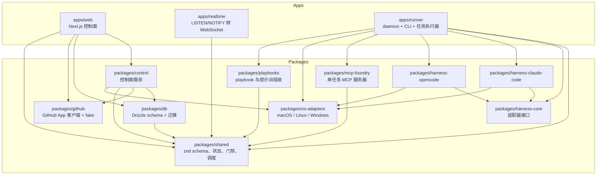
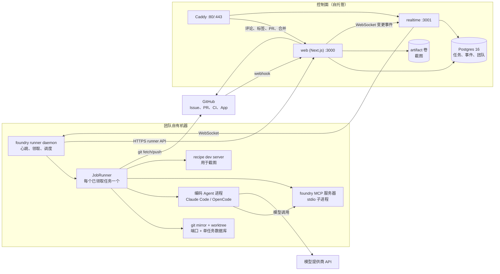
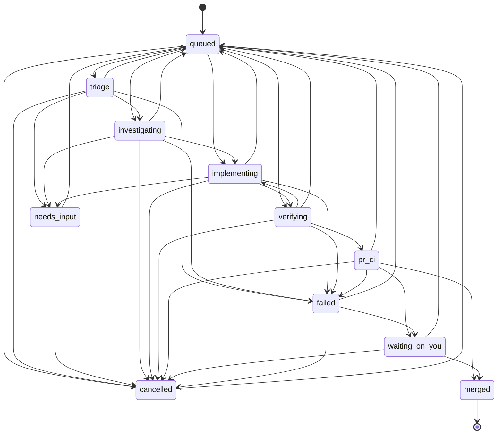
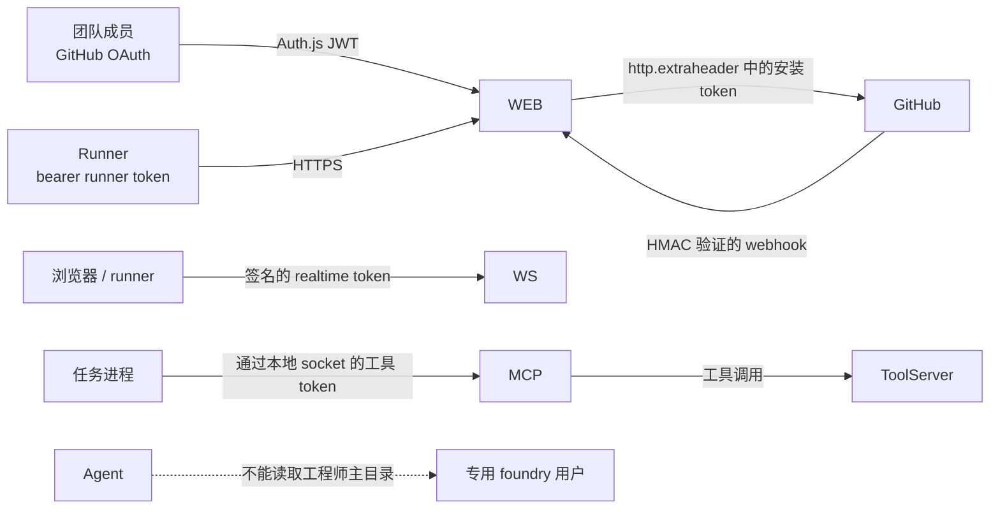
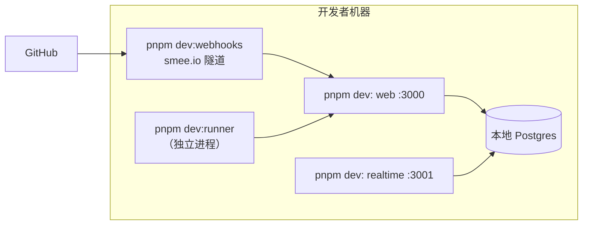
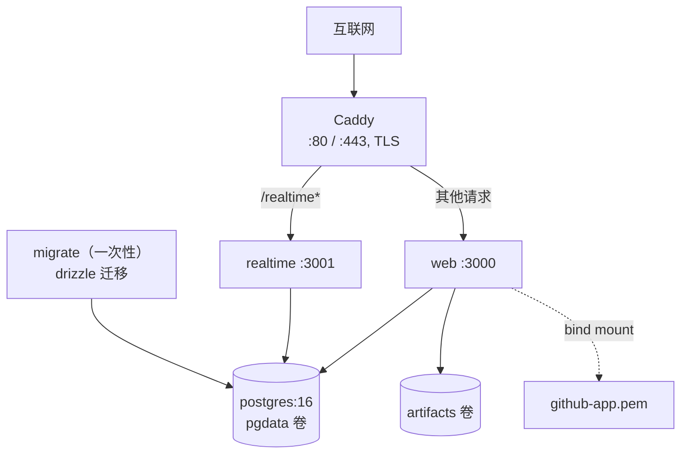

# Foundry — 总体方案设计

> English: [overall-design.md](overall-design.md)

状态：当前实现 · 适用版本：Foundry 0.x（MVP） · 最后审阅：2026-11-08

本文说明 Foundry 目前的实际构建方式：运行时组件、组件之间如何通信、状态保存在哪里、一个任务如何
从 GitHub issue 变成已合并的 pull request，以及系统如何部署。内容以源码为准，而不是只依据产品规格。
如果本文与代码不一致，以代码为准；修改代码时请同步更新本文。

相关文档：

- 产品目标与范围：[`software-factory-product-spec.zh-CN.md`](../../software-factory-product-spec.zh-CN.md)
- 组件设计：[`components.zh-CN.md`](components.zh-CN.md)
- 核心用例与序列图：[`use-cases.zh-CN.md`](use-cases.zh-CN.md)
- Runner 运行时决策：[`docs/adr/001-runner-runtime.zh-CN.md`](../adr/001-runner-runtime.zh-CN.md)
- 配置与安装：[`docs/local-setup.zh-CN.md`](../local-setup.zh-CN.md)
- 面板视觉设计系统（设计令牌与说明）：[`DESIGN.md`](../../DESIGN.md)

---

## 1. Foundry 是什么

Foundry 把 GitHub issue 转化为经过验证、已经合并的 pull request。团队自己机器上的长期运行
**runner** 会领取任务、创建 git worktree、驱动编码 Agent（Claude Code 或 OpenCode）按照固定
playbook 工作、运行仓库自己的检查、创建 pull request，然后由**置信度门禁（confidence gate）**
决定自动合并还是交给人工审查。

两个特性决定了整体架构：

1. **控制面只保存元数据，不保存源代码。** 任务、事件、证据元数据和截图会经过控制面；仓库检出、
   凭据以及 Agent 读写的代码都留在 runner 机器上。
2. **模型之外的部分是确定性的。** 阶段、状态转换、调度、检查执行、合并门禁和恢复语义都是普通
   TypeScript。只有阶段内部需要判断时才调用模型。

### 1.1 参与者

| 参与者                    | 职责                                                                          |
| ------------------------- | ----------------------------------------------------------------------------- |
| **团队成员**              | 创建 issue、回答问题、审查或合并 pull request、配置仓库。                     |
| **GitHub**                | Issue 来源、App 安装、pull request、CI 检查、审查、通知。                     |
| **控制面**                | 认证用户和 runner、接收 webhook、维护任务状态、调度工作、评估门禁、发送通知。 |
| **Runner**                | 在团队机器上领取并执行任务；负责 worktree、端口、单任务服务和 Agent 进程。    |
| **编码 Agent（harness）** | 在一个 worktree 内读取和修改代码，并通过 Foundry MCP 工具汇报进度。           |
| **模型提供商**            | 为 harness 提供模型（Anthropic、OpenAI、Google、OpenRouter、自托管等）。      |

---

## 2. 软件架构

### 2.1 Monorepo 与包

仓库是一个 pnpm workspace，使用 Turborepo 管理。工作区包名为 `@foundry/<name>`，直接导出
TypeScript 源码（而不是 `dist`），这样控制面和 runner 可以共享同一套类型和 schema。



保持系统可测试的依赖规则：

- `packages/shared` 只依赖 zod、picomatch 等小型工具库；不得导入数据库、GitHub 或 harness。
- `packages/db` 负责 SQL 和 Drizzle；业务规则不放在这里。
- `packages/control` 负责控制面业务规则，接收 `ControlContext`（数据库、GitHub 客户端、通知器、
  时钟、密钥），因此可以在 Vitest 中进程内运行。
- `apps/web` 的路由处理器只做解析、认证、调用 `@foundry/control`、返回结果，不包含业务规则。
- `apps/runner` 只使用 `node:` API；Bun 是运行时而不是源码依赖。这样 Vitest 可以用 Node 运行
  runner 代码。
- 所有 harness 都位于 `HarnessAdapter` 之后；新增 harness 不应修改 playbook、门禁、调度器或面板。

### 2.2 运行时拓扑



系统有两类进程：

**控制面**（`apps/web`、`apps/realtime`、Postgres、Caddy）。除了 Postgres 和 artifact 卷之外
无状态，可以自由重启。每个服务一个 Node 进程；web 进程还会启动一个进程内后台 worker。

**Runner**（`apps/runner`）。安装在每台机器上的长期运行 daemon，负责本地状态（git mirror、
worktree、端口租约、密钥、日志），每个已领取的任务在进程内由独立的 `JobRunner` 执行，后者再启动
harness 进程。

### 2.3 数据流

**Issue 到任务。** GitHub 发送 `issues.labeled` webhook。`apps/web` 验证签名，把原始投递存入
`webhook_inbox` 并立即确认。worker 随后分发；`createJobFromIssue` 插入一个 `queued` 任务，生成
确定性的分支名，并通过 GitHub App 发布第一条状态评论和标签。

**领取。** runner 心跳会返回团队仓库、短期 realtime token、被撤销的任务 ID、需要保留的任务 ID
以及单任务限制。daemon 随后调用 `POST /api/runner/claim`。控制面为每个排队任务对合格 runner
排序，并用 `SELECT … FOR UPDATE SKIP LOCKED` 原子地把最佳任务交给该 runner，同时记录
`stage_changed` 和可选的 `resumed` 事件。

**执行。** `JobRunner` 从 bare mirror 创建 worktree、租用端口块、准备单任务服务、以 playbook
作为系统提示启动 harness，并通过 stdio 挂载 `foundry` MCP 服务器，然后把规范化事件分批发送到控制面
（`POST /api/runner/jobs/:id/events`）。

**进度与证据。** 阶段变更、计划、问题、证据（检查和截图）、置信度和检查点都有专门的 runner
API 动作。控制面会校验调用 runner 仍然拥有该任务，并校验状态转换在
`packages/shared/src/states.ts` 中合法。

**Pull request 与门禁。** 在 `verifying` 阶段，runner 对将要提交的确切工作树重新运行 recipe
检查，使用短期安装 token 提交并推送分支，然后请求控制面创建 PR。控制面负责 PR 正文、审查者和合并。
每当 CI、审查或检查状态变化时，控制面都会重新评估门禁。

**实时更新。** Postgres 触发器发出 `NOTIFY foundry_changes`，负载为 `{table, id, team_id, op}`。
`apps/realtime` 通过 WebSocket 仅向签名 token 中 `teamId` 相同的客户端广播。客户端随后通过带认证
的面板 API 拉取行数据。runner 只监听“可能有任务可领取”的信号。

### 2.4 任务状态机

唯一事实来源是 `packages/shared/src/states.ts`。不要自行发明状态转换。



`RUNNER_STAGES` 是 `triage`、`investigating`、`implementing`、`verifying`。不在该集合中的状态由
控制面负责。`queued` 是统一的重入点：暂停、失败、取消或人工要求修改的任务都会带着 `resumeStage`
回到这里。

### 2.5 数据模型

`packages/db/src/schema.ts` 是权威 schema。重要的表：

| 表                                 | 用途                                                                      |
| ---------------------------------- | ------------------------------------------------------------------------- |
| `teams`                            | 团队、默认值、每日花费上限、外发 webhook。                                |
| `users`、`memberships`、`invites`  | GitHub 身份、角色、待接受邀请。                                           |
| `repos`                            | 安装、仓库、默认值、合并模式、缓存的 `.foundry/` 文件、onboarding 状态。  |
| `runners`、`runner_repo_readiness` | 已注册机器、能力、调度/电源状态、按 recipe 的就绪状态。                   |
| `jobs`                             | 每个工作单元一行：状态、阶段、分支、runner、恢复状态、成本、门禁结果。    |
| `events`                           | 只追加的任务时间线（`stage_changed`、`usage`、`checkpoint`、`gate` 等）。 |
| `questions`、`job_inputs`          | “先问不猜”的问题，以及等待投递给 Agent 的人工输入。                       |
| `evidence`、`artifacts`            | 检查结果、截图/备注 artifact 及签名 URL 存储。                            |
| `webhook_inbox`                    | 已验证的原始 GitHub 投递，按 delivery ID 幂等，由 worker 重试。           |
| `notifications`                    | 每个渠道（push、email、webhook、digest）的投递日志。                      |

SQL 迁移位于 `packages/db/migrations`；NOTIFY 触发器和报表视图
（`metrics_job_facts`、`metrics_handover_waits`、`metrics_runner_busy`）也定义在那里。

### 2.6 控制面内部结构

当 `DATABASE_URL` 和 `FOUNDRY_SECRET` 存在时，`apps/web` 会从 `instrumentation.node.ts` 启动
进程内 worker。worker 每 30 秒执行一次：

1. 重试未处理的 webhook 投递（最多 5 次）。
2. 如果 GitHub 上的 PR 已合并，则把任务标记为 `merged`。
3. 如果 PR 上存在待处理的 “changes requested” 审查，则重新排队任务。
4. 为仍处于打开状态且带有 `foundry` 标签的 issue 创建任务（webhook 中断后的补偿）。
5. 对超过两分钟未心跳的 runner，重新排队其任务。
6. 到达配置时间后发送每日摘要。

worker 执行的所有操作也可以按需调用或从路由调用；通过 `setContextForTests` 注入
`ControlContext`，可以在测试中针对一次性数据库运行整个接口面。

### 2.7 Runner 内部结构

Runner 有一个轻量 daemon 和一个较重的单任务执行器：

| 模块             | 职责                                                                                       |
| ---------------- | ------------------------------------------------------------------------------------------ |
| `daemon.ts`      | 心跳循环、调度/电源/磁盘门控、领取循环、realtime socket、睡眠抑制、GC。                    |
| `job-runner.ts`  | 初始化、harness 会话、阶段强制、MCP 工具处理、验证循环、PR/onboarding 完成、检查点、清理。 |
| `workspace.ts`   | 每仓库一个 bare mirror；每任务一个 `git worktree`；提交、diff、推送、detached worktree。   |
| `ports.ts`       | 为每个任务租用十个端口（`FOUNDRY_PORT` … `+9`）。                                          |
| `checks.ts`      | 在独立进程组中运行 recipe 命令，带超时和输出捕获。                                         |
| `services.ts`    | 创建和删除单任务 Postgres 数据库。                                                         |
| `readiness.ts`   | 在 detached worktree 中证明 recipe 在本机可用，然后才接受该仓库的任务。                    |
| `tool-server.ts` | stdio MCP 服务器背后的本地 Unix socket（Windows 上为回环 TCP）。                           |
| `state.ts`       | 本地任务记忆（worktree、session ID、端口、parked/running），用于 sticky resume 和 GC。     |
| `scrub.ts`       | 在内容离开机器前，按已知值和 token 模式脱敏。                                              |
| `brief.ts`       | 把交接简报推送到 `refs/foundry/<job-id>/brief` 并读取。                                    |
| `gc.ts`          | 清理过期 worktree、端口租约和本地任务记录。                                                |

### 2.8 信任边界与安全



- **用户**通过 Auth.js 使用 GitHub 登录；会话是 JWT。runner token 是随机值，只保存 SHA-256
  哈希。Join、realtime 和 artifact URL 使用 HMAC 签名的过期 token。
- **GitHub** webhook 在解析前校验 `x-hub-signature-256`。安装 token 按调用创建，并通过
  `http.extraheader` 传给 git，绝不写入 remote URL 或错误信息会打印的 argv。
- **密钥**保存在操作系统密钥库（Keychain、`systemd-creds`，或第二个 home 的 `0600` 文件）。
  名称像密钥的环境变量值和常见 token 模式会从事件文本、检查输出和 harness 记录中脱敏。
- **Agent** 不得运行策略禁止的命令（默认 `git push`、`rm -rf /`、`sudo`），可以被禁止访问网络，
  并且被要求留在 worktree 内。所有 git push 都由 runner 自己执行。
- **隔离**按任务进行：worktree、端口块、进程组、可选的单任务数据库，以及操作系统支持的资源限制
  （Linux 上 cgroups v2；macOS/Windows 上尽力而为的 `nice`）。
- **控制面**从不接收仓库内容。上传的 artifact 只有截图和备注，且 artifact URL 是签名的。

### 2.9 失败与恢复模型

| 失败                      | 检测方式                                    | 恢复方式                                                                                |
| ------------------------- | ------------------------------------------- | --------------------------------------------------------------------------------------- |
| Runner 崩溃或睡眠         | 超过 `HEARTBEAT_TIMEOUT_MS`（120 秒）未心跳 | Sweeper 在 `lastCompletedStage` 之后的阶段重新排队；先给原 runner 10 分钟 sticky 窗口。 |
| Runner 关闭或离开调度窗口 | `daemon.stop()` / 调度状态变化              | `JobRunner.pause()` 完成当前回合、写检查点、推送分支和简报，然后把任务退回 `queued`。   |
| Agent 提前停止            | harness 回合结束但没有 `stage(done)`        | runner 最多提醒两次，然后以明确原因使任务失败。                                         |
| 验证检查失败              | 受信任检查运行返回非零                      | 回到 `implementing`，最多 `max_verify_loops`（默认 3）次；失败输出发送给 Agent。        |
| Agent 提问                | `ask` MCP 工具                              | 任务停在 `needs_input`，保留 worktree 和会话；回答后重新排队。                          |
| 超出预算                  | usage 事件、墙钟时间、花费上限              | 停止 Agent，任务以预算原因失败；限制变更通过心跳推送。                                  |
| Webhook 丢失              | worker 补偿                                 | 每 30 秒核对带标签的 issue、已合并 PR 和 changes-requested 审查。                       |
| 重复 webhook              | `webhook_inbox` 唯一键                      | 只存一次；重复项忽略。                                                                  |
| Worktree 残留             | 每小时 GC + 启动 GC                         | 删除已完成任务和过期 parked 任务的 worktree；磁盘下限会暂停领取。                       |

### 2.10 为什么这样选择

| 选择                            | 理由                                                                               | 影响                                                           |
| ------------------------------- | ---------------------------------------------------------------------------------- | -------------------------------------------------------------- |
| 全栈 TypeScript，单一 monorepo  | 任务状态、事件、recipe/policy 和 API 契约只定义一次；runner 与控制面不会悄悄漂移。 | 严格类型，所有边界使用共享 zod schema。                        |
| 确定性流水线 + LLM 阶段         | 重复工作写成代码，模型只用于判断；任务可复现、可度量。                             | playbook 和阶段顺序固定；harness 可互换。                      |
| 本地执行 + git worktree         | 代码、密钥和算力留在团队机器上；没有沙箱账单。                                     | 系统必须处理笔记本随时离线（检查点、sticky/portable resume）。 |
| 控制面只存元数据                | 缩小影响范围，凭据留在本地。                                                       | 证据仅限于检查、备注和截图。                                   |
| Postgres 同时作为队列和事件日志 | 用 `SKIP LOCKED` 原子领取，用 LISTEN/NOTIFY 推送，用只追加事件做度量。             | 单个 Postgres 是扩展边界（对目标团队规模足够）。               |
| Bun 编译 Runner                 | 每个平台一个可执行文件，用户机器无需 Node 工具链。                                 | runner 源码只能使用 `node:` API，以便 Vitest 在 Node 下运行。  |
| Harness 适配器接口              | Claude Code 和 OpenCode 的传输与事件结构不同。                                     | 进度汇报统一走共享 MCP 工具，而不是解析 harness 特有事件。     |

---

## 3. 部署架构

### 3.1 本地开发



- `pnpm dev` 只启动 web 和 realtime。runner 是独立进程，必须先 join。
- `pnpm dev:webhooks` 通过 smee.io 把 GitHub 投递转发到 `/api/webhooks/github`。
- GitHub App 的 Homepage、Callback、Setup 和 Webhook URL 指向 localhost/smee。
- 测试使用按需创建的另一套 Postgres 数据库（`FOUNDRY_TEST_DATABASE_URL`）。

### 3.2 生产环境：Docker Compose

`deploy/compose.yaml` 是受支持的单机部署方式。



启动顺序：Postgres 健康后，一次性 `migrate` 服务执行迁移，然后启动 web 和 realtime，最后启动
Caddy。Caddy 为 `FOUNDRY_DOMAIN` 获取证书，把 `/realtime*` 代理到 realtime，其余请求代理到 web。

生产环境要求：

- 在 `.env` 中设置 `FOUNDRY_DOMAIN`、`POSTGRES_PASSWORD`、`FOUNDRY_SECRET`、GitHub App 凭据、
  OAuth 凭据和 `AUTH_SECRET`。
- 把 GitHub App 的 Homepage、Callback、Setup 和 Webhook URL 指向公开域名。
- 挂载 `github-app.pem`（compose 文件已包含）或提供密钥路径。
- Artifact 保存在 `artifacts` 卷上；如果截图重要，请备份该卷。
- 不使用 Docker 时，可以把相同进程放在任意 TLS 反向代理后面：先 `pnpm build`，再运行
  `pnpm --filter @foundry/web start`、realtime 服务和 Postgres。

### 3.3 Runner 部署

Runner 与控制面分开安装：

```bash
foundry runner join <fdj_token> --server https://foundry.example.com
foundry runner install-service          # 用户级服务，登录时启动
# 共享机器：
sudo foundry runner install-service --system --user foundry
```

- macOS 使用 launchd（`dev.foundry.runner.<name>`）；Linux 使用 systemd 单元
  （`foundry-runner-<name>.service`）；Windows 写入 Startup `.cmd`。
- 每个 daemon 需要唯一的 `--name`；同一登录下的第二个 daemon 还需要唯一的 `--home`。两个 daemon
  不得共享 home。
- Runner 的本地调度（仅交流电、空闲暂停、时间窗口、周末）在本地控制是否领取，并通过心跳上报控制面。
- Runner 只领取它在当前 recipe 下已证明就绪的仓库（`runner_repo_readiness`），并且只在安装了所需
  harness 且已登录时才领取。
- Windows runner 通过 PowerShell 执行 recipe 命令，并使用回环 TCP 而不是 Unix socket 提供 MCP 桥。

### 3.4 端口与网络

| 端口                    | 服务            | 说明                                                     |
| ----------------------- | --------------- | -------------------------------------------------------- |
| 80 / 443                | Caddy           | compose 中的公网入口。                                   |
| 3000                    | `apps/web`      | 面板、API、webhook。                                     |
| 3001                    | `apps/realtime` | WebSocket 广播（Caddy 后的 `/realtime`）。               |
| 5432                    | Postgres        | compose 中绑定 `127.0.0.1`。                             |
| 41000–42999             | 任务端口块      | 每个 runner 租用；`FOUNDRY_PORT` 到 `FOUNDRY_PORT_END`。 |
| 127.0.0.1:<port>        | OpenCode 服务器 | 每个任务一个，使用租用端口。                             |
| Unix socket / 127.0.0.1 | MCP 桥          | `FOUNDRY_MCP_SOCKET` 或 `FOUNDRY_MCP_URL`。              |

出站 HTTP（GitHub、模型 API、邮件、webhook、git）在设置了 `FOUNDRY_HTTP_PROXY` 时走该代理，否则
依次使用 `HTTPS_PROXY`/`HTTP_PROXY`，最后使用 macOS 系统代理。localhost 和 `FOUNDRY_NO_PROXY`
被排除。git 网络命令也会收到代理参数。使用 `file://` remote 的测试 fixture 绕过代理。

### 3.5 扩展性与可用性

当前设计面向小团队（2–20 名工程师）和一台控制面主机：

- **Runner 可以水平扩展。** 增加机器、提高 `--concurrency` 或增加 daemon 都能增加容量。领取通过
  `SKIP LOCKED` 避免竞争。
- **控制面只有一个 Postgres。** web 和 realtime 可以独立重启；worker 在 web 进程内，部署多个
  web 副本会重复执行周期性补偿，因此应优先纵向扩展。未来版本可以把 worker 拆成单 leader。
- **可用性是尽力而为。** 推荐一台常在线共享 runner；笔记本也受支持，但必须预期睡眠、断网和重排。
- **度量内建。** `events` 加上 `metrics_*` 视图驱动指标页面；容量卡片估算共享 runner 本可节省的
  排队时间。

### 3.6 非功能属性

| 属性         | 实现                                                                                                                         |
| ------------ | ---------------------------------------------------------------------------------------------------------------------------- |
| **安全**     | 验证 webhook、哈希 runner token、过期签名 URL、header 中的安装 token、密钥脱敏、禁止命令、专用 OS 用户，后续可选单任务容器。 |
| **隐私**     | 控制面只看到元数据、事件、日志尾部和证据，不看到源代码；仓库环境变量留在 runner。                                            |
| **可靠性**   | 幂等 webhook inbox、原子领取、阶段检查点、心跳 sweeper、补偿核对。                                                           |
| **可观测性** | 每个任务只追加事件、面板实时日志、runner 上的 harness 记录、指标视图、通知。                                                 |
| **成本控制** | 单任务成本和墙钟上限、团队每日花费上限、验证循环上限、等待人工时停止 Agent。                                                 |
| **可移植性** | macOS 和 Linux runner、Bun 编译二进制、自托管控制面、通过 `GITHUB_HOST` 支持 GHES。                                          |
| **可测试性** | GitHub 和 harness fake、内存通知器、可注入控制上下文、`FOUNDRY_GIT_BASE` git fixture、面板 Playwright 测试。                 |

---

## 4. 已知限制

- 每个控制面只连接一个 GitHub host；每个部署一个团队工作区。
- worker 运行在 web 进程内；多个 web 副本会重复执行周期性工作。
- Artifact 位于控制面主机本地（共享卷，而不是对象存储）。
- 仅笔记本团队无法保证吞吐量；容量卡片只是信息提示。
- Windows runner 可用，但比 macOS/Linux 更新（无空闲检测，限制为尽力而为）。
- MVP 门禁是固定规则；可编程门禁、黑盒验收套件和对抗式审查者属于后续模块。

## 5. 修改本设计

当变更影响本文描述的边界时：

1. 先修改代码和测试。
2. 如果产品行为变化，更新 `software-factory-product-spec.zh-CN.md`。
3. 在同一个 pull request 中更新本文以及 `components.zh-CN.md` / `use-cases.zh-CN.md`，两种语言
   同步更新。
4. 如果变更是有真实取舍的架构决策，在 `docs/adr/` 下新增 ADR。
