# Foundry — Core Use Cases and Detailed Design

> 中文版本: [use-cases.zh-CN.md](use-cases.zh-CN.md)

Status: current implementation · Last reviewed: 2026-11-08

This document walks through the core use cases end to end. Each use case states its preconditions,
shows the sequence of calls, lists alternatives and failure paths, and points at the files that
implement it. Read [`overall-design.md`](overall-design.md) for the system context and
[`components.md`](components.md) for per-component responsibilities.

Conventions in the diagrams:

- `Web` is `apps/web` (Next.js route handlers + panel).
- `Control` is `packages/control` running inside the web process.
- `DB` is Postgres, `RT` is `apps/realtime`, `GH` is GitHub, `Runner` is the runner daemon,
  `Job` is one `JobRunner`, `Agent` is the harness process, `MCP` is the per-job MCP server.
- A dashed arrow is an asynchronous side effect or a push.

---

## UC-1 — Sign in, create a team, install the App, link repositories

**Actors:** team member, GitHub, control plane
**Preconditions:** the control plane is running with GitHub OAuth and App credentials.

**Main flow**

1. The user opens `/signin` and authorizes the GitHub App (OAuth scopes `read:user user:email`).
2. Auth.js calls GitHub, receives the profile and calls `upsertUser`, which also accepts pending
   invites for that login.
3. The user creates a team on `/setup`; `createTeam` makes the team and an `admin` membership.
4. The user installs the App; GitHub redirects to `/api/github/setup?installation_id=…`.
5. The route links every accessible repo to the team (`linkInstallation`), ensures the `foundry`
   label exists and caches `.foundry/` files when present.
6. If the install happened before login, the route stores the installation in a cookie, redirects
   to sign-in, then links it on return. `Sync from GitHub` also attaches unlinked installations.

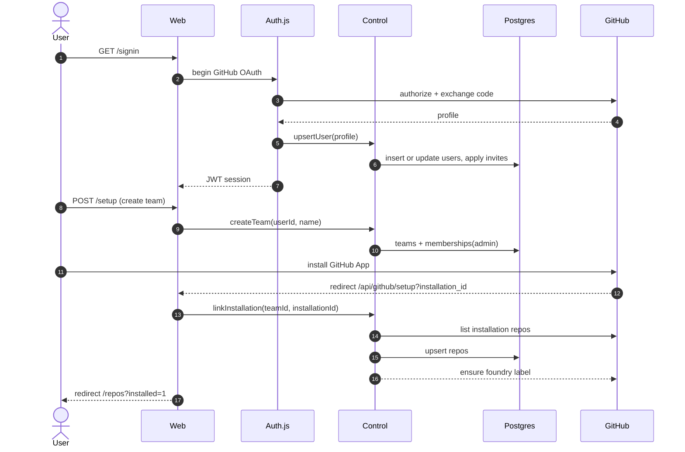

**Alternatives and failures**

- No session yet: the installation ID is held in an `httpOnly` cookie for 30 minutes.
- The App was installed before a team existed: `syncUnlinkedInstallations` attaches installations
  not owned by another team.
- GitHub is unreachable: the route surfaces an error and the user retries or opens `/repos` to
  sync later.

**Implementation:** `apps/web/src/auth.ts`, `packages/control/src/teams.ts`,
`apps/web/src/app/api/github/setup/route.ts`, `apps/web/src/server/session.ts`.

---

## UC-2 — Onboard a repository with a recipe pull request

**Actors:** team member, control plane, runner, agent, GitHub
**Preconditions:** the repo is linked, at least one runner is joined (otherwise the job waits in
`queued`), the default harness is installed and signed in.

**Main flow**

1. The user clicks **Onboard repo** on `/repos`.
2. `startOnboarding` cancels an active onboarding job if this is a restart, creates an
   `onboarding` job with the `onboarding` playbook and branch
   `foundry/onboarding-<short-id>`, and sets the repo's onboarding status to `running`.
3. A runner claims the job. Onboarding jobs may run before the repo has a recipe.
4. The agent writes `.foundry/recipe.yaml`, `.foundry/policy.yaml` and
   `.github/ISSUE_TEMPLATE/foundry.yml`, then calls `stage(verifying)` and `stage(done)`.
5. The runner re-reads the recipe, runs `install`, every check and any dev server, commits and
   pushes the branch, and calls the `onboarding` action with `{ok, headSha, summary}`.
6. `completeOnboarding` moves the job to `verifying`, opens the PR (title "Set up Foundry") and
   sets the repo status to `pr_open`.
7. The user merges the PR. The `pull_request.closed` webhook calls `markJobMerged`, which refreshes
   `.foundry/` from the default branch; the repo now has `acceptsJobs = true`.

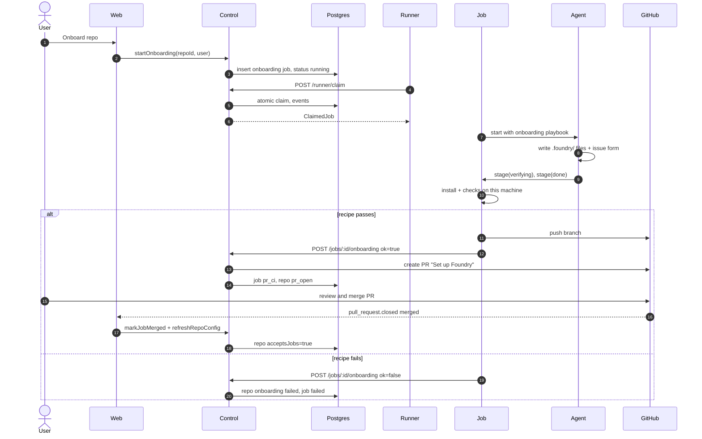

**Alternatives and failures**

- **No runner:** the job stays queued; `/repos` shows `onboarding…` and the job page shows the
  queue reason.
- **Agent asks a question:** see UC-8; the job parks and resumes with the answer.
- **Recipe commands fail:** up to `max_verify_loops` retries with the failure output sent to the
  agent; then the job fails and the repo status becomes `failed`.
- **Restart:** **Retry onboarding** cancels the current job and starts a new one.
- **Merged but not accepting:** `.foundry/recipe.yaml` is missing/invalid, or the push was not
  seen; sync from GitHub or push a commit.

**Implementation:** `packages/control/src/onboarding.ts`, `apps/runner/src/job-runner.ts`
(`finishOnboarding`), `packages/control/src/merge-gate.ts` (`markJobMerged`),
`packages/control/src/repos.ts` (`refreshRepoConfig`), `packages/playbooks/src/playbooks/onboarding.md`.

---

## UC-3 — Label an issue and create a job

**Actors:** team member, GitHub, control plane
**Preconditions:** the repo accepts jobs and the `foundry` label exists.

**Main flow**

1. The user adds the `foundry` label to an issue (or submits the Foundry issue form, which adds it).
2. GitHub sends `issues` / `labeled`. The webhook route verifies the signature, stores the delivery
   in `webhook_inbox` and returns `202`.
3. `processWebhook` dispatches to `createJobFromIssue`.
4. The job is created as `queued` with:
   - harness/model/playbook/pin from labels, falling back to repo and team defaults;
   - author mapping to a `users` row when the login exists;
   - branch `foundry/<job-id>-<slug>`.
5. A `stage_changed` event (`null → queued`) is recorded, and the GitHub status comment and
   `foundry:queued` label are synced.
6. The worker also reconciles labeled issues every 30 seconds, so a missed webhook still creates
   the job.

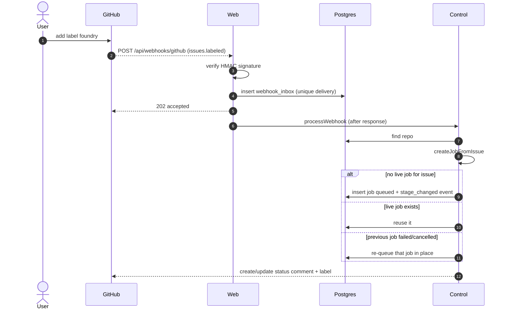

**Alternatives and failures**

- **Duplicate delivery:** the unique `(provider, delivery_id)` key makes storage a no-op.
- **Processing error:** the delivery keeps `processed_at = null` with an incremented attempt count;
  the worker retries up to five times.
- **Re-applying the label:** a live job is reused; a stopped job is revived; only a merged job
  starts a new attempt.
- **Issue closed:** an active job is cancelled (except in `pr_ci`, where the PR owns the outcome).
- **Webhook down:** the worker's `reconcileLabeledIssues` creates any missing jobs.

**Implementation:** `apps/web/src/app/api/webhooks/github/route.ts`,
`packages/control/src/ingest.ts`, `packages/control/src/jobs.ts`,
`packages/control/src/github-sync.ts`.

---

## UC-4 — Join, heartbeat, readiness and claim

**Actors:** runner operator, runner daemon, control plane
**Preconditions:** the user has created a join token on `/runners`.

**Main flow**

1. `foundry runner join <fdj_token> --server <url>` sends machine info to `/api/runner/join`.
   The signed join token (7-day TTL) proves the team; the response contains a runner token, stored
   in the OS secret store.
2. `foundry runner start` starts the daemon. It opens the local MCP tool server and detects
   harnesses.
3. Every 15 seconds the daemon heartbeats: CPU, memory, free disk, AC power, accepting state,
   running job IDs, harnesses, concurrency and version.
4. The control plane updates the runner row and returns:
   - a short-lived realtime token and URL;
   - draining state, revoked job IDs, keep-job IDs and per-job limits;
   - the team's repos with their cached recipe SHA.
5. The daemon reports readiness for any repo whose recipe SHA changed: OS constraint, system
   binaries, and a real run of `warm`, `install` and every check in a detached worktree.
6. The daemon calls `/api/runner/claim` while it is accepting, under its concurrency limit. The
   control plane ranks eligible runners and hands back the best queued job.

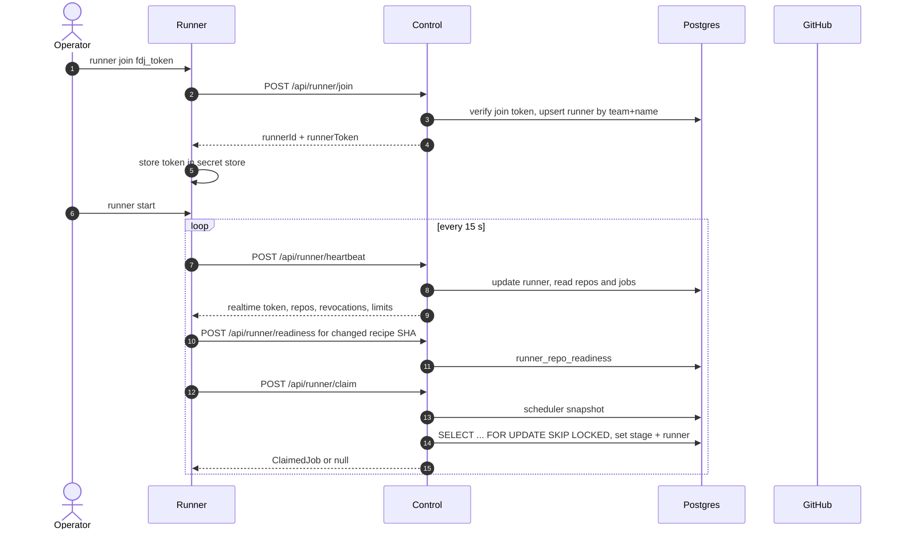

**Scheduling order** (`packages/shared/src/scheduler.ts`): a pinned runner; the sticky runner
during its 10-minute window; then shared runners; then the least-loaded eligible personal runner,
with a tie-break bonus for the job author's own laptop.

**Eligibility:** online, not draining, accepting, below concurrency, ready for the repo at the
current recipe SHA, the requested harness installed and signed in, OS allowed by the recipe, and
not pinned elsewhere.

**Alternatives and failures**

- **Offline/busy/not ready:** the runner is ineligible; the job stays queued and
  `diagnoseQueue` explains why ("no runner online", "repo not ready", …).
- **Re-join with the same name:** updates the same runner row; a second daemon needs a distinct
  name and home.
- **Draining:** no new jobs; running jobs finish.
- **Daily spend cap reached:** claims stop for the team.

**Implementation:** `apps/runner/src/daemon.ts`, `apps/runner/src/readiness.ts`,
`apps/runner/src/api.ts`, `packages/control/src/runners.ts`, `packages/control/src/claim.ts`.

---

## UC-5 — Execute a job through the playbook stages

**Actors:** runner, agent, MCP server, control plane, GitHub
**Preconditions:** a runner claimed a `ticket` job and the repo is ready.

**Main flow**

1. `JobRunner.setup` creates or reuses the worktree, leases ports, loads recipe and policy, computes
   limits, provisions services, builds env, copies the env file and runs `install`.
2. It assembles the playbook prompt (plus repo overrides/skills and any handoff brief), registers
   the per-job tool token, and starts the harness with the `foundry` MCP server.
3. The agent works through stages, calling `stage` to advance. The runner enforces order:
   `triage → investigating → implementing → verifying → done`.
4. On each stage change the runner records the stage with the control plane and writes a
   checkpoint: commit, push the branch, push the handoff brief, record `lastCompletedStage`,
   session ID and head SHA.
5. Events (messages, tool calls, subagents, usage, logs) are buffered and flushed to the control
   plane every second in batches of at most 200.
6. Usage events update the job's cost and token counters; exceeding the cap stops the harness.
7. If the agent stops without `stage(done)`, the runner nudges it up to twice, then fails the job.

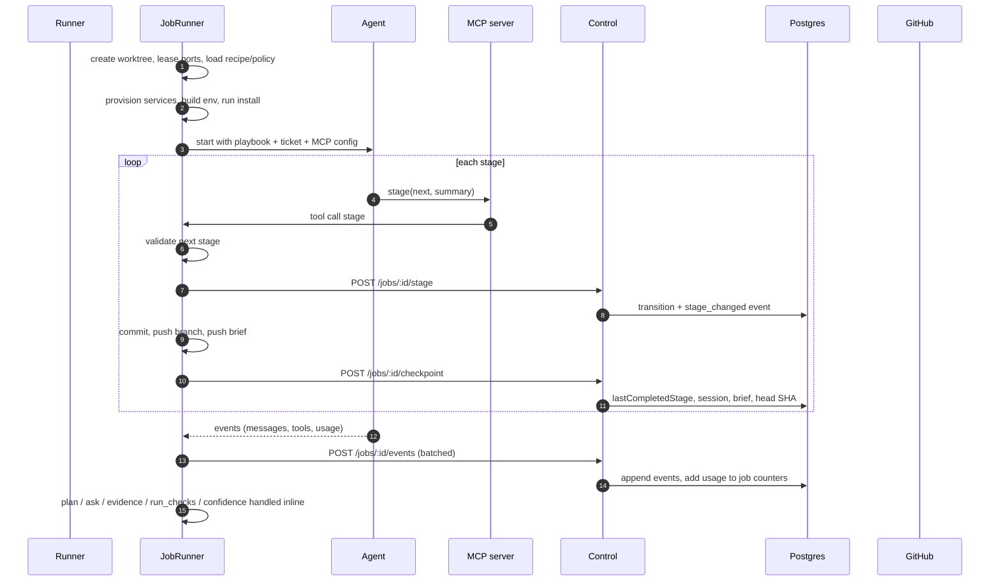

**Alternatives and failures**

- **Agent asks a question:** UC-8; the job parks and resumes.
- **Harness error:** the job fails with a scrubbed reason; the local transcript has the detail.
- **Cost or time budget:** the harness is stopped and the job fails with the budget reason.
- **Tool call after revocation:** the control plane returns `409`; the runner stops the harness.
- **Runner shutdown/schedule end:** UC-9; the job checkpoints and returns to `queued`.

**Implementation:** `apps/runner/src/job-runner.ts` (`setup`, `drive`, `onTool`, `toolStage`,
`checkpoint`), `packages/mcp-foundry/src/server.ts`, `packages/playbooks/src/index.ts`,
`packages/control/src/runner-api.ts`.

---

## UC-6 — Verification loop and trusted checks

**Actors:** runner, agent, control plane
**Preconditions:** the agent called `stage(done)`.

**Main flow**

1. The runner fingerprints the working tree (`git add -A` + `git write-tree`).
2. If the agent's last full `run_checks` used the same tree, those results are trusted; otherwise
   the runner re-runs every recipe check.
3. Each check runs in its own process group with the recipe timeout, `CI=1`, the job env and any
   OS resource wrapper. Output is scrubbed and tailed.
4. Every result is stored as `check` evidence with command, exit code, duration and output tail.
5. On failure, if the loop budget allows, the runner records a verify loop, transitions to
   `implementing`, and resumes the agent with the failing commands and output.
6. If checks still fail after `max_verify_loops` (default 3), the job fails.

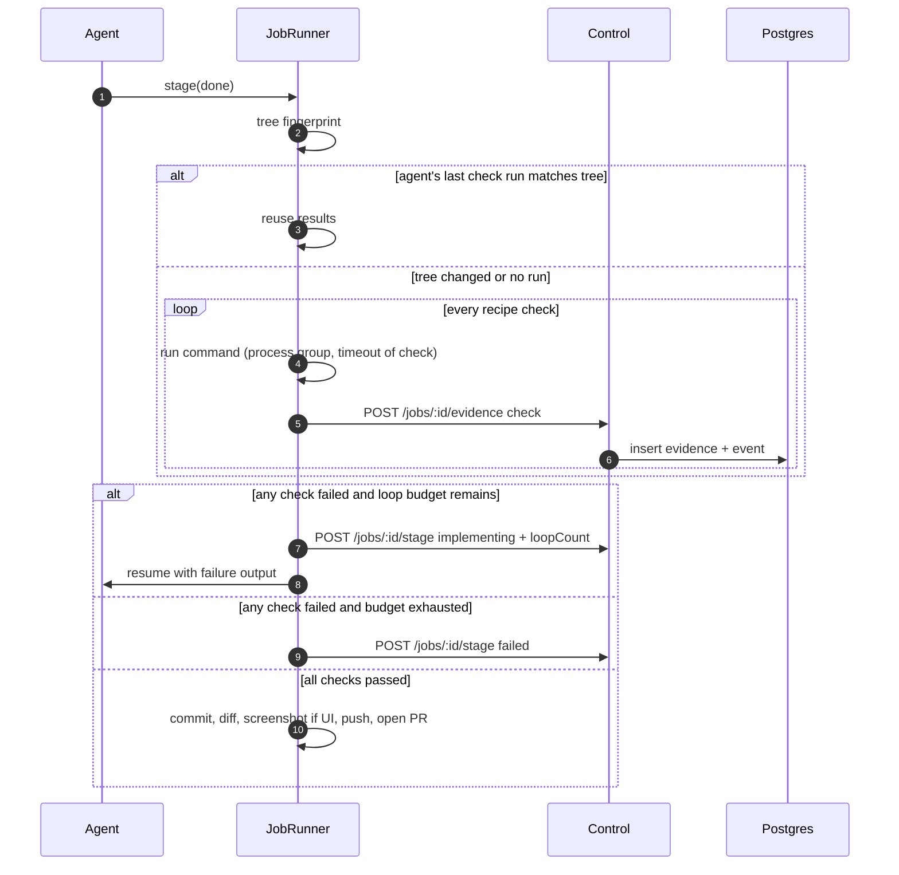

**Alternatives and failures**

- **No checks in the recipe:** the gate fails rule `checks` ("nothing was verified").
- **Check timeout:** killed with the process tree; recorded as failed with a timeout note.
- **UI change without a screenshot:** the runner starts the recipe dev server on `$FOUNDRY_PORT`,
  waits for `ready_path`, captures Playwright, and stores it as screenshot evidence.
- **No changed files:** the job fails ("the agent finished without changing any files").

**Implementation:** `apps/runner/src/job-runner.ts` (`runChecks`, `verifiedChecks`,
`retryOrGiveUp`, `captureUiScreenshot`), `apps/runner/src/checks.ts`,
`packages/shared/src/gate.ts`.

---

## UC-7 — Open the PR, evaluate the confidence gate, merge or hand over

**Actors:** runner, control plane, GitHub, team member
**Preconditions:** verification passed and the branch is pushed.

**Main flow**

1. The runner calls the `pr` action with title, summary, head SHA, UI flag and changed lines.
2. `openPullRequest` renders the PR body (summary, plan, check evidence, screenshots, confidence),
   creates the PR or refreshes it, stores `prNumber`/`prUrl`, transitions the job to `pr_ci` and
   evaluates the gate.
3. The gate fetches the diff, CI state, reviews and latest evidence and calls `evaluateGate`.
4. If CI or the AI review is still pending, the gate returns `pending` and waits for webhooks.
5. When every rule holds, the control plane merges the PR (squash), notifies, and transitions the
   job to `merged`.
6. Otherwise the job moves to `waiting_on_you`. Risk-rule reviewers are requested first; otherwise
   the ticket author reviews. The failed rules are shown and stored.

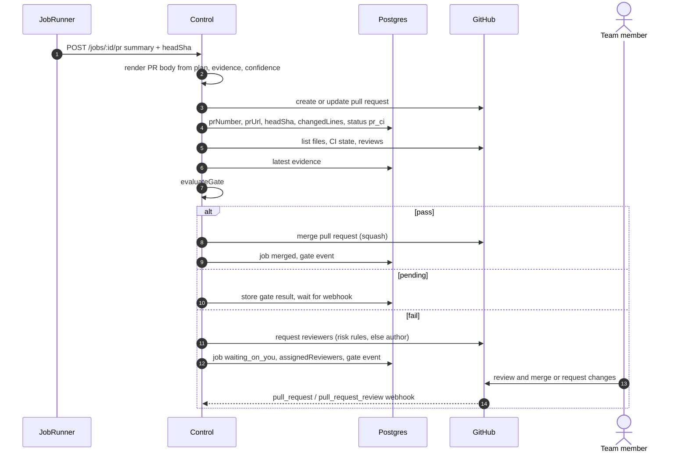

**Gate rules** (`packages/shared/src/gate.ts`): merge mode on; every recipe check has passing
evidence; UI changes have a screenshot; CI green; required AI review not blocking; no risk rule
matched; diff within `max_diff_lines_for_automerge`; agent confidence `high` with no open
uncertainties; cost within the effective cap. Self-reported confidence can only lower trust.

**Alternatives and failures**

- **CI fails after the PR:** the gate records the failure and hands over; a human decides.
- **Changes requested:** UC-10 re-queues the job at `implementing`.
- **Human merges out of band:** the `pull_request.closed` webhook or the worker marks the job
  merged.
- **Webhook missed:** the worker reconciles open PRs and reviews every 30 seconds.
- **Onboarding jobs:** merge mode is forced `off`, so a human always merges the recipe PR.

**Implementation:** `packages/control/src/prs.ts`, `packages/control/src/merge-gate.ts`,
`packages/shared/src/gate.ts`, `packages/shared/src/risk.ts`,
`packages/shared/src/comments.ts`, `packages/control/src/github-sync.ts`.

---

## UC-8 — Ask a question and answer it

**Actors:** agent, control plane, ticket author, GitHub/panel
**Preconditions:** the agent cannot decide without a product or data decision.

**Main flow**

1. The agent calls `ask(question, options)` and ends its turn.
2. The runner checkpoints, sends the question to the control plane and sets a grace timer to stop
   the harness (default 20 seconds).
3. `askQuestion` stores the question, posts one issue comment that @mentions the author with a
   checkbox per option, transitions the job to `needs_input`, keeps the runner sticky for 10
   minutes and notifies.
4. The author answers in one of three ways:
   - ticks a checkbox (GitHub sends `issue_comment.edited`);
   - replies on the issue (plain reply while `needs_input`);
   - clicks an option in the panel.
5. `answerQuestion` records the answer, edits the question comment to show the chosen option,
   queues the answer as `job_inputs`, and moves the job to `queued` once all open questions on the
   job are answered.
6. The original runner (sticky) resumes the native session with the answer; otherwise another
   runner resumes from the handoff brief (UC-9).

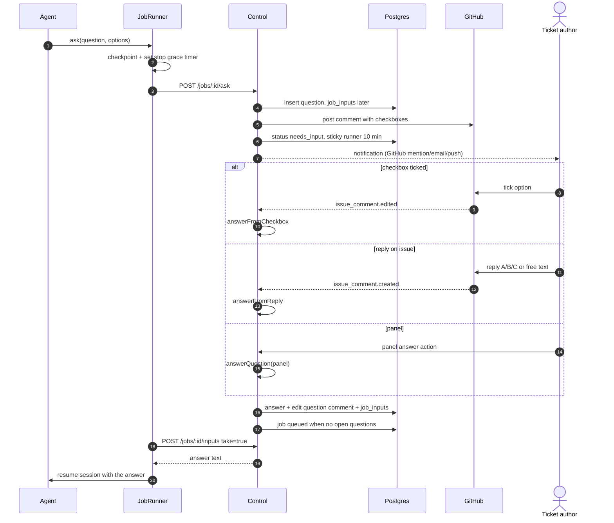

**Alternatives and failures**

- **Already answered:** the second answer is ignored (first answer wins).
- **Multiple open questions:** the job re-queues only after all are answered.
- **Runner gone:** the answer stays queued; portable resume continues on another runner.
- **No issue (panel-created job):** the question exists only in the panel.
- **Helpfulness feedback:** the panel can mark a question helpful or not; this feeds metrics.

**Implementation:** `packages/control/src/questions.ts`,
`packages/shared/src/comments.ts` (`renderQuestionComment`, `parseCheckedOption`,
`parseReplyAnswer`), `packages/control/src/ingest.ts` (`issue_comment`), `apps/runner/src/job-runner.ts`
(`toolAsk`, `parkForAnswer`).

---

## UC-9 — Runner goes away: checkpoint, re-queue, sticky or portable resume

**Actors:** runner, control plane, sweeper, another runner
**Preconditions:** a job is in a runner stage when its machine sleeps, crashes or loses the network.

**Main flow**

1. The sweeper runs every 30 seconds and finds jobs in runner stages whose runner has not
   heartbeat for `HEARTBEAT_TIMEOUT_MS` (120 seconds).
2. It records a warning event and transitions the job to `queued` at the stage after
   `lastCompletedStage`, setting the lost runner as sticky for 10 minutes.
3. The sticky runner, if it comes back in time, is ranked first and resumes its native session
   in place.
4. Otherwise any ready runner claims the job. Because the session ID belongs to another machine,
   the claim clears it and marks the resume mode `portable`.
5. The new runner checks out the existing branch, reads the handoff brief from
   `refs/foundry/<job-id>/brief`, and starts a fresh harness session with the brief, plan, findings,
   Q&A and uncertainties in the prompt.
6. A `resumed` event records the runner and mode on the timeline.

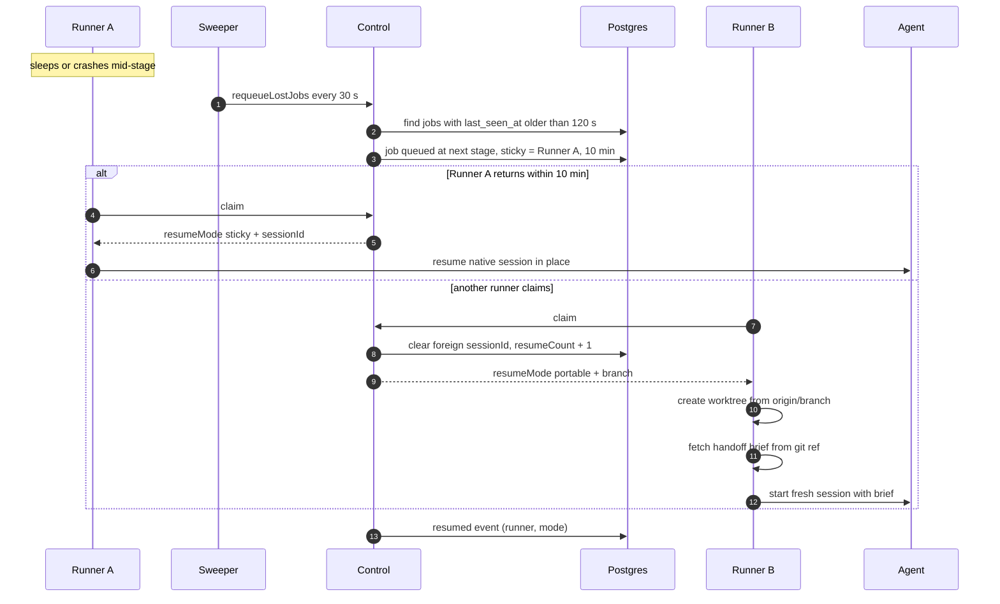

**Checkpoints** are written at every stage boundary and when pausing: commit, push the branch,
push the brief, and record `lastCompletedStage`, session ID and head SHA. That is what makes both
resume modes safe.

**Alternatives and failures**

- **No runner online:** the job stays queued; the panel shows "no runner online" and the queued
  duration.
- **Sticky runner returns but is not eligible:** ranking returns no runner for it; the job waits
  or another runner takes it after the sticky window.
- **Brief missing:** portable resume starts without it; the branch still has the earlier work.
- **Daemon shutdown:** `pause()` checkpoints, returns the job to `queued`, and keeps the worktree
  for a possible sticky resume.

**Implementation:** `packages/control/src/sweeper.ts`, `packages/control/src/claim.ts`,
`packages/shared/src/scheduler.ts`, `apps/runner/src/job-runner.ts` (`checkpoint`, `onStopped`),
`apps/runner/src/brief.ts`, `packages/shared/src/brief.ts`, `apps/runner/src/workspace.ts`.

---

## UC-10 — Human feedback: changes requested, messages and `/foundry` commands

**Actors:** team member, GitHub, control plane, runner
**Preconditions:** the job has an open PR or is parked.

**Main flow**

1. A human submits a review with **Request changes** on the PR. The
   `pull_request_review` webhook calls `handleChangesRequestedReview`, which claims the review ID
   once, stores the review body as a human message and returns the job to `queued` at
   `implementing`.
2. A human comments `/foundry <text>` on the issue or PR. `parseFoundryCommand` extracts the text:
   - `/foundry cancel` cancels the job;
   - `/foundry retry` re-queues it from `triage`;
   - any other text is a message to the agent.
3. The next runner takes the job, delivers pending inputs, and the agent continues with them.
4. If webhooks were down, the worker reconciles changes-requested reviews and open PRs every 30
   seconds.

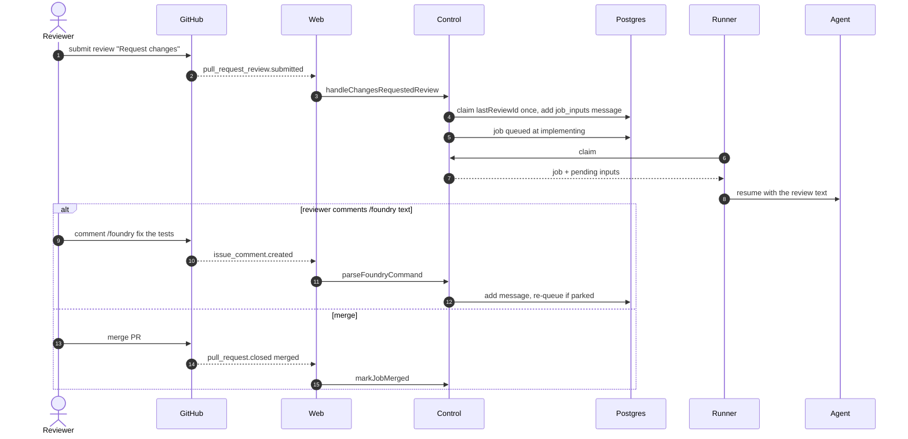

**Alternatives and failures**

- **Duplicate review webhook:** the atomic `lastReviewId` update makes it a no-op.
- **Non-team member `/foundry`:** ignored unless the login is a team member.
- **Bot commands:** ignored.
- **Changes requested while `pr_ci`:** the job returns to the agent so CI can run again after the
  fix.

**Implementation:** `packages/control/src/merge-gate.ts`,
`packages/control/src/ingest.ts`, `packages/control/src/jobs.ts` (`sendMessage`),
`packages/shared/src/comments.ts` (`parseFoundryCommand`).

---

## UC-11 — Runner readiness proves a recipe

**Actors:** runner, control plane
**Preconditions:** the repo has a recipe on its default branch.

**Main flow**

1. Each heartbeat includes repos and their recipe SHA.
2. For a repo whose SHA differs from the last reported one, `ReadinessReporter`:
   - fetches the mirror and reads `.foundry/recipe.yaml` at `origin/<default>`;
   - checks the OS constraint and `system_deps` (binary presence and optional minimum version);
   - requires a Postgres URL if the recipe declares a Postgres service;
   - creates a detached worktree of the default branch and runs `warm`, `install` and all checks,
     capped at 20 minutes.
3. It reports `{repoId, recipeSha, ready, reason}`; the control plane upserts
   `runner_repo_readiness`.
4. Scheduling only treats a runner as ready when its reported SHA equals the repo's current
   recipe SHA.

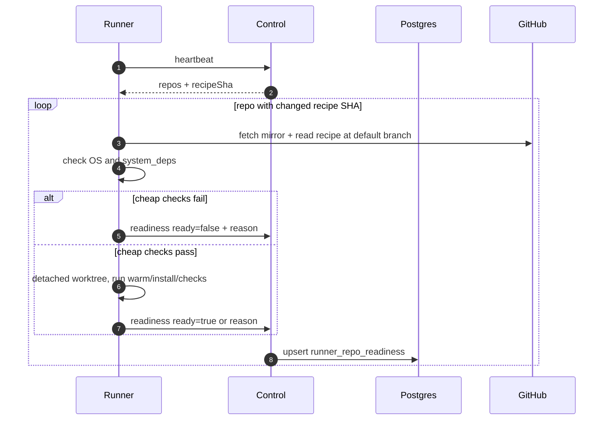

**Alternatives and failures**

- **Recipe missing/invalid:** not ready; the repo cannot accept jobs.
- **A check times out or exits non-zero:** not ready with the failing step and output tail.
- **Recipe changes:** the SHA changes, so every runner re-checks.
- **A readiness pass takes minutes:** later heartbeats still claim jobs; only one pass runs at a
  time.

**Implementation:** `apps/runner/src/readiness.ts`, `packages/control/src/runners.ts`
(`reportReadiness`), `packages/control/src/claim.ts` (`schedulerSnapshot`),
`packages/shared/src/recipe.ts`.

---

## UC-12 — Realtime updates in the panel and on runners

**Actors:** Postgres, realtime service, panel, runner daemon
**Preconditions:** the client holds a signed realtime token for its team.

**Main flow**

1. Postgres triggers on job/event/question changes call `NOTIFY foundry_changes` with
   `{table, id, team_id, op, columns}`.
2. `apps/realtime` receives the payload on its single `LISTEN` connection.
3. It sends `{type:"change", …}` only to WebSocket clients whose token `teamId` matches.
4. The panel refetches the affected view through authenticated APIs.
5. A runner daemon listens only for `table === "jobs"` and starts a claim loop.

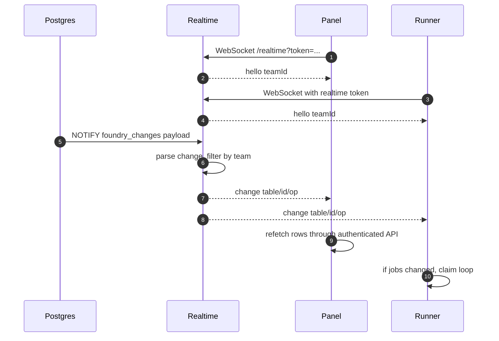

**Alternatives and failures**

- **Token expired:** the server drops the client; it reconnects with a fresh token.
- **Dead client:** the 25-second ping/pong loop terminates it.
- **Postgres unavailable:** the realtime server starts with no listener and broadcasts nothing.
- **Missed message:** the panel also polls or refetches on navigation; realtime is an optimization,
  not the source of truth.

**Implementation:** `apps/realtime/src/server.ts`, `packages/shared/src/tokens.ts`,
`apps/web/src/app/api/realtime-token/route.ts`, `apps/web/src/components/realtime-tables.ts`,
`apps/runner/src/daemon.ts` (`connectRealtime`).

---

## Use-case to code map

| Use case                  | Entry point                              | Core modules                            | Primary tests                                     |
| ------------------------- | ---------------------------------------- | --------------------------------------- | ------------------------------------------------- |
| UC-1 sign-in/team/App     | `/signin`, `/setup`, `/api/github/setup` | `auth.ts`, `teams.ts`                   | `tests/api/more-routes.test.ts`                   |
| UC-2 onboarding           | `/repos` onboard action                  | `onboarding.ts`, `job-runner.ts`        | `tests/e2e/job.test.ts`                           |
| UC-3 issue to job         | webhook route                            | `ingest.ts`, `jobs.ts`                  | `tests/api/github-webhook.test.ts`                |
| UC-4 join/heartbeat/claim | `/api/runner/*`                          | `runners.ts`, `claim.ts`, `daemon.ts`   | `tests/api/runner-join.test.ts`, `daemon.test.ts` |
| UC-5 execution            | claim + MCP                              | `job-runner.ts`, `mcp-foundry`          | `job-runner.test.ts`, `mcp.test.ts`               |
| UC-6 verification         | `stage(done)`                            | `job-runner.ts`, `checks.ts`, `gate.ts` | `job-runner.test.ts`, `gate.test.ts`              |
| UC-7 PR/gate              | `pr` action + webhooks                   | `prs.ts`, `merge-gate.ts`               | `control.test.ts`, `gate.test.ts`                 |
| UC-8 ask/answer           | `ask` + issue comment                    | `questions.ts`, `comments.ts`           | `control.test.ts`, `job-runner.test.ts`           |
| UC-9 resume               | sweeper + claim                          | `sweeper.ts`, `claim.ts`, `brief.ts`    | `control.test.ts`, `scheduler.test.ts`            |
| UC-10 feedback            | reviews + `/foundry`                     | `merge-gate.ts`, `ingest.ts`, `jobs.ts` | `control.test.ts`                                 |
| UC-11 readiness           | heartbeat + `/readiness`                 | `readiness.ts`, `runners.ts`            | `readiness.test.ts`                               |
| UC-12 realtime            | WebSocket + NOTIFY                       | `apps/realtime`, `realtime-tables.ts`   | `server.test.ts`, `realtime-tables.test.ts`       |

## Adding a use case

When adding or changing a use case:

1. Update the state machine if a new status or transition is needed, in `states.ts` and the panel.
2. Add the event, schema and rendering pieces to `packages/shared`.
3. Implement the rule in `packages/control` or `apps/runner`, with a test beside it.
4. Add a sequence diagram and implementation map here, in English and Chinese.
5. Update the product spec if the behavior is user-visible.
