# Foundry — 核心用例与详细设计

> English: [use-cases.md](use-cases.md)

状态：当前实现 · 最后审阅：2026-11-08

本文端到端说明核心用例。每个用例都给出前置条件、调用序列、替代与失败路径，以及实现它的文件。
系统上下文见 [`overall-design.zh-CN.md`](overall-design.zh-CN.md)，各组件职责见
[`components.zh-CN.md`](components.zh-CN.md)。

图中约定：

- `Web` 是 `apps/web`（Next.js 路由处理器 + 面板）。
- `Control` 是在 web 进程内运行的 `packages/control`。
- `DB` 是 Postgres，`RT` 是 `apps/realtime`，`GH` 是 GitHub，`Runner` 是 runner daemon，
  `Job` 是一个 `JobRunner`，`Agent` 是 harness 进程，`MCP` 是单任务 MCP 服务器。
- 虚线箭头表示异步副作用或推送。

---

## UC-1 — 登录、创建团队、安装 App、关联仓库

**参与者：** 团队成员、GitHub、控制面
**前置条件：** 控制面已运行，并配置了 GitHub OAuth 和 App 凭据。

**主流程**

1. 用户打开 `/signin` 并授权 GitHub App（OAuth scope 为 `read:user user:email`）。
2. Auth.js 调用 GitHub 获取资料并调用 `upsertUser`，同时接受该登录名的待处理邀请。
3. 用户在 `/setup` 创建团队；`createTeam` 创建团队和 `admin` 成员关系。
4. 用户安装 App；GitHub 重定向到 `/api/github/setup?installation_id=…`。
5. 路由把可访问的仓库关联到团队（`linkInstallation`），确保 `foundry` 标签存在，并在有
   `.foundry/` 文件时缓存它们。
6. 如果安装在登录前发生，路由把 installation 存入 cookie，重定向到登录页，返回后再关联。
   “Sync from GitHub” 也会关联未关联的安装。

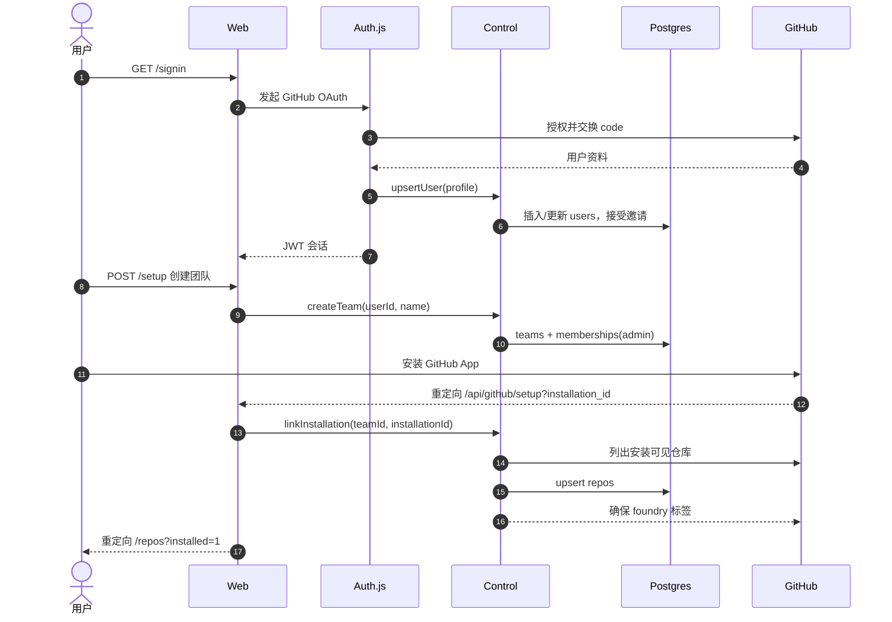

**替代与失败**

- 尚无会话：installation ID 保存在 `httpOnly` cookie 中 30 分钟。
- App 在团队存在前安装：`syncUnlinkedInstallations` 关联尚未被其他团队占用的安装。
- GitHub 不可达：路由显示错误，用户稍后重试或打开 `/repos` 同步。

**实现：** `apps/web/src/auth.ts`、`packages/control/src/teams.ts`、
`apps/web/src/app/api/github/setup/route.ts`、`apps/web/src/server/session.ts`。

---

## UC-2 — 通过 recipe pull request 完成仓库 onboarding

**参与者：** 团队成员、控制面、runner、Agent、GitHub
**前置条件：** 仓库已关联，至少一个 runner 已 join（否则任务停在 `queued`），默认 harness 已安装
并登录。

**主流程**

1. 用户在 `/repos` 点击 **Onboard repo**。
2. `startOnboarding` 若为重启则取消当前 onboarding 任务，创建 `onboarding` 任务，使用
   `onboarding` playbook 和分支 `foundry/onboarding-<short-id>`，并把仓库 onboarding 状态设为
   `running`。
3. Runner 领取任务。Onboarding 任务可以在仓库还没有 recipe 时运行。
4. Agent 编写 `.foundry/recipe.yaml`、`.foundry/policy.yaml` 和
   `.github/ISSUE_TEMPLATE/foundry.yml`，然后调用 `stage(verifying)` 和 `stage(done)`。
5. Runner 重新读取 recipe，运行 `install`、所有检查以及可选 dev server，提交并推送分支，然后调用
   `onboarding` 动作，参数为 `{ok, headSha, summary}`。
6. `completeOnboarding` 把任务转到 `verifying`，创建 PR（标题 “Set up Foundry”），并把仓库状态
   设为 `pr_open`。
7. 用户合并 PR。`pull_request.closed` webhook 调用 `markJobMerged`，后者从默认分支刷新
   `.foundry/`；仓库现在 `acceptsJobs = true`。

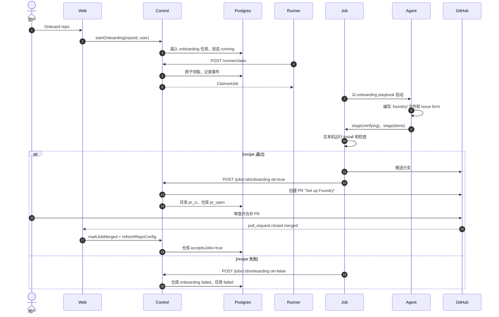

**替代与失败**

- **没有 runner：** 任务保持 queued；`/repos` 显示 `onboarding…`，任务页显示排队原因。
- **Agent 提问：** 见 UC-8；任务停放，回答后恢复。
- **Recipe 命令失败：** 最多 `max_verify_loops` 次重试，失败输出发送给 Agent；之后任务失败，仓库状态
  变为 `failed`。
- **重启：** **Retry onboarding** 取消当前任务并启动新任务。
- **已合并但不接受任务：** `.foundry/recipe.yaml` 缺失/无效，或推送未被看到；从 GitHub 同步或推送
  一个提交。

**实现：** `packages/control/src/onboarding.ts`、`apps/runner/src/job-runner.ts`
（`finishOnboarding`）、`packages/control/src/merge-gate.ts`（`markJobMerged`）、
`packages/control/src/repos.ts`（`refreshRepoConfig`）、
`packages/playbooks/src/playbooks/onboarding.md`。

---

## UC-3 — 给 issue 加标签并创建任务

**参与者：** 团队成员、GitHub、控制面
**前置条件：** 仓库接受任务，且 `foundry` 标签存在。

**主流程**

1. 用户给 issue 添加 `foundry` 标签（或提交 Foundry issue 表单，表单会自动添加）。
2. GitHub 发送 `issues` / `labeled`。webhook 路由验证签名，把投递存入 `webhook_inbox` 并返回
   `202`。
3. `processWebhook` 分发到 `createJobFromIssue`。
4. 任务以 `queued` 创建：
   - harness/model/playbook/pin 来自标签，回退到仓库和团队默认值；
   - 作者映射到存在的 `users` 行；
   - 分支为 `foundry/<job-id>-<slug>`。
5. 记录 `stage_changed` 事件（`null → queued`），并同步 GitHub 状态评论和 `foundry:queued` 标签。
6. worker 每 30 秒还会核对带标签的 issue，因此遗漏的 webhook 仍会创建任务。

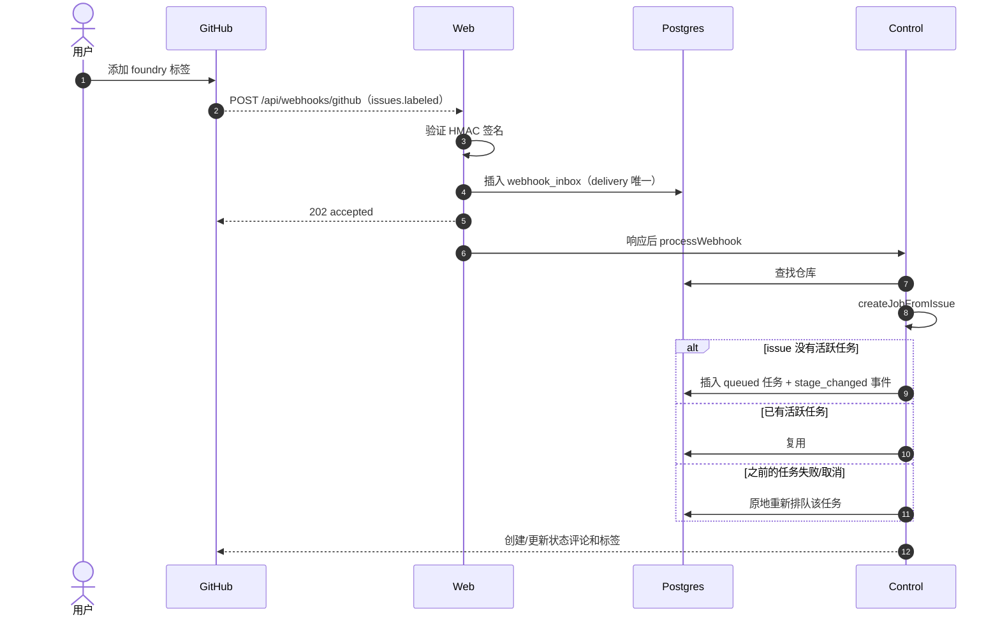

**替代与失败**

- **重复投递：** 唯一 `(provider, delivery_id)` 键使存储成为空操作。
- **处理错误：** 投递保持 `processed_at = null` 并递增尝试次数；worker 最多重试五次。
- **重新加标签：** 活跃任务复用；停止的任务复活；只有已合并任务才开启新尝试。
- **Issue 关闭：** 活跃任务被取消（`pr_ci` 除外，此时由 PR 决定结果）。
- **Webhook 中断：** worker 的 `reconcileLabeledIssues` 创建缺失任务。

**实现：** `apps/web/src/app/api/webhooks/github/route.ts`、
`packages/control/src/ingest.ts`、`packages/control/src/jobs.ts`、
`packages/control/src/github-sync.ts`。

---

## UC-4 — Join、心跳、就绪与领取

**参与者：** runner 操作者、runner daemon、控制面
**前置条件：** 用户已在 `/runners` 创建 join token。

**主流程**

1. `foundry runner join <fdj_token> --server <url>` 把机器信息发送到 `/api/runner/join`。
   签名 join token（7 天有效）证明团队身份；响应包含 runner token，保存在 OS 密钥库。
2. `foundry runner start` 启动 daemon。它打开本地 MCP 工具服务器并检测 harness。
3. 每 15 秒 daemon 发送心跳：CPU、内存、磁盘剩余、交流电、接受状态、运行中任务 ID、harness、
   并发数和版本。
4. 控制面更新 runner 行并返回：
   - 短期 realtime token 和 URL；
   - draining 状态、被撤销任务 ID、需保留任务 ID 和单任务限制；
   - 团队仓库及其缓存的 recipe SHA。
5. 对 recipe SHA 变化的仓库，daemon 上报就绪：OS 约束、系统二进制，以及在 detached worktree 中
   真实运行 `warm`、`install` 和所有检查。
6. daemon 在接受任务且低于并发上限时调用 `/api/runner/claim`。控制面对合格 runner 排序并交回最合适
   的排队任务。

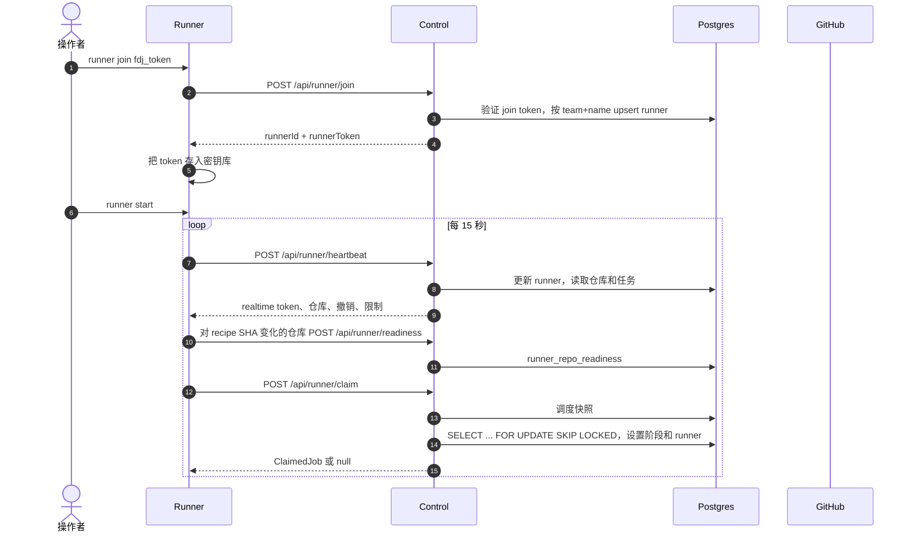

**调度顺序**（`packages/shared/src/scheduler.ts`）：指定的 runner；sticky 窗口内（10 分钟）的原
runner；共享 runner；然后是最低负载且合格的个人 runner，并对任务作者自己的笔记本给予微小优先。

**资格：** 在线、未 draining、接受任务、低于并发、在当前 recipe SHA 下对该仓库就绪、所需 harness
已安装并登录、OS 符合 recipe、未被指定到其他机器。

**替代与失败**

- **离线/忙碌/未就绪：** runner 不合格；任务保持 queued，`diagnoseQueue` 解释原因（“no runner
  online”、“repo not ready” 等）。
- **同名重新 join：** 更新同一 runner 行；第二个 daemon 需要不同名称和 home。
- **Draining：** 不接新任务；运行中的任务完成。
- **达到每日花费上限：** 团队停止领取。

**实现：** `apps/runner/src/daemon.ts`、`apps/runner/src/readiness.ts`、
`apps/runner/src/api.ts`、`packages/control/src/runners.ts`、`packages/control/src/claim.ts`。

---

## UC-5 — 按 playbook 阶段执行任务

**参与者：** runner、Agent、MCP 服务器、控制面、GitHub
**前置条件：** runner 已领取一个 `ticket` 任务，且仓库就绪。

**主流程**

1. `JobRunner.setup` 创建或复用 worktree、租用端口、加载 recipe 和 policy、计算限制、准备服务、
   构建环境变量、复制 env 文件并运行 `install`。
2. 它组装 playbook 提示（加上仓库覆盖/skills 和交接简报），注册单任务工具 token，并以 `foundry`
   MCP 服务器启动 harness。
3. Agent 通过调用 `stage` 推进阶段。runner 强制顺序：
   `triage → investigating → implementing → verifying → done`。
4. 每次阶段变更，runner 向控制面记录阶段并写检查点：提交、推送分支、推送交接简报，记录
   `lastCompletedStage`、session ID 和 head SHA。
5. 事件（消息、工具调用、子 Agent、usage、日志）被缓冲，并每秒批量发送到控制面，每批最多 200 条。
6. usage 事件更新任务成本和 token 计数；超过上限会停止 harness。
7. 如果 Agent 没有 `stage(done)` 就停止，runner 最多提醒两次，然后使任务失败。

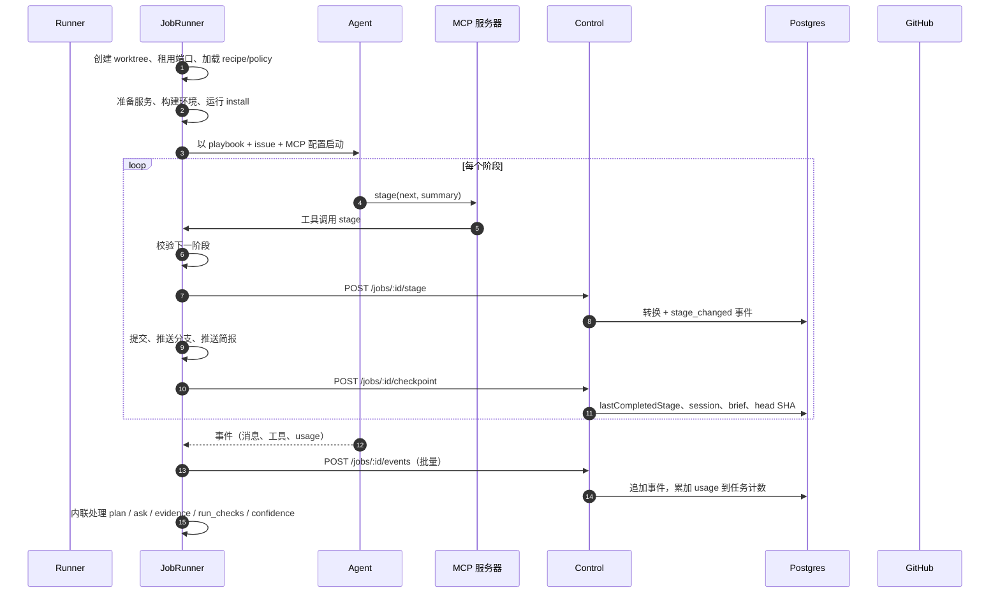

**替代与失败**

- **Agent 提问：** UC-8；任务停放并在回答后恢复。
- **Harness 错误：** 任务以脱敏原因失败；本地记录保留细节。
- **成本或时间预算：** 停止 harness，并以预算原因失败。
- **撤销后的工具调用：** 控制面返回 `409`；runner 停止 harness。
- **Runner 关闭/调度结束：** UC-9；任务写检查点并回到 `queued`。

**实现：** `apps/runner/src/job-runner.ts`（`setup`、`drive`、`onTool`、`toolStage`、
`checkpoint`）、`packages/mcp-foundry/src/server.ts`、`packages/playbooks/src/index.ts`、
`packages/control/src/runner-api.ts`。

---

## UC-6 — 验证循环与受信任检查

**参与者：** runner、Agent、控制面
**前置条件：** Agent 调用了 `stage(done)`。

**主流程**

1. runner 对工作树取指纹（`git add -A` + `git write-tree`）。
2. 如果 Agent 上一次完整 `run_checks` 使用的是同一工作树，则信任那些结果；否则 runner 重新运行所有
   recipe 检查。
3. 每个检查在独立进程组中运行，使用 recipe 超时、`CI=1`、任务环境和 OS 资源包装。输出会脱敏并截取
   尾部。
4. 每个结果都作为 `check` 证据保存，包含命令、退出码、耗时和输出尾部。
5. 失败时，如果循环预算允许，runner 记录一次验证循环，转换到 `implementing`，并把失败命令和输出
   作为消息恢复给 Agent。
6. 如果在 `max_verify_loops`（默认 3）之后仍失败，任务失败。

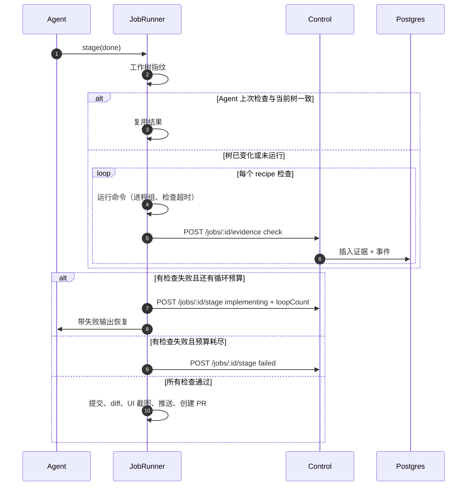

**替代与失败**

- **Recipe 没有检查：** 门禁规则 `checks` 失败（“nothing was verified”）。
- **检查超时：** 连同进程树一起杀掉；记录为失败并带超时说明。
- **UI 变更但没有截图：** runner 在 `$FOUNDRY_PORT` 启动 recipe dev server，等待 `ready_path`，
  用 Playwright 截图并保存为截图证据。
- **没有文件变更：** 任务失败（“the agent finished without changing any files”）。

**实现：** `apps/runner/src/job-runner.ts`（`runChecks`、`verifiedChecks`、`retryOrGiveUp`、
`captureUiScreenshot`）、`apps/runner/src/checks.ts`、`packages/shared/src/gate.ts`。

---

## UC-7 — 创建 PR、评估置信度门禁、合并或交接

**参与者：** runner、控制面、GitHub、团队成员
**前置条件：** 验证通过且分支已推送。

**主流程**

1. runner 调用 `pr` 动作，传入标题、摘要、head SHA、UI 标志和变更行数。
2. `openPullRequest` 渲染 PR 正文（摘要、计划、检查证据、截图、置信度），创建或刷新 PR，保存
   `prNumber`/`prUrl`，把任务转到 `pr_ci` 并评估门禁。
3. 门禁获取 diff、CI 状态、审查和最新证据，调用 `evaluateGate`。
4. 如果 CI 或 AI 审查仍在等待，门禁返回 `pending`，等待 webhook。
5. 所有规则满足时，控制面合并 PR（squash），发送通知，并把任务转到 `merged`。
6. 否则任务进入 `waiting_on_you`。优先请求风险规则审查者；否则由 issue 作者审查。失败规则会显示并
   保存。

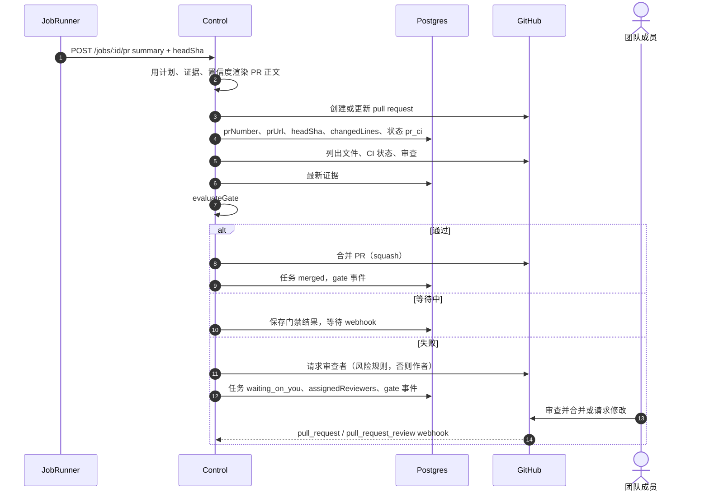

**门禁规则**（`packages/shared/src/gate.ts`）：合并模式开启；每个 recipe 检查都有通过证据；UI 变更
有截图；CI 通过；所需 AI 审查不阻塞；没有风险规则命中；diff 不超过
`max_diff_lines_for_automerge`；Agent 置信度为 `high` 且无未决不确定性；成本不超过有效上限。
自评置信度只能降低信任。

**替代与失败**

- **PR 创建后 CI 失败：** 门禁记录失败并交接；由人工决定。
- **请求修改：** UC-10 把任务重新排队到 `implementing`。
- **人工在别处合并：** `pull_request.closed` webhook 或 worker 会把任务标记为 merged。
- **Webhook 遗漏：** worker 每 30 秒核对打开的 PR 和审查。
- **Onboarding 任务：** 合并模式强制为 `off`，因此 recipe PR 始终由人工合并。

**实现：** `packages/control/src/prs.ts`、`packages/control/src/merge-gate.ts`、
`packages/shared/src/gate.ts`、`packages/shared/src/risk.ts`、
`packages/shared/src/comments.ts`、`packages/control/src/github-sync.ts`。

---

## UC-8 — 提问与回答

**参与者：** Agent、控制面、issue 作者、GitHub/面板
**前置条件：** Agent 在没有产品或数据决策时无法继续。

**主流程**

1. Agent 调用 `ask(question, options)` 并结束回合。
2. runner 写检查点，把问题发送到控制面，并设置宽限计时器以停止 harness（默认 20 秒）。
3. `askQuestion` 保存问题，在 issue 上发布一条 @作者 的评论，每个选项一个复选框，把任务转到
   `needs_input`，把 runner 保持 sticky 10 分钟并发送通知。
4. 作者可以通过三种方式回答：
   - 勾选复选框（GitHub 发送 `issue_comment.edited`）；
   - 在 issue 上回复（`needs_input` 期间的普通回复）；
   - 在面板点击选项。
5. `answerQuestion` 记录回答，编辑问题评论显示所选选项，把回答排入 `job_inputs`，并在任务的所有开放
   问题都回答后把任务转到 `queued`。
6. 原 runner（sticky）带回答恢复原生会话；否则另一个 runner 从交接简报恢复（UC-9）。

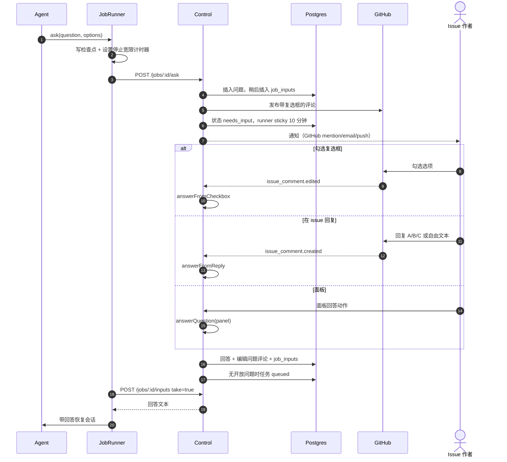

**替代与失败**

- **已回答：** 第二个回答被忽略（先到先得）。
- **多个开放问题：** 只有全部回答后任务才重新排队。
- **Runner 不在：** 回答保持排队；portable resume 在其他 runner 继续。
- **没有 issue（面板创建的任务）：** 问题只存在于面板。
- **有用性反馈：** 面板可以标记问题是否有帮助；这会进入指标。

**实现：** `packages/control/src/questions.ts`、
`packages/shared/src/comments.ts`（`renderQuestionComment`、`parseCheckedOption`、
`parseReplyAnswer`）、`packages/control/src/ingest.ts`（`issue_comment`）、
`apps/runner/src/job-runner.ts`（`toolAsk`、`parkForAnswer`）。

---

## UC-9 — Runner 消失：检查点、重新排队、sticky 或 portable 恢复

**参与者：** runner、控制面、sweeper、另一个 runner
**前置条件：** 任务处于 runner 阶段时，机器睡眠、崩溃或断网。

**主流程**

1. sweeper 每 30 秒运行，找出处于 runner 阶段且 runner 超过 `HEARTBEAT_TIMEOUT_MS`（120 秒）
   未心跳的任务。
2. 它记录一条警告事件，把任务转到 `lastCompletedStage` 之后的阶段，把丢失的 runner 设为 sticky
   10 分钟。
3. 如果 sticky runner 及时回来，它排在最前，并原地恢复原生会话。
4. 否则任何就绪 runner 都可以领取。由于会话 ID 属于另一台机器，领取会清空它并标记为 `portable`。
5. 新 runner 检出已有分支，从 `refs/foundry/<job-id>/brief` 读取交接简报，并用简报、计划、发现、
   Q&A 和不确定性作为提示启动全新 harness 会话。
6. `resumed` 事件把 runner 和模式记录到时间线。

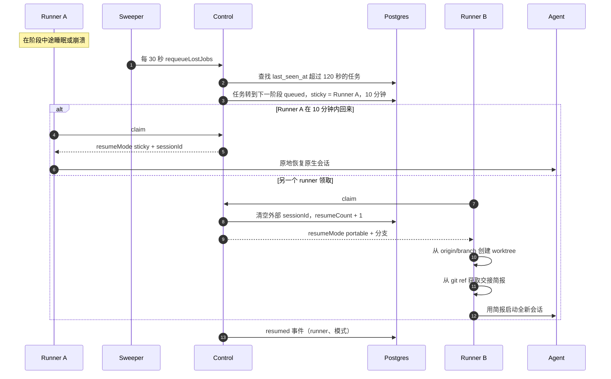

**检查点**会在每个阶段边界和暂停时写入：提交、推送分支、推送简报，并记录 `lastCompletedStage`、
session ID 和 head SHA。这是两种恢复模式安全的基础。

**替代与失败**

- **没有 runner 在线：** 任务保持 queued；面板显示 “no runner online” 和排队时长。
- **Sticky runner 回来但不合格：** 排序对它返回空；任务继续等待，或在 sticky 窗口后由其他 runner
  领取。
- **简报缺失：** portable resume 在没有简报的情况下开始；分支仍保留此前工作。
- **Daemon 关闭：** `pause()` 写检查点，把任务退回 `queued`，并保留 worktree 以便 sticky 恢复。

**实现：** `packages/control/src/sweeper.ts`、`packages/control/src/claim.ts`、
`packages/shared/src/scheduler.ts`、`apps/runner/src/job-runner.ts`（`checkpoint`、
`onStopped`）、`apps/runner/src/brief.ts`、`packages/shared/src/brief.ts`、
`apps/runner/src/workspace.ts`。

---

## UC-10 — 人工反馈：请求修改、消息与 `/foundry` 命令

**参与者：** 团队成员、GitHub、控制面、runner
**前置条件：** 任务有打开的 PR 或处于停放状态。

**主流程**

1. 人工在 PR 上提交 **Request changes** 审查。`pull_request_review` webhook 调用
   `handleChangesRequestedReview`，它只认领一次 review ID，把审查正文保存为人工消息，并把任务退回
   `queued` 的 `implementing`。
2. 人工在 issue 或 PR 上评论 `/foundry <text>`。`parseFoundryCommand` 提取文本：
   - `/foundry cancel` 取消任务；
   - `/foundry retry` 从 `triage` 重新排队；
   - 其他文本是给 Agent 的消息。
3. 下一个 runner 领取任务，投递待处理输入，Agent 带这些输入继续。
4. 如果 webhook 中断，worker 每 30 秒核对 changes-requested 审查和打开的 PR。

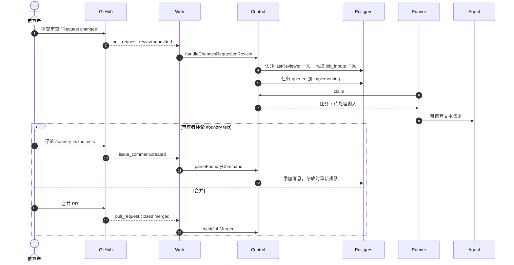

**替代与失败**

- **重复审查 webhook：** 原子更新 `lastReviewId` 使其成为空操作。
- **非团队成员的 `/foundry`：** 除非登录名是团队成员，否则忽略。
- **Bot 命令：** 忽略。
- **`pr_ci` 期间请求修改：** 任务回到 Agent，修复后 CI 会重新运行。

**实现：** `packages/control/src/merge-gate.ts`、`packages/control/src/ingest.ts`、
`packages/control/src/jobs.ts`（`sendMessage`）、`packages/shared/src/comments.ts`
（`parseFoundryCommand`）。

---

## UC-11 — Runner 就绪检查证明 recipe 可用

**参与者：** runner、控制面
**前置条件：** 仓库默认分支上有 recipe。

**主流程**

1. 每次心跳都包含仓库及其 recipe SHA。
2. 对 SHA 与上次报告不同的仓库，`ReadinessReporter`：
   - 获取 mirror 并读取 `origin/<default>` 上的 `.foundry/recipe.yaml`；
   - 检查 OS 约束和 `system_deps`（二进制存在及可选最低版本）；
   - 如果 recipe 声明 Postgres 服务，则要求配置 Postgres URL；
   - 创建默认分支的 detached worktree，运行 `warm`、`install` 和所有检查，上限 20 分钟。
3. 它上报 `{repoId, recipeSha, ready, reason}`；控制面 upsert `runner_repo_readiness`。
4. 只有当 runner 上报的 SHA 等于仓库当前 recipe SHA 时，调度才认为它对该仓库就绪。

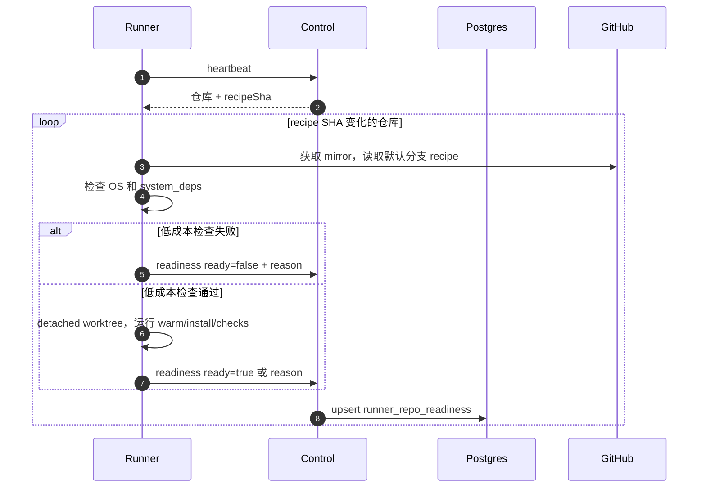

**替代与失败**

- **Recipe 缺失/无效：** 不就绪；仓库不能接受任务。
- **检查超时或非零退出：** 不就绪，并带失败步骤和输出尾部。
- **Recipe 变化：** SHA 变化，所有 runner 重新检查。
- **就绪检查耗时数分钟：** 后续心跳仍可领取任务；同一时间只运行一次检查。

**实现：** `apps/runner/src/readiness.ts`、`packages/control/src/runners.ts`
（`reportReadiness`）、`packages/control/src/claim.ts`（`schedulerSnapshot`）、
`packages/shared/src/recipe.ts`。

---

## UC-12 — 面板和 runner 的实时更新

**参与者：** Postgres、realtime 服务、面板、runner daemon
**前置条件：** 客户端持有其团队的签名 realtime token。

**主流程**

1. Postgres 在任务/事件/问题变化时触发 `NOTIFY foundry_changes`，负载为
   `{table, id, team_id, op, columns}`。
2. `apps/realtime` 在其唯一 `LISTEN` 连接上接收负载。
3. 它只向 token `teamId` 匹配的 WebSocket 客户端发送 `{type:"change", …}`。
4. 面板通过带认证的 API 重新拉取受影响的视图。
5. runner daemon 只监听 `table === "jobs"`，并启动领取循环。

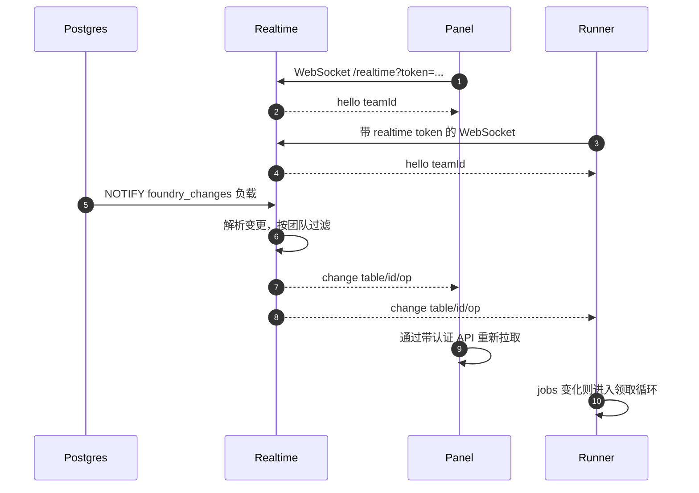

**替代与失败**

- **Token 过期：** 服务器断开客户端；客户端用新 token 重连。
- **死亡客户端：** 25 秒 ping/pong 循环终止它。
- **Postgres 不可用：** realtime 服务器启动但没有 listener，不广播。
- **消息遗漏：** 面板在导航时也会轮询或重新拉取；realtime 是优化，不是事实来源。

**实现：** `apps/realtime/src/server.ts`、`packages/shared/src/tokens.ts`、
`apps/web/src/app/api/realtime-token/route.ts`、`apps/web/src/components/realtime-tables.ts`、
`apps/runner/src/daemon.ts`（`connectRealtime`）。

---

## 用例与代码映射

| 用例                | 入口                                     | 核心模块                                | 主要测试                                          |
| ------------------- | ---------------------------------------- | --------------------------------------- | ------------------------------------------------- |
| UC-1 登录/团队/App  | `/signin`、`/setup`、`/api/github/setup` | `auth.ts`、`teams.ts`                   | `tests/api/more-routes.test.ts`                   |
| UC-2 onboarding     | `/repos` onboard 动作                    | `onboarding.ts`、`job-runner.ts`        | `tests/e2e/job.test.ts`                           |
| UC-3 issue 到任务   | webhook 路由                             | `ingest.ts`、`jobs.ts`                  | `tests/api/github-webhook.test.ts`                |
| UC-4 join/心跳/领取 | `/api/runner/*`                          | `runners.ts`、`claim.ts`、`daemon.ts`   | `tests/api/runner-join.test.ts`、`daemon.test.ts` |
| UC-5 执行           | claim + MCP                              | `job-runner.ts`、`mcp-foundry`          | `job-runner.test.ts`、`mcp.test.ts`               |
| UC-6 验证           | `stage(done)`                            | `job-runner.ts`、`checks.ts`、`gate.ts` | `job-runner.test.ts`、`gate.test.ts`              |
| UC-7 PR/门禁        | `pr` 动作 + webhook                      | `prs.ts`、`merge-gate.ts`               | `control.test.ts`、`gate.test.ts`                 |
| UC-8 提问/回答      | `ask` + issue 评论                       | `questions.ts`、`comments.ts`           | `control.test.ts`、`job-runner.test.ts`           |
| UC-9 恢复           | sweeper + claim                          | `sweeper.ts`、`claim.ts`、`brief.ts`    | `control.test.ts`、`scheduler.test.ts`            |
| UC-10 人工反馈      | 审查 + `/foundry`                        | `merge-gate.ts`、`ingest.ts`、`jobs.ts` | `control.test.ts`                                 |
| UC-11 就绪          | heartbeat + `/readiness`                 | `readiness.ts`、`runners.ts`            | `readiness.test.ts`                               |
| UC-12 实时          | WebSocket + NOTIFY                       | `apps/realtime`、`realtime-tables.ts`   | `server.test.ts`、`realtime-tables.test.ts`       |

## 新增用例

新增或修改用例时：

1. 如果需要新状态或转换，先在 `states.ts` 和面板中更新状态机。
2. 在 `packages/shared` 中添加事件、schema 和渲染片段。
3. 在 `packages/control` 或 `apps/runner` 中实现规则，并在旁边添加测试。
4. 在本文中添加序列图和实现映射，中英文同步。
5. 如果行为对用户可见，更新产品规格。
