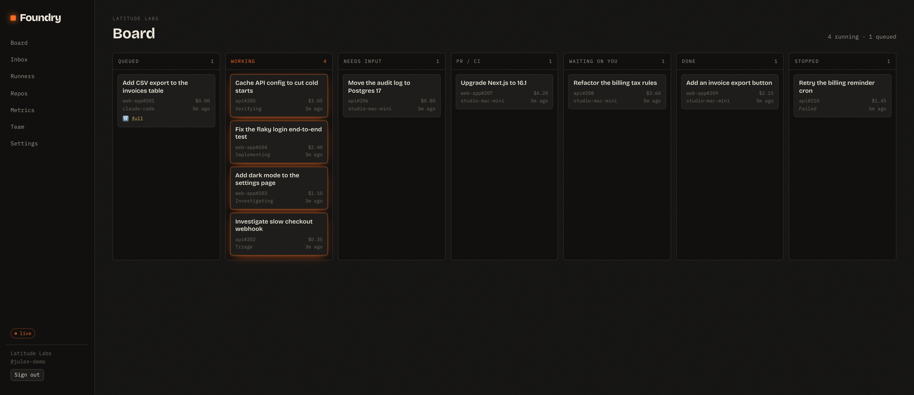
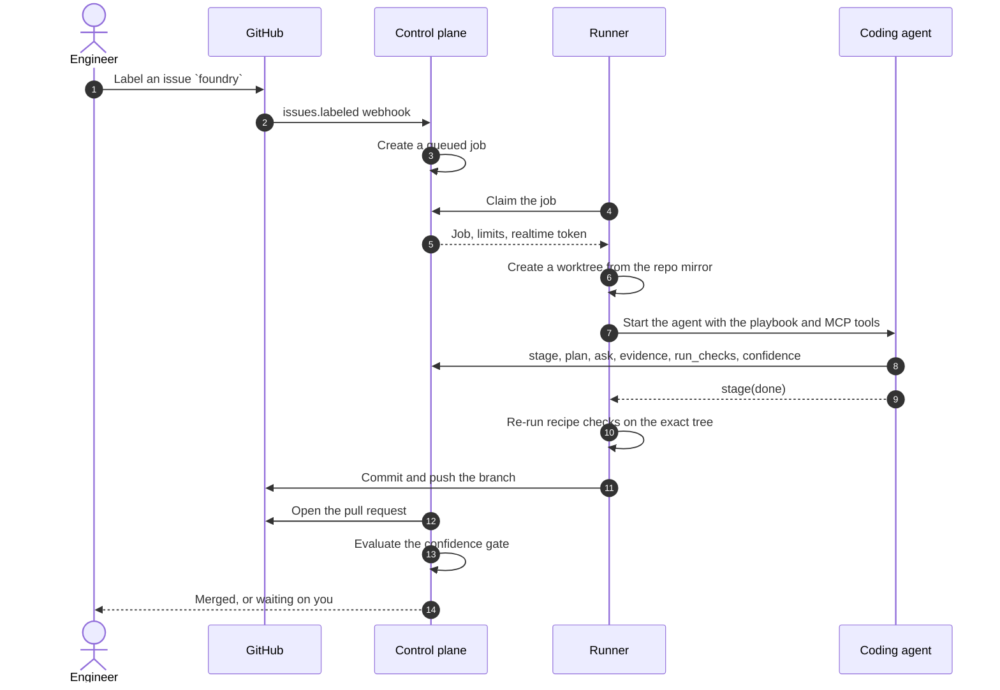
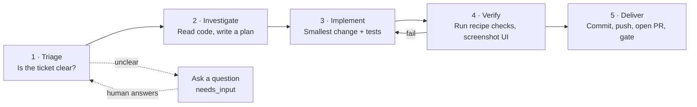
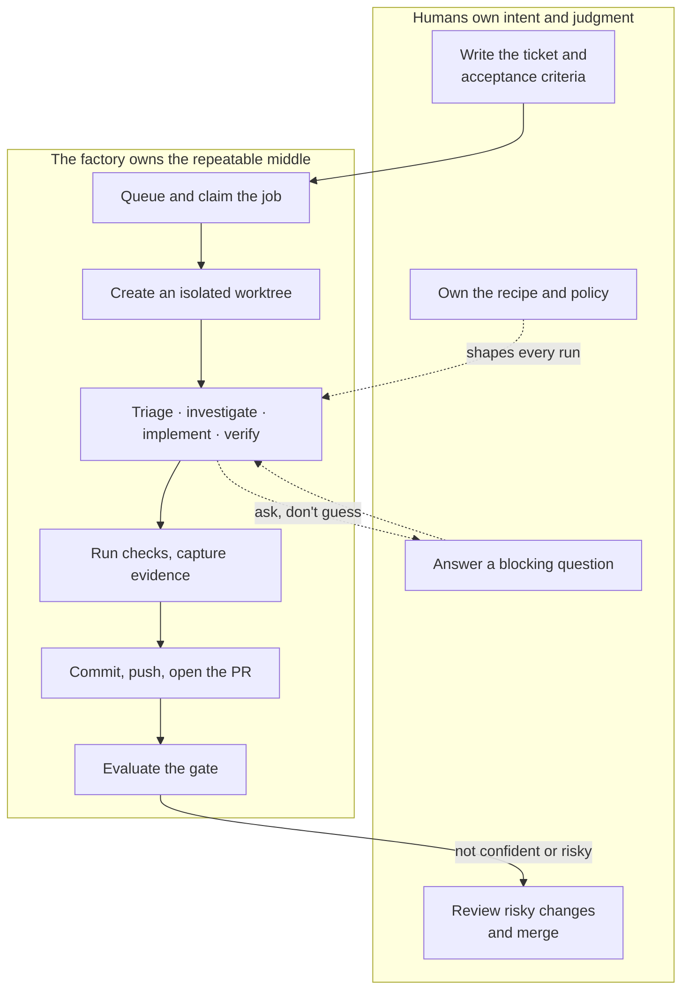
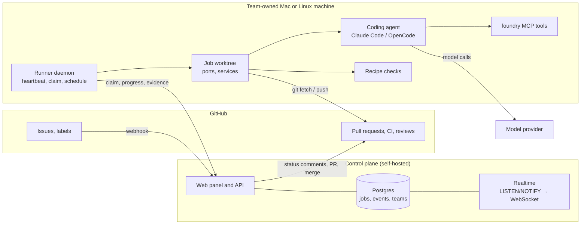
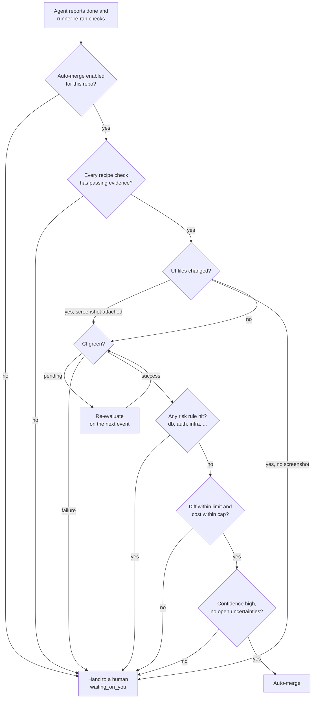
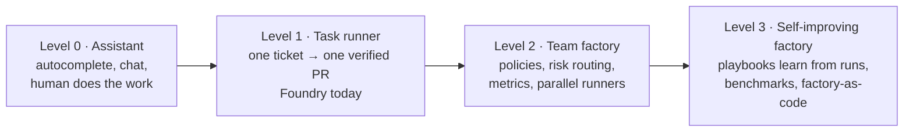

# Software factories, explained

> 中文版本: [introduction.zh-CN.md](introduction.zh-CN.md)

This is the gentle introduction. It explains what a **software factory** is, why it is becoming
possible now, and how **Foundry** puts the idea to work: turning a GitHub issue into a verified pull
request with a coding agent doing the middle of the work. No prior knowledge of Foundry is assumed.
If you want the full architecture, follow the links at the end.

---

## 1. The problem: we still make software by hand

A ticket arrives. A person reads it, finds the relevant files, forms a plan, edits code, runs the
tests, fixes what broke, writes a pull request, waits for CI, and asks a teammate to review. Then
they switch back to whatever they were doing before.

That loop is different every time in its details and nearly identical in its shape. Multiply it by
every ticket on the board and a team spends a large share of its day on the same choreography:
understanding, editing, checking, reporting.

AI assistants help at the keystroke level — complete this line, explain this function, write this
test. But an assistant does not own a ticket. Somebody still has to decide what "done" means, keep
the agent on task, run the checks, and open the PR. The choreography stays with the human.

A software factory changes that: it makes the choreography itself the product.

## 2. What is a software factory?

A **software factory** is an assembly line for software work. It takes a unit of intent — usually a
ticket — through a fixed sequence of stages and produces a verified, reviewable result, usually a
pull request. Every step is recorded so the line itself can be measured and improved.

The word "factory" can sound like mindless mass production. It is the opposite. Think of a
professional kitchen rather than a widget press:

- **The human is the chef.** They decide what to cook, taste the result, and send back what is not
  right.
- **The agents are the cooks.** They follow recipes, work at stations, and plate the dish.
- **Foundry is the kitchen.** It provides the stations, the recipes, the pass where dishes are
  checked, and the ticket rail that keeps orders moving.

### Four things that make it a factory

| Property              | What it means                                                                                 |
| --------------------- | --------------------------------------------------------------------------------------------- |
| **Standard input**    | Work enters in a known form (a GitHub issue with acceptance criteria), not as a vague prompt. |
| **Fixed pipeline**    | The stages are the same on every run. Only the judgment inside a stage is left to the model.  |
| **Verification gate** | Nothing is "done" until the repository's own checks pass and the result is reviewable.        |
| **Measurement**       | Every stage, check, dollar and human interruption is logged, so the line can be improved.     |

### What it is not

- **Not a chatbot.** You do not converse a factory into a feature. You hand it a ticket.
- **Not "AI replaces engineers".** Humans own intent, ambiguity and risk. The factory removes the
  repetitive middle, not the judgment at the edges.
- **Not autocomplete.** The unit of work is a whole ticket with acceptance criteria, not a line of
  code.

## 3. Why this is possible now

Two ideas make a software factory more than a demo:

1. **Coding agents are good enough at bounded tasks.** Give an agent a ticket with clear acceptance
   criteria and a repository it can read, and it can usually make the change. The hard part is no
   longer raw code generation.
2. **The deterministic outer loop.** Repeated work belongs in ordinary code, not in a prompt. Queue,
   claim, state transitions, check execution, git, the merge decision and resume-after-crash are all
   deterministic. The model is called only for the judgment inside a stage. This makes runs cheaper,
   repeatable and measurable, and it means you can test the factory like any other program.

Verification is the other half. Autonomy is only safe when "it worked" means something. A factory
that cannot run your tests, your build and (for UI changes) a browser is just a fast way to open bad
pull requests. That is why the repository's checks — its **recipe** — are first-class, not an
afterthought.

## 4. Meet Foundry

Foundry is an open, self-hosted software factory for small product teams. In one sentence:

> **Foundry turns GitHub issues into verified, merged pull requests.**

Label an issue `foundry`. A long-lived **runner** on one of your team's Mac or Linux machines claims
the job, creates an isolated git worktree, and drives a coding agent (**Claude Code** or **OpenCode**)
through a fixed playbook. The agent reports progress through a small set of MCP tools. When it is
done, the runner runs your repository's checks on the exact tree that will be committed, pushes the
branch, and opens a pull request. A **confidence gate** then decides whether the change merges itself
or waits for a human.

_The board with a sample team. Each ticket shows its repository and issue number, its cost, the
stage or runner handling it, and when it last changed. Tickets in the Working lane are live; the
Needs input lane is waiting for a human answer._

## 5. The path from ticket to pull request

The job keeps a full timeline: every stage change, question, check result and cost update. If the
runner sleeps or crashes, the job is re-queued and resumes from its last checkpoint on any eligible
runner. If the agent needs a decision, it asks and the job parks in `needs_input` until a human
answers.

## 6. The five stations

1. **Triage.** Read the ticket and decide whether it is clear enough to build. If two reasonable
   readings would produce different code, the agent asks one concrete question with two to four
   options instead of guessing. Then the job stops and waits — no tokens burned on a guess.
2. **Investigate.** Find the relevant code, tests and conventions. For a bug, reproduce it. Write a
   short numbered plan of the files to change and the tests to add, and record it on the job.
3. **Implement.** Make the smallest change that meets the acceptance criteria. Follow the style
   around it, add tests that would fail without the change, and leave unrelated code alone.
4. **Verify.** Run the repository's own checks — lint, typecheck, tests and anything else the recipe
   defines. If they fail, the failure output goes back to the agent and it tries again, up to a
   configured number of loops. If UI files changed, it starts the app and attaches a screenshot.
5. **Deliver.** The runner, never the agent, commits and pushes. The control plane opens the pull
   request and evaluates the confidence gate.

The stage order is enforced. A job cannot jump from triage to merged; legal transitions live in one
place in the code (`packages/shared/src/states.ts`), and the runner and panel both use them.

## 7. Who does what

This split is the whole design. The factory is deterministic where repetition lives and calls the
model where judgment lives. Humans stay at the edges: setting intent going in, judging outcomes
coming out, and handling anything ambiguous or risky in between.

## 8. Under the hood

Three properties matter more than the boxes:

- **The control plane holds metadata, not source code.** Jobs, events, evidence metadata and
  screenshots pass through it. The checkout, credentials and the code the agent reads stay on the
  runner machine.
- **The runner and agent speak through a small, fixed interface.** The `foundry` MCP server exposes
  `stage`, `plan`, `ask`, `evidence`, `run_checks` and `confidence`. The control plane does not parse
  the agent's chat; it receives typed progress reports. That is why Claude Code and OpenCode are
  interchangeable behind the harness adapter.
- **The recipe is the repository's own definition of "works".** It lives in `.foundry/recipe.yaml`
  and is checked into the repo, so the factory follows the project instead of the other way round.

## 9. The confidence gate

Auto-merge is not a mood. It is a rule set evaluated by ordinary code, and the agent's own confidence
can only lower trust, never override a failed rule.

Rules can be tuned per repository. A typical setup keeps auto-merge off entirely and uses the factory
only to prepare reviewed PRs; a confident setup enables it and uses **risk rules** — path patterns
such as migrations, auth code or infrastructure — to force named reviewers onto sensitive changes.
The gate is also where small diffs pay off: a large change is more likely to wait for a human, which
nudges everyone toward smaller PRs.

## 10. Safety, privacy and trust

A factory that touches your code has to be boringly safe. Foundry's defaults:

- **Code stays local.** Repository contents never reach the control plane. Only checks, notes and
  screenshots are uploaded, and artifact URLs are signed.
- **The agent cannot push.** The runner performs every `git push` itself, with short-lived
  installation tokens passed in `http.extraheader` — never in a URL or a command line that an error
  message might print.
- **Secrets stay on the machine.** They live in the OS secret store, and known values plus token
  patterns are scrubbed from events, check output and the transcript before anything leaves.
- **Jobs are isolated.** Each gets its own worktree, port block, process group and optional
  database. The agent stays inside its worktree and is denied commands such as `sudo` by default.
- **Everything is auditable.** An append-only event log records stages, questions, checks, cost and
  the gate decision for every job.

## 11. Where a software factory fits

**It fits** small product teams (roughly 2–20 engineers) with a real issue tracker, a repository
with meaningful automated checks, and a stream of well-scoped tickets: bug fixes, small features,
dependency bumps, test improvements, documentation.

**It fits less well** when the work is mostly strategy, research or design exploration; when the
repository has no tests or CI to verify against; or when every change needs human judgment for
regulatory reasons. A factory raises the floor on repeatable work; it does not replace the people
who decide what is worth building.

**Adoption advice from the people building these systems:**

- Start with one repository and one team, on a real slice of the product.
- Keep the backlog small. A factory that floods reviewers is just a faster queue.
- Invest in checks before autonomy. Verification is what makes the gate trustworthy.
- Treat failures as feedback about the machine: fix the playbook, the recipe or the policy, not
  only the failed ticket.

## 12. The road ahead

The current release is the first level of a longer ladder. The interesting frontier is not a
smarter model; it is a better factory around it.

- **Level 1 — task runner (today).** One ticket in, one verified PR out, with human checkpoints and
  a confidence gate. Teams measure cost per ticket, time in stage and how often the gate says
  "human".
- **Level 2 — team factory.** The factory becomes programmable: richer policies, risk-based
  reviewers, black-box acceptance suites, more harnesses and models, and metrics that compare teams
  and repos. This is where "factory as code" starts to matter — the process is versioned, reviewed
  and improved like any other code.
- **Level 3 — self-improving factory.** Runs become evidence. Meta-agents look for patterns in
  failed runs and propose changes to playbooks, recipes and policies. Past runs become a private
  benchmark for evaluating new models. The factory measures its own yield and gets better at
  choosing what to automate.

The invariant across all levels is the same: **a deterministic outer loop, verification as the
gate, and humans at the edges.** Models will change. That shape should not.

## 13. Try it and read more

- **Run it locally:** [docs/local-setup.md](local-setup.md) — the control plane, Postgres and a
  runner on your machine.
- **Onboard a repository:** [docs/onboarding.md](onboarding.md) — install the GitHub App, write the
  recipe, prove the machine can run it.
- **How Foundry is built:** [docs/design/overall-design.md](design/overall-design.md),
  [docs/design/components.md](design/components.md) and
  [docs/design/use-cases.md](design/use-cases.md).
- **The product vision and scope:** [software-factory-product-spec.md](../software-factory-product-spec.md).
- **What goes in `.foundry/`:** [docs/foundry-dot-dir.md](foundry-dot-dir.md).

If you remember one sentence: a software factory is a repeatable pipeline that turns intent into
verified software, and Foundry is a small, self-hosted one you can run on your own machines.
