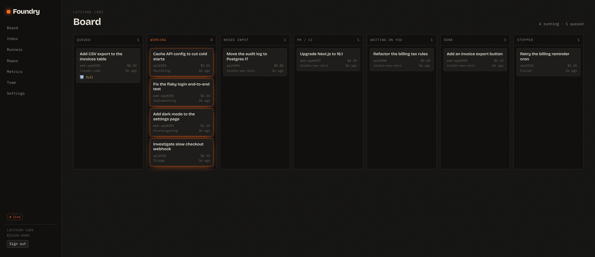
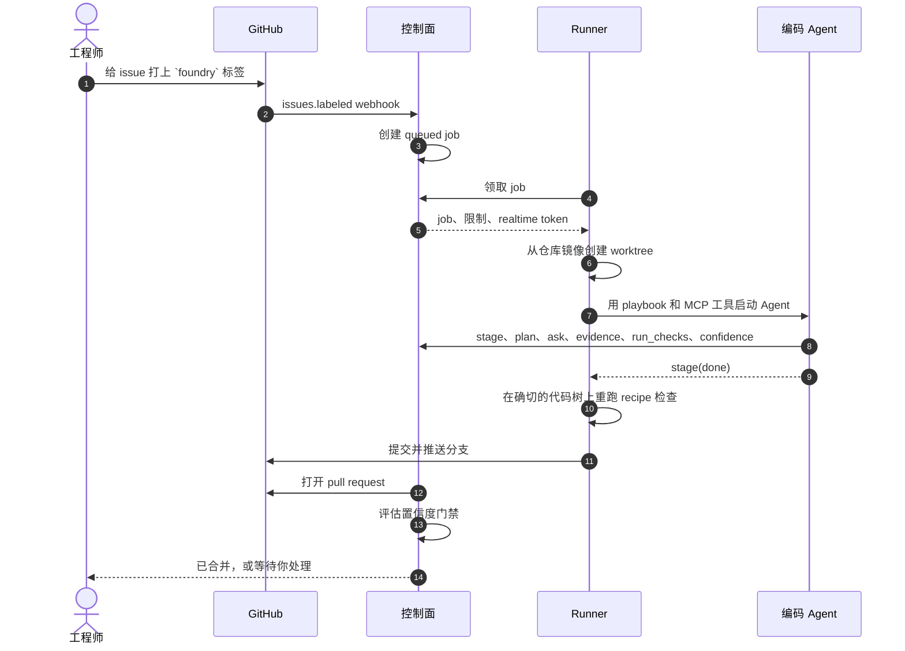
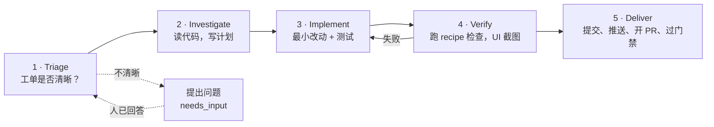
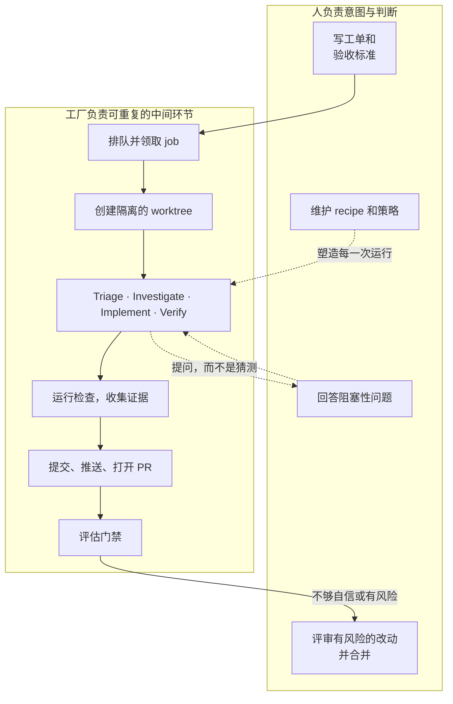
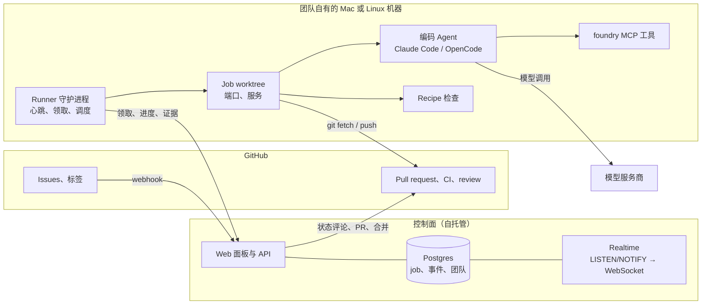
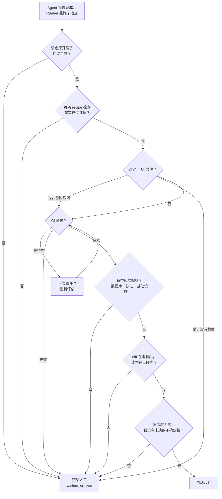
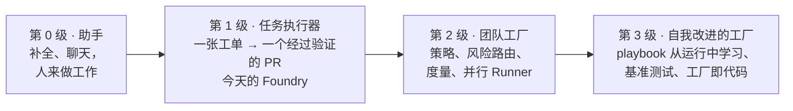

# 什么是软件工厂：写给初学者的介绍

> English version: [introduction.md](introduction.md)

这是一篇入门文章。它会解释什么是**软件工厂**、为什么这件事现在成为可能，以及 **Foundry** 如何把
这个想法变成现实：把一张 GitHub issue 变成经过验证的 pull request，中间的工作交给编码 Agent。
阅读本文不需要任何 Foundry 背景。想要完整的架构细节，请从文末的链接继续。

---

## 1. 问题：我们仍然在“手工”制造软件

一张工单进来。有人读它、找到相关代码、构思方案、修改代码、运行测试、修好失败的地方、提交 pull
request、等待 CI，再请同事 review。然后切回之前在做的事情。

这个循环每次的细节都不同，形状却几乎一样。乘以看板上的每一张工单，团队一天中很大一部分时间都花在
同一套编排上：理解、修改、验证、汇报。

AI 助手在“按键级别”帮了忙：补全这一行、解释这个函数、写这个测试。但助手并不拥有一张工单。仍然需要
有人决定“完成”意味着什么、让 Agent 保持在任务上、运行检查、打开 PR。编排工作仍然在人身上。

软件工厂改变的就是这一点：**把编排本身变成产品**。

## 2. 什么是软件工厂？

**软件工厂（software factory）是一条软件工作的流水线。** 它把一份意图——通常是一张工单——送过固定
顺序的若干阶段，产出一个经过验证、可供评审的结果，通常是一个 pull request。每一步都有记录，因此
流水线本身可以被度量和改进。

“工厂”这个词听起来像无脑的大规模生产，事实恰恰相反。把它想成一家专业厨房，而不是一台冲压机：

- **人是主厨。** 决定做什么菜、品尝结果、把不合格的菜退回去。
- **Agent 是厨师。** 按照菜谱操作、在工位间协作、把菜装盘。
- **Foundry 是厨房。** 它提供工位、菜谱、出菜口（检查的地方），以及让订单流动起来的出单轨道。

### 让它成为“工厂”的四件事

| 属性         | 含义                                                       |
| ------------ | ---------------------------------------------------------- |
| **标准输入** | 工作以已知的形式进入（带验收标准的 GitHub issue），而不是模糊的提示词。 |
| **固定流水线** | 每次运行的阶段都相同。只有阶段内部的判断交给模型。         |
| **验证门禁** | 除非仓库自己的检查通过、结果可供评审，否则不算“完成”。     |
| **可度量**   | 每个阶段、每次检查、每一美元和每一次人工介入都被记录，流水线才能改进。 |

### 它不是什么

- **不是一个聊天机器人。** 你不是靠聊天“聊”出一个功能，而是交给它一张工单。
- **不是“AI 取代工程师”。** 人负责意图、歧义和风险。工厂拿走的是重复的中间环节，不是边缘的判断。
- **不是自动补全。** 工作单元是一张带验收标准的完整工单，而不是一行代码。

## 3. 为什么现在可行

两件事让软件工厂不再只是演示：

1. **编码 Agent 在边界清晰的任务上已经足够好。** 给 Agent 一张验收标准明确的工单和一个可读的仓库，
   它通常能完成修改。难点不再是原始的代码生成。
2. **确定性的外循环。** 重复性的工作应该写成普通代码，而不是塞进提示词。排队、领取、状态转换、
   运行检查、git 操作、合并决策、崩溃后续跑——这些都是确定性的。只有阶段内部的判断才调用模型。
   这让运行更便宜、可复现、可度量，也意味着你可以像测试任何程序一样测试工厂。

另一半是验证。只有当“成功”有真实含义时，自治才是安全的。一个不能运行你的测试、构建和（对 UI 改动
而言）浏览器的工厂，只是一个更快地制造坏 PR 的方式。这就是为什么仓库自己的检查——它的 **recipe
（配方）**——是一等公民，而不是事后补充。

## 4. 认识 Foundry

Foundry 是一个面向小型产品团队的、可自托管的开源软件工厂。一句话：

> **Foundry 把 GitHub issue 变成经过验证、可合并的 pull request。**

给一张 issue 打上 `foundry` 标签。团队某台 Mac 或 Linux 机器上常驻的 **Runner** 会领取这个 job，
创建一个隔离的 git worktree，并驱动一个编码 Agent（**Claude Code** 或 **OpenCode**）按照固定的
playbook 工作。Agent 通过一小组 MCP 工具汇报进度。完成之后，Runner 在**即将提交的那棵代码树**上
运行仓库的检查，推送分支并打开 pull request。随后**置信度门禁（confidence gate）**决定这个改动是
自行合并，还是等待人工处理。

*一个示例团队的看板。每张工单显示仓库与 issue 编号、成本、正在处理它的阶段或 Runner，以及最后
变更时间。Working 列中的工单是实时运行的；Needs input 列则在等待人工回答。*

## 5. 从工单到 pull request 的路径

Job 保留完整的时间线：每次阶段变化、提问、检查结果和成本更新。如果 Runner 休眠或崩溃，job 会被重新
排队，并在任意一个符合条件的 Runner 上从最近的检查点继续。如果 Agent 需要人做决定，它会提问，job
停在 `needs_input`，直到有人回答。

## 6. 五个工位

1. **Triage（分诊）。** 读工单，判断是否足够清晰可以开工。如果两种合理的理解会产生不同的代码，
   Agent 会提出一个具体问题，并给出 2–4 个选项，而不是猜测。然后 job 停止并等待——不把 token 花在
   猜测上。
2. **Investigate（调查）。** 找到相关代码、测试和约定。如果是 bug，先复现。写一份简短的编号计划，
   列出要改的文件和要加的测试，并记录到 job 上。
3. **Implement（实现）。** 做满足验收标准的最小改动。遵循周围的代码风格，补上“没有这次改动就会失败”
   的测试，不碰无关代码。
4. **Verify（验证）。** 运行仓库自己的检查——lint、typecheck、测试，以及 recipe 中定义的任何其他内容。
   如果失败，失败输出会送回 Agent，它再试一次，直到配置的次数上限。如果改动了 UI 文件，就启动应用
   并附上截图。
5. **Deliver（交付）。** 由 Runner（绝不是 Agent）提交和推送。控制面打开 pull request 并评估置信度
   门禁。

阶段顺序是被强制的。job 不能从 triage 直接跳到 merged；合法的状态转换只定义在代码中的一处
（`packages/shared/src/states.ts`），Runner 和面板都使用它。

## 7. 谁做什么

这个分工就是整个设计。工厂在重复发生的地方保持确定性，在需要判断的地方调用模型。人始终在边缘：
进入时设定意图，出来时判断结果，中间处理任何含糊或有风险的事情。

## 8. 内部结构

比方框更重要的三个性质：

- **控制面只保存元数据，不保存源代码。** job、事件、证据元数据和截图会经过控制面；代码检出、凭据
  以及 Agent 读写的代码都留在 Runner 机器上。
- **Runner 和 Agent 通过一小套固定接口交流。** `foundry` MCP server 暴露 `stage`、`plan`、`ask`、
  `evidence`、`run_checks` 和 `confidence`。控制面不解析 Agent 的聊天内容，而是接收结构化的进度
  报告。这也是 Claude Code 和 OpenCode 可以在 harness 适配器之后互换的原因。
- **Recipe 是仓库自己对“能工作”的定义。** 它放在 `.foundry/recipe.yaml` 并提交进仓库，因此是工厂
  跟随项目，而不是项目迁就工厂。

## 9. 置信度门禁

自动合并不是一种心情，而是一组由普通代码评估的规则；Agent 自己的置信度只能降低信任，永远不能覆盖
一条失败的规则。

规则可以按仓库调整。典型的保守配置会完全关闭自动合并，只把工厂用来准备待评审的 PR；更自信的配置会
开启自动合并，并用**风险规则**——迁移、认证代码、基础设施等路径模式——把敏感改动强制交给指定
reviewer。门禁也是小 diff 划算的地方：改动越大，越可能等待人工，这会让所有人倾向于更小的 PR。

## 10. 安全、隐私与信任

一个会碰你代码的工厂必须“无聊地安全”。Foundry 的默认做法：

- **代码留在本地。** 仓库内容永远不会到达控制面。只有检查结果、备注和截图会上传，而且 artifact URL
  是签名的。
- **Agent 不能推送。** 每一次 `git push` 都由 Runner 自己执行，使用短期的 installation token，并通过
  `http.extraheader` 传递——绝不写进 URL 或可能被错误信息打印出来的命令行。
- **密钥留在机器上。** 它们存放在操作系统密钥库中；已知的值和 token 模式会在任何内容离开机器之前，
  从事件、检查输出和会话记录中擦除。
- **Job 相互隔离。** 每个 job 有自己的 worktree、端口段、进程组，以及可选的数据库。Agent 待在
  worktree 内，默认被执行策略禁止运行 `sudo` 之类的命令。
- **一切可审计。** 只追加的事件日志记录每个 job 的阶段、提问、检查、成本和门禁决策。

## 11. 软件工厂适合什么场景

**适合**大约 2–20 人的小型产品团队：有真实的 issue 跟踪、有有意义的自动化检查、并且持续产生边界
清晰工单的仓库——bug 修复、小功能、依赖升级、测试改进、文档。

**不太适合**：工作主要是战略、研究或设计探索；仓库没有测试或 CI 可供验证；或者每一次改动都因为
合规原因必须由人判断。工厂抬高的是可重复工作的下限，它不会替代决定“什么值得做”的人。

**来自构建这类系统的人的采用建议：**

- 从一个仓库、一个团队、产品中一块真实的小切片开始。
- 保持待办队列小。一个淹没 reviewer 的工厂只是一个更快的队列。
- 在自治之前先投资检查。验证是门禁可信的前提。
- 把失败当作关于机器的反馈：修 playbook、recipe 或策略，而不只是修那张失败的工单。

## 12. 未来之路

当前版本是更长阶梯的第一级。真正的前沿不是更聪明的模型，而是围绕它更好的工厂。

- **第 1 级——任务执行器（今天）。** 一张工单进，一个经过验证的 PR 出，带人工检查点和置信度门禁。
  团队可以度量每张工单的成本、各阶段耗时，以及门禁多常说“交给人工”。
- **第 2 级——团队工厂。** 工厂变得可编程：更丰富的策略、基于风险的 reviewer、黑盒验收测试、
  更多 harness 和模型，以及可以比较团队与仓库的度量。这时“工厂即代码”开始真正发挥作用——流程像
  其他代码一样被版本化、评审和改进。
- **第 3 级——自我改进的工厂。** 运行本身成为证据。Meta-agent 从失败的运行中寻找模式，并向
  playbook、recipe 和策略提出修改。过去的运行成为评估新模型的私有基准。工厂度量自己的产出，并越来
  越擅长决定该自动化什么。

所有级别共享同一个不变量：**确定性的外循环、作为门禁的验证，以及处在边缘的人。** 模型会变，这个形状
不应该变。

## 13. 试一试，继续阅读

- **在本地运行：** [docs/local-setup.zh-CN.md](local-setup.zh-CN.md) —— 控制面、Postgres，以及你机器上
  的一个 Runner。
- **接入一个仓库：** [docs/onboarding.zh-CN.md](onboarding.zh-CN.md) —— 安装 GitHub App、编写 recipe、
  证明这台机器能运行它。
- **Foundry 是如何构建的：** [docs/design/overall-design.zh-CN.md](design/overall-design.zh-CN.md)、
  [docs/design/components.zh-CN.md](design/components.zh-CN.md) 和
  [docs/design/use-cases.zh-CN.md](design/use-cases.zh-CN.md)。
- **产品愿景与范围：** [software-factory-product-spec.zh-CN.md](../software-factory-product-spec.zh-CN.md)。
- **`.foundry/` 里放什么：** [docs/foundry-dot-dir.zh-CN.md](foundry-dot-dir.zh-CN.md)。

如果只记住一句话：软件工厂是一条把意图变成经过验证的软件的、可重复的流水线；而 Foundry 是一个
小而自托管、可以跑在你自己机器上的软件工厂。
