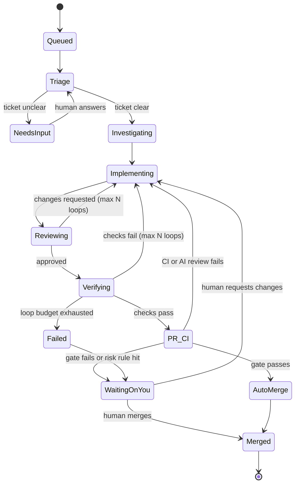
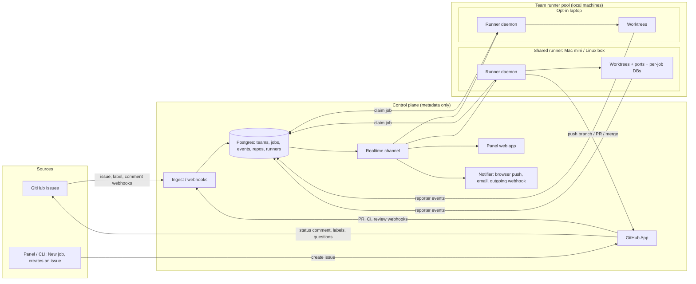

# Foundry — Software Factory Product Spec

> 中文版本: [software-factory-product-spec.zh-CN.md](software-factory-product-spec.zh-CN.md)

> Working name: **Foundry**. Version 0.5 · 2026-11-06
> **Decisions locked:** primary customer is **small product teams (2–20 engineers)** (v0.2). Jobs **run on local machines** (team-owned runners using git worktrees), not cloud sandboxes (v0.2). Runners support **macOS and Linux** from day one (v0.3). A **laptops-only** team setup is fully supported; a shared always-on runner is recommended, not required (v0.3). The MVP is **GitHub-only**: GitHub Issues is the ticket source, and questions, status and notifications use GitHub itself plus the panel (email and browser push). It has no dependency on Linear or Slack (v0.4). MVP harnesses are **Claude Code and OpenCode**; Codex, Cursor CLI and others come later. The **Runner core and the Control plane are both TypeScript** and share one monorepo and one set of types (v0.5).
> Sources studied:
> 1. [I Built My Own Software Factory with Claude Code — Jan Marshal](https://www.youtube.com/watch?v=sPpTWl3Cs14)
> 2. [WTF is a Software Factory? — Syntax, with Adam Jacob (Swamp Club)](https://www.youtube.com/watch?v=aYz9G3__Z4g)
> 3. [How to Build an AI Software Factory That Ships Faster — Boundary, with Zach Lloyd (Warp)](https://www.youtube.com/watch?v=XUEfIxkdT2Q)

---

## 1. One-liner

Foundry turns a ticket into a verified, merged pull request. Coding agents follow a fixed playbook (triage → investigate → implement → verify → PR). A confidence gate decides whether the change merges itself or goes to a human. Every run is recorded, so the factory itself can be measured and improved.

**The human is the chef, the agents are the cooks.** Foundry is the kitchen: the stations, the recipes, the pass where dishes get checked, and the ticket rail.

---

## 2. What the research says

### 2.1 Where the three sources agree

| Theme                                                            | What it means for the product                                                                                                      |
| ---------------------------------------------------------------- | ---------------------------------------------------------------------------------------------------------------------------------- |
| A factory is the SDLC run by agents, not a single smarter prompt | The core object is a _pipeline with stages_, not a chat                                                                            |
| A human stays in control, at the edges                           | Humans write the intent going in and judge the outcome coming out. The middle runs on its own unless something is unclear or risky |
| Verification is what makes autonomy possible                     | Without real checks (tests, build, browser, black-box tests) you can't trust auto-merge. Verification gets first-class investment  |
| Every factory is specific to its product                         | The factory definition lives in the repo and the team edits it. Foundry ships defaults, not one fixed process                      |
| When output is bad, fix the machine, not the output              | Failures should feed back into playbooks, skills and checks                                                                        |
| It has to be measurable                                          | Every stage, token, dollar and human touch gets logged                                                                             |

### 2.2 Insights from each video

**Jan Marshal (a working implementation)**

- The pipeline states are Queued → Triage → Investigating → Implementing ⇄ Verifying → PR/CI → Waiting on you → Merged.
- **Ask, don't guess.** If a ticket is vague ("make the recipe book nicer"), triage stops and offers options (A/B/C). The job resumes once the user answers.
- **Merge when confident.** Auto-merge happens only if the agent is confident, CI is green and the AI review raised no issues. Otherwise the job is handed to the human.
- **Repo onboarding.** An agent reads the repo in a sandbox, works out how to install and check it, and opens a "recipe" PR (`setup.json` with install, checks and a warm-image step).
- Architecture has three parts. The **runner** (the foreman, which never writes code), the **reporter** (rides inside each agent session and streams stages, sub-agents and tokens), and the **panel** (a real-time dashboard you can open from your phone).
- Jobs can run locally in git worktrees or in cloud sandboxes, one sandbox per job. Each repo gets a warm image, and sandboxes **hibernate** after 5 minutes of waiting on a human.
- Each job page shows its timeline, live events, cost (e.g. $0.35), verification evidence (4/4 checks) and an "open in IDE" takeover link.
- Lesson from his demo: verification failed because the sandbox had no browser libraries, so nothing auto-merged. **The environment is part of the factory.**

**Adam Jacob (principles)**

- **Deterministic outer loop, LLM inside it.** Don't let the LLM rediscover the same workflow on every run. Turn repeated work into typed, modular steps and call the model only where judgment is needed. This is cheaper and gives the same result every time.
- **Black-box acceptance tests come first.** If you're heading toward a factory, build an outside-in test suite before anything else. It's what makes refactoring and autonomy safe.
- **Commit to an architecture.** Write it down as a skill (domain-driven design gives agents a vocabulary they already know). Review every change against it.
- **Adversarial reviewers for non-functional requirements** (accessibility, performance, Lighthouse score). A router decides which reviewers a given change needs.
- **Rollout:** start with a team of about five people working on a real slice of the product, show working proof, then expand. Keep the backlog small.
- Product managers shift from "tell engineers what to build" to "review outcomes", because rework is cheap now.

**Zach Lloyd / Boundary (measurement and governance)**

- **Factory as code.** The factory is defined declaratively (agents, skills, MCP servers, models, where jobs run), like Terraform. That makes it versionable, branchable, diffable and A/B-testable.
- **Metrics:** human interactions per PR (an automation index, not a yes/no), DORA metrics, cost per engineer and per stage, and online evals (an LLM judges sampled traces, e.g. "redundant tests", "dead ends", "relearning something that should be a skill").
- **Meta-agents** look for patterns in failed runs and propose diffs to the factory definition.
- **Runs become benchmarks.** Good and bad past runs become a private benchmark to replay against new models. This needs anti-cheating isolation so the agent can't see the future commit.
- **Start with interactive use, then automate.** Get all work flowing through the cloud loop first (Slack, Jira, MCP, even with direct prompts). Then automate a growing share of it.
- **Risk-based review.** An owners-style file can contain code or LLM predicates, e.g. "touches env vars", "adds a table", "adds a dependency". Those changes force review by a named human. A side effect: a "small PR with no risky paths auto-merges" policy pushed engineers to write smaller PRs, and the share of PRs qualifying rose from 10% to 80%.
- **Evidence beats reading code** for UI changes: screenshots and computer-use videos.
- **Plan to minimize expected pain** (the chance of rework times the cost of that rework). Plan hard for schemas, not for button colors. Optionally run spec → implement → re-spec → re-implement.
- "Yield" is hard to define and differs per business. Very small, pre-product-market-fit teams don't need heavy factory infrastructure.

### 2.3 Design principles for Foundry

1. **Recipe over vibes.** Every job follows a playbook with explicit stages. Nothing improvises its way to "done".
2. **Verify before trust.** The scope of auto-merge equals the scope of what verification can actually check.
3. **Ask instead of guess.** When an agent is uncertain, that's a state in the pipeline, not a failure.
4. **Humans at the pass.** Users approve outcomes and answer questions. They don't babysit steps.
5. **The factory is code.** It's versioned in the repo, reviewed like code, and improved like code.
6. **Everything is an event.** If it wasn't recorded, it can't be measured or improved.
7. **Deterministic where possible.** Repeated work becomes scripts and steps. LLMs are used for judgment.
8. **Bring your own harness and model.** Claude Code, OpenCode, Codex, Cursor and others are interchangeable workers.

---

## 3. Problem and users

### 3.1 Problem

Developers using coding agents today act as the "continue button". They prompt each step by hand (investigate, code, test, open the PR, merge). Throughput is capped by human attention. Quality varies because every session improvises, and there's no record of what agents did, what it cost, or why it failed.

Teams that try to fix this end up wiring Docker, webhooks and bots together into fragile internal tools.

### 3.2 Target users

| Segment                                                         | MVP?                      | Need                                                                                                                                                                                            |
| --------------------------------------------------------------- | ------------------------- | ----------------------------------------------------------------------------------------------------------------------------------------------------------------------------------------------- |
| **Small product team (2–20 engineers)** past product-market fit | **Yes (primary)**         | A shared queue anyone on the team can file into, auto-merge for low-risk work, a forced human look at risky changes, cost visibility per person and repo, all on hardware the team already owns |
| **Solo builder / indie hacker** running several products        | Supported (a team of one) | Ship many small changes in parallel while away from the keyboard                                                                                                                                |
| **Mid-size engineering org (50–500)**                           | Full version              | Governance, risk policies, audit trail, private benchmarks, per-team factories                                                                                                                  |
| Pre-PMF teams of 1–3 exploring                                  | Not targeted              | Too early; plain agent subscriptions are enough                                                                                                                                                 |

### 3.3 Jobs to be done

- "When I file a clear ticket, I want a mergeable PR with proof it works, without touching it."
- "When a ticket is vague, I want to be asked a crisp question on my phone, not get a wrong PR."
- "When something risky changes (schema, auth, dependencies), I want to be forced to look."
- "I want to know which kinds of work the factory handles well, what it costs, and how to make it better."

### 3.4 Positioning

- **Compared with chat-based coding agents** (Claude Code, OpenCode, Codex, Cursor): Foundry doesn't replace them. It **orchestrates** them as workers.
- **Compared with Linear-to-agent integrations:** Foundry owns verification, the confidence gate and measurement, not just dispatch.
- **Compared with Warp Factories and other enterprise platforms:** Foundry is self-serve for small teams. It's open-core and opinionated about its playbooks. It is **local-first**: code, secrets and compute stay on the team's own machines, and only metadata (job state, events, costs) goes to the control plane. There's no sandbox bill.

---

## 4. Core concepts (glossary)

| Concept                | Definition                                                                                                                            |
| ---------------------- | ------------------------------------------------------------------------------------------------------------------------------------- |
| **Source**             | Where work comes from. In the MVP that's GitHub Issues only (the panel and CLI just create issues). Linear, Slack and MCP come later  |
| **Job**                | One unit of work: a ticket moving through the pipeline. It has one branch and one PR                                                  |
| **Playbook**           | The ordered stages and instructions a job follows (feature, bugfix, refactor, chore)                                                  |
| **Recipe**             | Per-repo machine setup: install, check commands, warm-image steps, required tools (e.g. a browser)                                    |
| **Harness**            | The coding agent that does the work. Claude Code and OpenCode in the MVP; Codex, Cursor CLI and others later                          |
| **Runner**             | Long-lived process that claims jobs, launches the harness, watches it, merges and cleans up. It never writes code                     |
| **Reporter**           | Hook or plugin inside the harness session that emits stage, token, cost and log events                                                |
| **Workspace**          | Where a job executes: a git worktree on a runner machine, with its own ports and env file. A local container is optional              |
| **Runner pool**        | The team's set of registered runner machines (e.g. an always-on Mac mini plus engineers' laptops). Jobs are scheduled across the pool |
| **Confidence gate**    | The rule set that decides between auto-merge and handover to a human                                                                  |
| **Risk rule**          | A predicate over a diff (a path glob, a regex, or later an LLM judge) that forces human review                                        |
| **Evidence**           | Artifacts proving the change works: check output, screenshots, videos, test reports                                                   |
| **Panel**              | Real-time web UI: inbox, job board, job detail, repos, machines, settings, metrics                                                    |
| **Factory definition** | The `.foundry/` folder in each repo containing recipe, playbooks, policies and skills                                                 |

---

## 5. MVP

### 5.1 MVP goal

**A team of 3–10 engineers connects their GitHub repos and runs the Foundry runner on the machines they already have: their Mac or Linux laptops, and optionally a shared box. Anyone on the team files tickets, and the team gets back merged PRs with evidence. Unclear tickets come back as questions to whoever filed them, and risky changes go to the right reviewer.**

Target: 7–8 weeks for one experienced builder working with agents.

### 5.2 MVP scope at a glance

| Area              | In MVP                                                                                                                                                                                                                                                                                                 | Deferred to full version                                                                                 |
| ----------------- | ------------------------------------------------------------------------------------------------------------------------------------------------------------------------------------------------------------------------------------------------------------------------------------------------------ | -------------------------------------------------------------------------------------------------------- |
| Sources           | **GitHub Issues only** (by label), plus a "New job" box in the panel that simply creates a GitHub issue                                                                                                                                                                                                | Linear and Slack (1.0), Jira, Sentry, MCP, email                                                         |
| Repo host         | GitHub (GitHub App)                                                                                                                                                                                                                                                                                    | GitLab, Bitbucket, Cursor Origin                                                                         |
| Harnesses         | **Claude Code** (Anthropic models) and **OpenCode** (any provider: Anthropic, OpenAI, Google, OpenRouter, or local models), both run headless behind one adapter interface (see 5.8.1)                                                                                                                 | Codex CLI, Cursor CLI, Gemini CLI/Antigravity, mixing harnesses and models per stage                     |
| Workspaces        | **Local only, on macOS and Linux.** A team runner pool that is either laptops only or laptops plus shared always-on machine(s). Git worktree per job, per-job port and env allocation, checkpoints so jobs can move between machines                                                                   | Optional local Docker isolation per job (1.0); cloud sandboxes as an opt-in overflow (2.x)               |
| Playbooks         | One built-in playbook (triage → investigate → implement ⇄ review → verify → PR) with bugfix and feature variants                                                                                                                                                                                       | Custom playbooks, deterministic steps, spec stage, spec→impl→respec                                      |
| Verification      | Recipe checks (lint, types, tests, build) plus a headless-browser screenshot for UI repos, and an independent read-only code review of the diff                                                                                                                                                        | Black-box acceptance suites, computer-use videos, multiple adversarial reviewer skills                   |
| Merge policy      | `off` / `merge_when_confident` per repo, with fixed gate rules                                                                                                                                                                                                                                         | Programmable gates, tiered approvals, small-PR policies                                                  |
| Risk rules        | Path globs and regexes in `.foundry/policy.yaml`, each mapped to a **required reviewer** (a GitHub user or team)                                                                                                                                                                                       | LLM-judge predicates, per-file review tracking                                                           |
| Human-in-the-loop | Ask-instead-of-guess questions with options, routed to **the ticket's author** with an @mention on the issue. Answer by ticking a checkbox or replying in the issue, or with one click in the panel. Notifications come through GitHub's own notifications, plus email and browser push from the panel | Slack DMs with buttons (1.0), mobile app push, multiplayer threads, tagging teammates into a running job |
| Takeover          | "Open workspace": an SSH or Cursor/VS Code Remote link to the worktree on the runner machine                                                                                                                                                                                                           | Live pairing, steering a running agent                                                                   |
| Observability     | Real-time inbox, job board and list, job timeline, logs, cost and tokens per job, per person, per repo and per day                                                                                                                                                                                     | Online evals, A/B tests, benchmarks                                                                      |
| Team              | One workspace per team, GitHub sign-in, two roles (admin and member), shared queue, a per-member "My jobs" view                                                                                                                                                                                        | Multiple teams per org, SSO/SCIM, fine-grained roles, audit export                                       |

### 5.3 The MVP pipeline



What each stage does:

- **Triage:** classifies the ticket as feature, bug or chore and checks it has acceptance criteria. If it's unclear, it writes one question with two to four options plus a free-text answer and moves to `NeedsInput`.
- **Investigating:** reads the code, writes a short plan into the job (files to touch, approach, risks). Plans in more depth when a risk rule is likely to fire, e.g. on schema changes.
- **Implementing:** edits code on branch `foundry/<job-id>-<slug>`.
- **Reviewing:** a fresh, read-only reviewer session inspects the diff in a throwaway worktree with the ticket, plan and summary. It reports blocking and non-blocking findings. Blocking findings loop back to Implementing up to `max_review_loops` times; a clean review (or an exhausted loop budget, which then fails the gate) moves to Verifying.
- **Verifying:** runs the recipe checks. For UI changes it also starts the app and captures screenshots. Failures loop back to Implementing, up to 3 times by default. Every check's command, exit code and output tail is stored as evidence.
- **PR/CI:** opens the PR with a template (summary, plan, evidence, a self-reported confidence and why), then waits for CI and the optional AI review (e.g. Bugbot). Failures loop back to Implementing.
- **Gate:** see section 5.5.
- **Waiting on you:** the human merges, requests changes (which go back to the agent as a new message), or closes.

### 5.4 Repo onboarding ("recipe PR")

1. The user installs the GitHub App and selects a repo in the panel.
2. Foundry starts an onboarding job on a runner in the team pool. The agent finds the package manager, install command, check commands, dev server command and required system tools (e.g. Playwright browsers).
3. It **runs** every command to prove it works, then opens a PR adding:

```text
.foundry/
  recipe.yaml       # install, checks, dev server, system deps, warm steps
  policy.yaml       # merge mode, risk rules, loop budgets, cost caps
  playbook.md       # optional per-repo overrides and notes for agents
  skills/
    architecture.md # optional: conventions and architecture vocabulary
```

Example `recipe.yaml`:

```yaml
install: bun install --frozen-lockfile
checks:
  - name: lint
    run: bun run lint
  - name: typecheck
    run: bun run typecheck
  - name: test
    run: bun test
  - name: build
    run: bun run build
dev_server:
  run: bun run dev --port $FOUNDRY_PORT # runner assigns a free port per job
  ready_path: /
services: # per-job local resources
  postgres: { database: "app_$FOUNDRY_JOB_ID" } # created on the runner's shared Postgres, dropped on cleanup
env_file: .foundry/env.example # keys only; values come from the runner's secret store
system_deps: [playwright-chromium]
warm: # runs once per runner per lockfile hash
  - bun install --frozen-lockfile
  - bunx playwright install --with-deps chromium
```

Example `policy.yaml`:

```yaml
merge: merge_when_confident # off | merge_when_confident
require_ci_green: true
require_ai_review_clean: true # e.g. Bugbot
max_verify_loops: 3
max_cost_per_job_usd: 5
max_diff_lines_for_automerge: 400
risk_rules:
  - name: database schema
    paths: ["**/migrations/**", "**/schema.prisma", "**/*.sql"]
    reviewers: ["@acme/backend-leads"]
  - name: secrets and env
    diff_regex: "process\\.env\\.|std::env::var"
    reviewers: ["@alice"]
  - name: dependencies
    paths: ["package.json", "bun.lock", "Cargo.toml"]
    reviewers: ["@acme/maintainers"]
  - name: auth
    paths: ["src/auth/**"]
    reviewers: ["@bob"]
```

4. Once the recipe PR is merged, each runner that serves the repo builds a **warm cache**. That means a bare mirror clone, dependency caches keyed by lockfile hash, and system tools. A new job's worktree then needs only a `git worktree add` and a fast, cache-hit install.
5. Every runner runs a **capability check** for each repo (all recipe checks pass, the dev server boots, a screenshot can be taken). It's marked `ready` or `not ready, with a reason`. Jobs are only scheduled onto runners that are ready for that repo. This turns Jan's "couldn't verify" case into a blocker at setup time instead of a surprise later.

### 5.5 The confidence gate (MVP rules)

A PR auto-merges **only if all of these hold**:

1. Repo policy is `merge_when_confident`.
2. Every recipe check passed in Verifying, and evidence exists for each one.
3. UI-affecting change (detected from file types or paths): at least one screenshot was captured successfully.
4. CI is green, and the AI review (if required) has no unresolved blocking comments.
5. The independent reviewer approved the change. If its loop budget was exhausted, its failed evidence blocks the gate.
6. No risk rule matched the diff.
7. Diff size ≤ `max_diff_lines_for_automerge`.
8. The agent's self-assessment is `high`, and it lists no open uncertainties.
9. Total job cost ≤ `max_cost_per_job_usd`.

Otherwise the job moves to **Waiting on you**, with the specific failed rules listed at the top of the job page, e.g. "Risk rule hit: database schema (2 files)". The handover is **routed**, not broadcast. If a risk rule fired, its `reviewers` are requested on the PR and notified. Otherwise the ticket's author is asked to review. Each team member's inbox shows only what's waiting on them, plus a team-wide "unassigned" lane.

Self-assessed confidence alone is never sufficient. It can only _lower_ trust, never override a failed rule.

### 5.6 MVP features by screen

**Inbox (home, per member)**

- "Waiting on you" cards at the top: questions about tickets you filed (answer in one tap) and PRs where you're a required reviewer.
- "Unassigned" lane: handovers with no clear owner, which any member can claim.
- Your active jobs with their live stage, and a toggle to show the whole team's.
- Today's team totals: jobs, merged, auto-merged, tokens, money spent.

**Jobs (board and list views)**

- Columns or groups by stage, updating in real time.
- Filter by repo, author, harness, runner and status.

**Job detail**

- Header: title, source link, author, repo, harness and model, runner machine and worktree path, cost, elapsed time.
- Timeline of stages with durations and loop counts.
- Plan, evidence (check results, screenshots), PR link, gate result.
- Live event and log stream.
- Actions: answer, send a message, retry from a stage, cancel, open workspace, merge or close.

**Repos**

- Onboarding status, recipe PR, per-runner readiness, defaults (harness, merge mode), whether jobs are accepted.

**Runners**

- The team pool: each machine's owner, type (`shared` or `personal`), online status, last seen, CPU, memory, disk, running jobs out of the concurrency limit, and which repos it's ready for.
- Each runner also shows its OS and CPU architecture.
- Personal laptops are opt-in, with an "only on AC power" default schedule. When the team has shared machines, those are preferred.
- Laptops-only teams see a capacity card: hours the queue had no online runner this week, and the estimated queue time a shared runner would have saved.
- Drain a runner (stop new jobs, let current ones finish) and remove it.

**Team**

- Invite with GitHub sign-in, roles (admin or member). Each member's GitHub login is their identity for routing questions and reviews, so no other accounts need linking.

**Settings**

- Default harness and model, team model API keys (bring your own key), notification preferences per member (GitHub only, email, browser push, or a daily email digest), team spend cap per day.

### 5.7 Ticket conventions: GitHub-native workflow

The MVP needs only GitHub plus the Foundry panel. Every team in the target market already has GitHub, and the GitHub App installed in onboarding gives Foundry everything it needs, so setup is "install one app" rather than three.

**Filing work**

- Adding the `foundry` label to an issue starts a job. Onboarding creates the label in each repo.
- Onboarding also adds an issue form, `.github/ISSUE_TEMPLATE/foundry.yml`, with **Goal**, **Acceptance criteria**, **Constraints** and **Out of scope** fields. The form applies the `foundry` label automatically. Triage scores tickets against these fields and asks a question if a section that matters is missing.
- Optional override labels: `harness:claude-code` or `harness:opencode`, `model:<provider/model>` (e.g. `model:openai/gpt-5.4`, for OpenCode), `runner:<machine-name>` (pin a job to one machine), `playbook:bugfix`.
- Other ways to file: the panel's "New job" box, which just creates the issue for you, and `foundry new "<title>"` in the CLI. Either way, the GitHub issue stays the single source of truth.
- Teams wanting a board can use **GitHub Projects**. Foundry keeps an optional "Foundry stage" field in sync, so the project board shows Triage, Implementing, Waiting on you and so on.

**Status on the issue**

- Foundry posts **one status comment** per job and keeps editing it rather than adding new ones. It shows the current stage, runner, cost so far, a link to the job page, and the PR once it exists.
- A single `foundry:<stage>` label, e.g. `foundry:waiting-on-you`, is swapped as the stage changes, so issue lists can be filtered by stage.
- The PR body says `Closes #<issue>`, so merging closes the issue the normal GitHub way.

**Asking questions (ask instead of guess)**

- A question is posted as a new issue comment that @mentions the ticket's author. Each option is a task-list checkbox:

```markdown
@alice I need one decision before continuing:

**Which scope should this cover?**

- [ ] A. Visual polish only (spacing, typography, colors)
- [ ] B. Visual polish plus layout changes
- [ ] C. Full redesign, including new components

Tick one box, or reply with your own answer.
```

- Ticking a box (Foundry gets an `issue_comment.edited` webhook) or replying with a comment both count as the answer. So does one click in the panel. The first answer wins, and Foundry edits the question comment to show "Answered: A by @alice".
- Changes requested on a PR in "Waiting on you" use GitHub's normal review flow. A review with "Request changes", or a PR comment starting with `/foundry`, goes back to the agent as its next instruction.

**Notifications (no extra tools)**

- **GitHub's own notifications** carry most of it. The @mention on a question, review requests for risk-rule reviewers, and PR activity already reach people through GitHub's web inbox, email and mobile app.
- **The panel adds two optional channels:** browser push (the panel is an installable web app, so this works on phones too) and email through a transactional email service. Each member chooses GitHub only, push, email, or a daily digest.
- **Generic outgoing webhook (optional):** a team can paste any webhook URL and get a JSON payload for "question asked", "handover" and "merged". The payload includes a ready-made one-line message in both `text` and `content` fields, the formats Slack and Discord incoming webhooks expect. That's enough to pipe events into Slack or Discord with their incoming-webhook URLs, or into anything else through Zapier or n8n, without Foundry building those integrations. Native Slack and Linear apps are planned for 1.0.

### 5.8 MVP architecture



Components:

- **Control plane (TypeScript).** A Next.js app running as a standalone Node server (panel UI and API routes), self-hosted Postgres 16, and Foundry's own small realtime service that turns Postgres LISTEN/NOTIFY into WebSocket messages. All of it ships as one Docker Compose stack (web, realtime, Postgres, and Caddy for TLS) that runs on any VM, so a team can self-host the whole control plane from day one. Ingest endpoints verify webhook signatures and write to a `webhook_inbox` table, then turn those into `job` rows. GitHub App permissions: contents, pull requests, issues, checks, workflows (to push `.github/workflows/` changes), and optionally projects for the board sync. The GitHub App also posts status comments, labels and questions on issues. The notifier sends browser push, email and optional outgoing webhooks. **No source code is stored in or passes through the control plane.** It sees job metadata, events, log tails and evidence artifacts (screenshots), and log uploads can be turned off per repo.
- **Runner (TypeScript).** Written in TypeScript on the Bun runtime and shipped as a single self-contained executable per platform (`bun build --compile` for macOS and Linux, on arm64 and x64), so users don't need Node or Bun installed. It's installed with one command (`brew install foundry`, or the Linux install script) and joined with `foundry runner join <team-token>`. The same binary provides the `foundry` CLI. It runs under a dedicated OS user (see 5.9), keeps a heartbeat, and claims jobs atomically (`UPDATE … WHERE status='queued' … SKIP LOCKED`). It only claims jobs for repos it's ready for and respects its concurrency limit and schedule. It creates the workspace, launches the harness headless with the playbook as system instructions, enforces time and cost budgets, and cleans up afterwards. **The runner never edits code.**
- **Reporter.** It has two parts that work the same way for every harness:
  1. **A per-job `foundry` MCP server**, started by the runner and given to the harness. The agent calls its tools to report progress explicitly: `stage(name)`, `ask(question, options)`, `evidence(kind, …)`, `confidence(level, reasons)`. Both Claude Code and OpenCode support MCP, so this needs no harness-specific code.
  2. **An event normalizer in the runner** that turns each harness's native stream into Foundry's `stage_changed`, `subagent_started`, `tool_call`, `usage` (tokens and cost), `question`, `evidence` and `log` events. It reads Claude Code's SDK message stream and hooks, and OpenCode's server event stream and plugin hooks.
- **Secrets.** Team model API keys are kept in the runner's local secret store (Keychain on macOS; `systemd-creds` or an encrypted file on Linux) and pushed to runners once at join time. Repo env values live on the runner, never in the control plane. They're injected per job as environment variables, and logs are scrubbed for known secret patterns before upload.

### 5.8.1 Harness adapters (Claude Code and OpenCode in the MVP)

Every harness sits behind one TypeScript interface in the runner. Adding Codex or Cursor CLI later means writing one new adapter; the playbook, reporter, gate and panel stay unchanged.

```ts
interface HarnessAdapter {
  id: "claude-code" | "opencode"; // later: "codex" | "cursor" | "gemini"
  detect(): Promise<{ installed: boolean; version?: string; authOk: boolean }>;
  start(opts: {
    cwd: string; // the job's worktree
    model: string; // e.g. "claude-opus-5.5" or "openai/gpt-5.4"
    systemPrompt: string; // playbook + repo skills
    prompt: string; // ticket body or handoff brief
    env: Record<string, string>; // FOUNDRY_PORT, keys, ...
    mcpServers: McpServerConfig[]; // always includes the per-job foundry server
    permissions: PermissionPolicy; // allowed tools and commands
  }): Promise<HarnessSession>;
  resume(sessionId: string, message: string, opts: ResumeOpts): Promise<HarnessSession>;
  stop(session: HarnessSession): Promise<void>; // graceful, then kills the process group
}

interface HarnessSession {
  id: string; // native session id, stored for sticky resume
  events: AsyncIterable<HarnessEvent>; // normalized: message, tool_call, usage, subagent, error
  done: Promise<{ status: "ok" | "error" | "stopped"; costUsd?: number }>;
}
```

|                     | **Claude Code**                                                                                                                                   | **OpenCode**                                                                                                                                                                                                  |
| ------------------- | ------------------------------------------------------------------------------------------------------------------------------------------------- | ------------------------------------------------------------------------------------------------------------------------------------------------------------------------------------------------------------- |
| Integration         | Claude Agent SDK for TypeScript (`@anthropic-ai/claude-agent-sdk`), in-process from the runner. Fallback: `claude -p --output-format stream-json` | OpenCode's headless server plus its TypeScript SDK (`@opencode-ai/sdk`), one server per job inside the worktree. Fallback: `opencode run`                                                                     |
| Models              | Anthropic models                                                                                                                                  | Any configured provider (Anthropic, OpenAI, Google, OpenRouter, local and self-hosted models), chosen per job with `model:<provider/model>`                                                                   |
| Events and cost     | SDK message stream (assistant and tool messages, the result message with usage and cost) and hooks for subagents and tool calls                   | Server event stream (session, message and tool events) and a small Foundry plugin for tool-call hooks. Cost is calculated from token usage and the provider's price table when the provider doesn't report it |
| Resume in place     | `resume: <sessionId>` in the SDK                                                                                                                  | Continue the same session ID through the SDK or server                                                                                                                                                        |
| Permissions         | SDK permission mode and allowed-tools list, generated from `policy.yaml`                                                                          | `opencode.json` permission settings, generated per job from `policy.yaml`                                                                                                                                     |
| Why it's in the MVP | The strongest coding agent for many teams today, and the harness used in Jan Marshal's factory                                                    | Open source and provider-agnostic. Teams can use OpenAI, Gemini or local models without waiting for a Codex adapter, and teams with data-residency concerns can point it at self-hosted models                |

Defaults and rules:

- Team default is Claude Code. A repo can set `default_harness: opencode`, and a ticket can override with `harness:` and `model:` labels.
- The runner's readiness check includes `detect()` for each harness. A runner that has only OpenCode installed never gets `harness:claude-code` jobs.
- The playbook is plain markdown, injected as the system prompt for either harness. Harness-specific notes, if needed, live in `.foundry/playbook.<harness>.md`.
- Portable resume (see 5.9) can change harness on purpose. For example, if a Claude Code job lands on a runner with only OpenCode, it can continue from the handoff brief. This is off by default and recorded on the timeline.
- Exact SDK options and CLI flags for both harnesses are confirmed in a week 2 spike and pinned to tested versions. The runner refuses to use a harness version it hasn't been tested against unless an admin overrides it.

### 5.8.2 Tech stack (TypeScript end to end)

The runner, control plane, CLI, MCP server and shared schemas are all TypeScript in one monorepo, so event types, job states and the `.foundry/` file schemas are defined once and checked at compile time on both sides.

```text
foundry/                         # pnpm workspaces + Turborepo
  apps/
    web/                         # Control plane: Next.js (App Router) panel + API routes + webhook ingest
    realtime/                    # Small Node service: Postgres LISTEN/NOTIFY → WebSocket/SSE fan-out
    runner/                      # Runner daemon + `foundry` CLI, Bun runtime, compiled per platform
  packages/
    shared/                      # zod schemas: events, job states, recipe.yaml, policy.yaml, API contracts
    db/                          # Drizzle ORM schema + migrations (Postgres)
    github/                      # Octokit-based GitHub App client: webhooks, comments, labels, checks, merge
    harness-claude-code/         # Claude Code adapter
    harness-opencode/            # OpenCode adapter + Foundry plugin
    mcp-foundry/                 # Per-job MCP server (stage, ask, evidence, confidence)
    os-adapters/                 # macOS and Linux adapters (see 5.9)
```

| Layer                  | Choice                                                                                                                                     | Notes                                                                                                                                    |
| ---------------------- | ------------------------------------------------------------------------------------------------------------------------------------------ | ---------------------------------------------------------------------------------------------------------------------------------------- |
| Language               | TypeScript (strict) everywhere                                                                                                             | One type system for runner ↔ control plane messages                                                                                      |
| Control plane          | Next.js (standalone Node server), Drizzle ORM, self-hosted Postgres 16                                                                     | API routes for webhooks, runner API and panel; `@octokit/webhooks` for signature checks                                                  |
| Realtime               | The `apps/realtime` service: one Postgres LISTEN connection, WebSocket fan-out                                                             | Runners and the panel subscribe per team to job, event and question changes                                                              |
| Deployment             | Docker Compose: `web`, `realtime`, `postgres`, `caddy`                                                                                     | Same stack for local development and production; any VM works. GitHub webhooks reach dev laptops through smee.io or `cloudflared tunnel` |
| Artifacts              | Local disk volume behind a signed-URL route; S3-compatible storage optional                                                                | Screenshots and other evidence                                                                                                           |
| Runner runtime         | Bun, compiled with `bun build --compile` to one executable per OS and CPU                                                                  | No runtime install for users. The runner avoids native Node addons so compiled builds stay portable                                      |
| Runner ↔ control plane | HTTPS with a runner token for claiming, events and heartbeats; WebSocket for push                                                          | Contracts validated with the shared zod schemas on both ends                                                                             |
| Process and OS work    | `Bun.spawn` and `execa`, wrapping `git`, `launchctl` or `systemctl`, `caffeinate` or `systemd-inhibit`, etc.                               | OS differences stay inside `packages/os-adapters`                                                                                        |
| Validation and config  | zod plus a YAML parser for `.foundry/*.yaml`                                                                                               | The same schema powers recipe-PR validation and runner parsing                                                                           |
| Testing                | Vitest for unit tests; a fake harness adapter and a recorded-webhook GitHub mock for end-to-end pipeline tests; Playwright for panel tests | Release CI runs runner tests on macOS and Linux, arm64 and x64                                                                           |

### 5.9 Local execution model

Running locally is cheaper, keeps code on the team's hardware, and reuses the machines' existing toolchains. In exchange, Foundry has to solve isolation, availability and contention itself. MVP rules:

**Where jobs run: two supported setups**

| Setup                                                         | Who it's for                                                               | Behavior                                                                                                                                                           |
| ------------------------------------------------------------- | -------------------------------------------------------------------------- | ------------------------------------------------------------------------------------------------------------------------------------------------------------------ |
| **Laptops only** (fully supported, the zero-hardware default) | Teams trying Foundry, or fully remote teams with no spare machine          | Each member who opts in runs a runner on their own laptop. Jobs run while laptops are awake and their schedules allow. Throughput follows the team's working hours |
| **Shared runner plus laptops** (recommended upgrade)          | Teams that want jobs to finish overnight and while everyone is in meetings | One or more always-on machines (a Mac mini, a spare Linux box or a VM) run 4–8 concurrent jobs. Laptops add capacity                                               |

Neither setup is required. A team can start with laptops only and add a shared runner later without changing anything else. The panel shows how much queue time a shared runner would have saved over the last 7 days, so the upgrade prompt is based on data rather than a nag.

**Runner schedules and power**

- Each runner has a schedule. Defaults for laptops: "when on AC power", "pause while the owner is actively using the machine" (optional, based on idle time), and "nights and weekends" (optional). Shared runners default to always-on.
- While it has a job running, the runner holds a sleep inhibitor (`caffeinate -i` on macOS, `systemd-inhibit` on Linux), so an idle laptop on AC power doesn't sleep mid-job. Closing the lid still sleeps the machine, and that case is handled by re-queueing (below).
- Concurrency defaults to 1–2 on laptops, auto-suggested from CPU cores, RAM and the repo's measured build cost.

**Surviving laptops going away**

In a laptops-only team, the machine that started a job is often asleep, closed or offline when the next step is needed. Foundry handles this as the normal case, not an error:

- **Checkpoints at every stage boundary.** The runner pushes the job branch and writes a **handoff brief** to a private git ref on GitHub (`refs/foundry/<job-id>/brief`, never part of the PR). The brief holds the plan, the stage reached, check results, the Q&A so far and open uncertainties. Because it lives on GitHub, no code-bearing data has to go through the control plane.
- **Heartbeat loss.** If a runner misses heartbeats for 2 minutes during an active stage, the job goes back to the queue from its last completed stage.
- **Sticky resume, then portable resume.** When a waiting job gets its answer, or a lost job is re-queued, Foundry first offers it to the original runner for up to 10 minutes. That runner can resume the exact harness session in place. Otherwise any ready runner picks it up. It checks out the branch, reads the handoff brief and starts a fresh harness session from it. The timeline marks this "resumed on <machine>".
- **Nobody is online.** Jobs stay queued. The inbox shows "Queued, no runner online" with how long they've been waiting. Questions can still be answered on the GitHub issue or in the panel while all laptops are closed; the job continues once a runner comes back.

**Scheduling**

- Order of preference: the job's `runner:<name>` pin; the original runner for sticky resume; `shared` runners; then the least-loaded `personal` runner that's ready for the repo and inside its schedule. The job author's own laptop gets a small tie-break bonus, so takeover is local for them.
- Recipes can constrain the OS (`os: [macos]` for iOS builds, `os: [linux]` for Linux-only tooling). Jobs wait in the queue rather than overloading a machine.

**Supported operating systems: macOS and Linux from day one**

The runner is one TypeScript codebase compiled to a single executable per platform. OS-specific behavior lives in `packages/os-adapters` behind one `OsAdapter` interface (install service, create user, secret store, resource limits, sleep inhibitor, idle and power detection). Windows is not supported in the MVP (WSL2 is a candidate for 1.x).

| Concern                     | macOS (13+; Apple Silicon and Intel)                                                                        | Linux (Ubuntu 22.04+, Debian 12+, Fedora 39+; x86_64 and arm64)                                                  |
| --------------------------- | ----------------------------------------------------------------------------------------------------------- | ---------------------------------------------------------------------------------------------------------------- |
| Install                     | `brew install foundry`, or a signed and notarized `.pkg`                                                    | `curl -fsSL get.foundry.dev \| sh`, plus `.deb` and `.rpm` packages                                              |
| Run as a service            | `launchd` daemon                                                                                            | `systemd` system service                                                                                         |
| Dedicated user              | `foundry` user created with `sysadminctl` and hidden from the login window                                  | `foundry` system user created with `useradd --system`                                                            |
| Secret store                | Keychain for the `foundry` user                                                                             | `systemd-creds` where available, otherwise an age-encrypted file readable only by `foundry`                      |
| Per-job resource limits     | Process group, `nice` and `taskpolicy`. Memory is watched, and a job over its limit is killed (best effort) | cgroups v2 through `systemd-run --scope` (hard CPU and memory limits)                                            |
| Keep awake while busy       | `caffeinate -i`                                                                                             | `systemd-inhibit --what=sleep:idle`                                                                              |
| Idle and AC-power detection | `ioreg` HID idle time, `pmset -g batt`                                                                      | logind idle hint, `upower` (or `/sys/class/power_supply`)                                                        |
| Browser for verification    | Playwright Chromium, installed by the recipe's `warm` step                                                  | Playwright Chromium with `--with-deps`. The readiness check verifies the system libraries Jan's demo was missing |
| Headless servers            | Supported (Mac mini without a display)                                                                      | Supported (no desktop session needed)                                                                            |
| Container mode (1.0)        | Docker Desktop, OrbStack or Colima                                                                          | Docker or rootless Podman                                                                                        |

Both operating systems run the same readiness check, so a runner that can't verify a repo never gets that repo's jobs. Release CI tests the runner on both operating systems and both CPU architectures.

**Isolation per job (on one machine)**

- **Code:** a `git worktree` off a bare mirror, on branch `foundry/<job-id>-<slug>`.
- **Ports:** the runner leases a free port range per job, exposed as `FOUNDRY_PORT` (and more if needed), so parallel dev servers never collide.
- **Databases and services:** recipe-declared services get per-job resources on the runner's shared instances, e.g. a database named `app_<job-id>`. They're created at job start and dropped at cleanup.
- **Processes:** each job runs in its own process group, with CPU and memory limits where the OS supports them. Cancelling or finishing a job kills the whole group, so no orphaned dev servers are left behind.
- **OS user:** the runner and agents run as a dedicated `foundry` user, not as the engineer. Agents can't read the engineer's home directory, SSH keys, browser cookies or cloud credentials. The GitHub App issues a short-lived token per job for push access.
- **Optional container mode (1.0):** run each job in a local Docker or Podman container built from the recipe, for teams that want stronger isolation without the cloud.

**Waiting and resuming**

- In `NeedsInput` or `WaitingOnYou`, the agent process is stopped but the worktree and the harness session file are kept. When the human answers, the original runner resumes the session in place: Claude Code through the SDK's `resume` option, OpenCode by continuing the same session ID on a restarted OpenCode server. If that runner isn't online, the job moves to another runner using portable resume (above). This replaces cloud hibernation, and idle jobs cost nothing.
- Worktrees untouched for 7 days, and all worktrees of merged or closed jobs, are garbage-collected. A disk-space floor (e.g. 20 GB free) pauses new claims.

**Takeover**

- "Open workspace" gives an SSH or Cursor/VS Code Remote link to the job's worktree on that runner, reachable through Tailscale or the team's LAN. Opening it pauses the agent so the human and the agent don't edit at the same time. Closing hands control back with a summary of the human's changes.

### 5.10 MVP data model (core tables)

```text
teams(id, name, gh_org, daily_spend_cap_usd, outgoing_webhook_url)
users(id, email, gh_login, notify_pref, push_subscription jsonb, created_at)
memberships(team_id, user_id, role)                       -- role: admin | member
repos(id, team_id, gh_installation_id, full_name, gh_project_id, default_harness,
      default_model, merge_mode, accepts_jobs, recipe_sha)
runners(id, team_id, owner_user_id, name, kind, os, arch, os_version, token_hash,
        schedule jsonb, on_ac_power, last_seen_at, cpu, mem, disk_free,
        max_concurrency, status)                          -- kind: shared | personal; os: macos | linux
runner_repo_readiness(runner_id, repo_id, recipe_sha, ready, reason, checked_at)
jobs(id, team_id, repo_id, author_user_id, source, source_ref, title, body, playbook,
     harness, model, runner_id, worktree_path, port_base, harness_session_id, status,
     stage, last_completed_stage, brief_ref, origin_runner_id, resume_count, loop_count,
     branch, pr_number, confidence,
     gate_result jsonb, assigned_reviewers jsonb, cost_usd, tokens_in, tokens_out,
     created_at, started_at, finished_at)
events(id, job_id, ts, kind, stage, payload jsonb)        -- append-only log
questions(id, job_id, asked_user_id, prompt, options jsonb, answer, answered_by,
          answered_via, gh_comment_id, answered_at)       -- via: panel | gh_checkbox | gh_reply
evidence(id, job_id, kind, name, status, command, output_tail, artifact_url)
webhook_inbox(id, provider, delivery_id, payload jsonb, received_at, processed_at)
```

### 5.11 MVP success metrics

These are measured from the `events` table and shown on a simple metrics page, sliced by repo and team member:

| Metric                                                                                          | MVP target (after 4 weeks of real use by a 3–10 person team)                                                             |
| ----------------------------------------------------------------------------------------------- | ------------------------------------------------------------------------------------------------------------------------ |
| Weekly active filers (members who filed at least one job)                                       | ≥ 70% of the team                                                                                                        |
| Ticket → PR success rate (PR opened with all checks passing)                                    | ≥ 70%                                                                                                                    |
| Auto-merge rate (of merged PRs)                                                                 | ≥ 40% on repos with `merge_when_confident`                                                                               |
| Post-merge revert or hotfix rate for auto-merged PRs                                            | ≤ 5%                                                                                                                     |
| Human touches per merged PR (answers + messages + manual merges)                                | ≤ 1.0 median                                                                                                             |
| Ticket → merged lead time (median)                                                              | < 45 minutes for small tickets                                                                                           |
| Cost per merged PR (median)                                                                     | Tracked; target < $3                                                                                                     |
| Share of NeedsInput questions judged "good question" by the user (thumbs up or down)            | ≥ 80%                                                                                                                    |
| Time a handover waits for its routed reviewer (median)                                          | < 4 working hours                                                                                                        |
| Jobs re-queued because a runner went offline                                                    | Tracked; < 5% with a shared runner. Expected to be higher for laptops-only teams, where the goal is that resumes succeed |
| Portable resume success rate (re-queued jobs that finish on another machine without human help) | ≥ 90%                                                                                                                    |
| Queue time with no runner online (laptops-only teams, during working hours)                     | Tracked; drives the "add a shared runner" suggestion                                                                     |
| Job success rate, macOS vs Linux runners                                                        | Within 5 points of each other, as a check for OS-specific bugs                                                           |
| Success rate and cost per merged PR, Claude Code vs OpenCode (per model)                        | Tracked side by side, so teams can choose defaults from their own data                                                   |
| Runner utilization on the shared machine (busy time during working hours)                       | Tracked, to tell teams when to add capacity                                                                              |

### 5.12 MVP non-goals

- **Cloud sandboxes.** All execution is on team-owned machines.
- Multiple teams per organization, SSO, usage-based billing.
- Writing specs or PRDs from vague ideas. The MVP assumes tickets are roughly ticket-sized.
- Deploying to production or monitoring after merge.
- Custom playbook editor UI. Playbooks are edited as files in `.foundry/`.
- Replacing the IDE. Takeover just hands off to the user's existing tools.

### 5.13 MVP build plan (8–9 weeks)

| Week | Deliverable                                                                                                                                                                                                                                                                                                                                                                                                                                        |
| ---- | -------------------------------------------------------------------------------------------------------------------------------------------------------------------------------------------------------------------------------------------------------------------------------------------------------------------------------------------------------------------------------------------------------------------------------------------------- |
| 1    | Control plane skeleton: GitHub sign-in, teams and memberships, GitHub App, webhook inbox, jobs and events tables, realtime board                                                                                                                                                                                                                                                                                                                   |
| 2    | Runner core (TypeScript on Bun): `runner join`, heartbeat, atomic claiming, worktrees off a bare mirror, port leasing, process groups. `HarnessAdapter` interface plus the **Claude Code adapter** (Agent SDK), the per-job `foundry` MCP server and the event normalizer. Spike that confirms SDK and CLI details for both harnesses. `OsAdapter` interface with the **macOS** implementation (launchd, `sysadminctl` user, Keychain, caffeinate) |
| 3    | **OpenCode adapter** (server + SDK, Foundry plugin, per-job permission config, cost from token usage). **Linux** OS adapter (systemd, system user, `systemd-creds`, cgroups v2, `systemd-inhibit`). Packaging: `bun build --compile` per platform, Homebrew, signed and notarized `.pkg`, install script, `.deb`/`.rpm`. Release CI matrix covering both operating systems and both CPU architectures                                              |
| 4    | Playbook v1 (triage, investigate, implement, verify loop), `foundry` CLI for stages, questions and evidence; NeedsInput round trip with in-place stop and resume of the harness session                                                                                                                                                                                                                                                            |
| 5    | Repo onboarding and recipe PR; per-runner readiness checks on both operating systems; warm caches; PR creation with template; CI and review webhooks; gate v1 with reviewer routing; auto-merge                                                                                                                                                                                                                                                    |
| 6    | Runner pool: schedules (AC power, idle, nights), sleep inhibitor, stage checkpoints and handoff briefs, heartbeat-loss re-queue, sticky then portable resume, OS- and harness-constrained scheduling, garbage collection, per-job DB services                                                                                                                                                                                                      |
| 7    | GitHub-native workflow: issue form, status comment edited in place, `foundry:<stage>` labels, checkbox and reply answers, `/foundry` PR commands, optional GitHub Projects sync; notifier (browser push, email, outgoing webhook); per-member inbox; "no runner online" states                                                                                                                                                                     |
| 8    | Job detail page (timeline including "resumed on"), workspace takeover link, cost per member and repo, metrics page with capacity card, team spend cap                                                                                                                                                                                                                                                                                              |
| 9    | Dogfood with 2 real small teams: one **laptops-only** and one with a **Linux shared runner**. Harden failure modes (lid closed mid-stage, resume on a different OS, port leaks, flaky CI), write docs, private beta                                                                                                                                                                                                                                |

**Dogfooding rule:** from week 5, once a ticket can become a PR end to end, Foundry's own tickets go through Foundry.

---

## 6. Full version

The full version turns Foundry from "a pipeline that runs tickets" into **a programmable, measurable, self-improving factory platform for teams.** It's organized into seven modules.

### 6.1 Module A — Intake and planning

- **More sources:** Linear (with two-way status sync), Jira, Slack (a thread becomes a job, and the reply thread becomes the conversation), Sentry (an error becomes a bugfix job, with deduplication), MCP (file jobs from any agent), email, CLI and API.
- **Intake triage agent:** merges duplicates, splits epics into job-sized tickets, attaches relevant code and past jobs, and estimates risk and size.
- **Planning tuned to expected pain.** Planning depth is chosen per ticket based on predicted risk: low-risk UI tweaks skip planning, while schema or API changes get a spec stage that needs human approval first.
- **Spec stage:** an optional PRD or technical spec written into the job and approved before implementation. Includes a spec-adherence check at verification.
- **Re-spec loop (optional per playbook):** implement → reverse-engineer what was learned into a revised spec → re-implement from scratch → keep whichever version scores better.
- **Small-backlog mode:** a WIP limit per repo or team, so the factory can't flood reviewers.

### 6.2 Module B — Factory-as-code

- **`.foundry/` becomes a full declarative definition:** sources, playbooks (stages, which agent and model per stage, skills, MCP servers, tool permissions), deterministic steps, reviewers, gates, budgets, workspaces.
- **Deterministic steps.** Typed steps (scripts or containers with declared inputs and outputs) sit in the playbook alongside LLM stages. A "promote to step" action turns a repeated agent behavior (e.g. "run DB migration and seed") into a script, in line with Adam Jacob's "LLM calls into a deterministic loop".
- **Multi-agent per stage:** e.g. a planner model plus a cheaper implementer model plus an independent verifier model. Mixed harnesses are supported.
- **Factory versioning:** every job records the factory-definition commit it ran under. Factory changes go through PRs, and the definition can be branched for experiments.
- **Playbook library and marketplace:** community playbooks and skills (Next.js app, Rust CLI, Python service, data pipeline, mobile).

### 6.3 Module C — Verification and review

- **Black-box acceptance suite manager:** generates and maintains outside-in tests from acceptance criteria and real user flows. Stored as a reusable suite, run on every job, separate from the agent that wrote the code.
- **Computer-use QA agent:** drives the running app in a real browser (or mobile simulator, or CLI). Records video, step-by-step screenshots and a failure explanation.
- **Adversarial reviewers:** pluggable skills that check one concern each: architecture conformance (against `skills/architecture.md`), accessibility (WCAG), performance budgets (Lighthouse, bundle size), security (secrets, injection, authz), test quality (redundant or meaningless tests), and "did it do what the ticket asked" (spec adherence).
- **Reviewer router:** an LLM classifier picks which reviewers a diff needs. No accessibility review if no UI changed.
- **Preview environments:** a deployed preview per PR, linked from the job, with QA run against it.

### 6.4 Module D — Governance and risk

- **Programmable risk rules:** predicates written as globs, regexes, AST queries or LLM judges, e.g. "adds a new external service dependency". Each rule maps to required reviewers, a minimum number of approvals, or "never auto-merge".
- **Per-file review tracking:** a risky file isn't considered reviewed until its named owner has explicitly approved that file. Whole-PR LGTMs don't count.
- **Tiered merge policies:** for example, low risk auto-merges after AI review, medium risk needs one human, high risk needs an owner plus a second reviewer. Policies can depend on diff size, paths, author type and time of day (e.g. no auto-merge on Friday evenings).
- **Budgets and quotas:** cost caps per job, per user, per team and per month, with alerts. Concurrency limits.
- **Audit log:** an immutable record of who or what changed what, which model, which factory version and which approvals. Exportable for compliance (SOC 2, ISO).
- **Security:** per-job container isolation on runners, network egress allowlists for jobs, scoped tokens per job, secret broker, fully self-hosted control plane.

### 6.5 Module E — Observability and measurement

- **Factory dashboard:** DORA metrics (lead time, deploy frequency, change failure rate, time to restore); throughput by stage; where jobs stall; loop counts; cost by repo, team, stage and model.
- **Automation index:** human interactions per merged PR, tracked over time per repo and team. This is the main "is the factory getting better" number.
- **Yield (configurable per business):** the platform offers three levels and lets each team choose. Level 1 is PRs merged without revert. Level 2 is features shipped, where an LLM judges whether the ticket's acceptance criteria were met in production. Level 3 is outcome-linked, connecting jobs to product analytics events (e.g. a workflow's completion time dropped).
- **Online evals:** LLM judges run on a sample of traces, e.g. "redundant tests", "dead ends", "relearning a command that should be in the recipe", "ignored the architecture skill". Results are sliced by model, playbook version and skill version.
- **Session sentiment and skill analytics:** which skill versions correlate with fewer loops and fewer human touches.

### 6.6 Module F — Self-improvement ("fix the machine")

- **Failure clustering:** groups failed or handed-over jobs by root cause (missing tool in the image, flaky test, unclear ticket template, wrong check command, repeated reviewer complaint).
- **Factory improvement agent:** proposes PRs against `.foundry/` (recipe fixes, new risk rules, playbook wording, new skills, promoted deterministic steps), with the evidence that motivated each one.
- **Private benchmarks from real work:** any past job can be marked as a benchmark case. Foundry snapshots the starting commit, environment and acceptance checks, and hides future commits and PRs to prevent cheating. Replay the set against new models, harnesses or playbook versions and get cost, success and time curves for your own codebase.
- **A/B experiments:** route a percentage of jobs to factory variant B, then compare automation index, success rate and cost, with significance testing.

### 6.7 Module G — Collaboration and operations

- **Multiplayer jobs:** a job is a shared thread. Teammates can be tagged into it, and everyone can watch how others prompt and steer agents.
- **Mobile app with push notifications** for questions and reviews. Handling these should be as quick as answering texts.
- **Live takeover and steering:** join the running agent session on its runner through a web IDE, send mid-run instructions, pause and resume.
- **Review load balancing:** handovers rotate across eligible reviewers, with SLAs and nudges. The WIP limit is tied to the team's real review capacity.
- **Post-merge stage (optional):** watch deploy and error-rate signals (Sentry, Datadog). Open a revert job automatically on regression.
- **Organizations:** teams, roles (owner, maintainer, contributor, viewer), SSO/SCIM, per-team factories inheriting from an org template.
- **Rollout program for larger organizations:** a guided "first team of five" pilot, as Adam Jacob recommends: one real slice of the product, permission to break process, a baseline and after-metrics report to show leadership.

### 6.8 Full-version architecture changes compared with the MVP

- **Local stays the default.** Runner pool management grows up: label-based scheduling (OS, GPU, "has iOS simulator", "has staging VPN"), capacity planning ("you'd save X hours of queue time per week with one more Mac mini"), and fleet-wide runner and toolchain upgrades.
- Local container mode: each job in a Docker or Podman container built from the recipe, with egress control. Disk snapshots (APFS clones or overlayfs) enable cheap forks for best-of-N attempts, keeping the best implementation.
- **Cloud overflow (opt-in, 2.x):** when the local queue exceeds a threshold, burst jobs to a cloud sandbox provider using the same recipe. It's off by default, chosen per repo, for teams whose policy allows code to leave their machines.
- Event store moves to Postgres plus columnar analytics (ClickHouse or BigQuery) for metrics and evals. Artifacts (screenshots, videos, traces) go to object storage.
- Public API and webhooks so Foundry can be scripted and embedded.
- Self-hosted / bring-your-own-cloud deployment, packaged with Helm or Terraform.

---

## 7. Roadmap

| Phase         | Theme                    | Key outcomes                                                                                                                                                                                                                                                                                                                                                                                                                         |
| ------------- | ------------------------ | ------------------------------------------------------------------------------------------------------------------------------------------------------------------------------------------------------------------------------------------------------------------------------------------------------------------------------------------------------------------------------------------------------------------------------------ |
| **MVP (0.x)** | "The team's ticket rail" | GitHub-only: Issues as the source, questions and status on the issue, GitHub notifications plus browser push and email, local runner pool on macOS and Linux (laptops-only or with shared machines), checkpoints and portable resume, Claude Code and OpenCode harnesses, TypeScript runner and control plane, fixed playbook, recipe onboarding, confidence gate, risk rules with reviewer routing, per-member inbox, cost tracking |
| **1.0**       | "Trust"                  | **Codex CLI and Cursor CLI harness adapters**, local container isolation, computer-use QA with video, adversarial reviewers (architecture, accessibility, security), local preview URLs over Tailscale, programmable gates, **native Linear and Slack apps** (Linear as a source with status sync; Slack DMs with answer buttons and Slack threads as a source), mobile push                                                         |
| **1.5**       | "Factory as code"        | Full `.foundry/` schema, deterministic steps, multi-agent stages, factory versioning, playbook library                                                                                                                                                                                                                                                                                                                               |
| **2.0**       | "Measure and improve"    | Automation index and DORA dashboard, online evals, failure clustering, improvement agent, private benchmarks, A/B experiments                                                                                                                                                                                                                                                                                                        |
| **2.5**       | "Scale up"               | Organizations with multiple teams, SSO, audit export, per-file review tracking, budgets, self-hosted control plane, post-merge monitoring and auto-revert, opt-in cloud overflow                                                                                                                                                                                                                                                     |

---

## 8. Business model (draft)

- **Open-core.** The runner, reporter, playbooks and `.foundry/` schema are open source, which builds trust and community playbooks. The hosted control plane is paid.
- **Bring your own inference.** Users pay model providers directly, and Foundry shows cost transparently. An optional managed-inference markup can come later.
- **No compute resale.** Jobs run on the team's own machines, so Foundry's costs are just the control plane, and gross margin is high. The pitch: "no sandbox bill; your idle Mac mini becomes 6 engineers' worth of cooks."
- **Pricing sketch (per team):**
  - Free: up to 3 members, up to 3 runners (enough for a laptops-only trial), 2 repos, 14-day history.
  - Team ($25/member/month): unlimited runners and repos, risk rules with routing, metrics, 1-year history; Linear and Slack apps once they ship in 1.0.
  - Business ($45/member/month, 1.5+): factory-as-code features, evals, benchmarks, audit log, SSO.
  - Enterprise: self-hosted control plane, custom.
- **Community:** a Discord where factory builders share what works. Two of the three videos stress that the techniques are discovered collectively.

---

## 9. Risks and mitigations

| Risk                                                                                                                                                    | Mitigation                                                                                                                                                                                                                                                                                |
| ------------------------------------------------------------------------------------------------------------------------------------------------------- | ----------------------------------------------------------------------------------------------------------------------------------------------------------------------------------------------------------------------------------------------------------------------------------------- |
| **Slop factory:** high volume, low quality, reviewer fatigue                                                                                            | Auto-merge is limited to what verification covers, small-PR incentives, WIP limits, revert-rate tracking with automatic tightening of the gate                                                                                                                                            |
| **Verification gaps** (e.g. a runner missing browser libraries)                                                                                         | Per-runner readiness checks; jobs only go to ready runners; "can't verify" means handover, never merge                                                                                                                                                                                    |
| **Agent overconfidence**                                                                                                                                | Self-assessed confidence can only downgrade; hard rules decide                                                                                                                                                                                                                            |
| **Runaway cost**                                                                                                                                        | Budgets per job and team spend cap per day, loop limits, stopped agents while waiting, cost visible on every card                                                                                                                                                                         |
| **Security on local machines** (agents running on hardware that also holds engineers' credentials)                                                      | Dedicated `foundry` OS user with no access to engineers' home directories, short-lived per-job GitHub tokens, secret scrubbing before upload, risk rules on auth, env and dependency changes, branch protection kept on; container mode in 1.0; shared runners recommended over laptops   |
| **Capacity and availability**, worst for laptops-only teams (lids close, nobody online at night, one shared box saturates)                              | Stage checkpoints with handoff briefs, heartbeat-loss re-queue, sticky then portable resume, sleep inhibitor while busy, "no runner online" made visible, capacity card that shows the value of adding a shared runner                                                                    |
| **Portable resume loses context** (a fresh session on another machine doesn't know what the first one learned)                                          | The handoff brief is written at every stage boundary and holds the plan, findings, Q&A and open uncertainties. Track resume success rate, and treat failed resumes as factory bugs to fix                                                                                                 |
| **Environment drift between runners**, including macOS vs Linux differences (tool versions, case-sensitive file systems, BSD vs GNU command-line tools) | Readiness re-checked per runner when the recipe or toolchain changes; recipe pins tool versions (mise or asdf, `.nvmrc`); recipes can declare `os:` constraints; success rate compared per OS; container mode removes drift                                                               |
| **Two OS adapters double the surface area**                                                                                                             | One TypeScript core with a thin `OsAdapter` interface; CI matrix covering both operating systems and architectures; dogfooding on both in week 9                                                                                                                                          |
| **TypeScript runner as a long-lived daemon** (memory growth, Bun compatibility with the SDKs, compiled-binary edge cases)                               | Keep the daemon small: harness work runs in child processes or per-job servers. Supervise with launchd or systemd and restart automatically. Avoid native addons. Week 2 spike proves both harness SDKs under compiled Bun, with plain Node as a fallback runtime (`npx @foundry/runner`) |
| **Two harnesses behave differently** (different tool names, event shapes and cost reporting)                                                            | Progress reporting goes through the shared `foundry` MCP tools, not harness-specific parsing; the normalizer is covered by recorded-stream tests; success rate and cost are compared per harness on the metrics page                                                                      |
| **Weaker isolation on macOS** (no cgroups, so memory and CPU limits are best effort)                                                                    | Memory watchdog that kills a job over its limit, lower default concurrency on Macs, and container mode in 1.0 for hard limits                                                                                                                                                             |
| **Resource contention on one machine** (parallel builds, ports, databases)                                                                              | Port leasing, per-job databases, process groups with limits, concurrency set from measured build cost                                                                                                                                                                                     |
| **Review bottleneck in a small team** (one or two senior people get every risky handover)                                                               | Small-PR incentive, WIP limits, reviewer rotation (1.0), "waiting time per reviewer" metric                                                                                                                                                                                               |
| **Vendor or harness churn**                                                                                                                             | Harness adapter interface; the playbook is plain markdown plus a CLI, not tied to one harness                                                                                                                                                                                             |
| **Team adoption** (private working habits, product vs. engineering ownership)                                                                           | Small teams have less process to break; shared visible queue; onboard the whole team at once with a 2-week pilot and before and after metrics                                                                                                                                             |
| **Commoditization** by AI labs or IDEs shipping similar pipelines                                                                                       | Differentiate on verification depth, factory-as-code, measurement and benchmarks on the customer's own code, and staying neutral across harnesses                                                                                                                                         |

---

## 10. Open questions

Resolved:

- v0.2: the primary customer is **small teams (2–20 engineers)**, and execution is **local** (team runner pool, git worktrees). Cloud sandboxes are an opt-in overflow, no earlier than 2.x.
- v0.3: runners support **macOS and Linux** from day one (Windows/WSL2 is a 1.x candidate). A **laptops-only** setup is fully supported; a shared runner is recommended but not required.
- v0.4: the MVP is **GitHub-only**. Issues are the source; questions, status and review happen on GitHub; notifications use GitHub plus browser push and email. Linear and Slack move to 1.0.
- v0.5: MVP harnesses are **Claude Code and OpenCode**. Codex and Cursor CLI come in 1.0; Gemini/Antigravity after that. The **runner and control plane are TypeScript** (Bun-compiled runner, Next.js control plane, shared zod schemas in one monorepo).

Still open:

1. **Which 1.0 integration comes first**, Linear or Slack? Decide from what private-beta teams actually ask for and how often they use the outgoing webhook.
2. **Open-source scope:** everything except the hosted panel, or only the runner and schema? Local-first teams may expect a self-hostable control plane early.
3. **How opinionated should the default playbook be?** For example, should it build on an existing framework like pstack, or ship its own?
4. **Yield definition for the MVP:** stick with "merged without revert within 7 days", or add the author's thumbs up or down on outcomes?
5. **Laptop default:** should "pause while the owner is actively using the machine" be on by default? It protects the owner's experience, but it cuts laptops-only throughput during working hours.
