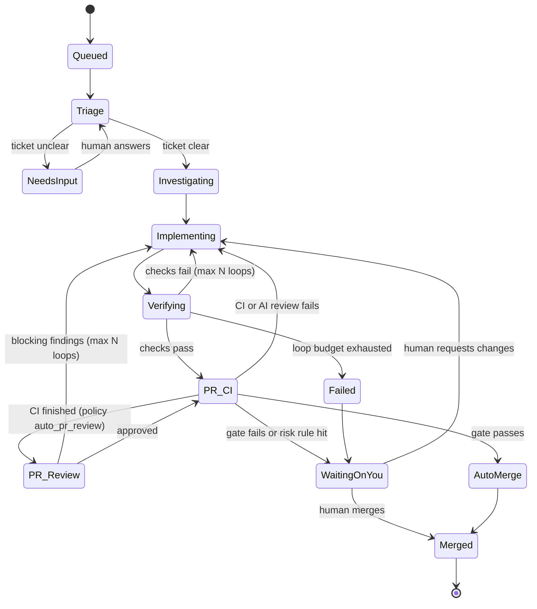
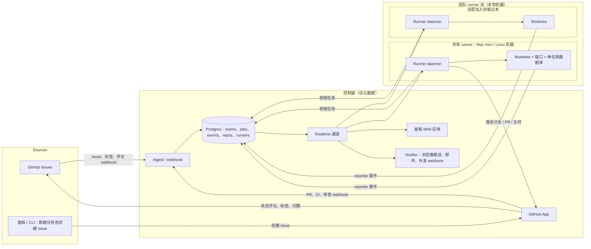

# Foundry — 软件工厂产品规格

> English: [software-factory-product-spec.md](software-factory-product-spec.md)

> 工作名称：**Foundry**。版本 0.5 · 2026-11-06
> **已锁定决策：** 主要客户是**小型产品团队（2–20 名工程师）**（v0.2）。任务**在本地机器上运行**
> （团队自有 runner，使用 git worktree），而不是云沙箱（v0.2）。Runner 从第一天起支持 **macOS 和
> Linux**（v0.3）。完全支持**只有笔记本**的团队配置；推荐但不强制使用常在线共享 runner（v0.3）。
> MVP **只支持 GitHub**：GitHub Issues 是工单来源，问题、状态和通知使用 GitHub 本身加面板（邮件和
> 浏览器推送）。不依赖 Linear 或 Slack（v0.4）。MVP 的 harness 是 **Claude Code 和 OpenCode**；
> Codex、Cursor CLI 等稍后加入。**Runner 核心和控制面都是 TypeScript**，共享一个 monorepo 和一套
> 类型（v0.5）。
> 研究来源：
> 1. [I Built My Own Software Factory with Claude Code — Jan Marshal](https://www.youtube.com/watch?v=sPpTWl3Cs14)
> 2. [WTF is a Software Factory? — Syntax, with Adam Jacob (Swamp Club)](https://www.youtube.com/watch?v=aYz9G3__Z4g)
> 3. [How to Build an AI Software Factory That Ships Faster — Boundary, with Zach Lloyd (Warp)](https://www.youtube.com/watch?v=XUEfIxkdT2Q)

---

## 1. 一句话概括

Foundry 把一张工单变成经过验证、已经合并的 pull request。编码 Agent 按照固定 playbook
（triage → investigate → implement → verify → PR）工作。置信度门禁决定变更是自动合并还是交给人工。
每次运行都有记录，因此工厂本身可以被度量和改进。

**人是厨师，Agent 是帮厨。** Foundry 是厨房：工位、食谱、出菜前检查的传菜口，以及工单夹。

---

## 2. 研究告诉了我们什么

### 2.1 三个来源的共识

| 主题                                                 | 对产品意味着什么                                                                     |
| ---------------------------------------------------- | ------------------------------------------------------------------------------------ |
| 工厂是由 Agent 运行的 SDLC，而不是一个更聪明的提示词 | 核心对象是*带阶段的流水线*，不是聊天                                                 |
| 人始终在边缘保持控制                                 | 人输入意图并判断产出。中间过程自动运行，除非不清楚或有风险                           |
| 验证让自治成为可能                                   | 没有真正的检查（测试、构建、浏览器、黑盒测试），就不能信任自动合并。验证需要一等投入 |
| 每个工厂都针对自己的产品                             | 工厂定义放在仓库里，由团队编辑。Foundry 提供默认值，而不是固定流程                   |
| 产出不好时，修机器而不是修产出                       | 失败应反馈到 playbook、skills 和检查中                                               |
| 必须可度量                                           | 每个阶段、token、美元和人工介入都要记录                                              |

### 2.2 每个视频的洞察

**Jan Marshal（一个可运行的实现）**

- 流水线状态是 Queued → Triage → Investigating → Implementing ⇄ Verifying → PR/CI → Waiting on
  you → Merged。
- **先问，不猜。** 如果工单含糊（“把食谱书做得更好看”），triage 会停下并提供选项（A/B/C）。用户
  回答后任务继续。
- **有信心才合并。** 只有 Agent 有信心、CI 通过且 AI 审查没有问题时才自动合并。否则交给人工。
- **仓库 onboarding。** Agent 在沙箱中阅读仓库，找出如何安装和检查，然后打开一个“recipe” PR
  （`setup.json`，包含 install、checks 和 warm-image 步骤）。
- 架构分三部分：**runner**（工头，从不写代码）、**reporter**（运行在每个 Agent 会话内，流式上报
  阶段、子 Agent 和 token）和 **panel**（可以随时从手机打开实时看板）。
- 任务可以在本地 git worktree 中运行，也可以在云沙箱中运行，每个任务一个沙箱。每个仓库有 warm
  image，沙箱在等待人工 5 分钟后**休眠**。
- 每个任务页显示时间线、实时事件、成本（例如 $0.35）、验证证据（4/4 检查）和“open in IDE”接管
  链接。
- 他演示中的教训：验证失败是因为沙箱没有浏览器库，所以没有任何东西自动合并。**环境是工厂的一部分。**

**Adam Jacob（原则）**

- **确定性的外循环，LLM 在里面。** 不要让 LLM 每次运行都重新发现相同工作流。把重复工作变成类型化、
  模块化的步骤，只在需要判断时调用模型。这样更便宜，而且每次结果一致。
- **黑盒验收测试优先。** 如果目标是工厂，先构建由外而内的测试套件。它让重构和自治变得安全。
- **坚持架构。** 把它写成 skill（领域驱动设计给 Agent 一套它们已经熟悉的词汇）。用架构审查每个
  变更。
- **对抗式审查者处理非功能需求**（可访问性、性能、Lighthouse 分数）。路由器决定一个变更需要哪些
  审查者。
- **推广：** 先让约五人的团队在产品的真实切片上工作，展示可行证明，然后扩展。保持待办列表小。
- 产品经理从“告诉工程师做什么”转向“审查结果”，因为返工现在很便宜。

**Zach Lloyd / Boundary（度量与治理）**

- **工厂即代码。** 工厂以声明式定义（Agent、skills、MCP 服务器、模型、任务在哪里运行），像
  Terraform。这使它可版本化、可分支、可 diff、可 A/B 测试。
- **指标：** 每个 PR 的人工交互次数（自动化指数，不是是/否）、DORA 指标、每位工程师和每个阶段的
  成本，以及在线评估（LLM 判断采样轨迹，例如“冗余测试”“死胡同”“重新学习本应是 skill 的东西”）。
- **元 Agent** 在失败运行中寻找模式，并向工厂定义提出 diff。
- **运行变成基准。** 好的和坏的过去运行可以成为私有基准，用新模型回放。这需要反作弊隔离，使 Agent
  看不到未来的提交。
- **先从交互式使用开始，再自动化。** 先让所有工作流经云循环（Slack、Jira、MCP，甚至直接提示），
  然后自动化越来越大的比例。
- **基于风险的审查。** owners 风格的文件可以包含代码或 LLM 谓词，例如“修改环境变量”“添加表”
  “添加依赖”。这些变更强制指定人工审查。一个副作用：“没有风险路径的小 PR 自动合并”策略促使
  工程师写更小的 PR，符合条件的 PR 比例从 10% 升到 80%。
- **UI 变更中证据胜过读代码：** 截图和 computer-use 视频。
- **计划以最小化预期痛苦**（返工概率 × 返工成本）。为 schema 认真计划，不要为按钮颜色计划。可选地
  运行 spec → implement → re-spec → re-implement。
- “Yield”很难定义，且因业务而异。非常小、尚未找到产品市场契合的团队不需要重型工厂基础设施。

### 2.3 Foundry 的设计原则

1. **Recipe 胜过感觉。** 每个任务遵循带明确阶段的 playbook。没有任何东西靠即兴发挥到达“完成”。
2. **先验证再信任。** 自动合并的范围等于验证实际能检查的范围。
3. **先问不猜。** Agent 不确定时，这是流水线中的一个状态，而不是失败。
4. **人在传菜口。** 用户批准结果并回答问题。他们不盯每个步骤。
5. **工厂即代码。** 它在仓库中版本化，像代码一样审查，像代码一样改进。
6. **一切皆事件。** 如果没有记录，就无法度量或改进。
7. **尽可能确定性。** 重复工作变成脚本和步骤。LLM 用于判断。
8. **自带 harness 和模型。** Claude Code、OpenCode、Codex、Cursor 等是可互换的工人。

---

## 3. 问题与用户

### 3.1 问题

今天使用编码 Agent 的开发者实际上在充当“继续按钮”。他们手工提示每个步骤（调查、编码、测试、
开 PR、合并）。吞吐量受人的注意力限制。质量参差不齐，因为每个会话都在即兴发挥，而且没有记录
Agent 做了什么、花了多少钱、为什么失败。

试图解决这个问题的团队最终把 Docker、webhook 和机器人拼成脆弱的内部工具。

### 3.2 目标用户

| 细分                                                | 是否 MVP？       | 需求                                                                                                                       |
| --------------------------------------------------- | ---------------- | -------------------------------------------------------------------------------------------------------------------------- |
| 已过产品市场契合的**小型产品团队（2–20 名工程师）** | **是（主要）**   | 团队任何人可提交的共享队列、低风险工作自动合并、高风险变更有强制人工查看、按人和仓库的成本可见性，全部运行在团队已有硬件上 |
| 同时做多个产品的**独立开发者 / 独立黑客**           | 支持（一人团队） | 离开键盘时并行发布许多小变更                                                                                               |
| **中型工程组织（50–500 人）**                       | 完整版           | 治理、风险策略、审计轨迹、私有基准、按团队工厂                                                                             |
| 1–3 人探索中的 pre-PMF 团队                         | 不针对           | 太早；普通 Agent 订阅就够了                                                                                                |

### 3.3 要完成的工作

- “当我提交一张清晰的工单时，我想要一个可合并的 PR，并带有它可用的证明，而不用我碰它。”
- “当工单含糊时，我想在手机上被问一个清晰的问题，而不是得到一个错误的 PR。”
- “当有风险的东西变化时（schema、认证、依赖），我想被强制查看。”
- “我想知道工厂擅长哪些工作、成本多少，以及如何让它更好。”

### 3.4 定位

- **与基于聊天的编码 Agent 相比**（Claude Code、OpenCode、Codex、Cursor）：Foundry 不替代它们。
  它把它们**编排**成工人。
- **与 Linear 到 Agent 的集成相比：** Foundry 拥有验证、置信度门禁和度量，而不仅仅是分发。
- **与 Warp Factories 和其他企业平台相比：** Foundry 面向小团队自助使用。它是 open-core，并对
  playbook 有明确主张。它是**本地优先**的：代码、密钥和算力留在团队自己的机器上，只有元数据
  （任务状态、事件、成本）进入控制面。没有沙箱账单。

---

## 4. 核心概念（术语表）

| 概念                   | 定义                                                                                           |
| ---------------------- | ---------------------------------------------------------------------------------------------- |
| **Source**             | 工作来源。MVP 中只有 GitHub Issues（面板和 CLI 只是创建 issue）。Linear、Slack 和 MCP 稍后加入 |
| **Job**                | 一个工作单元：在流水线中移动的工单。它有一个分支和一个 PR                                      |
| **Playbook**           | 任务遵循的有序阶段和指令（feature、bugfix、refactor、chore）                                   |
| **Recipe**             | 按仓库的机器设置：install、检查命令、warm-image 步骤、所需工具（例如浏览器）                   |
| **Harness**            | 执行工作的编码 Agent。MVP 中是 Claude Code 和 OpenCode；Codex、Cursor CLI 等稍后加入           |
| **Runner**             | 长期运行的进程，领取任务、启动 harness、监视它、合并并清理。它从不写代码                       |
| **Reporter**           | harness 会话内的 hook 或插件，发出阶段、token、成本和日志事件                                  |
| **Workspace**          | 任务执行的地方：runner 机器上的 git worktree，有自己的端口和 env 文件。本地容器可选            |
| **Runner pool**        | 团队注册的 runner 机器集合（例如一台常在线 Mac mini 加工程师的笔记本）。任务在池中调度         |
| **Confidence gate**    | 决定自动合并还是交给人工的规则集                                                               |
| **Risk rule**          | 对 diff 的谓词（路径 glob、正则，或稍后的 LLM 判断），强制人工审查                             |
| **Evidence**           | 证明变更可用的产物：检查输出、截图、视频、测试报告                                             |
| **Panel**              | 实时 Web UI：inbox、任务看板、任务详情、仓库、机器、设置、指标                                 |
| **Factory definition** | 每个仓库中 `.foundry/` 文件夹，包含 recipe、playbook、策略和 skills                            |

---

## 5. MVP

### 5.1 MVP 目标

**一个 3–10 名工程师的团队连接他们的 GitHub 仓库，并在已有的机器上运行 Foundry runner：Mac 或
Linux 笔记本，以及可选的共享机器。团队任何人提交工单，团队得到带回滚证据的已合并 PR。不清楚的
工单以问题形式回到提交者，有风险的变更交给正确的审查者。**

目标：一名有经验的构建者与 Agent 协作 7–8 周。

### 5.2 MVP 范围一览

| 领域      | MVP 中                                                                                                                                                              | 推迟到完整版                                                             |
| --------- | ------------------------------------------------------------------------------------------------------------------------------------------------------------------- | ------------------------------------------------------------------------ |
| 来源      | **仅 GitHub Issues**（按标签），加上面板中的 “New job” 框，它只是创建一个 GitHub issue                                                                              | Linear 和 Slack（1.0）、Jira、Sentry、MCP、邮件                          |
| 仓库托管  | GitHub（GitHub App）                                                                                                                                                | GitLab、Bitbucket、Cursor Origin                                         |
| Harness   | **Claude Code**（Anthropic 模型）和 **OpenCode**（任意 provider：Anthropic、OpenAI、Google、OpenRouter 或本地模型），都在一个适配器接口后无头运行（见 5.8.1）       | Codex CLI、Cursor CLI、Gemini CLI/Antigravity、按阶段混合 harness 和模型 |
| Workspace | **仅本地，macOS 和 Linux。** runner 池可以是只有笔记本，或笔记本加常在线共享机器。每个任务一个 git worktree、按任务的端口和 env 分配、检查点使任务可在机器间移动    | 可选的本地 Docker 隔离（1.0）；云沙箱作为可选溢出（2.x）                 |
| Playbook  | 一个内置 playbook（triage → investigate → implement ⇄ verify → PR），带 bugfix 和 feature 变体                                                                      | 自定义 playbook、确定性步骤、spec 阶段、spec→impl→respec                 |
| 验证      | Recipe 检查（lint、类型、测试、构建），加上 UI 仓库的无头浏览器截图                                                                                                 | 黑盒验收套件、computer-use 视频、对抗式审查者                            |
| 合并策略  | 按仓库 `off` / `merge_when_confident`，带固定门禁规则                                                                                                               | 可编程门禁、分级审批、小 PR 策略                                         |
| 风险规则  | `.foundry/policy.yaml` 中的路径 glob 和正则，每个映射到**必需审查者**（GitHub 用户或团队）                                                                          | LLM 判断谓词、按文件审查跟踪                                             |
| 人在回路  | 先问不猜的问题带选项，路由到**工单作者**并在 issue 上 @mention。通过勾选复选框、在 issue 回复或在面板一键回答。通知通过 GitHub 自身通知，加上面板的邮件和浏览器推送 | Slack DM 带按钮（1.0）、移动 App 推送、多人线程、把队友拉进运行中的任务  |
| 接管      | “Open workspace”：SSH 或 Cursor/VS Code Remote 链接到 runner 机器上的 worktree                                                                                      | 实时结对、操控运行中的 Agent                                             |
| 可观测性  | 实时 inbox、任务看板和列表、任务时间线、日志、按任务/人/仓库/天的成本和 token                                                                                       | 在线评估、A/B 测试、基准                                                 |
| 团队      | 每个团队一个工作区、GitHub 登录、两种角色（admin 和 member）、共享队列、按成员的 “My jobs” 视图                                                                     | 每个组织多个团队、SSO/SCIM、细粒度角色、审计导出                         |

### 5.3 MVP 流水线



每个阶段做什么：

- **Triage：** 将工单分类为 feature、bug 或 chore，并检查是否有验收标准。如果不清楚，写一个带
  2–4 个选项加自由文本答案的问题，并进入 `NeedsInput`。
- **Investigating：** 阅读代码，把简短计划写入任务（要改的文件、方法、风险）。如果风险规则可能
  触发（例如 schema 变更），计划会更深入。
- **Implementing：** 在分支 `foundry/<job-id>-<slug>` 上编辑代码。
- **Verifying：** 运行 recipe 检查。UI 变更还会启动应用并截图。失败会回到 Implementing，默认最多
  3 次。每个检查的命令、退出码和输出尾部都作为证据存储。
- **PR/CI：** 用模板创建 PR（摘要、计划、证据、自报置信度及原因），然后等待 CI 和可选的 AI 审查
  （例如 Bugbot）。失败会回到 Implementing。
- **PR 评审（可选，`auto_pr_review`）：** PR head 的 CI 结束后，新的只读评审会话检查已推送的 PR
  和失败的检查详情（名称、摘要、注解），Foundry 再把结论和行内评论作为 GitHub 评审发布。阻塞性
  问题会回到 Implementing，最多 `max_review_loops` 轮；评审通过时只留下评论，随后 gate 把 PR 交给
  人工，开启 `auto_pr_review` 时永不自动合并。由于 Foundry App 是 PR 作者，GitHub 不允许它提交批准，
  因此评审使用 `COMMENT` 事件，结论写在正文中。
- **Gate：** 见 5.5 节。
- **Waiting on you：** 人工合并、请求修改（作为新消息回到 Agent）或关闭。

### 5.4 仓库 onboarding（“recipe PR”）

1. 用户安装 GitHub App 并在面板中选择仓库。
2. Foundry 在团队 runner 池中的一个 runner 上启动 onboarding 任务。Agent 找出包管理器、安装命令、
   检查命令、dev server 命令和所需系统工具（例如 Playwright 浏览器）。
3. 它**运行**每条命令证明可用，然后打开一个 PR 添加：

```text
.foundry/
  recipe.yaml       # install, checks, dev server, system deps, warm steps
  policy.yaml       # merge mode, risk rules, loop budgets, cost caps
  playbook.md       # optional per-repo overrides and notes for agents
  skills/
    architecture.md # optional: conventions and architecture vocabulary
```

`recipe.yaml` 示例：

```yaml
install: bun install --frozen-lockfile
checks:
  - name: lint
    run: bun run lint
  - name: typecheck
    run: bun run typecheck
  - name: test
    run: bun test
  - name: build
    run: bun run build
dev_server:
  run: bun run dev --port $FOUNDRY_PORT # runner assigns a free port per job
  ready_path: /
services: # per-job local resources
  postgres: { database: "app_$FOUNDRY_JOB_ID" } # created on the runner's shared Postgres, dropped on cleanup
env_file: .foundry/env.example # keys only; values come from the runner's secret store
system_deps: [playwright-chromium]
warm: # runs once per runner per lockfile hash
  - bun install --frozen-lockfile
  - bunx playwright install --with-deps chromium
```

`policy.yaml` 示例：

```yaml
merge: merge_when_confident # off | merge_when_confident
require_ci_green: true
require_ai_review_clean: true # e.g. Bugbot
max_verify_loops: 3
max_cost_per_job_usd: 5
max_diff_lines_for_automerge: 400
risk_rules:
  - name: database schema
    paths: ["**/migrations/**", "**/schema.prisma", "**/*.sql"]
    reviewers: ["@acme/backend-leads"]
  - name: secrets and env
    diff_regex: "process\\.env\\.|std::env::var"
    reviewers: ["@alice"]
  - name: dependencies
    paths: ["package.json", "bun.lock", "Cargo.toml"]
    reviewers: ["@acme/maintainers"]
  - name: auth
    paths: ["src/auth/**"]
    reviewers: ["@bob"]
```

4. recipe PR 合并后，每个服务该仓库的 runner 构建**warm 缓存**：bare mirror clone、按 lockfile
   哈希键控的依赖缓存和系统工具。新任务的 worktree 只需要 `git worktree add` 和快速命中的安装。
5. 每个 runner 对每个仓库运行**能力检查**（所有 recipe 检查通过、dev server 启动、能截图）。它被
   标记为 `ready` 或 `not ready, with a reason`。任务只调度到对该仓库就绪的 runner。这把 Jan 的
   “无法验证”情况变成设置时的阻塞，而不是之后的意外。

### 5.5 置信度门禁（MVP 规则）

PR **只有在以下全部成立时**才自动合并：

1. 仓库策略是 `merge_when_confident`。
2. Verifying 中每个 recipe 检查都通过，且每个都有证据。
3. UI 相关变更（从文件类型或路径检测）：至少成功捕获一张截图。
4. CI 通过，且 AI 审查（如果需要）没有未解决的阻塞评论。
5. 没有风险规则匹配 diff。
6. diff 大小 ≤ `max_diff_lines_for_automerge`。
7. Agent 自评为 `high`，且没有列出未决不确定性。
8. 任务总成本 ≤ `max_cost_per_job_usd`。
9. `auto_pr_review` 关闭。开启时，自动 PR 评审只留下评论，PR 始终等待人工合并。

否则任务进入 **Waiting on you**，具体失败规则列在任务页顶部，例如
“Risk rule hit: database schema (2 files)”。交接是**路由的**，不是广播。如果风险规则触发，其
`reviewers` 会在 PR 上被请求审查并收到通知。否则工单作者被要求审查。每个成员的 inbox 只显示
等待他们的事项，以及团队级 “unassigned” 泳道。

自评置信度本身永远不够。它只能**降低**信任，绝不能覆盖失败的规则。

### 5.6 按屏幕划分的 MVP 功能

**Inbox（首页，按成员）**

- 顶部 “Waiting on you” 卡片：关于你提交的工单的问题（一键回答）以及你是必需审查者的 PR。
- “Unassigned” 泳道：没有明确负责人的交接，任何成员可以认领。
- 你的活跃任务及其实时阶段，以及显示整个团队任务的开关。
- 今日团队总计：任务、已合并、自动合并、token、花费。

**Jobs（看板和列表视图）**

- 按阶段分列或分组，实时更新。
- 按仓库、作者、harness、runner 和状态过滤。

**任务详情**

- 头部：标题、来源链接、作者、仓库、harness 和模型、runner 机器和 worktree 路径、成本、耗时。
- 阶段时间线，带持续时间和循环次数。
- 计划、证据（检查结果、截图）、PR 链接、门禁结果。
- 实时事件和日志流。
- 操作：回答、发送消息、从某阶段重试、取消、打开 workspace、合并或关闭。

**Repos**

- Onboarding 状态、recipe PR、每个 runner 的就绪状态、默认值（harness、合并模式）、是否接受任务。

**Runners**

- 团队池：每台机器的所有者、类型（`shared` 或 `personal`）、在线状态、最后在线时间、CPU、内存、
  磁盘、运行中任务/并发上限，以及它为哪些仓库就绪。
- 每个 runner 还显示 OS 和 CPU 架构。
- 个人笔记本是自愿加入的，默认 “only on AC power” 调度。团队有共享机器时优先使用共享机器。
- 只有笔记本的团队看到容量卡片：本周队列没有在线 runner 的小时数，以及共享 runner 本可节省的估计
  排队时间。
- Drain 一个 runner（停止新任务，让当前任务完成）并移除它。

**Team**

- 用 GitHub 登录邀请，角色（admin 或 member）。每个成员的 GitHub 登录名就是路由问题和审查的身份，
  因此无需关联其他账号。

**Settings**

- 默认 harness 和模型、团队模型 API key（自带 key）、每个成员的通知偏好（仅 GitHub、邮件、浏览器
  推送或每日邮件摘要）、团队每日花费上限。

### 5.7 工单约定：GitHub 原生工作流

MVP 只需要 GitHub 加 Foundry 面板。目标市场中的每个团队都已有 GitHub，onboarding 中安装的 GitHub
App 提供了 Foundry 所需的一切，因此设置是“安装一个 App”而不是三个。

**提交工作**

- 给 issue 添加 `foundry` 标签会启动任务。Onboarding 在每个仓库中创建该标签。
- Onboarding 还添加 issue 表单 `.github/ISSUE_TEMPLATE/foundry.yml`，包含 **Goal**、
  **Acceptance criteria**、**Constraints** 和 **Out of scope** 字段。表单自动应用 `foundry`
  标签。Triage 根据这些字段评分，如果重要部分缺失就提问。
- 可选覆盖标签：`harness:claude-code` 或 `harness:opencode`、`model:<provider/model>`
  （例如 `model:openai/gpt-5.4`，用于 OpenCode）、`runner:<machine-name>`（把任务固定到一台机器）、
  `playbook:bugfix`。
- 其他提交方式：面板的 “New job” 框，它只是替你创建 issue；以及 CLI 中的
  `foundry new "<title>"`。无论哪种方式，GitHub issue 始终是唯一事实来源。
- 想要看板的团队可以使用 **GitHub Projects**。Foundry 保持可选的 “Foundry stage” 字段同步，
  因此项目看板显示 Triage、Implementing、Waiting on you 等。

**Issue 上的状态**

- Foundry 每个任务发布**一条状态评论**，并持续编辑它，而不是新增。它显示当前阶段、runner、目前
  成本、任务页链接，以及存在后的 PR。
- 一个 `foundry:<stage>` 标签，例如 `foundry:waiting-on-you`，随阶段变化而替换，因此 issue 列表
  可以按阶段过滤。
- PR 正文写 `Closes #<issue>`，因此合并会以 GitHub 正常方式关闭 issue。

**提问（先问不猜）**

- 问题作为新的 issue 评论发布，并 @mention 工单作者。每个选项是任务列表复选框：

```markdown
@alice I need one decision before continuing:

**Which scope should this cover?**

- [ ] A. Visual polish only (spacing, typography, colors)
- [ ] B. Visual polish plus layout changes
- [ ] C. Full redesign, including new components

Tick one box, or reply with your own answer.
```

- 勾选一个框（Foundry 收到 `issue_comment.edited` webhook）或用评论回复都算回答。在面板一键回答
  也算。第一个回答获胜，Foundry 编辑问题评论显示 “Answered: A by @alice”。
- 在 “Waiting on you” 中对 PR 请求修改使用 GitHub 正常审查流程。带 “Request changes” 的审查，或
  以 `/foundry` 开头的 PR 评论，会作为 Agent 的下一条指令回到 Agent。

**通知（无需额外工具）**

- **GitHub 自身通知**承担大部分。问题上的 @mention、风险规则审查者的审查请求以及 PR 活动已经通过
  GitHub 的 Web inbox、邮件和移动 App 到达人们。
- **面板增加两个可选渠道：** 浏览器推送（面板是可安装的 Web 应用，因此在手机上也可用）和通过事务性
  邮件服务的邮件。每个成员选择仅 GitHub、推送、邮件或每日摘要。
- **通用外发 webhook（可选）：** 团队可以粘贴任意 webhook URL，获得 “question asked”、
  “handover” 和 “merged” 的 JSON 负载。负载在 `text` 和 `content` 字段中包含现成的一行消息，
  分别是 Slack 和 Discord 传入 webhook 期望的格式。这足以通过它们的 incoming-webhook URL 把事件
  管道到 Slack 或 Discord，或通过 Zapier/n8n 管道到其他任何地方，而 Foundry 无需构建这些集成。
  原生 Slack 和 Linear App 计划在 1.0。

### 5.8 MVP 架构



组件：

- **控制面（TypeScript）。** 一个 Next.js 应用，作为独立 Node 服务器运行（面板 UI 和 API 路由），
  加上自托管 Postgres 16，以及 Foundry 自己的小型 realtime 服务，把 Postgres LISTEN/NOTIFY 转成
  WebSocket 消息。全部打包为一个 Docker Compose 栈（web、realtime、Postgres 和 Caddy 负责 TLS），
  可运行在任何 VM 上，因此团队从第一天起就能自托管整个控制面。Ingest 端点验证 webhook 签名并写入
  `webhook_inbox` 表，然后转成 `job` 行。GitHub App 权限：contents、pull requests、issues、
  checks、workflows（推送 `.github/workflows/` 变更需要），以及可选的 projects（看板同步）。
  GitHub App 还在 issue 上发布状态评论、标签和问题。Notifier 发送浏览器推送、邮件和可选外发
  webhook。**控制面不存储也不经过源代码。** 它看到任务元数据、事件、日志尾部和证据产物（截图），
  日志上传可以按仓库关闭。
- **Runner（TypeScript）。** 用 TypeScript 编写，运行在 Bun 上，按平台发布为单个自包含可执行文件
  （`bun build --compile`，macOS 和 Linux，arm64 和 x64），因此用户无需安装 Node 或 Bun。一条命令
  安装（`brew install foundry` 或 Linux 安装脚本），并用 `foundry runner join <team-token>` 加入。
  同一个二进制提供 `foundry` CLI。它运行在专用 OS 用户下（见 5.9），保持心跳，并原子领取任务
  （`UPDATE … WHERE status='queued' … SKIP LOCKED`）。它只领取自己已就绪的仓库任务，并遵守并发
  上限和调度。它创建工作区，以 playbook 作为系统指令无头启动 harness，执行时间和成本预算，并在
  之后清理。**Runner 从不编辑代码。**
- **Reporter。** 它有两部分，对每个 harness 工作方式相同：
  1. **单任务 `foundry` MCP 服务器**，由 runner 启动并交给 harness。Agent 调用其工具显式汇报进度：
     `stage(name)`、`ask(question, options)`、`evidence(kind, …)`、`confidence(level, reasons)`。
     Claude Code 和 OpenCode 都支持 MCP，因此不需要 harness 特定代码。
  2. **Runner 中的事件规范化器**，把每个 harness 的原生流转成 Foundry 的 `stage_changed`、
     `subagent_started`、`tool_call`、`usage`（token 和成本）、`question`、`evidence` 和 `log`
     事件。它读取 Claude Code 的 SDK 消息流和 hooks，以及 OpenCode 的服务器事件流和插件 hooks。
- **密钥。** 团队模型 API key 保存在 runner 的本地密钥库（macOS Keychain；Linux
  `systemd-creds` 或加密文件），并在 join 时一次性推送到 runner。仓库 env 值保存在 runner 上，
  绝不进入控制面。它们按任务作为环境变量注入，日志在上传前按已知密钥模式清洗。

### 5.8.1 Harness 适配器（MVP 中的 Claude Code 和 OpenCode）

每个 harness 都位于 runner 中的一个 TypeScript 接口之后。以后添加 Codex 或 Cursor CLI 只需写一个
新适配器；playbook、reporter、门禁和面板保持不变。

```ts
interface HarnessAdapter {
  id: "claude-code" | "opencode"; // later: "codex" | "cursor" | "gemini"
  detect(): Promise<{ installed: boolean; version?: string; authOk: boolean }>;
  start(opts: {
    cwd: string; // the job's worktree
    model: string; // e.g. "claude-opus-5.5" or "openai/gpt-5.4"
    systemPrompt: string; // playbook + repo skills
    prompt: string; // ticket body or handoff brief
    env: Record<string, string>; // FOUNDRY_PORT, keys, ...
    mcpServers: McpServerConfig[]; // always includes the per-job foundry server
    permissions: PermissionPolicy; // allowed tools and commands
  }): Promise<HarnessSession>;
  resume(sessionId: string, message: string, opts: ResumeOpts): Promise<HarnessSession>;
  stop(session: HarnessSession): Promise<void>; // graceful, then kills the process group
}

interface HarnessSession {
  id: string; // native session id, stored for sticky resume
  events: AsyncIterable<HarnessEvent>; // normalized: message, tool_call, usage, subagent, error
  done: Promise<{ status: "ok" | "error" | "stopped"; costUsd?: number }>;
}
```

|                 | **Claude Code**                                                                                                                          | **OpenCode**                                                                                                                               |
| --------------- | ---------------------------------------------------------------------------------------------------------------------------------------- | ------------------------------------------------------------------------------------------------------------------------------------------ |
| 集成            | 用于 TypeScript 的 Claude Agent SDK（`@anthropic-ai/claude-agent-sdk`），在 runner 进程内。回退：`claude -p --output-format stream-json` | OpenCode 无头服务器及其 TypeScript SDK（`@opencode-ai/sdk`），每个任务在 worktree 内一个服务器。回退：`opencode run`                       |
| 模型            | Anthropic 模型                                                                                                                           | 任意已配置 provider（Anthropic、OpenAI、Google、OpenRouter、本地和自托管模型），按任务用 `model:<provider/model>` 选择                     |
| 事件和成本      | SDK 消息流（assistant 和 tool 消息、带 usage 和 cost 的 result 消息）以及子 Agent 和工具调用的 hooks                                     | 服务器事件流（session、message 和 tool 事件）以及用于工具调用 hook 的小型 Foundry 插件。provider 不报告成本时，根据 token 用量和价格表计算 |
| 原地恢复        | SDK 中 `resume: <sessionId>`                                                                                                             | 通过 SDK 或服务器继续同一 session ID                                                                                                       |
| 权限            | SDK 权限模式和 allowed-tools 列表，由 `policy.yaml` 生成                                                                                 | `opencode.json` 权限设置，按任务由 `policy.yaml` 生成                                                                                      |
| 为什么在 MVP 中 | 当今许多团队最强的编码 Agent，也是 Jan Marshal 工厂中使用的 harness                                                                      | 开源且 provider 无关。团队可以使用 OpenAI、Gemini 或本地模型，无需等待 Codex 适配器；有数据驻留顾虑的团队可以指向自托管模型                |

默认值和规则：

- 团队默认是 Claude Code。仓库可以设置 `default_harness: opencode`，工单可以用 `harness:` 和
  `model:` 标签覆盖。
- Runner 的就绪检查包含每个 harness 的 `detect()`。只安装了 OpenCode 的 runner 永远得不到
  `harness:claude-code` 任务。
- Playbook 是纯 markdown，作为系统提示注入任一 harness。如果需要 harness 特定说明，放在
  `.foundry/playbook.<harness>.md`。
- Portable resume（见 5.9）可以有意更换 harness。例如，Claude Code 任务落到只有 OpenCode 的
  runner 时，可以从交接简报继续。默认关闭，并记录在时间线上。
- 两个 harness 的确切 SDK 选项和 CLI 标志在第 2 周 spike 中确认，并固定到测试过的版本。Runner
  拒绝使用未测试过的 harness 版本，除非管理员覆盖。

### 5.8.2 技术栈（端到端 TypeScript）

Runner、控制面、CLI、MCP 服务器和共享 schema 都在一个 monorepo 中用 TypeScript，因此事件类型、
任务状态和 `.foundry/` 文件 schema 只定义一次，并在两端编译期检查。

```text
foundry/                         # pnpm workspaces + Turborepo
  apps/
    web/                         # Control plane: Next.js (App Router) panel + API routes + webhook ingest
    realtime/                    # Small Node service: Postgres LISTEN/NOTIFY → WebSocket/SSE fan-out
    runner/                      # Runner daemon + `foundry` CLI, Bun runtime, compiled per platform
  packages/
    shared/                      # zod schemas: events, job states, recipe.yaml, policy.yaml, API contracts
    db/                          # Drizzle ORM schema + migrations (Postgres)
    github/                      # Octokit-based GitHub App client: webhooks, comments, labels, checks, merge
    harness-claude-code/         # Claude Code adapter
    harness-opencode/            # OpenCode adapter + Foundry plugin
    mcp-foundry/                 # Per-job MCP server (stage, ask, evidence, confidence)
    os-adapters/                 # macOS and Linux adapters (see 5.9)
```

| 层              | 选择                                                                                                       | 备注                                                                                                   |
| --------------- | ---------------------------------------------------------------------------------------------------------- | ------------------------------------------------------------------------------------------------------ |
| 语言            | 全部严格 TypeScript                                                                                        | runner ↔ 控制面消息一套类型系统                                                                        |
| 控制面          | Next.js（独立 Node 服务器）、Drizzle ORM、自托管 Postgres 16                                               | webhook、runner API 和面板的 API 路由；`@octokit/webhooks` 做签名验证                                  |
| Realtime        | `apps/realtime` 服务：一条 Postgres LISTEN 连接，WebSocket 广播                                            | runner 和面板按团队订阅任务、事件和问题变化                                                            |
| 部署            | Docker Compose：`web`、`realtime`、`postgres`、`caddy`                                                     | 本地开发和生产同一栈；任何 VM 可用。GitHub webhook 通过 smee.io 或 `cloudflared tunnel` 到达开发笔记本 |
| Artifact        | 签名 URL 路由后的本地磁盘卷；可选 S3 兼容存储                                                              | 截图和其他证据                                                                                         |
| Runner 运行时   | Bun，用 `bun build --compile` 编译为每个 OS 和 CPU 一个可执行文件                                          | 用户无需安装运行时。Runner 避免原生 Node 插件，以保持编译产物可移植                                    |
| Runner ↔ 控制面 | HTTPS + runner token 用于领取、事件和心跳；WebSocket 用于推送                                              | 两端用共享 zod schema 验证契约                                                                         |
| 进程和 OS 操作  | `Bun.spawn` 和 `execa`，包装 `git`、`launchctl` 或 `systemctl`、`caffeinate` 或 `systemd-inhibit` 等       | OS 差异留在 `packages/os-adapters` 内                                                                  |
| 验证和配置      | zod 加 YAML 解析器处理 `.foundry/*.yaml`                                                                   | 同一 schema 驱动 recipe PR 验证和 runner 解析                                                          |
| 测试            | Vitest 单元测试；fake harness 适配器和记录型 webhook GitHub mock 做端到端流水线测试；Playwright 做面板测试 | 发布 CI 在 macOS 和 Linux、arm64 和 x64 上运行 runner 测试                                             |

### 5.9 本地执行模型

本地运行更便宜，把代码留在团队硬件上，并复用机器已有的工具链。作为交换，Foundry 必须自己解决
隔离、可用性和竞争。MVP 规则：

**任务在哪里运行：两种受支持的配置**

| 配置                                   | 适合谁                                          | 行为                                                                                                    |
| -------------------------------------- | ----------------------------------------------- | ------------------------------------------------------------------------------------------------------- |
| **只有笔记本**（完全支持，零硬件默认） | 试用 Foundry 的团队，或没有备用机器的全远程团队 | 每个自愿加入的成员在自己的笔记本上运行 runner。任务在笔记本唤醒且调度允许时运行。吞吐量跟随团队工作时间 |
| **共享 runner 加笔记本**（推荐升级）   | 希望任务在夜间和开会时完成的团队                | 一台或多台常在线机器（Mac mini、备用 Linux 机器或 VM）运行 4–8 个并发任务。笔记本增加容量               |

两种配置都不是必需的。团队可以只从笔记本开始，之后添加共享 runner，而无需改变其他任何东西。面板
显示过去 7 天共享 runner 本可节省多少排队时间，因此升级提示基于数据而不是唠叨。

**Runner 调度和电源**

- 每个 runner 有调度。笔记本默认：“when on AC power”、“pause while the owner is actively using
  the machine”（可选，基于空闲时间）和 “nights and weekends”（可选）。共享 runner 默认常在线。
- 任务运行时，runner 持有睡眠抑制器（macOS 上 `caffeinate -i`，Linux 上 `systemd-inhibit`），
  因此插电的空闲笔记本不会在任务中途睡眠。合上盖子仍会睡眠，这种情况通过重新排队处理（见下）。
- 并发默认笔记本 1–2，根据 CPU 核心、内存和仓库实测构建成本自动建议。

**应对笔记本消失**

在只有笔记本的团队中，启动任务的机器在需要下一步时常常已睡眠、合盖或离线。Foundry 把这当作正常
情况而不是错误：

- **每个阶段边界检查点。** Runner 推送任务分支，并把**交接简报**写到 GitHub 上的私有 git ref
  （`refs/foundry/<job-id>/brief`，永不属于 PR）。简报包含计划、到达的阶段、检查结果、目前的问答
  和未决不确定性。因为它存在于 GitHub 上，代码数据无需经过控制面。
- **心跳丢失。** 如果 runner 在活跃阶段错过心跳 2 分钟，任务从其最后完成的阶段回到队列。
- **先 sticky resume，再 portable resume。** 等待中的任务得到回答，或丢失的任务重新排队时，
  Foundry 先给原 runner 最多 10 分钟。该 runner 可以原地恢复确切的 harness 会话。否则任何就绪
  runner 接手。它检出分支、读取交接简报，并从简报开始新的 harness 会话。时间线标记
  “resumed on <machine>”。
- **没有人在线。** 任务保持排队。inbox 显示 “Queued, no runner online” 及等待时长。所有笔记本
  关闭时仍可在 GitHub issue 或面板回答问题；runner 回来后任务继续。

**调度**

- 优先级顺序：任务的 `runner:<name>` 固定；sticky resume 的原 runner；`shared` runner；然后是对
  仓库就绪且在调度内、负载最低的 `personal` runner。任务作者自己的笔记本获得小的平局加分，因此
  接管对他们来说是本地的。
- Recipe 可以约束 OS（iOS 构建用 `os: [macos]`，Linux 专用工具用 `os: [linux]`）。任务在队列中
  等待，而不是压垮机器。

**从第一天起支持的操作系统：macOS 和 Linux**

Runner 是一套 TypeScript 代码，按平台编译为单个可执行文件。OS 特定行为位于
`packages/os-adapters` 的 `OsAdapter` 接口之后（安装服务、创建用户、密钥库、资源限制、睡眠抑制、
空闲和电源检测）。MVP 不支持 Windows（WSL2 是 1.x 候选）。

| 关注点          | macOS（13+；Apple Silicon 和 Intel）                               | Linux（Ubuntu 22.04+、Debian 12+、Fedora 39+；x86_64 和 arm64）              |
| --------------- | ------------------------------------------------------------------ | ---------------------------------------------------------------------------- |
| 安装            | `brew install foundry`，或签名并公证的 `.pkg`                      | `curl -fsSL get.foundry.dev \| sh`，以及 `.deb` 和 `.rpm` 包                 |
| 作为服务运行    | `launchd` daemon                                                   | `systemd` 系统服务                                                           |
| 专用用户        | 用 `sysadminctl` 创建 `foundry` 用户，并从登录窗口隐藏             | 用 `useradd --system` 创建 `foundry` 系统用户                                |
| 密钥库          | `foundry` 用户的 Keychain                                          | 可用时 `systemd-creds`，否则只有 `foundry` 可读的 age 加密文件               |
| 单任务资源限制  | 进程组、`nice` 和 `taskpolicy`。监视内存，超限任务被杀（尽力而为） | 通过 `systemd-run --scope` 的 cgroups v2（硬 CPU 和内存限制）                |
| 忙碌时保持唤醒  | `caffeinate -i`                                                    | `systemd-inhibit --what=sleep:idle`                                          |
| 空闲和电源检测  | `ioreg` HID 空闲时间、`pmset -g batt`                              | logind idle hint、`upower`（或 `/sys/class/power_supply`）                   |
| 验证用浏览器    | recipe 的 `warm` 步骤安装 Playwright Chromium                      | 带 `--with-deps` 的 Playwright Chromium。就绪检查验证 Jan 演示中缺失的系统库 |
| 无头服务器      | 支持（无显示器的 Mac mini）                                        | 支持（无需桌面会话）                                                         |
| 容器模式（1.0） | Docker Desktop、OrbStack 或 Colima                                 | Docker 或 rootless Podman                                                    |

两个操作系统运行相同的就绪检查，因此无法验证仓库的 runner 永远得不到该仓库的任务。发布 CI 在两个
操作系统和两种 CPU 架构上测试 runner。

**单机上的单任务隔离**

- **代码：** 从 bare mirror 创建的 `git worktree`，分支 `foundry/<job-id>-<slug>`。
- **端口：** runner 为每个任务租用空闲端口范围，作为 `FOUNDRY_PORT` 暴露（如需更多），因此并行
  dev server 永不冲突。
- **数据库和服务：** recipe 声明的服务在 runner 共享实例上获得单任务资源，例如名为
  `app_<job-id>` 的数据库。任务开始时创建，清理时删除。
- **进程：** 每个任务在自己的进程组中运行，在 OS 支持处有 CPU 和内存限制。取消或完成任务会杀掉整个
  进程组，因此不会留下孤儿 dev server。
- **OS 用户：** runner 和 Agent 以专用 `foundry` 用户运行，而不是工程师本人。Agent 无法读取工程师
  的主目录、SSH key、浏览器 cookie 或云凭据。GitHub App 为推送访问签发单任务短期 token。
- **可选容器模式（1.0）：** 在由 recipe 构建的本地 Docker 或 Podman 容器中运行每个任务，面向希望
  更强隔离但不想上云的团队。

**等待与恢复**

- 在 `NeedsInput` 或 `WaitingOnYou` 中，Agent 进程停止，但 worktree 和 harness 会话文件保留。人工
  回答后，原 runner 原地恢复会话：Claude Code 通过 SDK 的 `resume` 选项，OpenCode 在重启的
  OpenCode 服务器上继续同一 session ID。如果该 runner 不在线，任务通过 portable resume（见上）
  移到另一台 runner。这取代云休眠，空闲任务零成本。
- 7 天未触碰的 worktree，以及所有已合并或已关闭任务的 worktree，会被垃圾回收。磁盘剩余下限（例如
  20 GB 空闲）会暂停新领取。

**接管**

- “Open workspace” 提供通过 Tailscale 或团队 LAN 访问该 runner 上任务 worktree 的 SSH 或
  Cursor/VS Code Remote 链接。打开它会暂停 Agent，避免人和 Agent 同时编辑。关闭后交回控制权，
  并附上人工修改的摘要。

### 5.10 MVP 数据模型（核心表）

```text
teams(id, name, gh_org, daily_spend_cap_usd, outgoing_webhook_url)
users(id, email, gh_login, notify_pref, push_subscription jsonb, created_at)
memberships(team_id, user_id, role)                       -- role: admin | member
repos(id, team_id, gh_installation_id, full_name, gh_project_id, default_harness,
      default_model, merge_mode, accepts_jobs, recipe_sha)
runners(id, team_id, owner_user_id, name, kind, os, arch, os_version, token_hash,
        schedule jsonb, on_ac_power, last_seen_at, cpu, mem, disk_free,
        max_concurrency, status)                          -- kind: shared | personal; os: macos | linux
runner_repo_readiness(runner_id, repo_id, recipe_sha, ready, reason, checked_at)
jobs(id, team_id, repo_id, author_user_id, source, source_ref, title, body, playbook,
     harness, model, runner_id, worktree_path, port_base, harness_session_id, status,
     stage, last_completed_stage, brief_ref, origin_runner_id, resume_count, loop_count,
     branch, pr_number, confidence,
     gate_result jsonb, assigned_reviewers jsonb, cost_usd, tokens_in, tokens_out,
     created_at, started_at, finished_at)
events(id, job_id, ts, kind, stage, payload jsonb)        -- append-only log
questions(id, job_id, asked_user_id, prompt, options jsonb, answer, answered_by,
          answered_via, gh_comment_id, answered_at)       -- via: panel | gh_checkbox | gh_reply
evidence(id, job_id, kind, name, status, command, output_tail, artifact_url)
webhook_inbox(id, provider, delivery_id, payload jsonb, received_at, processed_at)
```

### 5.11 MVP 成功指标

这些指标从 `events` 表计算，并显示在简单指标页上，按仓库和团队成员切片：

| 指标                                                                     | MVP 目标（3–10 人团队真实使用 4 周后）                              |
| ------------------------------------------------------------------------ | ------------------------------------------------------------------- |
| 每周活跃提交者（至少提交一个任务的成员）                                 | ≥ 团队的 70%                                                        |
| 工单 → PR 成功率（PR 打开且所有检查通过）                                | ≥ 70%                                                               |
| 自动合并率（占已合并 PR）                                                | `merge_when_confident` 仓库上 ≥ 40%                                 |
| 自动合并 PR 的合并后回滚或热修率                                         | ≤ 5%                                                                |
| 每个已合并 PR 的人工介入（回答 + 消息 + 手动合并）                       | 中位数 ≤ 1.0                                                        |
| 工单 → 合并交付时间（中位数）                                            | 小工单 < 45 分钟                                                    |
| 每个已合并 PR 的成本（中位数）                                           | 跟踪；目标 < $3                                                     |
| 被用户评为“好问题”的 NeedsInput 问题比例（点赞/点踩）                    | ≥ 80%                                                               |
| 交接等待其路由审查者的时间（中位数）                                     | < 4 个工作小时                                                      |
| 因 runner 离线而重新排队的任务                                           | 跟踪；有共享 runner 时 < 5%。只有笔记本团队预期更高，目标是恢复成功 |
| Portable resume 成功率（重新排队任务在无人帮助的情况下在另一台机器完成） | ≥ 90%                                                               |
| 没有在线 runner 的排队时间（只有笔记本团队，工作时间内）                 | 跟踪；驱动“添加共享 runner”建议                                     |
| macOS 与 Linux runner 的任务成功率                                       | 相差 5 个百分点以内，作为 OS 特定 bug 的检查                        |
| Claude Code 与 OpenCode 的成功率和每个已合并 PR 成本（按模型）           | 并排跟踪，使团队可以根据自己的数据选择默认值                        |
| 共享机器的 runner 利用率（工作时间内忙碌时间）                           | 跟踪，告诉团队何时增加容量                                          |

### 5.12 MVP 非目标

- **云沙箱。** 所有执行都在团队自有机器上。
- 每个组织多个团队、SSO、按量计费。
- 从模糊想法编写规格或 PRD。MVP 假设工单大致是工单大小。
- 部署到生产或合并后监控。
- 自定义 playbook 编辑器 UI。Playbook 作为 `.foundry/` 中的文件编辑。
- 替代 IDE。接管只是交给用户现有工具。

### 5.13 MVP 构建计划（8–9 周）

| 周  | 交付物                                                                                                                                                                                                                                                                                                                                                         |
| --- | -------------------------------------------------------------------------------------------------------------------------------------------------------------------------------------------------------------------------------------------------------------------------------------------------------------------------------------------------------------- |
| 1   | 控制面骨架：GitHub 登录、团队和成员、GitHub App、webhook inbox、任务和事件表、实时看板                                                                                                                                                                                                                                                                         |
| 2   | Runner 核心（Bun 上的 TypeScript）：`runner join`、心跳、原子领取、从 bare mirror 创建 worktree、端口租用、进程组。`HarnessAdapter` 接口加 **Claude Code 适配器**（Agent SDK）、单任务 `foundry` MCP 服务器和事件规范化器。确认两个 harness 的 SDK 和 CLI 细节的 spike。`OsAdapter` 接口加 **macOS** 实现（launchd、`sysadminctl` 用户、Keychain、caffeinate） |
| 3   | **OpenCode 适配器**（服务器 + SDK、Foundry 插件、单任务权限配置、从 token 用量计算成本）。**Linux** OS 适配器（systemd、系统用户、`systemd-creds`、cgroups v2、`systemd-inhibit`）。打包：按平台 `bun build --compile`、Homebrew、签名并公证的 `.pkg`、安装脚本、`.deb`/`.rpm`。发布 CI 矩阵覆盖两个操作系统和两种 CPU 架构                                    |
| 4   | Playbook v1（triage、investigate、implement、verify 循环）、用于阶段、问题和证据的 `foundry` CLI；NeedsInput 往返，带原地停止和恢复 harness 会话                                                                                                                                                                                                               |
| 5   | 仓库 onboarding 和 recipe PR；两个操作系统上的按 runner 就绪检查；warm 缓存；带模板的 PR 创建；CI 和审查 webhook；带审查者路由的 gate v1；自动合并                                                                                                                                                                                                             |
| 6   | Runner 池：调度（交流电、空闲、夜间）、睡眠抑制器、阶段检查点和交接简报、心跳丢失重排、先 sticky 再 portable resume、OS 和 harness 约束调度、垃圾回收、单任务数据库服务                                                                                                                                                                                        |
| 7   | GitHub 原生工作流：issue 表单、原地编辑的状态评论、`foundry:<stage>` 标签、复选框和回复回答、`/foundry` PR 命令、可选 GitHub Projects 同步；notifier（浏览器推送、邮件、外发 webhook）；按成员 inbox；“no runner online” 状态                                                                                                                                  |
| 8   | 任务详情页（含 “resumed on” 的时间线）、workspace 接管链接、按成员和仓库的成本、带容量卡片的指标页、团队花费上限                                                                                                                                                                                                                                               |
| 9   | 与 2 个真实小团队 dogfood：一个**只有笔记本**，一个有 **Linux 共享 runner**。加固失败模式（阶段中途合盖、跨 OS 恢复、端口泄漏、不稳定 CI）、编写文档、私有 beta                                                                                                                                                                                                |

**Dogfooding 规则：** 从第 5 周起，一旦工单可以端到端变成 PR，Foundry 自己的工单就走 Foundry。

---

## 6. 完整版

完整版把 Foundry 从“运行工单的流水线”变成**面向团队的可编程、可度量、自我改进的工厂平台。**
它组织为七个模块。

### 6.1 模块 A — 接入与规划

- **更多来源：** Linear（双向状态同步）、Jira、Slack（线程变成任务，回复线程变成对话）、Sentry
  （错误变成 bugfix 任务，带去重）、MCP（任何 Agent 提交任务）、邮件、CLI 和 API。
- **接入 triage Agent：** 合并重复项、把 epic 拆成任务大小的工单、附加相关代码和过去任务、估算风险
  和大小。
- **按预期痛苦调整规划。** 根据预测风险选择规划深度：低风险 UI 调整跳过规划，schema 或 API 变更
  进入需要人工先批准的 spec 阶段。
- **Spec 阶段：** 可选地把 PRD 或技术规格写入任务，并在实现前批准。验证时包含规格一致性检查。
- **Re-spec 循环（按 playbook 可选）：** implement → 把学到的逆向工程成修订规格 → 从头重新实现 →
  保留评分更好的版本。
- **小待办模式：** 按仓库或团队的 WIP 上限，防止工厂淹没审查者。

### 6.2 模块 B — 工厂即代码

- **`.foundry/` 成为完整的声明式定义：** 来源、playbook（阶段、每阶段用哪个 Agent 和模型、skills、
  MCP 服务器、工具权限）、确定性步骤、审查者、门禁、预算、工作区。
- **确定性步骤。** 类型化步骤（带声明输入输出的脚本或容器）与 LLM 阶段并列放在 playbook 中。
  “promote to step” 操作把重复的 Agent 行为（例如“运行 DB 迁移并填充种子”）变成脚本，符合
  Adam Jacob 的“LLM 调用进入确定性循环”。
- **每阶段多 Agent：** 例如规划模型加更便宜的实现模型加独立验证模型。支持混合 harness。
- **工厂版本化：** 每个任务记录它运行时的工厂定义提交。工厂变更走 PR，定义可以分支用于实验。
- **Playbook 库和市场：** 社区 playbook 和 skills（Next.js 应用、Rust CLI、Python 服务、数据管道、
  移动端）。

### 6.3 模块 C — 验证与审查

- **黑盒验收套件管理器：** 从验收标准和真实用户流程生成并维护由外而内的测试。作为可复用套件存储，
  每个任务运行，独立于写代码的 Agent。
- **Computer-use QA Agent：** 在真实浏览器（或移动模拟器、CLI）中驱动运行中的应用。录制视频、逐步
  截图和失败解释。
- **对抗式审查者：** 可插拔 skills，每个检查一个问题：架构一致性（对照 `skills/architecture.md`）、
  可访问性（WCAG）、性能预算（Lighthouse、bundle 大小）、安全（密钥、注入、授权）、测试质量
  （冗余或无意义测试）以及“是否完成了工单要求”（规格一致性）。
- **审查者路由器：** LLM 分类器选择 diff 需要哪些审查者。没有 UI 变更就不做可访问性审查。
- **预览环境：** 每个 PR 部署一个预览，从任务链接，并对它运行 QA。

### 6.4 模块 D — 治理与风险

- **可编程风险规则：** 以 glob、正则、AST 查询或 LLM 判断编写的谓词，例如“添加新的外部服务依赖”。
  每条规则映射到必需审查者、最低批准数或“永不自动合并”。
- **按文件审查跟踪：** 有风险的文件在指定所有者明确批准该文件之前不算已审查。整个 PR 的 LGTM 不算。
- **分级合并策略：** 例如低风险在 AI 审查后自动合并，中风险需要一名人工，高风险需要所有者加第二名
  审查者。策略可以依赖 diff 大小、路径、作者类型和一天中的时间（例如周五晚上不自动合并）。
- **预算和配额：** 按任务、用户、团队和月的成本上限，带告警。并发限制。
- **审计日志：** 谁或什么改变了什么、哪个模型、哪个工厂版本、哪些批准的不可变记录。可导出用于合规
  （SOC 2、ISO）。
- **安全：** runner 上的单任务容器隔离、任务网络出口允许列表、单任务范围 token、密钥代理、完全
  自托管控制面。

### 6.5 模块 E — 可观测性与度量

- **工厂看板：** DORA 指标（交付时间、部署频率、变更失败率、恢复时间）；按阶段的吞吐量；任务在哪里
  停滞；循环次数；按仓库、团队、阶段和模型的成本。
- **自动化指数：** 每个已合并 PR 的人工交互次数，按仓库和团队随时间跟踪。这是“工厂是否在变好”的
  主要数字。
- **Yield（按业务可配置）：** 平台提供三个层级，让每个团队选择。层级 1 是无回滚的已合并 PR。层级 2
  是已发布功能，由 LLM 判断工单验收标准是否在生产中满足。层级 3 与结果关联，把任务连接到产品分析
  事件（例如某个工作流的完成时间下降）。
- **在线评估：** LLM 判断器在采样轨迹上运行，例如“冗余测试”“死胡同”“重新学习本应放在 recipe 中
  的命令”“忽略架构 skill”。结果按模型、playbook 版本和 skill 版本切片。
- **会话情绪和 skill 分析：** 哪些 skill 版本与更少循环和更少人工介入相关。

### 6.6 模块 F — 自我改进（“修机器”）

- **失败聚类：** 按根因分组失败或交接的任务（镜像中缺少工具、不稳定测试、不清楚的工单模板、错误的
  检查命令、重复的审查者抱怨）。
- **工厂改进 Agent：** 向 `.foundry/` 提出 PR（recipe 修复、新风险规则、playbook 措辞、新 skills、
  提升为确定性步骤），并附上推动每条建议的证据。
- **来自真实工作的私有基准：** 任何过去任务都可以标记为基准用例。Foundry 快照起始提交、环境和验收
  检查，并隐藏未来提交和 PR 以防作弊。用新模型、harness 或 playbook 版本回放该集合，得到你自己代码库
  的成本、成功率和时间曲线。
- **A/B 实验：** 把一定比例任务路由到工厂变体 B，然后比较自动化指数、成功率和成本，并做显著性检验。

### 6.7 模块 G — 协作与运营

- **多人任务：** 任务是共享线程。队友可以被拉进来，每个人都能看到别人如何提示和操控 Agent。
- **移动 App 推送通知**，用于问题和审查。处理这些应该像回短信一样快。
- **实时接管和操控：** 通过 Web IDE 加入 runner 上运行中的 Agent 会话，发送运行中指令，暂停和恢复。
- **审查负载均衡：** 交接在合格审查者之间轮转，带 SLA 和提醒。WIP 上限与团队真实审查容量绑定。
- **合并后阶段（可选）：** 观察部署和错误率信号（Sentry、Datadog）。出现回归时自动打开回滚任务。
- **组织：** 团队、角色（owner、maintainer、contributor、viewer）、SSO/SCIM、按团队工厂继承组织模板。
- **面向大型组织的推广计划：** 按 Adam Jacob 的建议，引导式“前五人团队”试点：产品的一个真实切片、
  被允许打破流程、基线和之后给领导层的指标报告。

### 6.8 完整版相对 MVP 的架构变化

- **本地仍是默认。** Runner 池管理成熟：基于标签的调度（OS、GPU、“有 iOS 模拟器”、“有 staging
  VPN”）、容量规划（“再加一台 Mac mini 每周可节省 X 小时排队时间”），以及全舰队 runner 和工具链
  升级。
- 本地容器模式：每个任务在由 recipe 构建的 Docker 或 Podman 容器中，带出口控制。磁盘快照（APFS
  clone 或 overlayfs）支持低成本的 best-of-N 分叉，保留最佳实现。
- **云溢出（可选，2.x）：** 本地队列超过阈值时，使用同一 recipe 把任务突发到云沙箱提供商。默认
  关闭，按仓库选择，面向策略允许代码离开机器的团队。
- 事件存储迁移到 Postgres 加列式分析（ClickHouse 或 BigQuery）用于指标和评估。Artifact（截图、视频、
  轨迹）进入对象存储。
- 公共 API 和 webhook，使 Foundry 可脚本化和嵌入。
- 自托管 / 自带云部署，用 Helm 或 Terraform 打包。

---

## 7. 路线图

| 阶段           | 主题           | 关键成果                                                                                                                                                                                                                                                                                                                       |
| -------------- | -------------- | ------------------------------------------------------------------------------------------------------------------------------------------------------------------------------------------------------------------------------------------------------------------------------------------------------------------------------ |
| **MVP（0.x）** | “团队的工单轨” | 仅 GitHub：Issues 作为来源，问题和状态在 issue 上，GitHub 通知加浏览器推送和邮件，macOS 和 Linux 本地 runner 池（只有笔记本或有共享机器），检查点和 portable resume，Claude Code 和 OpenCode harness，TypeScript runner 和控制面，固定 playbook，recipe onboarding，置信度门禁，带审查者路由的风险规则，按成员 inbox，成本跟踪 |
| **1.0**        | “信任”         | **Codex CLI 和 Cursor CLI harness 适配器**，本地容器隔离，带视频的 computer-use QA，对抗式审查者（架构、可访问性、安全），通过 Tailscale 的本地预览 URL，可编程门禁，**原生 Linear 和 Slack App**（Linear 作为来源并同步状态；Slack DM 带回答按钮，Slack 线程作为来源），移动推送                                              |
| **1.5**        | “工厂即代码”   | 完整 `.foundry/` schema，确定性步骤，多 Agent 阶段，工厂版本化，playbook 库                                                                                                                                                                                                                                                    |
| **2.0**        | “度量与改进”   | 自动化指数和 DORA 看板，在线评估，失败聚类，改进 Agent，私有基准，A/B 实验                                                                                                                                                                                                                                                     |
| **2.5**        | “扩展”         | 多团队组织，SSO，审计导出，按文件审查跟踪，预算，自托管控制面，合并后监控和自动回滚，可选云溢出                                                                                                                                                                                                                                |

---

## 8. 商业模式（草案）

- **Open-core。** Runner、reporter、playbook 和 `.foundry/` schema 开源，以建立信任和社区 playbook。
  托管控制面收费。
- **自带推理。** 用户直接向模型提供商付费，Foundry 透明显示成本。可选的托管推理加价可以稍后加入。
- **不转售算力。** 任务在团队自己的机器上运行，因此 Foundry 的成本只是控制面，毛利率高。卖点是：
  “没有沙箱账单；你闲置的 Mac mini 变成六名工程师的帮厨。”
- **定价草案（按团队）：**
  - 免费：最多 3 名成员、最多 3 个 runner（足够只有笔记本试用）、2 个仓库、14 天历史。
  - Team（$25/成员/月）：无限 runner 和仓库、带路由的风险规则、指标、1 年历史；Linear 和 Slack
    App 在 1.0 发布后提供。
  - Business（$45/成员/月，1.5+）：工厂即代码功能、评估、基准、审计日志、SSO。
  - Enterprise：自托管控制面，定制。
- **社区：** 一个 Discord，工厂构建者分享什么有效。三个视频中有两个强调这些技术是集体发现的。

---

## 9. 风险与缓解

| 风险                                                                                                   | 缓解                                                                                                                                                                                                                  |
| ------------------------------------------------------------------------------------------------------ | --------------------------------------------------------------------------------------------------------------------------------------------------------------------------------------------------------------------- |
| **Slop 工厂：** 高产量、低质量、审查者疲劳                                                             | 自动合并限制在验证覆盖范围内、小 PR 激励、WIP 上限、回滚率跟踪并在超限时自动收紧门禁                                                                                                                                  |
| **验证缺口**（例如 runner 缺少浏览器库）                                                               | 按 runner 就绪检查；任务只去就绪 runner；“无法验证”意味着交接，绝不合并                                                                                                                                               |
| **Agent 过度自信**                                                                                     | 自评置信度只能降级；硬规则决定                                                                                                                                                                                        |
| **成本失控**                                                                                           | 按任务预算和团队每日花费上限、循环限制、等待时停止 Agent、每张卡片可见成本                                                                                                                                            |
| **本地机器安全**（Agent 运行在同时持有工程师凭据的硬件上）                                             | 专用 `foundry` OS 用户，无法访问工程师主目录；单任务短期 GitHub token；上传前密钥清洗；auth、env 和依赖变更的风险规则；保留分支保护；1.0 容器模式；推荐共享 runner 而非笔记本                                         |
| **容量和可用性**，只有笔记本团队最严重（合盖、夜间无人在线、一台共享机器饱和）                         | 带交接简报的阶段检查点、心跳丢失重排、先 sticky 再 portable resume、忙碌时睡眠抑制、可见的 “no runner online”、展示添加共享 runner 价值的容量卡片                                                                     |
| **Portable resume 丢失上下文**（另一台机器上的新会话不知道第一个会话学到了什么）                       | 每个阶段边界写交接简报，包含计划、发现、问答和未决不确定性。跟踪恢复成功率，把失败的恢复当工厂 bug 修复                                                                                                               |
| **Runner 间环境漂移**，包括 macOS 与 Linux 差异（工具版本、大小写敏感文件系统、BSD 与 GNU 命令行工具） | recipe 或工具链变化时按 runner 重新检查就绪；recipe 固定工具版本（mise 或 asdf、`.nvmrc`）；recipe 可以声明 `os:` 约束；按 OS 比较成功率；容器模式消除漂移                                                            |
| **两个 OS 适配器使面积翻倍**                                                                           | 一个 TypeScript 核心加薄 `OsAdapter` 接口；CI 矩阵覆盖两个 OS 和架构；第 9 周在两个 OS 上 dogfood                                                                                                                     |
| **TypeScript runner 作为长期 daemon**（内存增长、Bun 与 SDK 兼容性、编译二进制边缘情况）               | 保持 daemon 小：harness 工作在子进程或单任务服务器中运行。用 launchd 或 systemd 监督并自动重启。避免原生插件。第 2 周 spike 证明两个 harness SDK 在编译版 Bun 下可用，纯 Node 作为回退运行时（`npx @foundry/runner`） |
| **两个 harness 行为不同**（不同工具名、事件结构和成本上报）                                            | 进度汇报通过共享 `foundry` MCP 工具，而不是 harness 特定解析；规范化器由录制流测试覆盖；指标页按 harness 比较成功率和成本                                                                                             |
| **macOS 隔离较弱**（没有 cgroups，内存和 CPU 限制是尽力而为）                                          | 内存看门狗杀掉超限任务，Mac 上默认并发更低，1.0 容器模式提供硬限制                                                                                                                                                    |
| **单机资源竞争**（并行构建、端口、数据库）                                                             | 端口租用、单任务数据库、带限制的进程组、根据实测构建成本设置并发                                                                                                                                                      |
| **小团队审查瓶颈**（一两个资深人员接到所有风险交接）                                                   | 小 PR 激励、WIP 上限、审查者轮转（1.0）、“每个审查者等待时间”指标                                                                                                                                                     |
| **供应商或 harness 变动**                                                                              | Harness 适配器接口；playbook 是纯 markdown 加 CLI，不绑定单一 harness                                                                                                                                                 |
| **团队采用**（私有工作习惯、产品与工程所有权）                                                         | 小团队要打破的流程更少；共享可见队列；用 2 周试点让整个团队一起上手，并提供前后指标                                                                                                                                   |
| **商品化**：AI 实验室或 IDE 推出类似流水线                                                             | 在验证深度、工厂即代码、度量和客户自己代码上的基准、以及跨 harness 中立性上差异化                                                                                                                                     |

---

## 10. 开放问题

已解决：

- v0.2：主要客户是**小团队（2–20 名工程师）**，执行是**本地**（团队 runner 池、git worktree）。
  云沙箱是可选溢出，最早 2.x。
- v0.3：runner 从第一天起支持 **macOS 和 Linux**（Windows/WSL2 是 1.x 候选）。**只有笔记本**的
  配置完全支持；推荐共享 runner 但不强制。
- v0.4：MVP **只支持 GitHub**。Issues 是来源；问题、状态和审查在 GitHub 上进行；通知使用 GitHub
  加浏览器推送和邮件。Linear 和 Slack 移到 1.0。
- v0.5：MVP harness 是 **Claude Code 和 OpenCode**。Codex 和 Cursor CLI 在 1.0；Gemini/
  Antigravity 之后。**Runner 和控制面都是 TypeScript**（Bun 编译 runner、Next.js 控制面、共享
  zod schema 在一个 monorepo 中）。

仍开放：

1. **1.0 先做哪个集成**，Linear 还是 Slack？根据私有 beta 团队实际要求和 outgoing webhook 使用
   频率决定。
2. **开源范围：** 除托管面板之外的全部，还是只有 runner 和 schema？本地优先团队可能期望早期就有
   可自托管控制面。
3. **默认 playbook 应该多有主张？** 例如，应该基于现有框架如 pstack 构建，还是自带？
4. **MVP 的 Yield 定义：** 坚持“7 天内合并且无回滚”，还是加上作者对结果的好评/差评？
5. **笔记本默认值：** “pause while the owner is actively using the machine” 应该默认开启吗？
   它保护所有者体验，但会削减只有笔记本团队在工作时间的吞吐量。
